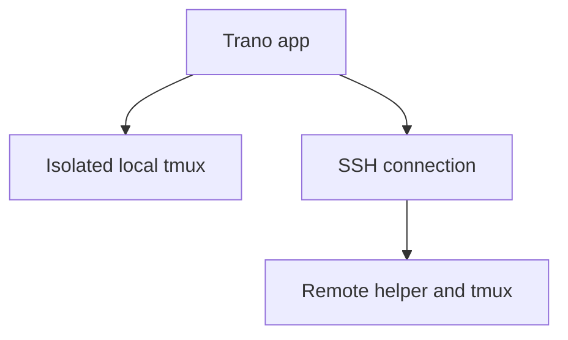

# Trano

> Trano is an early-development native macOS terminal for persistent shell and coding-agent work, with Linux SSH helpers. An isolated `tmux` server keeps terminal processes separate from app windows.

## Quick Start

**Requirements:**

- macOS 14+ runtime (`tmux` installed).
- Full Xcode with Swift 6.2+ (tested locally with Swift 6.4); `xcode-select -p` must select full Xcode, not standalone Command Line Tools.
- Go 1.24+ for building Linux amd64/arm64 helpers.
- Optional Claude and Codex CLIs installed by the user with provider-owned authentication.

**Build and run from source:**

```sh
scripts/build-app.sh
open build/Trano.app
build/Trano.app/Contents/MacOS/trano check
```
Local source builds are ad-hoc signed by default and do not enable production updates without release metadata.

## Architecture and Persistence



Closing the app leaves running tasks alive in `tmux`. An OS reboot destroys OS processes; recovery recreates panes and resumes mapped Claude/Codex conversations with exact IDs without replaying shell commands.

## Implemented Features

- **Workspace & UI**: Tabs, split panes, pane drag between tabs, default black appearance, custom font/colors/opacity/cursor, iTerm-style shortcuts, editable keybindings, command palette, insert path, session/activity search, URL/color detection, PNG paste, and editable voice input.
- **Coding Agents**: Claude and Codex account isolation, usage display, and same-provider switching controls. Automatic switching is opt-in, requires trusted quota/safe tool state, and requires exact conversation transfer. Usage may remain unknown until the provider reports supported metadata. Shared skills, hooks, MCP, and plugins preserve provider-specific capabilities.
- **Remote Hosts**: Requires SSH key auth, trusted `known_hosts`, and `tmux`. The Remote Hosts UI installs the bundled helper into user-owned `~/.local/bin` with no root daemon or TCP listener.
- **Automation & CLI**: Local UNIX API plus Glass Launcher adapter (`integrations/glass-launcher/trano.lua`). Run `build/Trano.app/Contents/MacOS/trano list` directly. `build/Trano.app/Contents/MacOS/trano api activity.list` requires the app/background API or `trano serve` running.

## Data, Privacy, and Validation Status

Local data defaults to `~/.local/share/trano` (`TRANO_DATA_DIR`), and remote data defaults to `~/.local/share/trano-remote` (`TRANO_REMOTE_ROOT`). Credentials stay in isolated account directories. The API excludes credentials; Trano has no automatic telemetry.

Automated core, native, `tmux`, and SSH tests exist, while authenticated end-to-end quota handoff, actual OS reboot, Korean IME via real OS input, microphone permissions, notification delivery, and signed installed-app replacement require release qualification.

See [docs/API.md](docs/API.md), [docs/NAVIGATION.md](docs/NAVIGATION.md), [docs/RECOVERY.md](docs/RECOVERY.md), [docs/PROGRESS.md](docs/PROGRESS.md), [docs/RTM.md](docs/RTM.md), [docs/RELEASING.md](docs/RELEASING.md), [CONTRIBUTING.md](CONTRIBUTING.md), [SECURITY.md](SECURITY.md), [THIRD_PARTY_NOTICES.md](THIRD_PARTY_NOTICES.md), and [LICENSE](LICENSE). Trano is independently implemented; design inspirations include [Tern](https://stencil.so/tern) and [Rex](https://www.superlogical.com/rex/docs/installation) without official endorsement.
