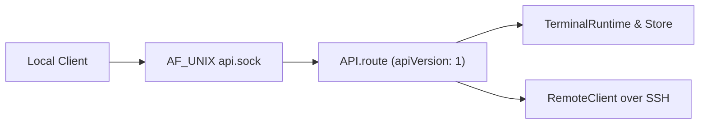

# Trano Local API Reference (`apiVersion: 1`)

> **Summary**: The Trano local API (`apiVersion: 1`) runs exclusively over an owned `AF_UNIX` socket (`<runtime_root>/api.sock`) using NDJSON to control PTY sessions, workspaces, scrollback, recovery, accounts, extensions, and remote hosts. The route table in [`Sources/TerminalCore/API.swift`](../Sources/TerminalCore/API.swift) is the sole method contract; unknown methods fail with `"Unknown API method"`. Appearance profiles, theme settings, and Sparkle updates are configured in native app code and do not expose API methods. For current implementation and verification evidence, see [`docs/PROGRESS.md`](PROGRESS.md) and [`docs/RTM.md`](RTM.md).

## Architecture and Protocol Envelope provide local-only NDJSON execution

The API server runs locally without HTTP exposure and processes one NDJSON request and one NDJSON response per socket connection.



- **Local Transport**: The server binds `<runtime_root>/api.sock` inside the isolated data root (`TRANO_DATA_DIR`). The runtime directory uses permissions `0700` and the socket uses permissions `0600`.
- **Connection Limits**: Each connection handles a single NDJSON request/response pair with a `1 MiB` maximum frame size, up to `16` concurrent clients, and `5` second read/write deadlines.
- **Service Hosts**: Either `trano serve` (`serviceKind: "cli"`) or `Trano Service.app` with `--service` (`serviceKind: "background"`) serves the socket after the GUI quits. Local CLI commands can also mutate state directly without an active socket server. Native notification callbacks via `customHandler` are outside the core method contract.
- **Envelope and Dates**: Every request must specify `apiVersion: 1`, and every `APIResponse` returns top-level `apiVersion: 1` for both success and error payloads. Dates use Swift `JSONEncoder`'s default encoding as seconds since the `2001` reference date. Default void-like mutations return `{"ok":true}` in `result`.

```json
{"apiVersion":1,"method":"server.info","params":{}}
{"apiVersion":1,"result":{"apiVersion":1,"buildID":"...","buildNumber":"...","pid":12345,"serviceKind":"cli","version":"..."}}
```

```json
{"apiVersion":1,"method":"panes.send","params":{"id":"PANE_UUID","text":"ls -la","enter":true}}
{"apiVersion":1,"result":{"ok":true}}
```

```json
{"apiVersion":2,"method":"server.info","params":{}}
{"apiVersion":1,"error":"Unsupported API version"}
```

## Core Domain Contracts govern state, accounts, recovery, and remote hosts

Each domain enforces strict state and safety boundaries inside [`Sources/TerminalCore/API.swift`](../Sources/TerminalCore/API.swift).

### Sessions, Panes, Activity, and `agentTasks` separate root lifecycle from children

`sessions.*` methods manage PTY panes, while workspaces represent layout sessions. Each session record contains `id`, `title`, `cwd`, `pid`, `host`, `agent`, `activity` (`state`, `reason`, `source`, `updatedAt`), `createdAt`, `alive`, optional `remote`, and optional `agentTasks`.

`sessions.list`, `activity.list`, and `state.get` include optional `agentTasks` child metadata (`id`, optional `parentID`, `name`, `agent`, `activity`, and optional `generation`), capped at `64` children per pane. Child identity and activity never update root lifecycle or supervision state. Missing `agentTasks` metadata means no reported children, not proof that zero children exist ([`docs/TAB-ACTIVITY.md`](TAB-ACTIVITY.md)).

Snapshots and captures can contain sensitive paths and terminal output: `state.get`, `sessions.list`, and `activity.list` expose `cwd` and session metadata, while `panes.capture` explicitly returns captured terminal text. Account credentials are never returned by any API method.

`activity.list` returns a full snapshot without cursor filtering. `events.list` reads from a `256`-event ring buffer using a nonnegative integral `since` cursor and sets `resetRequired` when the cursor falls behind. `actions.list` resolves user keybinding overrides via `ActionCatalog.resolved(overrides: runtime.state().settings.keyBindings)`. Catalog actions with `requiresUI=true` reject over the API.

### Bounded Scrollback and Exact-ID Recovery protect local and remote state

Scrollback persistence (`persistScrollback`, default `true`) archives sanitized UTF-8 display output for local and remote panes under the owned private runtime root (`<= 4 MiB` and `<= 10000` lines per pane). Scrollback is display-only, never replays commands, and flushes dirty snapshots every `5` seconds (up to `5` seconds of output may be lost on abrupt termination). Calling `scrollback.settings` updates local runtime persistence (`persistScrollback`) only, stopping local collection and removing local archives when disabled; native Settings separately propagates scrollback preferences to configured remote helpers.

Recovery is implemented for local PTY and remote SSH sessions. `recovery.settings` controls `automaticRestore` (default `true`) only. Recovery statuses are `live`, `restoring`, `restored`, `needs_attention`, and `failed`. A session resumes only from an exact trusted `providerSessionID` captured from `session_id` in the hook payload, paired with fresh launch generation and root-provider ancestry; it never guesses IDs, passes `--last`, or replays prompts. Root `Stop` is turn completion rather than process exit, and normal exits are excluded. `recovery.run` and `recovery.retry` preserve all live panes, including fallback shells. Remote recovery (`remote.recovery.run`, `remote.recovery.list`) and bundled offline Linux (`arm64` / `amd64`) helper installation (`remote.installation.check`, `remote.installation.install`) run network SSH work outside the shared local state transaction.

### Account Usage and Same-Provider Switching queue at safe turn boundaries

`accounts.add` accepts only `claude` or `codex` and rejects `shell`. Managed sessions use isolated `CLAUDE_CONFIG_DIR` or `CODEX_HOME` with a sanitized child environment (`--no-daemon` remains implemented in `Sources/TerminalCore/Accounts.swift:133` and `Sources/TerminalCore/Extensions.swift:238`).

`accounts.usage` returns stored usage snapshots. `accounts.usage.refresh` returns the existing cached structured statusline `rate_limits` snapshot for Claude (it does not fetch fresh remote telemetry) and requests `account/rateLimits/read` over RPC for Codex. Usage statuses are exact: `unknown`, `available`, `limited`, `authentication_required`, and `unavailable`. In [`Sources/TerminalCore/AccountUsage.swift`](../Sources/TerminalCore/AccountUsage.swift), only `available` snapshots older than `300` seconds downgrade to `unknown`, and Trano never infers quota from reset timestamps or output silence.

`automaticAccountSwitching` defaults to `false` and is updated via `accounts.switching`. `accounts.switch` returns an `AgentSupervision` record with a queued switch request rather than an immediately completed switch. The supervisor executes handoff only at a root safe turn boundary when no tools are in flight, staying within the same provider and exact conversation without prompt or tool replay. Trano copies only exact conversation files and metadata with receipts and backups while preserving target credentials. Rollback preflights backups, digests, and conflicts, guards attached SQLite state and history rows, and refuses rollback if newer target work exists, but rollback is **not crash-atomic** across the filesystem and SQLite database.

## Method Reference covers every route in `API.swift`

Every core `case` in [`Sources/TerminalCore/API.swift`](../Sources/TerminalCore/API.swift) is listed below by domain.

### Server, State, Activity, and Events

| Method | Required Params | Optional Params | Result / Behavior |
| :--- | :--- | :--- | :--- |
| `server.info` | None | None | Returns dynamic identity: `{"apiVersion": 1, "version": identity.version, "buildNumber": identity.buildNumber, "buildID": identity.buildID, "pid": <pid>, "serviceKind": "background" \| "cli"}`. |
| `state.get` | None | None | Returns encoded runtime state, including `agentLaunches` and session `agentTasks` metadata. |
| `activity.report` | `id` (string), `state` (`ActivityState` string) | `agent` (`AgentKind` string, defaults to `"shell"`), `reason` (string, defaults to `""`) | Reports session activity; returns `{"ok": true}`. |
| `activity.list` | None | None | Returns full snapshot of sessions (`runtime.list()`). No `since` filtering. |
| `events.list` | None | `since` (nonnegative integral number, defaults to `0`, `< Double(Int.max)`) | Returns events from the `256`-entry ring buffer with `resetRequired`. |

### Sessions, Panes, and Attachments

| Method | Required Params | Optional Params | Result / Behavior |
| :--- | :--- | :--- | :--- |
| `sessions.list` | None | `query` (string, defaults to `""`) | Returns sessions matching `title` + `" "` + `cwd` (case-insensitive). |
| `sessions.create` | `cwd` (string) | `title` (string, defaults to `"Terminal"`) | Creates and returns the new PTY session. |
| `sessions.terminate` | `id` (string) | None | Terminates session `id`; returns `{"ok": true}`. |
| `sessions.attach` | `id` (string) | None | Focuses existing pane or adds tab for `id`, sets `navigationRequest` if workspace selected; returns `{"ok": true}`. |
| `sessions.rename` | `id` (string), `title` (string, `1...200` chars) | None | Updates session title; returns `{"ok": true}`. |
| `panes.capture` | `id` (string) | None | Returns `{"text": "<captured_output>"}` for pane `id`. |
| `panes.send` | `id` (string), `text` (string) | `enter` (boolean, defaults to `false`) | Sends text to pane `id` (executes Enter only if `enter == true`); returns `{"ok": true}`. |
| `panes.detach` | `id` (string) | None | Detaches pane `id` from layout; returns `{"ok": true}`. |
| `panes.move` | `id` (string), `tabID` (string) | None | Moves pane `id` to `tabID`; returns `{"ok": true}`. |
| `attachments.upload` | `path` (string, regular file `<= 20 MiB`), `id` (string) | None | Uploads local PNG (`<= 20 * 1024 * 1024` bytes) for pane `id` and returns `{"path": "<local_or_remote_path>"}`. Does not execute Enter. |

### Scrollback and Recovery

| Method | Required Params | Optional Params | Result / Behavior |
| :--- | :--- | :--- | :--- |
| `scrollback.list` | None | None | Returns encoded scrollback archive metadata (`runtime.scrollbackMetadata()`). |
| `scrollback.settings` | `enabled` (boolean) | None | Enables or disables local runtime scrollback persistence (`runtime.setScrollbackPersistence(enabled)`); returns `{"ok": true}`. |
| `recovery.list` | None | None | Returns `runtime.state().recoveryResults`. |
| `recovery.run` | None | `id` (string, optional target `paneID`) | Recovers sessions while preserving all live panes; returns recovery results. |
| `recovery.retry` | None | `id` (string, optional target `paneID`) | Alias for `recovery.run`. |
| `recovery.settings` | `automaticRestore` (boolean) | None | Updates `settings.automaticRestore` only and returns `{"automaticRestore": <bool>}`. |

### Workspaces and Actions

| Method | Required Params | Optional Params | Result / Behavior |
| :--- | :--- | :--- | :--- |
| `workspaces.list` | None | None | Returns `runtime.state().layout.workspaces`. |
| `workspaces.launch` | `cwd` (string) | `agent` (`AgentKind` string, defaults to `"shell"`), `prompt` (string, defaults to `""`) | Launches workspace session and returns encoded result. |
| `workspaces.select` | `id` (string) | None | Selects workspace `id` and sets `navigationRequest`; returns `{"ok": true}`. |
| `actions.list` | None | None | Returns `ActionCatalog.resolved(overrides: runtime.state().settings.keyBindings)`. |
| `actions.perform` | `id` (`ActionID` string) | `cwd` (string), `workspaceID` (string), `tabID` (string), `paneID` (string) | Performs catalog action with `requestNavigation: true` (rejects if `requiresUI=true`); returns `{"ok": true}`. |

### Accounts and Extensions

| Method | Required Params | Optional Params | Result / Behavior |
| :--- | :--- | :--- | :--- |
| `accounts.list` | None | None | Returns `runtime.state().accounts` (credentials excluded). |
| `accounts.usage` | None | None | Returns array of account usage snapshots (`runtime.accountUsage()`). |
| `accounts.usage.refresh` | `id` (string) | None | Returns existing cached usage snapshot for Claude or requests `account/rateLimits/read` RPC for Codex (`runtime.refreshAccountUsage(accountID:)`). |
| `accounts.update` | `id` (string) | `label` (string), `enabled` (boolean), `pinned` (boolean) | Updates account flags/label and returns updated `runtime.state().accounts`. |
| `accounts.reorder` | `ids` (array of strings) | None | Reorders accounts (`runtime.reorderAccounts`); returns `{"ok": true}`. |
| `accounts.switch` | `paneID` (string), `accountID` (string) | None | Queues same-provider account switch at safe turn boundary (`runtime.requestAccountSwitch`); returns encoded `AgentSupervision` (request queued, not completed). |
| `accounts.switching` | `enabled` (boolean) | None | Updates `settings.automaticAccountSwitching`; returns `{"ok": true}`. |
| `accounts.add` | `provider` (`AgentKind` string: `"claude"` or `"codex"`; `"shell"` rejected), `label` (string) | None | Adds and returns account record. |
| `accounts.command` | `id` (string) | `login` (boolean, defaults to `false`) | Returns command info for account `id`. |
| `accounts.launch` | `id` (string), `cwd` (string) | `login` (boolean, defaults to `false`) | Launches account session in `cwd` and returns result. |
| `extensions.list` | None | None | Returns `runtime.state().extensions`. |
| `extensions.import` | `kind` (`ExtensionKind` string), `name` (string), `path` (string) | None | Imports extension from file path and returns extension record. |
| `extensions.enabled` | `accountID` (string) | None | Returns enabled extensions for `accountID`. |
| `extensions.preview` | `accountID` (string), `extensionIDs` (array of strings) | None | Returns `ExtensionPlan` preview for `accountID`. |
| `extensions.apply` | `plan` (`ExtensionPlan` object) | None | Applies decoded `ExtensionPlan`; returns `{"ok": true}`. |
| `extensions.plugin.command` | `accountID` (string), `extensionID` (string) | None | Returns plugin command for `accountID` and `extensionID`. |
| `extensions.plugin.install` | `accountID` (string), `extensionID` (string), `cwd` (string) | None | Explicitly starts provider CLI in its own pane at `cwd` to install plugin. |

### Remote Hosts, Installation, Recovery, and Sessions

| Method | Required Params | Optional Params | Result / Behavior |
| :--- | :--- | :--- | :--- |
| `remote.hosts.list` | None | None | Returns `runtime.state().remoteHosts`. |
| `remote.hosts.add` | `name` (string), `address` (string) | `sshConfigPath` (string) | Adds and returns remote host. |
| `remote.hosts.remove` | `id` (string) | None | Removes remote host `id`; returns `{"ok": true}`. |
| `remote.installation.check` | `hostID` (string) | None | Checks remote helper installation status on `hostID` without modifying the host. |
| `remote.installation.install` | `hostID` (string) | `force` (boolean, defaults to `false`) | Installs bundled Linux helper on `hostID` (refuses conflicts unless `force == true`, which backs up existing binary). |
| `remote.recovery.run` | `hostID` (string) | `id` (string, optional remote session ID) | Runs exact-ID remote session recovery on `hostID` and returns recovery results. |
| `remote.recovery.list` | `hostID` (string) | None | Queries remote helper on `hostID` and returns remote recovery results. |
| `remote.sessions.list` | `hostID` (string) | None | Lists remote sessions for `hostID`. |
| `remote.sync` | `hostID` (string) | None | Synchronizes remote host `hostID`; returns `{"ok": true}`. |
| `remote.paths.list` | `hostID` (string) | `path` (string, defaults to `""`) | Lists remote paths on `hostID`. |
| `remote.sessions.create` | `hostID` (string) | `cwd` (string, defaults to `""`) | Creates remote session on `hostID`. |
| `remote.sessions.attach` | `hostID` (string), `id` (string) | None | Attaches to remote session `id` on `hostID`. |
| `remote.sessions.reconnect` | `id` (string) | None | Reconnects remote bridge for `id` (preserves remote ID and live PID); returns `{"ok": true}`. |
| `remote.sessions.disconnect` | `id` (string) | None | Disconnects remote session `id`; returns `{"ok": true}`. |

## Qualification Boundaries separate implemented contracts from live environment gates

Source contracts and automated unit, UI, CLI, fake-provider PTY, installed-binary compatibility, and Go `-race` checks are recorded in [`docs/PROGRESS.md`](PROGRESS.md), [`docs/RTM.md`](RTM.md), and [`docs/verification.json`](verification.json), but several live qualification gates remain open: authenticated live provider quota/conversations/handoff/hooks/plugins/subagents, non-crash-atomic filesystem+SQLite account rollback, latest Linux SSH runtime execution after recent parser/lifecycle fixes (fixture absent), physical OS reboot recovery, physical input/display/audio/notification hardware matrices, live Glass adapter connections, notarized Developer ID Sparkle updates, public repository CI, and loaded-host performance SLOs.

## Appendix: Source and Contract Links

- API Route Implementation: [`Sources/TerminalCore/API.swift`](../Sources/TerminalCore/API.swift)
- Accounts, Supervision, and Switching: [`Sources/TerminalCore/Accounts.swift`](../Sources/TerminalCore/Accounts.swift), [`Sources/TerminalCore/AccountUsage.swift`](../Sources/TerminalCore/AccountUsage.swift), [`Sources/TerminalCore/AgentSupervision.swift`](../Sources/TerminalCore/AgentSupervision.swift), [`Sources/TerminalCore/AccountSwitch.swift`](../Sources/TerminalCore/AccountSwitch.swift)
- Extensions, Scrollback, and Recovery: [`Sources/TerminalCore/Extensions.swift`](../Sources/TerminalCore/Extensions.swift), [`Sources/TerminalCore/ScrollbackStore.swift`](../Sources/TerminalCore/ScrollbackStore.swift), [`Sources/TerminalCore/ScrollbackRuntime.swift`](../Sources/TerminalCore/ScrollbackRuntime.swift), [`Sources/TerminalCore/Recovery.swift`](../Sources/TerminalCore/Recovery.swift)
- Remote Helper and Installer: [`Sources/TerminalCore/Remote.swift`](../Sources/TerminalCore/Remote.swift), [`Sources/TerminalCore/RemoteInstaller.swift`](../Sources/TerminalCore/RemoteInstaller.swift)
- Tab Hover and Evidence: [`docs/TAB-ACTIVITY.md`](TAB-ACTIVITY.md), [`docs/PROGRESS.md`](PROGRESS.md), [`docs/RTM.md`](RTM.md), [`docs/verification.json`](verification.json)
