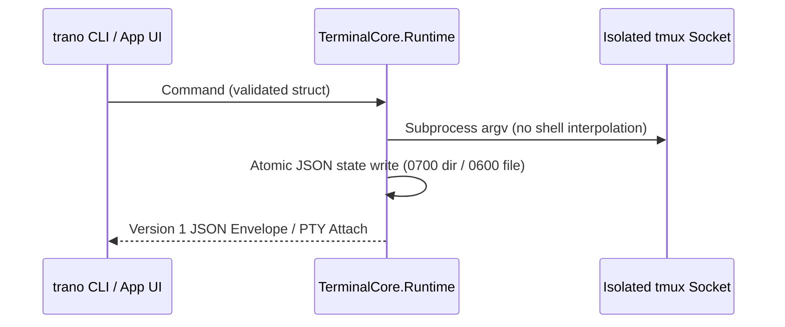

# M1 Software Design Description

> 현재 구현 상태, 실제 테스트, 남은 요구사항과 다음 명령은 [PROGRESS.md](PROGRESS.md) 및 [RTM.md](RTM.md)에 있으며, 재부팅 후 세션 자동 복원 요구사항은 [RECOVERY.md](RECOVERY.md)에 정의되어 있습니다. 이 문서의 이전 마일스톤 상태와 근거는 과거의 계획 스냅샷일 뿐 전체 제품 완성을 의미하지 않으며, 기존의 모든 U01-U21은 계속 유효한 범위에 포함됩니다.
> **Summary**: Specifies the planned Swift package architecture, subprocess `argv` isolation, atomic state persistence, and CLI v1 JSON envelope. All source paths below are planned new files except `experiments/check-persistence.py`.

## Component Architecture

All execution passes through `TerminalCore` using direct subprocess `argv` arrays to prevent injection and isolate state from default user `tmux` servers.

## Planned Repository Layout
- `experiments/check-persistence.py` (existing verified script)
- `Package.swift` (planned new file): Swift 6.4 manifest pinning `SwiftTerm` `v1.99.1`.
- `Sources/TerminalCore/Model.swift` & `Sources/TerminalCore/Runtime.swift` (planned new files): Domain models, atomic JSON persistence, and isolated `tmux` process runner.
- `Sources/TranoApp/App.swift` & `Sources/TranoApp/TerminalPane.swift` (planned new files): AppKit/SwiftUI black-themed shell, tab/split container, `Cmd+K`/`Cmd+Shift+P` overlays, and `SwiftTerm` view wrapper.
- `Sources/TranoCLI/main.swift` (planned new file): Versioned JSON CLI entrypoint.
- `Tests/TerminalCoreTests/RuntimeTests.swift`, `scripts/build-app.sh`, `docs/RTM.md` (planned new files).

## Data & API Design
- **CLI v1 Response Envelope**: Before introducing any public daemon socket, `trano` outputs a version `1` JSON envelope containing `session_id` (stable pane ID), `title`, `cwd`, `pid`, `status` (explicitly supporting `"unknown"`), and `host`, excluding raw credentials.
- **Atomic Persistence**: Metadata and UI settings are written via temp-file rename (`0600` permissions) inside an application-specific data root (`0700` permissions). A formal canonical JSON Schema file does not exist yet and is deferred.
