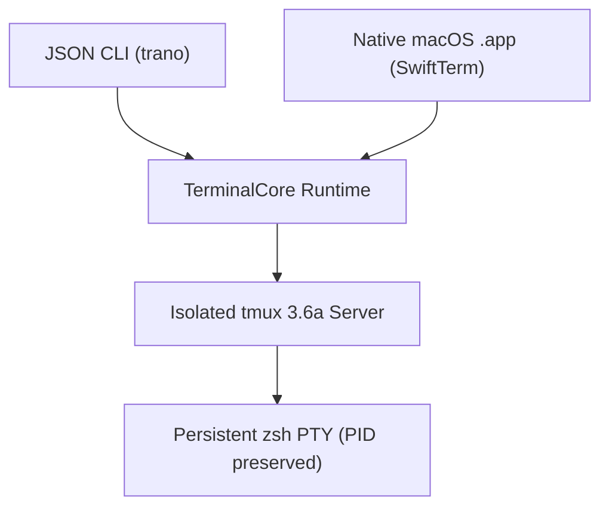

# M1 Milestone Plan: Core Persistent Terminal & Native Shell

> 현재 구현 상태, 실제 테스트, 남은 요구사항과 다음 명령은 [PROGRESS.md](PROGRESS.md) 및 [RTM.md](RTM.md)에 있으며, 재부팅 후 세션 자동 복원 요구사항은 [RECOVERY.md](RECOVERY.md)에 정의되어 있습니다. 이 문서의 이전 마일스톤 상태와 근거는 과거의 계획 스냅샷일 뿐 전체 제품 완성을 의미하지 않으며, 기존의 모든 U01-U21은 계속 유효한 범위에 포함됩니다.
> **Summary**: M1 delivers the foundational macOS `.app`, JSON CLI, and isolated persistent `zsh` runtime while keeping M2–M4 scope (U01–U21) open. Status is `planned` with zero code implemented.

## Overview Flow

Both the native UI and JSON CLI communicate through `TerminalCore` to an isolated `tmux` socket so disconnecting any client preserves the underlying `zsh` process.

## M1 Deliverables & Scope
- **Included in M1**: Real macOS `.app` bundle, versioned JSON CLI, isolated persistent `zsh` sessions, native tabs and splits, native black design, `Cmd+K` session picker (Rex priority), and `Cmd+Shift+P` command palette.
- **Deferred (M2–M4)**: Full U01–U21 release completion, canonical JSON state schema, structured activity event streaming (M3), remote host installation, and public distribution. Child documents cannot claim product completion.

## Execution Sequence & Exit Gates
1. **Prove Persistence & Core**: Wrap isolated `tmux` socket management in `TerminalCore` without touching the user's default `tmux` server.
2. **Deliver JSON CLI**: Provide deterministic session control for launchers.
3. **Integrate Native Renderer**: Embed `SwiftTerm` v1.99.1 in AppKit/SwiftUI with splits, tabs, and shortcuts.
4. **Open Verification Gates**: Automated XCTests must pass on macOS. Real manual OS Korean IME verification remains an open human gate until a proper automation tool exists. `docs/RTM.md` (planned new file) rows remain open until implementation and fresh test execution complete.
