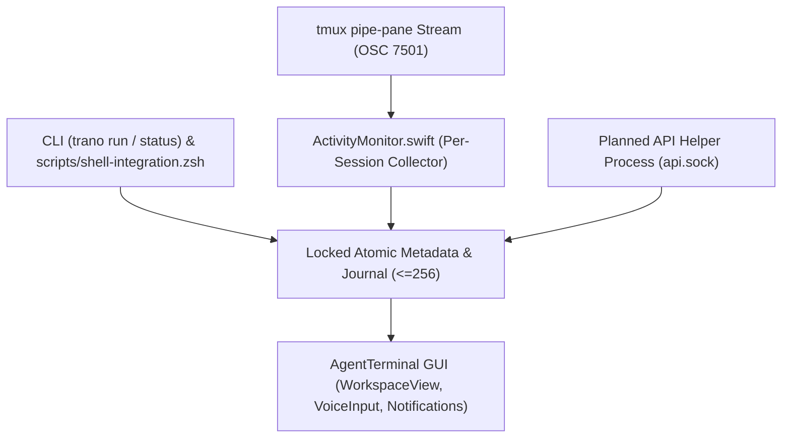

# M2 SDD separates UI from durable core services

> 현재 구현 상태, 실제 테스트, 남은 요구사항과 다음 명령은 [PROGRESS.md](PROGRESS.md) 및 [RTM.md](RTM.md)에 있으며, 재부팅 후 세션 자동 복원 요구사항은 [RECOVERY.md](RECOVERY.md)에 정의되어 있습니다. 이 문서의 이전 마일스톤 상태와 근거는 과거의 계획 스냅샷일 뿐 전체 제품 완성을 의미하지 않으며, 기존의 모든 U01-U21은 계속 유효한 범위에 포함됩니다.

> M2 decouples the GUI from session lifetime and status collection by using a planned `tmux`-owned `pipe-pane` collector per session, locked atomic state writes, a planned separate API helper process, and filesystem watchers.

## Architecture Map

- **Design Conclusion**: `tmux` owns session lifetime and spawns a planned `pipe-pane` collector process per session independent of the GUI and API listener; `trano status` and shell hooks directly update locked atomic core state without requiring `api.sock`, while the planned API helper process serves `api.sock` after UI quit.

## Component Design
- **Core (`Sources/TerminalCore/ActivityMonitor.swift`)**: Runs as a planned `tmux`-owned `pipe-pane` collector process per session independent of the UI and API listener to extract `OSC7501` (`working->running`). Discards invalid or oversize OSC sequences without saving the terminal stream. Writes locked atomic metadata and appends to a ring buffer (`<=256` entries) with a monotonic revision. Emits `resetRequired` when a client's `since` cursor predates the oldest retained revision.
- **Core (`Sources/TerminalCore/Attachment.swift`)**: On explicit Paste, validates clipboard PNG data (`<=20MiB`), writes to the private root `attachments/<UUID>.png` (`0700` dir), and returns a POSIX shell-quoted path without a trailing newline.
- **App (`Sources/TranoApp/TerminalPane.swift`, `WorkspaceView.swift`, `Store.swift`)**: `SwiftTerm` already implements `NSTextInputClient`; the app wraps and qualifies it (does not reimplement it) so preedit renders locally and only committed UTF8 bytes forward to the PTY. Preserves nested split branches and pane ratios in state, and supports dragging panes across tabs or into a new tab. Uses a filesystem watcher to observe state updates from `sessions.attach` without `1second` transcript polling. Actual OS app activation requires a URL/open bridge (not yet implemented).
- **App (`Sources/TranoApp/VoiceInput.swift`, `Notifications.swift`)**: `VoiceInput.swift` binds `Speech`/`AVFoundation` to explicit Start/Stop actions (`ko-KR` default, `en-US` configurable), releasing the microphone immediately on Stop and staging text in an editable draft. `Notifications.swift` tracks the last notified revision on disk, emitting `title+state` notifications for new `done`/`error`/`blocked` events; reports `unsupported` for closed-GUI notifications until the worker app mode is delivered.
- **CLI & Scripts (`scripts/shell-integration.zsh`)**: `trano run --agent claude|codex -- args` spawns the child via direct `argv`, reports `running`, and reports exit status on termination. Shell hooks and `trano status` directly update locked atomic core state (`unknown`, `idle`, `running`, `blocked`, `done`, `error`) without requiring `api.sock`.
