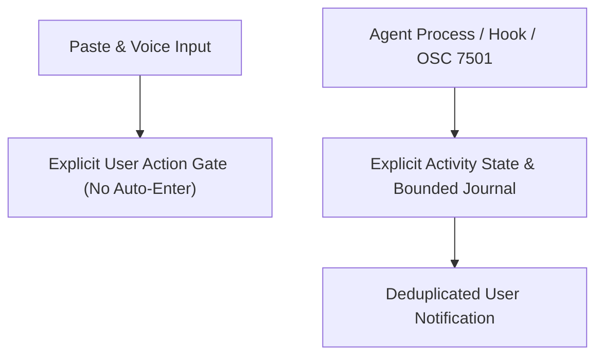

# M2 SRS requires explicit signals and user-gated inputs

Tab identity requirements extend M2 through [NAVIGATION.md](NAVIGATION.md) FR-NAV-9; its acceptance criteria are canonical.

Pane drag and normal-window detachment extend M2 through [NAVIGATION.md](NAVIGATION.md) FR-NAV-10; this adds the requested gesture without changing tab tear-off or floating-pane behavior.

Foreground program icons extend M2 through [NAVIGATION.md](NAVIGATION.md) FR-NAV-11, with optional display metadata separate from agent lifecycle identity.

Native tab drag completion extends the existing transfer contract through [NAVIGATION.md](NAVIGATION.md) FR-NAV-12, including outside release, cancellation and preserved job/window ownership.

> 현재 구현 상태, 실제 테스트, 남은 요구사항과 다음 명령은 [PROGRESS.md](PROGRESS.md) 및 [RTM.md](RTM.md)에 있으며, 재부팅 후 세션 자동 복원 요구사항은 [RECOVERY.md](RECOVERY.md)에 정의되어 있습니다. 이 문서의 이전 마일스톤 상태와 근거는 과거의 계획 스냅샷일 뿐 전체 제품 완성을 의미하지 않으며, 기존의 모든 U01-U21은 계속 유효한 범위에 포함됩니다.

> Paste and voice inputs require explicit user action without auto-execution, and all agent states require explicit signals rather than timeout or prompt-text inference.

## Requirements Map

- **Core Rule**: Paste and voice inputs never auto-execute (normal typed Return is unaffected), and activity states never rely on idle timeouts or arbitrary prompt text.

## Functional and Non-Functional Requirements
- **FR-INPUT-1 (U06) Korean IME & Text**: Pass Korean preedit and commit via `NSTextInputClient` unchanged; never send preedit bytes to the PTY. Preserve UTF8 NFC/NFD, emoji, and combining sequences. Option/meta behavior is configurable. Encoding checks do not prove perfect IME; real OS Korean 2-set IME testing is required on release.
- **FR-INPUT-2 (U02, U09, U10) Ergonomics & Splits**: Safe `http`/`https` URL click opens the browser through the OS. Support find buffer (`CmdF`), fullscreen (`ctrlcmdF`), focus (`cmdoption` arrow), resize (`ctrlcmd` arrow), zoom (`cmdshiftenter`), and tab cycle (`cmdshiftbrackets`). Existing `cmdK` session picker overrides iTerm clear; clear remains in palette. Support nested splits preserving branch and ratios in state, plus dragging a pane across tabs or to a new tab. Default styling is `font14` and `#0B0B0C`.
- **FR-INPUT-3 (U15) Safe Paste & Attachments**: Store image clipboard PNGs in private root attachments with a UUID filename, bounded to `<=20MiB`, and paste the shell-quoted path without a newline. Show a multiline text preview before paste. Never execute pasted content automatically. Never read other apps' clipboard except on user Paste action. Remote transfer is an explicit separate operation in M3.
- **FR-INPUT-4 (U13) Voice Input**: Use native macOS `Speech`/`AVFoundation`. User Start requests authorization, populates an editable draft, and Stop releases the microphone immediately. Paste requires user action without Enter. Default locale is `ko-KR` (configurable `en-US`), preferring on-device recognition and accurately reporting unavailable/unsupported states. Never record or run remote transcription silently at startup.
- **FR-ACTIVITY-1 (U07, U08) Explicit Activity**: Track statuses `unknown`, `idle`, `running`, `blocked`, `done`, `error` with `source` and timestamp. Map `OSC7501` `working->running` and label `Claude`/`Codex`; forbid idle-timeout inference. A durable status collector receives the stream independent of UI, ignores invalid/oversize OSC, and never saves the raw stream. Persist atomic metadata and a bounded event journal (`<=256` entries) with a monotonically increasing revision. `activity.list`/`events.list` support a `since` cursor and flag gaps as `resetRequired`. Hook CLI `trano status` works without a running GUI and updates locked atomic core state directly without requiring `api.sock`.
- **FR-ACTIVITY-1 presentation amendment**: Group native Activity rows into Working, Needs Attention, Done and Idle; show each provider icon and a dot for blocked/error or unread completion. Acknowledging a completion persists its exact activity timestamp; stale acknowledgements cannot clear a newer completion. The overlay stays inside the workspace without resizing the terminal.
- **FR-ACTIVITY-2 (U07) Notifications**: Emit native notifications only on newly observed `done`/`error`/`blocked` states, persistently deduplicated by event revision. Include `title+state` only (never shell output). Clicking focuses the session via the same attach action. An off toggle prevents new notifications, and permissions are requested only from user action. Closed-GUI notifications require a notification worker app mode (not CLI-only `UNUserNotificationCenter`); if not yet delivered, state reports `unsupported`.
- **FR-ACTIVITY-3 (U08, U18 foundation) Agent Runner**: `trano run --agent claude|codex -- args` uses direct `argv`, sets session identity and `running`, and sets completion from actual process exit; explicit hooks supply `blocked`. Never infer provider rate limits from arbitrary prompt text. Account management and auto-switch remain in M3.
- **NFR-INPUT-1 Performance & Isolation**: Use a filesystem watcher and bounded event work; forbid unbounded `1second` transcript scans. Keep test lifecycle roots isolated without touching installed Rex/Glass Launcher or real accounts.

## Reset ticket controls

| ID | Contract | Acceptance |
|---|---|---|
| FR-RESET-1 | Remove the tab-strip New Tab plus; retain Cmd+T and existing menu/palette actions | Native header contains no New Tab plus; native keyboard/menu creation preserves existing sessions |
| FR-RESET-2 | Show a ticket and count immediately beside Command Palette only for fresh provider-confirmed available banked resets on enabled registered accounts | Exact count, zero/unknown/expired/stale suppression, legacy snapshot compatibility, account isolation |
| FR-RESET-3 | Ticket opens account reset details; refresh is bounded/background and does not redeem, purchase or restart providers | Native click reaches account details without viewport mutation; bounded refresh; shell PIDs and layouts retained |

The verified Codex app-server schema supplies top-level `rateLimitResetCredits.availableCount` and optional, potentially capped `credits` details through `account/rateLimits/read`. Counts use the summary, expire after 300 seconds, subtract known expired available IDs once, and never come from scheduled quota-reset times; absent or unsupported provider metadata remains unknown. The helper polls enabled Codex accounts on its utility queue every 60 seconds, while native displays reevaluate freshness every 30 seconds. Reference: [OpenAI reset behavior](https://help.openai.com/en/articles/20001498-how-resets-work-in-codex); reproduce the installed protocol with `codex app-server generate-json-schema --out <directory>`.
