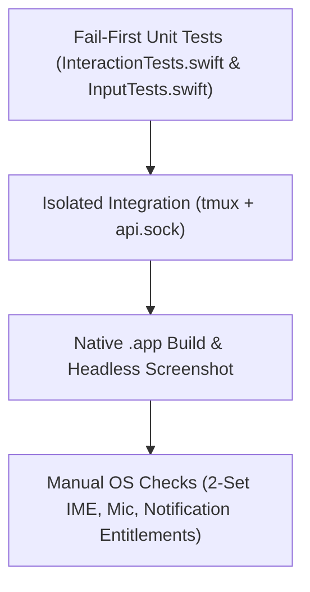

# M2 tests enforce fail-first unit checks and real OS verification

| FR-NAV-9 acceptance | Verification |
|---|---|
| Automatic/manual titles, focused icon order, Unicode, missing panes, remembered focus | `TabPresentationTests` |
| Legacy decoding, real OSC 0/2, byte/Unicode bounds, hostname fallback, unchanged state/PIDs, no DNS | `TerminalTitleTests` |
| Native title events, last-event race, attach/renderer identity, 20×16 icon slot, rendered preview | `TabPresentationTests`; existing tab lifecycle and Command-hint regressions |
| Release continuity | `experiments/check-native.py` under fresh temporary HOME, then signed local installer receipt |

Command: `swift test --filter 'TabPresentationTests|TerminalTitleTests|TabActivityHoverTests|TabLifecycleTests'`. Each test declares `Implements: FR-NAV-9`; RED evidence and current full-suite evidence are recorded in `verification.json`.

| FR-NAV-10 acceptance | Verification |
|---|---|
| Native source hit testing, click versus drag, captured payload/window, cancellation, retained lifetime through unmount | `NativePaneDragTests` |
| Origin-window outside drop, last pane, source mirrors, queued stale/cancel paths, normal-window seed, no unrelated startup recovery | `PaneTearOffTests` with real isolated tmux jobs |
| Existing tab and cross-window transfers | `TabTransferTests`; accepted asynchronous drop must not also detach |

Command: `swift test --filter 'NativePaneDragTests|PaneTearOffTests|TabTransferTests'`. Physical pointer qualification remains distinct from native event and state fixtures.

| FR-NAV-11 acceptance | Verification |
|---|---|
| Exact commands, global option values, separators, legacy metadata, bounded argv without environment decoding | `ForegroundProgramTests` |
| Actual foreground/background and zsh return, state/agent/PID preservation, no state reads per tick | `ForegroundProgramTests` with isolated PTYs and fake named executables |
| Focused icon stack, bundled thumbnails, live pane/tab update without renderer replacement | `ProgramIconTests`; inspected native preview |
| Linux parser/process fixtures, transient List metadata, PID reuse | Go `TestProgram` methods; actual Linux/SSH qualification reported separately |
| Packaged artifact identity | `Tests/Integrations/test_build_identity.py`; installed PNG hashes match provenance |

Commands: `swift test --filter 'ForegroundProgramTests|ProgramIconTests|TabPresentationTests'`, `python3 Tests/Integrations/test_build_identity.py`, and the remote Go suite. Fixtures never invoke a real Kubernetes client or credentials.

> 현재 구현 상태, 실제 테스트, 남은 요구사항과 다음 명령은 [PROGRESS.md](PROGRESS.md) 및 [RTM.md](RTM.md)에 있으며, 재부팅 후 세션 자동 복원 요구사항은 [RECOVERY.md](RECOVERY.md)에 정의되어 있습니다. 이 문서의 이전 마일스톤 상태와 근거는 과거의 계획 스냅샷일 뿐 전체 제품 완성을 의미하지 않으며, 기존의 모든 U01-U21은 계속 유효한 범위에 포함됩니다.

> Automated tests in `Tests/TerminalCoreTests/InteractionTests.swift` and `Tests/TerminalUITests/InputTests.swift` must fail before implementation and run in isolated temporary roots, while OS permission and hardware IME flows remain tracked as `manual/not-run` until executed.

## Verification Pipeline

- **Verification Conclusion**: Automated tests verify protocol, state, and layout logic in isolation, while OS-level IME and entitlement flows require manual execution before release.

## Test Specifications
- **Fail-First Automated Suites (`Tests/TerminalCoreTests/InteractionTests.swift` for core, `Tests/TerminalUITests/InputTests.swift` for renderer)**:
  - *IME Qualification (`InputTests.swift`)*: Verify the wrapped `SwiftTerm` `NSTextInputClient` delegate records zero committed PTY bytes during preedit while preserving committed UTF8 NFC/NFD, emoji, and combining sequences.
  - *OSC 7501 Parser (`InteractionTests.swift`)*: Verify `OSC7501` parsing across arbitrary chunk splits, enforce payload size cap, ignore malformed UTF8, and verify terminal state mapping (`unknown`, `idle`, `running`, `blocked`, `done`, `error` and `working->running`).
  - *Attachments (`InteractionTests.swift`)*: Verify `<=20MiB` bounds rejection, private directory permissions (`0700`), UUID naming, and shell-quoting without newline.
  - *Event Journal (`InteractionTests.swift`)*: Verify monotonic revision cursors (`since`), ring buffer eviction at `<=256` entries, gap detection returning `resetRequired`, and persistent notification revision deduplication.
  - *Nested Splits (`InteractionTests.swift` & `InputTests.swift`)*: Verify nested split branch preservation, ratio persistence, and pane move/detach lifecycle.
- **Isolation & Current Status**: All tests use isolated lifecycle roots without touching installed Rex/Glass Launcher or real accounts. Prior to M2, 7 current tests in `RuntimeTests` and `APITests` passed on 2026-11-10 (including nested layouts) alongside a native `.app` build and headless screenshot. Real OS Korean 2-set IME, `Speech`/`AVFoundation` microphone authorization, and `UNUserNotificationCenter` worker entitlements are `manual/not-run`.

| FR-NAV-12 acceptance | Verification |
|---|---|
| Native label input preserves close/menu targets | NativeTabDragTests: owning header hit test, click/threshold, native move source callbacks, cancellation and source lifetime |
| Outside tab completion preserves windows/jobs | TabTearOffTests: single/multi-tab full-tree detach, accepted async drop, cancellation, stale/queued ownership and unchanged PIDs |
| Pane/tab drop into workspace | WorkspaceDropTests: explicit workspace/empty destination, hosted target/chooser, immutable source identity and closed/input guards |
| Existing two-window transfer stays functional | TabTransferTests plus full Swift suite; source and destination operation negotiation checked separately |
| Release/install continuity | Signed app native persistence, source/bundle/helper identity and atomic installation retaining live shell PIDs/layout |
