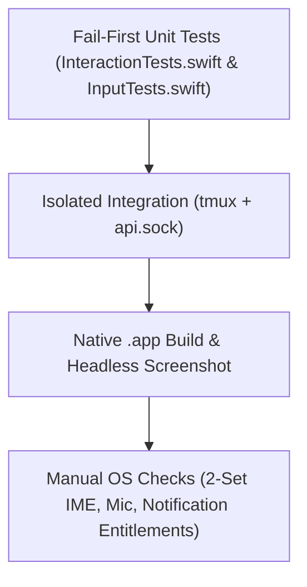

# M2 tests enforce fail-first unit checks and real OS verification

> 현재 구현 상태, 실제 테스트, 남은 요구사항과 다음 명령은 [PROGRESS.md](PROGRESS.md) 및 [RTM.md](RTM.md)에 있으며, 재부팅 후 세션 자동 복원 요구사항은 [RECOVERY.md](RECOVERY.md)에 정의되어 있습니다. 이 문서의 이전 마일스톤 상태와 근거는 과거의 계획 스냅샷일 뿐 전체 제품 완성을 의미하지 않으며, 기존의 모든 U01-U21은 계속 유효한 범위에 포함됩니다.

> Automated tests in `Tests/TerminalCoreTests/InteractionTests.swift` and `Tests/TerminalUITests/InputTests.swift` must fail before implementation and run in isolated temporary roots, while OS permission and hardware IME flows remain tracked as `manual/not-run` until executed.

## Verification Pipeline

- **Verification Conclusion**: Automated tests verify protocol, state, and layout logic in isolation, while OS-level IME and entitlement flows require manual execution before release.

## Test Specifications
- **Fail-First Automated Suites (`Tests/TerminalCoreTests/InteractionTests.swift` for core, `Tests/TerminalUITests/InputTests.swift` for renderer)**:
  - *IME Qualification (`InputTests.swift`)*: Verify the wrapped `SwiftTerm` `NSTextInputClient` delegate records zero committed PTY bytes during preedit while preserving committed UTF8 NFC/NFD, emoji, and combining sequences.
  - *OSC 7501 Parser (`InteractionTests.swift`)*: Verify `OSC7501` parsing across arbitrary chunk splits, enforce payload size cap, ignore malformed UTF8, and verify terminal state mapping (`unknown`, `idle`, `running`, `blocked`, `done`, `error` and `working->running`).
  - *Attachments (`InteractionTests.swift`)*: Verify `<=20MiB` bounds rejection, private directory permissions (`0700`), UUID naming, and shell-quoting without newline.
  - *Event Journal (`InteractionTests.swift`)*: Verify monotonic revision cursors (`since`), ring buffer eviction at `<=256` entries, gap detection returning `resetRequired`, and persistent notification revision deduplication.
  - *Nested Splits (`InteractionTests.swift` & `InputTests.swift`)*: Verify nested split branch preservation, ratio persistence, and pane move/detach lifecycle.
- **Isolation & Current Status**: All tests use isolated lifecycle roots without touching installed Rex/Glass Launcher or real accounts. Prior to M2, 7 current tests in `RuntimeTests` and `APITests` passed on 2026-11-10 (including nested layouts) alongside a native `.app` build and headless screenshot. Real OS Korean 2-set IME, `Speech`/`AVFoundation` microphone authorization, and `UNUserNotificationCenter` worker entitlements are `manual/not-run`.
