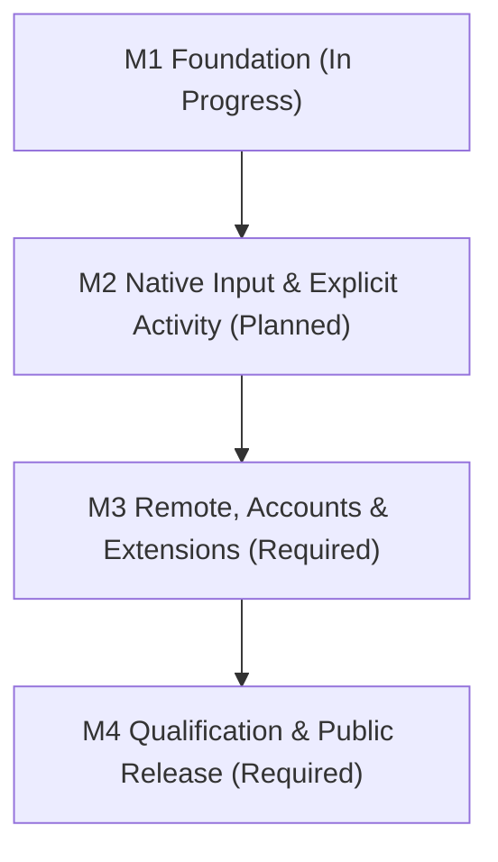

# M2 delivers native interactions and explicit agent activity

> 현재 구현 상태, 실제 테스트, 남은 요구사항과 다음 명령은 [PROGRESS.md](PROGRESS.md) 및 [RTM.md](RTM.md)에 있으며, 재부팅 후 세션 자동 복원 요구사항은 [RECOVERY.md](RECOVERY.md)에 정의되어 있습니다. 이 문서의 이전 마일스톤 상태와 근거는 과거의 계획 스냅샷일 뿐 전체 제품 완성을 의미하지 않으며, 기존의 모든 U01-U21은 계속 유효한 범위에 포함됩니다.

> M2 specifies native macOS input, split ergonomics, and explicit agent activity tracking without idle-timeout inference. Full PRD U01-U21 remains unchanged, while M3 (remote/accounts/extensions) and M4 (qualification/public release) remain required. Owner Codex executes sequentially.

## Milestone Map

- **M2 Conclusion**: M2 adds native input, attachments, voice draft, and durable activity tracking on top of M1 (which remains in progress with native and M1 release gates remaining).
- **Implemented Base**: `Sources/TerminalCore/{Runtime,Model,API}.swift`, `Sources/TranoApp/{App,Store,TerminalPane,WorkspaceView}.swift`, and tests `RuntimeTests`, `APITests`.
- **Planned M2 Files**: `Sources/TerminalCore/{ActivityMonitor.swift,Attachment.swift}`, `Sources/TranoApp/{VoiceInput.swift,Notifications.swift}`, `scripts/shell-integration.zsh`, `Tests/TerminalCoreTests/InteractionTests.swift`, `Tests/TerminalUITests/InputTests.swift`, and `docs/api.schema.json`.

## Verified Baseline and Scope Boundaries
Prior to M2, 7 current tests passed on 2026-11-10 including nested layouts, using real isolated `tmux` and an `AF_UNIX` socket, alongside a native `.app` build and headless terminal screenshot. Native and M1 release gates remain. No OS IME, microphone, or notification entitlement manual test has run yet. Source presence never equates to working external integration.
