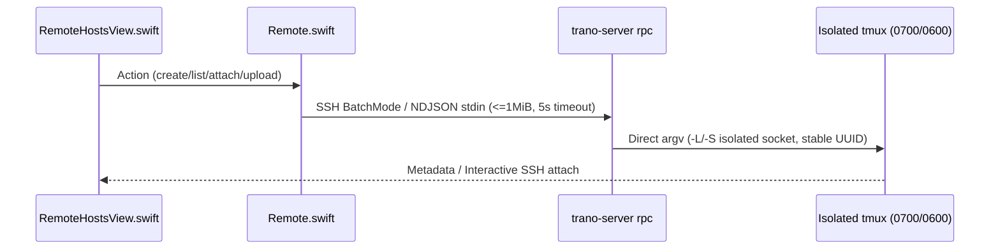

# M3 Software Design Description

> 현재 구현 상태, 실제 테스트, 남은 요구사항과 다음 명령은 [PROGRESS.md](PROGRESS.md) 및 [RTM.md](RTM.md)에 있으며, 재부팅 후 세션 자동 복원 요구사항은 [RECOVERY.md](RECOVERY.md)에 정의되어 있습니다. 이 문서의 이전 마일스톤 상태와 근거는 과거의 계획 스냅샷일 뿐 전체 제품 완성을 의미하지 않으며, 기존의 모든 U01-U21은 계속 유효한 범위에 포함됩니다.
> **L1 Summary**: Details the planned Go RPC helper, Swift SSH adapter, and profile/extension isolation boundaries grounded in verified upstream CLI contracts.

## L2 Component & Isolation Design

## L3 Module Contracts & Verified Sources
- **Remote Helper (`remote/go.mod`, `remote/main.go`)**: Built with Go `1.24.10` stdlib only. Parses single-line NDJSON requests up to `1MiB` on stdin for `health`, `list`, `new`, `capture`, `send`, `terminate`, `attach`. Enforces `5s` context timeouts and executes tmux via direct `exec.CommandContext` argv against a dedicated `0700` directory and `0600` metadata/socket files.
- **Build & Installer (`scripts/build-remote.sh`, `scripts/install-remote.sh`)**: `build-remote.sh` runs `CGO_ENABLED=0 go build` targeting `linux/amd64` and `linux/arm64` plus SHA-256 manifests. `install-remote.sh` implements `--check`, `--dry-run`, `--binary`, `--prefix`, `--force` without `sudo`, verifying SHA-256 and backing up on `--force` or aborting on unmanaged conflicts.
- **Swift Bridge & UI (`Sources/TerminalCore/Remote.swift`, `Sources/TranoApp/RemoteHostsView.swift`)**: Validates host aliases (`^[A-Za-z0-9._@-]+$`, no leading `-`), invokes BatchMode SSH for RPC (`$HOME/.local/bin/trano-server rpc`), spawns interactive SSH for `attach`, reuses existing local attaches, and streams image uploads via `scp` or SSH stdin to a restricted attachment directory.
- **Accounts, Failover & Extensions**: Verified upstream docs (`https://code.claude.com/docs/en/settings` confirming `CLAUDE_CONFIG_DIR` relocates settings, history, and plugins; `https://github.com/openai/codex/blob/main/codex-rs/config/src/types.rs` describing `CODEX_HOME/auth.json` and keychain options) and local CLI help (`codex login/plugin/mcp/resume`, `claude --resume --settings --plugin-dir`) govern argv/env construction. Profile apply writes atomically with backup inside owned profile roots only.
