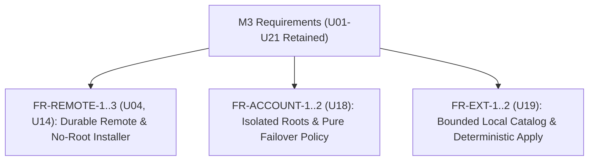

# M3 Software Requirements Specification

> 현재 구현 상태, 실제 테스트, 남은 요구사항과 다음 명령은 [PROGRESS.md](PROGRESS.md) 및 [RTM.md](RTM.md)에 있으며, 재부팅 후 세션 자동 복원 요구사항은 [RECOVERY.md](RECOVERY.md)에 정의되어 있습니다. 이 문서의 이전 마일스톤 상태와 근거는 과거의 계획 스냅샷일 뿐 전체 제품 완성을 의미하지 않으며, 기존의 모든 U01-U21은 계속 유효한 범위에 포함됩니다.
> **L1 Summary**: Defines exact acceptance criteria for remote execution (`FR-REMOTE-1..3`), account isolation (`FR-ACCOUNT-1..2`), and extension management (`FR-EXT-1..2`) covering U04, U14, U18, and U19 within full U01-U21 retention.

## L2 Functional Requirement Map

## L3 Requirement Acceptance Criteria
- **FR-REMOTE-1 (U14)**: Durable remote agent API supporting `health`, `list`, `new`, `capture`, `send`, `terminate`, `attach` over fixed SSH command `$HOME/.local/bin/trano-server rpc` with NDJSON stdin (bounded RPC `1MiB`, command timeout `5s`, no network listening port). Validates methods, ID, cwd, title, text size, and line bounds; invokes direct tmux argv using an isolated root (`0700`) and files (`0600`), never shared default tmux. Independent tmux owns the remote session so native client closing or SSH loss cannot stop it. Manager saves no raw terminal/transcripts content.
- **FR-REMOTE-2 (U04, U14)**: Native host registry with names, SSH aliases (strict allowlist: letters, digits, `-`, `.`, `_`, `@`; no leading dash or whitespace), create/list/attach remote. Local bridge owns the SSH process only; reconnect respawns bridge to the same `remoteID`; duplicate attach reuses local session; never automatically retry shell input. Metadata shell IDs use stable UUID and include `host` and `remoteID`. BatchMode read/control fails clearly when keys/known-host are missing (no auto-disable hostkey validation); native attached terminal uses interactive SSH to surface auth errors. User-selected image upload uses `scp` or SSH stdin to a restricted remote attachments path with no arbitrary interpolated data.
- **FR-REMOTE-3 (U14)**: Repeatable no-root (`no sudo`) installer supporting `--check`, `--dry-run`, `--binary`, `--prefix`, `--force`, unmanaged target conflict detection, force backup, and SHA-256 verification before installing prebuilt `linux/arm64` and `linux/amd64` binaries. No unverified `curl|sh` release URL may be invented.
- **FR-ACCOUNT-1 (U18)**: Account registration creates isolated provider config roots with opaque ID and label for `claude` (`CLAUDE_CONFIG_DIR`) and `codex` (`CODEX_HOME`), with no token read/copy/export and no global user config overwrites (`~/.claude`, `~/.codex`). Providers own login; default profile login is not performed automatically. Login and launch command plans use argv/environment without shell interpolation. UI lists profiles and launch/login actions; rate usage displays as unknown until a trusted provider adapter reports it (never fake bars).
- **FR-ACCOUNT-2 (U18)**: Same-provider failover planner is a pure policy requiring a trusted limit signal, quiescent tools, a resumable `sessionID`, a compatible adapter, and explicit opt-in. It excludes active/pinned accounts, honors cooldowns, defaults to no automatic migration, and never replays in-flight tools. Public product cannot copy or redistribute private CCO source (whose observed private README supports account names/reorder and legacy home preservation) or claim live parity. UI exposes `unqualified/unsupported`, not a working toggle, until an actual provider continuation adapter proves no duplicate actions.
- **FR-EXT-1 (U19)**: Unified local catalog for skills, plugins, hooks, and MCP canonical metadata targeting `claude` and `codex`, tracking per-provider capability, shared skill files, and native adapter settings. Imports local paths via explicit user action only, rejecting path traversal and symlinks, bounded to `8MiB` and `1000` files, with no implicit plugin execution.
- **FR-EXT-2 (U19)**: Generates per-profile deterministic config with preview and explicit Apply into owned roots only, using backup and atomic replace without modifying `~/.claude` or `~/.codex`. Symlinks skills from the owned managed catalog to profile dirs. Because Claude hooks/plugins format differs from Codex, incompatible entries are shown as `unsupported` instead of blind copy; no cross-provider compatibility is invented. Native plugin CLI may run via explicit user launch with the managed profile environment. MCP config uses command `args`/`env` with no plaintext secrets in the repo.
