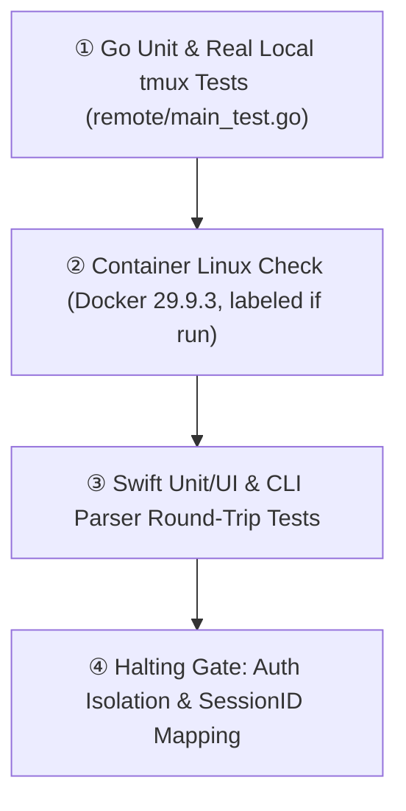

# M3 Test Specification (Tests-First)

> 현재 구현 상태, 실제 테스트, 남은 요구사항과 다음 명령은 [PROGRESS.md](PROGRESS.md) 및 [RTM.md](RTM.md)에 있으며, 재부팅 후 세션 자동 복원 요구사항은 [RECOVERY.md](RECOVERY.md)에 정의되어 있습니다. 이 문서의 이전 마일스톤 상태와 근거는 과거의 계획 스냅샷일 뿐 전체 제품 완성을 의미하지 않으며, 기존의 모든 U01-U21은 계속 유효한 범위에 포함됩니다.
> **L1 Summary**: Defines tests-first verification across Go unit/tmux integration, optional Docker container checks, and Swift isolation/policy suites, explicitly bounding unverified live SSH and credential flows.

## L2 Verification Pipeline

## L3 Planned Test Suites & Boundaries
- **Go Remote & Installer (`remote/main_test.go`, scripts)**: Unit and real local tmux integration tests covering `health`, `list`, `new`, `capture`, `send`, `terminate`, `attach`, `1MiB` payload limit, `5s` timeout, `0700`/`0600` permissions, path quoting, unknown ID isolation, and session survival after bridge exit. Installer tests verify `--check`, `--dry-run`, `--binary`, `--prefix`, `--force` backup, unmanaged conflict rejection, and SHA-256 mismatch failure. Cross-compilation does not prove Linux execution; container Linux integration using reachable Docker daemon `29.9.3` tests tmux and the binary independent of actual SSH and is explicitly labeled if run.
- **Swift Remote, Account & Extension Suites**: Tests host alias allowlist rejection (leading dash, whitespace), reconnect to identical `remoteID`, no automatic shell input retry, duplicate attach reuse, and safe image upload argv. Verifies `CLAUDE_CONFIG_DIR` and `CODEX_HOME` isolation, `~/.claude` and `~/.codex` preservation, path traversal/symlink rejection, `8MiB`/`1000`-file limits, atomic Apply with backup, and `unsupported` marking for cross-provider mismatches.
- **Failover Policy, CLI & Explicit Unverified Boundaries**: Tests same-provider candidate selection (active/pinned exclusion, cooldowns, trusted signal + quiescent tools + resumable `sessionID` requirement, in-flight tool replay refusal, `unqualified/unsupported` UI state). Generated configs round-trip through native parsers or `--check` when available; native host/account/extensions screens and actual CLI command plans are tested. Live remote SSH requires a user-provided host, credential login is not run, and automatic account switching remains unqualified.
