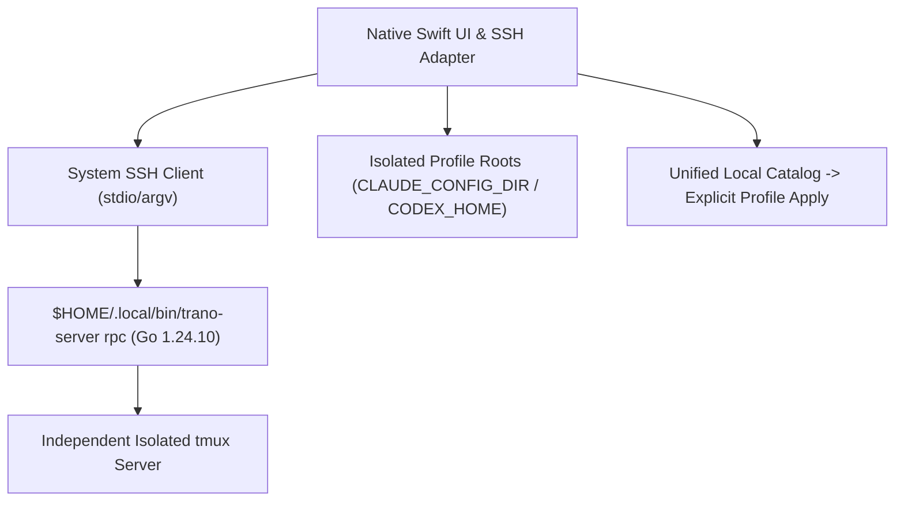

# M3 Planned Milestone: Remote Durability, Account Isolation, Extension Catalog

> 현재 구현 상태, 실제 테스트, 남은 요구사항과 다음 명령은 [PROGRESS.md](PROGRESS.md) 및 [RTM.md](RTM.md)에 있으며, 재부팅 후 세션 자동 복원 요구사항은 [RECOVERY.md](RECOVERY.md)에 정의되어 있습니다. 이 문서의 이전 마일스톤 상태와 근거는 과거의 계획 스냅샷일 뿐 전체 제품 완성을 의미하지 않으며, 기존의 모든 U01-U21은 계속 유효한 범위에 포함됩니다.
> **L1 Summary**: M3 specifies the planned remote tmux helper, SSH bridge, isolated account roots, and extension catalog while retaining full U01-U21 scope; M4 release remains required. Nothing is implemented yet.

## L2 Architecture Overview

- **Chosen Stack**: Trusted system SSH client avoids a new crypto/auth stack; Go 1.24.10 standard library (no third-party Go deps, `CGO_ENABLED=0 go build` for `linux/arm64` and `linux/amd64`) simplifies remote installation over a Swift toolchain and avoids unsafe exposed tmux TCP ports.

## L3 Planned Scope, Files, and Limitations
- **Planned Files**: `remote/go.mod`, `remote/main.go`, `remote/main_test.go`, `scripts/build-remote.sh`, `scripts/install-remote.sh`, `Sources/TerminalCore/Remote.swift`, `Sources/TranoApp/RemoteHostsView.swift`.
- **Stop Conditions & Limitations**: Stop immediately if auth isolation or session ID mapping fails. No real remote host is named or authorized, so live SSH remains unverified until one is provided. Auto-switch is unqualified/unsupported (`unqualified/unsupported` exposed, not a working toggle). Shared harness and private CCO code are not part of the new repo.
