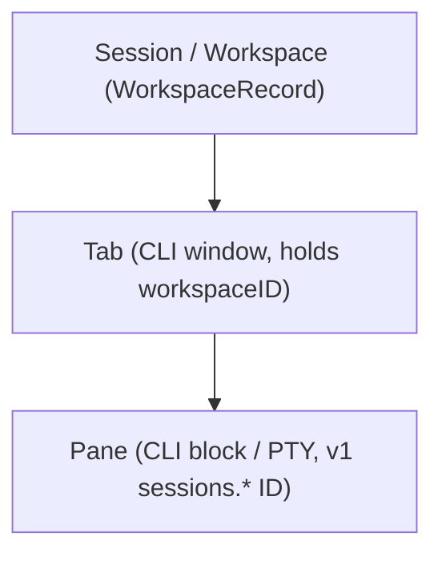

# Trano Navigation & Insert Path Engineering Amendment

> 현재 구현 상태, 실제 테스트, 남은 요구사항과 다음 명령은 [PROGRESS.md](PROGRESS.md) 및 [RTM.md](RTM.md)에 있으며, 재부팅 후 세션 자동 복원 요구사항은 [RECOVERY.md](RECOVERY.md)에 정의되어 있습니다. 이 문서의 이전 마일스톤 상태와 근거는 과거의 계획 스냅샷일 뿐 전체 제품 완성을 의미하지 않으며, 기존의 모든 U01-U21은 계속 유효한 범위에 포함됩니다.

> **Summary**: Trano adopts a 3-tier hierarchy (Session/Workspace → Tab → Pane), unified action registry, and native Insert Path while keeping PRD U01–U21 in full scope. M2 design is reopened to replace flat tabs with durable `WorkspaceRecord` groups without breaking v1 `sessions.*` pane APIs. Codex will execute sequentially test-first while M2 implementation remains in progress.

## 1. Architecture Correction & Hierarchy Decision
The prior M2 layout treated each PTY as a sidebar session with flat global tabs, which broke scoped cycling. We reopen M2 to match the 3-tier model verified from Rex Beta 0.1.0 (1853):

- **State & Migration**: `WorkspaceRecord` groups tab IDs and persists per-workspace selected tab and focused pane. Layouts lacking workspaces migrate into one default workspace preserving all IDs and PIDs. Switching groups changes views only. New Tab retains its selected pane focus request until the native terminal attaches to the window, then accepts typing without a click; a later selection or active native editor cancels obsolete focus.
- **API Compatibility**: Existing PTY IDs and `sessions.*` remain the v1 pane API without silent JSON shape replacement. A new `workspaces.*` API maps group operations explicitly in CLI docs.

## 2. Observed vs. Unverified Baseline (Rex Beta 0.1.0 (1853))
Read-only CLI inspection (no Rex state changed, no shortcut file copied) found **114 client actions**:
- **Observed Actions**: `session.new/switch/select/next/previous/rename/close/refresh/collapse/expand/collapse_others`; `client.tab.new/close/close_others/close_left/close_right/rename/next/previous/goto/move.backward/move.forward/move_to_new_window`; `pane.split.left/right/up/down/auto`; `pane.focus` (directions, `next`, `previous`); `pane.move` (directions); `pane.zoom/close/close_others/balance/resize/move_to_new_tab/move_to_tab/go_to_directory/go_to/view_activity/insert_path/copy_id/rename/paste/copy/select_all`; `prompt.previous/next` and scroll page.
- **Unverified Bindings**: `rex keymap` without client layers returns `bindings[]`. Only official `Cmd+K` and `Shift+Cmd+P` are verified from earlier research. We do not invent Rex default bindings; we use macOS/iTerm conventions, mark them in the audit table, and prioritize user keyboard remapping later.

## 3. Functional Requirements & Acceptance Criteria

### FR-NAV-1 (U03/U09/U10): Scoped Session → Tab → Pane Navigation
Named workspace requests MUST trim surrounding whitespace and reuse case-insensitive matches, including closed workspaces, without creating an extra shell or tab when an existing usable tab exists. Blank New Session names MUST create a new workspace with an unused lowercase `word-word` name (for example, `amber-cedar`), including keyboard, picker, API and launcher creation; invalid names MUST leave runtime state unchanged. Cmd+T and repeated tab switches MUST preserve each pane's native renderer identity, attach client, backend shell PID and output.

Implicit project launch MUST reuse only an open workspace containing an existing pane for that directory. A closed matching workspace stays closed with its retained tabs and jobs; launching the project creates a new randomly named workspace unless another open match exists. Exhausted normal naming pairs use alphabetic disambiguation within the second segment, preserving exactly two lowercase alphabetic segments and existing names.

Session next/previous wraps across workspaces and restores each workspace's last active tab and focused pane. Tab next/previous cycles strictly within the current workspace. Navigation never restarts shells or processes. New Session creates workspace + tab + pane; New Tab creates a tab in the active workspace. Must be verified by unit round-trip migration and focus restore tests.

### FR-NAV-2 (U03/U04/U09): Unified Typed Action Registry & Shortcuts
Activity (`pane.view_activity`) defaults to `cmd+.` and toggles once per key press; explicit overrides/disable and previously configured single bindings or sequence prefixes retain precedence. While Activity is open, unmodified Up/Down selects and scrolls rows in displayed section order; Enter/keypad Enter opens the selected exact pane across workspaces, tabs and splits. Selection follows pane identity through reorder; empty lists consume navigation keys, and marked input, native editors and sheets retain their keys.

The integrated tab strip is 40 points high with 12-point tab titles, including unchanged tab-close and transient shortcut-hint slots.

Native close/minimize/zoom controls are 14×14 points at x=9/32/55, centered 20 points below the top of that header after native update and resize. The workspace selector still starts at 72 points, keeping a 3-point gap after the controls without reducing terminal space. Native button objects, targets and window lifecycle remain intact. Double-clicking blank top-bar space or the floating-pane titlebar invokes native window zoom to maximize/restore; a single click still begins native window dragging and main-window context-menu clicks retain precedence.

Holding Command alone for 400ms MUST reveal inline tab hints matching `Cmd+1..8` and `Cmd+9` for the last tab. Releasing Command, another modifier/shortcut, window resign/close, or app deactivation MUST cancel pending and visible hints; inactive windows, settings and pickers must not show them. Hints MUST preserve tab geometry and existing keyboard/IME dispatch.

One typed registry exposes stable `id`, `title`, `category`, `keywords`, and `shortcut` shared across menus, palette, keyboard, and CLI/API `actions.list` with zero UI-only dead entries. Key capture matches exact modifiers and never steals IME commits or shortcuts inside TextFields/pickers.
- **Pickers**: `Cmd+K` sessions picker and `Shift+Cmd+P` commands; `Cmd+P` has no default picker binding. Go To Anything remains available through its action or an explicit configured shortcut. In the sessions picker, Up at the first selectable entry wraps to the last and Down at the last wraps to the first, including New Session, Add Remote Host, and the filtered Create action; both fixed footer actions remain selectable during filtering, and Enter executes the selected action while native IME editing retains its behavior.
- **Cycling**: Go To Tab `Cmd+1..8` (`Cmd+9` last), `Cmd+Shift+[`/`]` and `Ctrl+Tab` cycle tabs; `Cmd+Option+[`/`]` proposed for session cycling until Rex defaults are verified.

### FR-NAV-3 (U02/U03): Insert Path & Go To Directory
`pane.insert_path` (exposed in Edit menu + palette, no falsely claimed default Rex shortcut) opens a native file+folder picker starting in the actual current PTY `cwd`. Supports multi-select, shell-quotes paths containing spaces, apostrophes, or Korean characters, and inserts at cursor with no newline. Cancel has no effect and never runs `cd` or executes. Paths containing newline or `NUL` are rejected. File drag-and-drop uses the same formatter. Remote panes require a remote browser and never insert local host pathnames as valid remote paths. `pane.go_to_directory` uses `Cmd+Shift+G` to choose a folder and open a new tab there while preserving the old pane and running job. The conflicting global Find Previous default is unbound; its action and explicit custom bindings remain available. The new default yields to explicit single shortcuts and sequence prefixes.

### FR-NAV-4 (U09/U10/U11): Structural Mutations & Job Preservation
Close Workspace MUST remain available in header, picker, and sidebar controls. Closed workspaces MUST NOT appear in default lists or Cmd+K search results across empty, partial, exact, and Korean-corrected queries; nonempty queries MUST NOT bypass closed state. Retained jobs and tab/pane IDs MUST remain recoverable by Restore Tab or explicit named get-or-create. Passive refresh, stale actions, mirrored windows, and startup MUST NOT reopen closed workspaces, and final workspace close MUST NOT auto-create a shell.

Explicit pane or tab close (`Cmd+W`, `Cmd+Shift+W`, tab/pane `X`, context close, and close others) MUST capture all target state before stopping the first process. Because closing ends the backend lifetime, any prepare or validation failure before stop MUST leave running processes and layout intact. Explicitly closing the final pane or last tab closes that workspace view and selects the next open workspace in stored order, skipping hidden workspaces. Revalidation of captured identity and input keeps unrelated windows on their existing selection, while transfer detach remains independent. See [Closed terminal contract](CLOSED-TERMINALS.md).

Empty `closePane`/`closeTab` with a selected open session closes that captured session, selects the next open session, and preserves the window without shell creation/termination. Closing the last session leaves the window empty; another explicit close with no open selected session can close the window.

Dragging a complete tab into another open Trano window MUST move its existing tab ID, complete split tree, focused pane and running jobs into the destination workspace, with no duplicate in the source workspace. Dropping on a destination tab inserts at that position; dropping in the tab-strip blank area appends. Same-window dragging reorders tabs. Invalid, stale and foreign drag data MUST leave both layouts unchanged. Native two-window tests MUST assert the source/destination contents and preserved backend shell PIDs, including moving the source's final tab.

Pane headers support the same private drag transport: drop onto an existing tab to add a split, or onto the destination strip's blank area to create a tab from that pane. Visible sidebar tabs retain explicit cross-workspace targeting. Windows viewing the same workspace continue sharing its tab list. Moving requires floated panes to be returned first.

`Cmd+D` and `Cmd+Shift+D` MUST transfer native keyboard focus to the new split. Selected terminal focus MUST survive layout reparenting in its original window while yielding to newer pane selections or native editors.

`Cmd+Shift+Enter` MUST toggle the focused pane between its full terminal area and original split without recreating native renderers or attach clients. Float Pane MUST use the same renderer and process in a movable native floating window; floating `Return to Pane` and the floating native red close button return the pane to its original split and MUST preserve backend jobs, whereas ordinary floating-pane `Cmd+W` is an explicit pane close that saves state and terminates the process. Window close ownership MUST retain native animations without manual release of ARC-owned windows. Empty interactive startup MUST show a shell in a random collision-free workspace while preserving restored tabs and live jobs; an intentional last-tab close during that run MUST remain empty.

Command Palette MUST route Up/Down and Enter from the focused native search editor, keep the selected row visible, reset selection after filtering and preserve marked text and native copy/edit commands.

Opening owner input overlays temporarily hides that owner's floating windows and restores their visibility, frame, level and originating focus on dismissal. Native tests verify window visibility, real input controls and unchanged renderer/client identity; offscreen window lists do not establish physical screen order.

Renaming, moving or dragging panes and tabs, hiding a workspace, or closing a native window or app MUST preserve backend jobs. Explicit close (`Cmd+W`, `Cmd+Shift+W`, close others, `X`) saves state and terminates target jobs. `Cmd+Shift+T` (`Reopen Closed Tab`) restores saved topology into a fresh same-kind shell at the original `cwd` with sanitized display, available history imported as data (not guaranteed unsaved memory), and exact provider/account/organization conversation resume when its saved context is valid, with no command replay. Verification for this explicit-close change relies on pure/fake and inert native-component unit tests; live runtime tests were not performed.

### FR-NAV-5 (U04): Headless CLI/API Action Dispatch & GlassLauncher
`actions.list` documents all supported operations; `actions.perform` executes shared core commands using explicit target IDs or persisted focus. Actions requiring a native file panel return `requiresUI` / `noActiveWindow` when invoked headlessly rather than pretending a picker opened. GlassLauncher session launch/search/select operates on workspace groups while keeping stable v1 pane API mappings.

### FR-NAV-6 (U21): Native Black UI, Accessibility & Rex Action Audit
The 2026-11-11 layout refinement is MUST: merge title, application header and tabs into one visible row without a separate Trano title or development badge. The compact current-workspace selector leads the tab strip; Sessions navigation is collapsed by default and remains available through a toggle and existing pickers. Trailing controls place Activity before Command Palette. Activity must be hosted and clipped inside the terminal workspace, with unchanged terminal geometry and explicit close/Escape/outside-click dismissal. Native bounds and screenshots at 1280×800 and 900×620 verify this acceptance; viewport-size checks alone do not prove containment.

The workspace selector MUST sit 2–4pt beyond the native window-control group with valid native hit targets, and terminal views MUST fill their pane beneath its header without an added outer inset. Workspace and command pickers MUST stay inside the owning window and close on outside click or Escape before input reaches the terminal. Installed font choices MUST use inline native selection controls with a live preview and useful defaults, preserving custom fonts and the existing Settings Save/Cancel contract.

The workspace picker anchors directly beneath the actual selector bounds, uses a compact list height, and preserves native search, keyboard navigation and row context actions without resizing the terminal. New Session is fixed immediately above Add Remote Host beneath the scrolling results; named Create search results remain in the list. Random startup/new-window/detached-workspace names use lowercase `word-word` names, with a hyphenated numeric suffix for collisions; existing and explicitly supplied titles remain unchanged.

The `Cmd+K` session picker has no title header, while other picker headers remain intact. It displays the exact placeholder `Filter or create` and the creation label `New Session`.

Settings palettes MUST fit the native window width; native color-control bounds must be verified rather than inferred from a nonempty bitmap capture.

When enabled, the sidebar renders grouped workspaces. The tab bar shows only the selected workspace's tabs, and search labels include `Workspace > Tab > Pane` context. Full keyboard focus, accessibility labels, and consistent native black UI are required. All original PRD U01–U21 features remain required (including new OS windows / `Cmd+N` under PRD U09), while extra Rex surfaces (floating panes, global hotkey, web sharing) are not silently claimed by basic navigation and are tracked as planned parity separate from current tests:

| Source Rex Action ID | Trano Status | Shortcut / Notes |
| :--- | :--- | :--- |
| `session.new/switch/select/next/previous/rename/close/collapse/expand/collapse_others` | Planned | `Cmd+K` select; `Cmd+Opt+[`/`]` cycle (unverified Rex default) |
| `client.tab.new/close/close_others/rename/next/previous/goto/move.backward/move.forward` | Planned | `Cmd+1..9`, `Cmd+Shift+[`/`]`, `Ctrl+Tab` (macOS/iTerm convention) |
| `pane.split.*`, `pane.focus.*`, `pane.move.*`, `pane.zoom/close/close_others/balance/resize` | Planned | Shared registry + CLI/API target IDs |
| `pane.insert_path`, `pane.go_to_directory`, `pane.go_to`, `pane.move_to_tab/move_to_new_tab` | Planned | Edit menu + `Shift+Cmd+P` or an explicit configured shortcut; no `Cmd+P` default |
| `pane.copy_id/rename/paste/copy/select_all/view_activity`, `prompt.previous/next`, scroll | Planned | Mapped in unified action registry |
| New OS window (`Cmd+N`) / `client.tab.move_to_new_window` | New Window implemented; move-to-window planned | Required by original PRD U09; not optional future parity |
| `session.refresh`, floating panes, global hotkey, web sharing | Planned / Unverified | Planned parity separate from current navigation tests |

### FR-NAV-7: Native tab-strip context menus

Right-click and Control-click on a tab or blank tab-strip drag region opens a native menu with New Tab, Rename Session, Close Session, New Session, Add Remote Host and Customize View. Existing tab rename/reorder/close actions remain available on tabs. Customize View opens Appearance settings, applies Default or a saved appearance profile to the clicked tab's focused pane, manages profiles, and toggles the owning window's Sessions Sidebar with checkmarks. Native menu shortcuts reflect user overrides, stale/moved targets and pending input cannot mutate another session, and left-click/drag/close behavior remains intact.

Rename commits revalidate the original context after the dialog. Queued closes cancel if composition begins before dispatch, while newly created tabs remain in the background during late input; passive refresh and deferred focus also respect composing panes and native input sheets.

### FR-NAV-8: Session-picker context menus

Cmd+K session rows support native right-click/Control-click Rename Session, Close Session, Move Up and Move Down. Actions target the clicked workspace ID without activating another row, keep the picker/query/editor intact, and validate the canonical record at commit; closed/stale targets cannot be moved or closed. Open-workspace order persists, moves across hidden closed slots without wrapping, and updates both the picker and sidebar while preserving selection, tab trees and live jobs. Search navigation remains bound to stable row identity across reorder/removal, while marked text and other picker kinds retain their existing behavior.

### FR-NAV-9: Focused-agent tab identity

| Surface | Acceptance criterion |
|---|---|
| Icons | Stack distinct pane agents; the focused agent is in front. Duplicate providers use one icon; missing panes have a safe fallback. |
| Title | Automatic tabs follow the focused pane's terminal title, falling back to its stored session title. Explicit tab names remain unchanged. |
| Focus | Inactive tabs use their remembered pane; focus changes update strip, sidebar and hover without changing selection or renderer identity. |
| Metadata | Reject titles above 8,192 UTF-8 bytes before display-width/grapheme bounds; preserve Unicode joiners. Metadata uses the existing background tmux query with no transcript reads, DNS resolution, extra polling, provider restarts or state rewrites. Legacy snapshots remain readable. |
| Live titles | Native title events trigger at most one pending/in-flight read per window; retain events arriving after a read starts. Ignore retired renderer callbacks and merge only matching pane/PID title fields. |
| Geometry | Preserve tab height, close targets and Command-hint geometry; icons do not intercept input. |
| Verification | Core presentation/title tests and native focus/renderer/PID tests precede signed installation with identical live jobs and layout. |

### FR-NAV-10: Pane dragging and outside-window detachment

| Gesture | Acceptance criterion |
|---|---|
| Header drag | Native drag starts from pane header text/blank space; ordinary click, header controls and context menu continue to work. Terminal text selection remains separate. |
| Tab drop | Drop into another existing tab moves the same pane into that tab, retaining source split remainder and backend/provider identity. Existing cross-window targets keep working. |
| Outside release | An unhandled mouse release outside the originating window opens one normal window with one tab containing the same running pane. No replacement shell or provider launch is created. |
| Cancellation | Escape, stale/replayed records and unhandled drops inside the originating window leave pane ownership unchanged and create no new window. A successful tab drop never also creates a detached window. |
| Completion | Canonical pane/workspace and input ownership are checked at mutation; all mirrored source windows reconcile. New windows start on their committed workspace regardless of later global selection. |
| Verification | Native source/event tests and real tmux two-window/outside-drop tests cover accepted/canceled/stale/queued paths and unchanged backend PIDs before signed local installation. |

### FR-NAV-11: Foreground program icons

| Surface | Acceptance criterion |
|---|---|
| Named programs | Ordinary shells and zsh MUST render with the same native dark rounded terminal body and green prompt across light and dark schemes, while honoring explicit shell tint preferences. Claude/Codex identities MUST remain unchanged, and k9s and Kubernetes for kubectl exec MUST retain distinct identities without an expanded catalog or settings. |
| Identity | Use actual foreground process-group metadata. Background jobs and text/title strings cannot select an icon; `kubectl get` and option/remote-command values containing `exec` do not qualify. |
| Live UI | Tabs/sidebar keep focused program in front; pane headers use the same program identity. Return to zsh after the foreground command ends. Preserve existing bar/font/slot dimensions. |
| Lifecycle | Add optional `foregroundProgram`; keep `AgentKind`, activity, account/recovery bindings and running jobs unchanged. Local foreground sampling is a read-only projection; remote cache imports may store the optional display field. Unknown/legacy metadata uses a safe fallback. |
| Refresh | Local sampling is bounded, cached and off the main thread; coalesce pending work and avoid tmux/state/history scans on periodic ticks. Remote metadata uses the existing helper refresh. |
| Assets | Ordinary shell and zsh icons use native drawing; the existing legacy zsh PNG is retained but no longer used by ProgramLogo. Bundled k9s and Kubernetes artwork remains local with verified provenance and notices, requiring no runtime downloads. |
| Verification | Pure argument parsing, actual PTY fake-program foreground/background transitions, native resources/order and backward compatibility tests; no real Kubernetes command or credential access. |

### FR-NAV-12: Native tab drag completion

| Surface | Acceptance criterion |
|---|---|
| Source | Drag tab labels through a native move session; clicks select, close buttons remain clickable, and right/Control-click keeps the existing menu. Retain the source until completion, including hover redraw/unmount. |
| Existing destination | Drop reorders or transfers the whole tab with its split tree/title/focus and running jobs. Tab and pane negotiation both propose move; queued work revalidates open source/destination and input ownership. |
| Outside release | An unaccepted release outside the original window moves the complete dragged tab into one normal new window, including a single-tab source. Preserve tab/pane IDs, full split tree, title/focus and backend processes; transfer detach keeps the source workspace open. |
| Workspace destination | Sidebar workspace rows and the existing switcher's drag-hover chooser accept pane/tab drops into that explicit open workspace, including an empty destination. Hovering must not navigate away from the immutable source workspace before drop. |
| Source workspace row | Dropping a tab on its own workspace row appends that existing tab once; dropping a pane there moves it into a new tab in that workspace. Preserve all jobs and remaining splits. |
| Completion | Accepted asynchronous drops, cancellation, Escape, inside-window release, stale IDs or modal/composing input cannot also move or detach a window. No shell/provider creation or unrelated recovery. |
| Verification | Native hit testing and mouse/session callbacks, two-window/normal-window fixtures, accepted-versus-cancelled completion, queued/stale ownership and unchanged backend PIDs. Physical pointer qualification remains distinct from headless fixtures. |

### FR-NAV-13: Master View

One open session can be designated the Master View (header menu "Use as Master View", API `workspaces.master`). While it is selected, its tab strip shows its own tabs followed by every tab of another open session that needs review, so Activity attention can be tracked and worked through in one session.

| Surface | Acceptance criterion |
|---|---|
| Membership | A tab is presented while one of its panes is blocked (decision or permission), or has an unread completion or failure. Read completions and failures leave; tabs of closed sessions are never presented. The tab the Master View currently shows stays presented after it is read. |
| Order | Strip order: Master View tabs, then presented tabs by session order and tab order, so tabs do not jump as activity changes. Presented tabs show their source session name. |
| Ownership | Presenting never moves a tab: its workspace, split tree, jobs and PIDs are unchanged. Selecting a presented tab keeps the Master View selected, including when the selection reads the completion before it commits; navigation requests for presented panes keep a Master View window on the Master View. |
| Selection | Turning the view off, closing the source session or closing a presented tab moves the selection to a tab the Master View still shows. Closing the Master View's last own tab keeps it open. |
| Menus | Session actions (New Tab, Rename/Close Session, Use as Master View) on a presented tab target the Master View; sibling actions (move, close other/left/right) are disabled because they would act on the hidden source session. Close Tab closes the real tab. |
| Persistence | The designation lives in `master-view.json`; membership is derived on every state read and never written to `state.json` or `continuity.json`, so older helpers rewriting those files cannot drop it. |

### FR-INPUT-1: Preserve typing across double-interrupt agent exit

| Boundary | Acceptance criterion |
|---|---|
| Gesture | Two nonrepeat Ctrl+C presses within3 seconds in a focused Claude/Codex pane pass through immediately; subsequent physical key presses/releases wait in a bounded ephemeral queue. Single Ctrl+C, autorepeat and configured command shortcuts retain their existing behavior. |
| Release | Capture process identities before the first interrupt. Require two matching same-backend foreground-shell proofs and current terminal input-mode snapshots, then replay original native events FIFO through the current encoder, including shell-owned Kitty modes and replay-started IME composition. No guessed prompt text or synthesized Enter. |
| Authority | Recheck exact native renderer, window, responder, application focus, lease, backend birth and complete provider-generation history. Pair the final writer with an admission UUID so ordinary and guarded input cannot coalesce. An owner change cancels with a visible notice; it never redirects typing. |
| Remote | Existing session metadata carries optional backend/shell identity witnesses. Older Linux helpers require an update and metadata refresh; no new RPC route. Poll only during handoff, single-flight at40ms locally or400ms remotely. |
| Limits | Physical keys only; clipboard/API/pointer input remains on existing routes. Foreground ownership and stable parsed modes do not prove complete output drain or arbitrary shell-plugin readiness. Physical keyboard/OS IME, live provider, PTY and SSH qualification remain paused. |
| Evidence | `InterruptHandoffNativeTests`, `TerminalShellHandoffTests`, `TerminalInputRelayTests` and file-only Go shell-identity tests; receipts under `.local/interrupt-handoff/`. |
| Active IME | Retained marked text follows cursor movement from output-frame effects, including delayed committed Hangul echo and row redraw, across Core Graphics, MTKView Metal and background Metal; composition and configured colors remain unchanged. `IMEViewportTests` records the native regression and offscreen captures. |

## 4. Sequential Implementation & Verification Plan (Owner: Codex)
1. **Core & Files**: Add `Sources/TerminalCore/Workspace.swift` and `Sources/TerminalCore/Actions.swift`; update `Sources/TerminalCore/Model.swift` and `Sources/TranoApp/{Store,WorkspaceView,App,TerminalPane}.swift`.
2. **Test-First Suite**: Create `Tests/TerminalCoreTests/NavigationTests.swift` to verify layout migration round-trip, focus restoration, shell quoting (spaces/apostrophes/Korean, newline/`NUL` rejection), and headless `requiresUI` / `noActiveWindow` responses.
3. **PTY & Visual Qualification (paused)**: E2E testing remains paused, prohibiting real terminal jobs, live SSH, provider/PTY, or standalone app tests for this change; future live qualification MUST assert stopped jobs for explicit close and preserved jobs for moving panes or tabs, native window/app closure, and workspace hiding.
4. **Manual Verification Gate**: Because interactive OS file panel automation is unavailable in computer-use and AppleScript is prohibited, keep an explicit manual check gate for interactive `NSOpenPanel` selection and cancel behavior.

## Native interaction repairs — 2026-11-16

| Surface | Current contract | Evidence |
| --- | --- | --- |
| Horizontal tabs | Default tabs cap at240pt and shrink with count;title truncates before separate close target;fill preference remains available. | TabCompressionTests,InterfacePreferencesTests |
| File links | Cmd-click resolves native UTF8 OSC8 and absolute/relative local paths against originating pane cwd;line suffixes normalize after exact filename lookup. Remote paths remain remote;link policy and owner guards remain. | AgentFileLinkTests,QuickLookVendorLinkTests,TerminalInteractionTests |
| Copy | Actual registered native responder owns Cmd-C even if model focus lags. Same-grid layout preserves selection;coding-agent drags select text while clicks/wheel retain mouse reporting;k9s remains native passthrough. | SplitPanePointerCopyTests |
| Scroll | Hit-test receives superview coordinates,so upper/lower panes and overlay controls retain their own pointer targets. | SplitPanePointerCopyTests |
| Multiline | Legacy Claude/Codex Shift+Return/keypad Enter sends their verified newline shortcut;normal Enter,shell,IME and negotiated Kitty paths retain their existing behavior. | ShiftEnterNativeTests;provider/version evidence under`.local/native-interaction-batch/shift-enter/` |
| Explicit close | zsh/bash native history bytes are preserved as Data,including nonUTF8 records;native NUL/size/entry limits and fish framing remain. | ShellHistoryEncodingTests,ShellHistoryTests,ClosedTerminalLifecycleTests |
