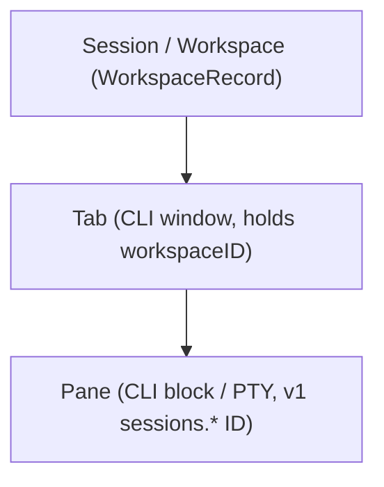

# Trano Navigation & Insert Path Engineering Amendment

> 현재 구현 상태, 실제 테스트, 남은 요구사항과 다음 명령은 [PROGRESS.md](PROGRESS.md) 및 [RTM.md](RTM.md)에 있으며, 재부팅 후 세션 자동 복원 요구사항은 [RECOVERY.md](RECOVERY.md)에 정의되어 있습니다. 이 문서의 이전 마일스톤 상태와 근거는 과거의 계획 스냅샷일 뿐 전체 제품 완성을 의미하지 않으며, 기존의 모든 U01-U21은 계속 유효한 범위에 포함됩니다.

> **Summary**: Trano adopts a 3-tier hierarchy (Session/Workspace → Tab → Pane), unified action registry, and native Insert Path while keeping PRD U01–U21 in full scope. M2 design is reopened to replace flat tabs with durable `WorkspaceRecord` groups without breaking v1 `sessions.*` pane APIs. Codex will execute sequentially test-first while M2 implementation remains in progress.

## 1. Architecture Correction & Hierarchy Decision
The prior M2 layout treated each PTY as a sidebar session with flat global tabs, which broke scoped cycling. We reopen M2 to match the 3-tier model verified from Rex Beta 0.1.0 (1853):

- **State & Migration**: `WorkspaceRecord` groups tab IDs and persists per-workspace selected tab and focused pane. Layouts lacking workspaces migrate into one default workspace preserving all IDs and PIDs. Switching groups changes views only.
- **API Compatibility**: Existing PTY IDs and `sessions.*` remain the v1 pane API without silent JSON shape replacement. A new `workspaces.*` API maps group operations explicitly in CLI docs.

## 2. Observed vs. Unverified Baseline (Rex Beta 0.1.0 (1853))
Read-only CLI inspection (no Rex state changed, no shortcut file copied) found **114 client actions**:
- **Observed Actions**: `session.new/switch/select/next/previous/rename/close/refresh/collapse/expand/collapse_others`; `client.tab.new/close/close_others/rename/next/previous/goto/move.backward/move.forward/move_to_new_window`; `pane.split.left/right/up/down/auto`; `pane.focus` (directions, `next`, `previous`); `pane.move` (directions); `pane.zoom/close/close_others/balance/resize/move_to_new_tab/move_to_tab/go_to_directory/go_to/view_activity/insert_path/copy_id/rename/paste/copy/select_all`; `prompt.previous/next` and scroll page.
- **Unverified Bindings**: `rex keymap` without client layers returns `bindings[]`. Only official `Cmd+K` and `Shift+Cmd+P` are verified from earlier research. We do not invent Rex default bindings; we use macOS/iTerm conventions, mark them in the audit table, and prioritize user keyboard remapping later.

## 3. Functional Requirements & Acceptance Criteria

### FR-NAV-1 (U03/U09/U10): Scoped Session → Tab → Pane Navigation
Session next/previous wraps across workspaces and restores each workspace's last active tab and focused pane. Tab next/previous cycles strictly within the current workspace. Navigation never restarts shells or processes. New Session creates workspace + tab + pane; New Tab creates a tab in the active workspace. Must be verified by unit round-trip migration and focus restore tests.

### FR-NAV-2 (U03/U04/U09): Unified Typed Action Registry & Shortcuts
One typed registry exposes stable `id`, `title`, `category`, `keywords`, and `shortcut` shared across menus, palette, keyboard, and CLI/API `actions.list` with zero UI-only dead entries. Key capture matches exact modifiers and never steals IME commits or shortcuts inside TextFields/pickers.
- **Pickers**: `Cmd+K` sessions picker, `Shift+Cmd+P` commands, `Cmd+P` Go To Anything (panes/tabs/sessions).
- **Cycling**: Go To Tab `Cmd+1..8` (`Cmd+9` last), `Cmd+Shift+[`/`]` and `Ctrl+Tab` cycle tabs; `Cmd+Option+[`/`]` proposed for session cycling until Rex defaults are verified.

### FR-NAV-3 (U02/U03): Insert Path & Go To Directory
`pane.insert_path` (exposed in Edit menu + palette, no falsely claimed default Rex shortcut) opens a native file+folder picker starting in the actual current PTY `cwd`. Supports multi-select, shell-quotes paths containing spaces, apostrophes, or Korean characters, and inserts at cursor with no newline. Cancel has no effect and never runs `cd` or executes. Paths containing newline or `NUL` are rejected. File drag-and-drop uses the same formatter. Remote panes require a remote browser and never insert local host pathnames as valid remote paths. `pane.go_to_directory` separately opens a new tab at the picked folder while preserving the old pane and running job.

### FR-NAV-4 (U09/U10/U11): Structural Mutations & Job Preservation
Supports renaming workspace/tab/pane, reordering tabs, closing view/tab/others while preserving backend jobs, restoring closed tabs, and moving/swapping/balancing splits while preserving PTY IDs. Active-workspace tab drops cannot move the wrong pane, and cross-session moves keep PTYs alive. Tests must prove valid focus after empty-tab removal, group balance/move integrity, and zero stopped jobs.

### FR-NAV-5 (U04): Headless CLI/API Action Dispatch & GlassLauncher
`actions.list` documents all supported operations; `actions.perform` executes shared core commands using explicit target IDs or persisted focus. Actions requiring a native file panel return `requiresUI` / `noActiveWindow` when invoked headlessly rather than pretending a picker opened. GlassLauncher session launch/search/select operates on workspace groups while keeping stable v1 pane API mappings.

### FR-NAV-6 (U21): Native Black UI, Accessibility & Rex Action Audit
The 2026-11-11 layout refinement is MUST: merge title, application header and tabs into one visible row without a separate Trano title or development badge. The compact current-workspace selector leads the tab strip; Sessions navigation is collapsed by default and remains available through a toggle and existing pickers. Trailing controls place Activity before Command Palette. Activity must be hosted and clipped inside the terminal workspace, with unchanged terminal geometry and explicit close/Escape/outside-click dismissal. Native bounds and screenshots at 1280×800 and 900×620 verify this acceptance; viewport-size checks alone do not prove containment.

When enabled, the sidebar renders grouped workspaces. The tab bar shows only the selected workspace's tabs, and search labels include `Workspace > Tab > Pane` context. Full keyboard focus, accessibility labels, and consistent native black UI are required. All original PRD U01–U21 features remain required (including new OS windows / `Cmd+N` under PRD U09), while extra Rex surfaces (floating panes, global hotkey, web sharing) are not silently claimed by basic navigation and are tracked as planned parity separate from current tests:

| Source Rex Action ID | Trano Status | Shortcut / Notes |
| :--- | :--- | :--- |
| `session.new/switch/select/next/previous/rename/close/collapse/expand/collapse_others` | Planned | `Cmd+K` select; `Cmd+Opt+[`/`]` cycle (unverified Rex default) |
| `client.tab.new/close/close_others/rename/next/previous/goto/move.backward/move.forward` | Planned | `Cmd+1..9`, `Cmd+Shift+[`/`]`, `Ctrl+Tab` (macOS/iTerm convention) |
| `pane.split.*`, `pane.focus.*`, `pane.move.*`, `pane.zoom/close/close_others/balance/resize` | Planned | Shared registry + CLI/API target IDs |
| `pane.insert_path`, `pane.go_to_directory`, `pane.go_to`, `pane.move_to_tab/move_to_new_tab` | Planned | Edit menu + `Shift+Cmd+P` / `Cmd+P`; no claimed Rex key |
| `pane.copy_id/rename/paste/copy/select_all/view_activity`, `prompt.previous/next`, scroll | Planned | Mapped in unified action registry |
| New OS window (`Cmd+N`) / `client.tab.move_to_new_window` | New Window implemented; move-to-window planned | Required by original PRD U09; not optional future parity |
| `session.refresh`, floating panes, global hotkey, web sharing | Planned / Unverified | Planned parity separate from current navigation tests |

## 4. Sequential Implementation & Verification Plan (Owner: Codex)
1. **Core & Files**: Add `Sources/TerminalCore/Workspace.swift` and `Sources/TerminalCore/Actions.swift`; update `Sources/TerminalCore/Model.swift` and `Sources/TranoApp/{Store,WorkspaceView,App,TerminalPane}.swift`.
2. **Test-First Suite**: Create `Tests/TerminalCoreTests/NavigationTests.swift` to verify layout migration round-trip, focus restoration, shell quoting (spaces/apostrophes/Korean, newline/`NUL` rejection), and headless `requiresUI` / `noActiveWindow` responses.
3. **Real PTY & Visual Verification**: Execute real PTY PID navigation integration tests to verify PIDs survive session/tab/pane moves and closes, plus actual native 2x snapshots via headless GUI script (not source-only checks).
4. **Manual Verification Gate**: Because interactive OS file panel automation is unavailable in computer-use and AppleScript is prohibited, keep an explicit manual check gate for interactive `NSOpenPanel` selection and cancel behavior.
