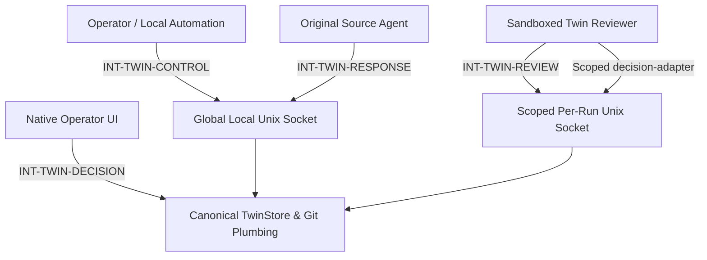

# Pessimistic Twin Interface Design Document (`docs/PESSIMISTIC-TWIN-API.md`)

> **Summary**: Pessimistic Twin exposes a two-tier local Unix domain socket contract under `APIRequest` / `APIResponse` (`apiVersion: 1`) separating operator control (`INT-TWIN-CONTROL`), sandboxed reviewer worktree operations (`INT-TWIN-REVIEW`), original-agent replies (`INT-TWIN-RESPONSE`), human and operational decisions (`INT-TWIN-DECISION`), early-bound CLI helpers (`INT-TWIN-CLI`), and canonical report payloads (`INT-TWIN-REPORT`). Local automation and provider helpers must bind to the exact socket for their role, respect strict byte limits, and rely on server-side Git and decision guards rather than direct metadata writes. The native kernel hook bridge, credential freeze, organization pin, profile digests and no-op guard are implemented with passing unit and signed-installation receipts below; authenticated provider runtime and physical E2E qualification remain paused.

## Interface Inventory

The interface isolates untrusted reviewer execution from global runtime control by binding reviewer processes to a per-run scoped Unix socket while keeping lifecycle management and source-agent responses on the global local socket. Canonical schemas are defined in [Sources/TerminalCore/API.swift](../Sources/TerminalCore/API.swift) , [PessimisticTwinModels.swift](../Sources/TerminalCore/PessimisticTwinModels.swift) , and routed in [PessimisticTwinAPI.swift](../Sources/TerminalCore/PessimisticTwinAPI.swift) .



| Interface ID | Surface | Transport / Entry | Allowed Methods / Subcommands | Caller Trust Boundary |
| :--- | :--- | :--- | :--- | :--- |
| `INT-TWIN-CONTROL` | Global Control API | Global local Unix socket | `twins.status`, `twins.enable`, `twins.stop` | Local operator / automation (`originPID` required; twin peers refused) |
| `INT-TWIN-REVIEW` | Scoped Reviewer API | Scoped per-run Unix socket | `twins.hook`, `twins.diff`, `twins.commit`, `twins.report` | Exact active twin reviewer peer (pane, generation, backend PID birth, provider ancestry, private profile) |
| `INT-TWIN-RESPONSE` | Original Agent Response API | Global local Unix socket | `twins.respond` | Exact original source peer and original unchanged provider conversation binding |
| `INT-TWIN-DECISION` | Workflow & Operational Decisions | Native UI + Scoped socket | Native `merge` / `feedback_only` / `discard`; scoped `ask` / `submit` / `poll` / `gate` | Human operator in native UI for workflow consent; scoped twin for ordinary operational decisions |
| `INT-TWIN-CLI` | Early-Bound Helper & Bootstrap CLI | `trano twin ...` executable | `run`, `hook`, `diff`, `commit`, `report`, `respond` | Dispatches before `TerminalRuntime` init to avoid forbidden sandbox writes |
| `INT-TWIN-REPORT` | Canonical Report Payload | Stdin / IPC JSON envelope | `TwinReport` (`status`, `rationale`, `changed_files`) | Untrusted agent output validated strictly before state transition |

## Per-Interface Contracts

### 1. Global Control Interface (`INT-TWIN-CONTROL`)

`INT-TWIN-CONTROL` manages twin lifecycle over the global local Unix socket using `APIRequest` (`apiVersion`, `method`, `params` only; no `id` property) and `APIResponse`. Protocol failures return the existing `APIResponse.error` string without a new numeric error taxonomy. Max CLI outbound frame is `1 MiB`. Local `originPID` is required for mutating controls, known twin peers are refused, no remote-host twin support exists, and no `twins.resolve` endpoint exists.

Native UI actions freeze the active local managed launch generation, conversation, and working directory in public Swift `TwinSourceExpectation` (`PessimisticTwinSourceExpectation.swift`) before async dispatch in `StorePessimisticTwins.swift`, and `enablePessimisticTwin(... expectedSource:)` in `PessimisticTwinRuntime.swift` validates it inside the transaction. The optional Swift-only parameter defaults to `nil` to preserve programmatic callers; no `expectedSource` JSON field or new method is added, `twins.enable` keeps current binding, and missing, unmanaged, remote, or ambiguous native sources are rejected.

Valid `twins.enable` request example:

```json
{"apiVersion":1,"method":"twins.enable","params":{"paneID":"pane-id","mode":"code_review"}}
```

| Method | Required Params | Optional Params | Response Payload | Contract & Guards |
| :--- | :--- | :--- | :--- | :--- |
| `twins.status` | None | `paneID` (string) | `{runs:[TwinRun]}` | Lists twin runs; filters by `paneID` when provided. |
| `twins.enable` | `paneID` (string), `mode` (`code_review` \| `security_review` \| `general_review`) | `roundCap` (`1...8`, default `3`), `noopCap` (`1...8`, default `2`) | Encoded `TwinRun` | Requires exact live managed local Claude or Codex session. No fallback and no twin-of-twin. |
| `twins.stop` | `runID` (string) | None | `{ok:true}` | Marks `user_interrupt` and requests cleanup. |

### 2. Scoped Reviewer Interface (`INT-TWIN-REVIEW`)

`INT-TWIN-REVIEW` is exposed exclusively on the per-run scoped Unix socket (`TRANO_TWIN_API_SOCKET`). General global runtime, workspace, account, terminal, resolve, or delete methods are unavailable. Every call validates that `runID` matches the socket-bound run, `round` is an integer in `1...8` matching the current active round, and the caller peer matches the exact pane, generation, backend PID birth, provider ancestry, and private profile. The source conversation ID cannot be reused as the fork ID.

Native kernel sandbox-identity C bridge admission is source-verified at `PessimisticTwinHookAdmission.swift` and `TranoSandboxBridge.c` and is invoked before hook mutation. It rechecks exact helper identity, process birth, ancestry, and the protected private ticket file before and after a kernel `file-write-data` permission query; only an unsandboxed root helper is admitted with no actual write, while sandboxed, unknown, or error states fail closed and are denied.

Valid `twins.report` request example:

```json
{"apiVersion":1,"method":"twins.report","params":{"runID":"00000000-0000-0000-0000-000000000001","round":1,"envelope":{"status":"working","rationale":"Corrected the demonstrated boundary condition; unit checks are recorded in the review.","changed_files":["src/parser.swift"]}}}
```

| Method | Required Params | Limits & Validation | Response Payload | Operational Behavior |
| :--- | :--- | :--- | :--- | :--- |
| `twins.hook` | `runID`, `round`, `payload` | CLI stdin `<= 512 KiB`; root provider hook only; exact worktree `cwd` and new session ID | Native hook output or `null` | Updates trusted fork identity / turn completion; rewrites helper global socket references to the scoped socket. |
| `twins.diff` | `runID`, `round` | Max diff `512 KiB` from actual Git service; no silent truncation | `{diff:string}` | Returns whole fixed snapshot diff; CLI writes raw diff; exposes no source history in `security_review`. |
| `twins.commit` | `runID`, `round`, `message` | `message` non-empty, `<= 4096` UTF-8 bytes, no `NUL`; active `reviewing` unreported twin only | `{tip:string,changed_files:[string]}` or `{status:"busy",retryAfterMs:250}` | Server validates owned branch, index, and snapshot ancestry and commits natively. Reviewer has zero direct shared Git metadata write authority. |
| `twins.report` | `runID`, `round`, `envelope` (`TwinReport`) | Only `launching` / `reviewing` in active trusted twin turn; `envelope <= 16 KiB` | `{ok:true}` | Stores first strict report with `reportedAt` and `reportedTurnID`; identical duplicate is idempotent, different final report is rejected. |

Before transitioning to `awaiting_decision`, a trusted root `done` in that same turn must follow `twins.report`, and the server verifies that the committed tip is clean, is a descendant of the snapshot, and has actual changed paths equal to `changed_files`. A bad report terminates the run with `invalid_agent_output` and performs no merge.

### 3. Original-Agent Response Interface (`INT-TWIN-RESPONSE`)

`twins.respond` is exposed only on the global local Unix socket. Reviewers cannot call `twins.respond`.

- **Parameters & Guards**: Requires `runID`, `round`, and `envelope` (`TwinReport` schema) -> returns `{ok:true}`. Requires the exact original source peer and original unchanged provider conversation binding, after the forwarded `QueuedInput` has been delivered (`forwardedID` receipt exists and queue row is consumed).
- **Forwarding & Turn Sequencing**: Feedback forwarding uses durable key `twin:<runID>:<round>` and a stable `forwardedID` receipt via internal `followups.add` / `QueuedInput` insertion and delivery without backdating or weakening guards (no reviewer `followups.add` write endpoint is added). Source feedback may wait for a later `done` after enqueue; after explicit `twins.respond` for the current round, a subsequent trusted root `done` enables a bounded new round or termination.

### 4. Workflow and Operational Decision Interface (`INT-TWIN-DECISION`)

Canonical `TwinStore` binds `runID`, `round`, source generation, `snapshotOID`, and `twinTipOID` for native workflow decision cards (`merge`, `feedback_only`, `discard`). Only an explicit user choice in the native UI can resolve the workflow card; the generic Decision API, raw `submit`, or any provider API cannot forge human consent. The card survives reviewer exit and older `RuntimeState` writers, and does not block source `Stop` needed for a future merge. `merge` requires a new source `done` after the user choice with different completion IDs, plus exact original branch, `HEAD`, index, content, input, tool, queue, and ordinary Decision guards; a dirty snapshot creates a checkpoint before a normal non-force merge, divergence transitions to `needs_review`, and merge conflict transitions to `conflict` with state left intact (`feedback_only` performs no merge; `discard` makes no applied claim). Ordinary operational production, destructive, and shared resource decisions retain [DECISIONS.md](DECISIONS.md) and [SUPERVISOR.md](SUPERVISOR.md) (`FR-SUP-4`) over the scoped `decision-adapter` (`ask|submit|poll|gate`, raw wire types `submit`, `poll`, `gate`, `512 KiB` max request/response, exact twin `session_id` and `workspace`, own non-reserved `request_id` for `poll`, exact provider/session for `gate`, and no `resolve`, `abandon`, `delete`, or protected workflow poll access); asking for an operational decision never grants sandbox escalation or human merge consent.

### 5. CLI Helper and Trusted Launch Interface (`INT-TWIN-CLI`)

Reviewer and response CLI subcommands dispatch early before `TerminalRuntime` initialization so sandboxed helpers never trigger forbidden runtime file writes. Unknown or duplicate flags are rejected, and no new public launch CLI options are added. Helper socket resolution checks `TRANO_TWIN_API_SOCKET` first; if absent, `TRANO_DATA_DIR/api.sock`, else the local default (paths must be absolute, contain no control characters or `.` / `..` segments, and be `< 104` UTF-8 bytes). Provider fork flags (`--resume ID --fork-session --permission-mode acceptEdits` for Claude `2.1.323`; `fork ID PROMPT` with `workspace-write` for Codex `0.167.0`), `security_review` history isolation, inner sandbox confinement, and the `30`-second missing fork `SessionStart` startup diagnostic follow [PESSIMISTIC-TWIN-DESIGN.md](PESSIMISTIC-TWIN-DESIGN.md) . Followup instructions to the original agent must explicitly include `trano twin respond RUN_ID --round N` because the original agent does not inherit `TRANO_TWIN_ROUND`:

```sh
trano twin respond 00000000-0000-0000-0000-000000000001 --round 1 < report.json
```

| Command | Context | Arguments & Stdin Limits | Socket & Retry Behavior |
| :--- | :--- | :--- | :--- |
| `trano twin run RUN_UUID --round N` | Trusted bootstrap | Immutable ticket, reserved generation, pane, backend birth, exact source account; calls shared `launch(cwd,agent,prompt,owned)` | Bound by server launch pipeline. |
| `trano twin hook RUN_UUID [--round N]` | Reviewer helper | Stdin JSON `<= 512 KiB`; `--round` falls back to `TRANO_TWIN_ROUND` in reviewer context only | Uses `TRANO_TWIN_API_SOCKET`. |
| `trano twin diff RUN_UUID [--round N]` | Reviewer helper | No stdin; `--round` falls back to `TRANO_TWIN_ROUND` | Uses `TRANO_TWIN_API_SOCKET`; writes raw diff to stdout. |
| `trano twin commit RUN_UUID [--round N] --message TEXT` | Reviewer helper | Requires `--message TEXT` (`1...4096` UTF-8 bytes, no `NUL`) | Retries `{status:"busy",retryAfterMs:250}` every `0.25...1` second for at most `30` seconds, then prints busy JSON and exits `75`. No blind retry for other mutations. |
| `trano twin report RUN_UUID [--round N]` | Reviewer helper | Stdin strict JSON object `<= 16 KiB` | Uses `TRANO_TWIN_API_SOCKET`. |
| `trano twin respond RUN_UUID --round N` | Original agent helper | Requires explicit `--round N`; stdin strict JSON object `<= 16 KiB` | Uses global socket (`TRANO_DATA_DIR/api.sock` or local default). |

### Private startup and lifetime

Twin launch prepares access-only file credentials (`TwinAccessOnlyCredentials`) without refresh tokens or alternate accounts in `PessimisticTwinAuthentication.swift`. `TwinLaunchPreparer` and `TerminalRuntime` continuation guards (`PessimisticTwinLaunchPreparation.swift` and `PessimisticTwinPaneRuntime.swift`) verify `TwinAuthenticationSeedProof` (source credential fingerprint, selected organization UUID, and private profile file SHA-256 digests) and reject source auth or endpoint environment overrides (`TwinSourceEnvironment`) or changed seed, profile, or organization state. Exact version gates remain `Claude 2.1.323` and `Codex 0.167.0`.

Lifetime ends at a frozen cutoff 5 minutes before token expiry and requires more than 30 seconds of startup headroom before that cutoff; `TwinRunCLI.ExpiryGuard` in `PessimisticTwinRunCLI.swift` and `TranoCLI/main.swift` sends `SIGINT` once at cutoff, sends `SIGKILL` once 5 seconds later if still running, and exits `78` without account fallback.

For restricted startup (`TwinRestrictedStartup` and `PessimisticTwinWorker`), a one-time native guard matches only the owned new Codex `Folder access` / `Open restricted` non-elevation notice while conversation ID is `nil` and registered ARGV, process, account, and profile match. It reserves `restrictedStartupAcknowledged` before sending one `Enter` via `beginProtocolWrite`/`finishWrite`. It never acknowledges `Trust and continue`, `Open existing task`, permission, or merge dialogs, grants no folder trust, alters no provider config, creates no human approval, and does not mark input ready (only later trusted `UserPromptSubmit` does). Partial screens retry without input; reserved attempts never replay. New project and skill instructions are disabled, while inherited dialogue remains untrusted. No global or scoped API endpoint is added; see [PESSIMISTIC-TWIN-DESIGN.md](PESSIMISTIC-TWIN-DESIGN.md#fr-twin-9-crash-safe-intent-journaling-and-owned-only-cleanup) for artifact and profile cleanup.

### 6. Canonical Report Schema (`INT-TWIN-REPORT`)

Both `twins.report` and `twins.respond` consume the canonical snake_case `TwinReport` JSON object (`<= 16 KiB` encoded). Standalone `no_further_improvement` sample:

```json
{"status":"no_further_improvement","rationale":"Verified snapshot diff and boundary checks; no additional defects remain.","changed_files":[]}
```

- `status`: `working` or `no_further_improvement`. `no_further_improvement` requires an empty `changed_files` array in `PessimisticTwinModels.swift` and zero actual committed path changes in addition to existing descendant-tip, clean-worktree, and path-equality validation.
- `rationale`: Non-empty string, `<= 8192` UTF-8 bytes, no `NUL`.
- `changed_files`: Array of `<= 256` unique relative paths, each `1...1024` UTF-8 bytes, with no empty, `.`, or `..` segments, no leading `/`, and no `NUL`.
- **Extensibility**: Additional `AgentOutput` fields are preserved by `Codable` / storage and remain untrusted.

## Versioning, Qualification, and References

- **Compatibility (`apiVersion: 1`)**: Experimental feature surface sharing canonical Swift `Codable` models and snake_case `TwinReport`. Changes to method names, parameters, modes, exit reasons, report fields, byte limits, or trust boundaries require explicit contract and test updates. No fixed deprecation promise is made. Missing optional metadata in historical `RuntimeState` cannot erase canonical `TwinStore` sidecar protected cards or receipts. Pending intent, resources, and diagnostics are preserved rather than auto-retrying unknown external mutations.
- **Qualification (`implemented; E2E paused`)**: Current source guards for access-only authentication, organization pinning, profile digests, strict no-op validation, disabled new skill/project instructions, one-time restricted startup acknowledgement, alias admission, artifact quarantine, asynchronous retirement, and private profile cleanup are implemented with the unit and installation receipts below; authenticated runtime qualification remains pending.

`.local/pessimistic-twin/snapshot-preflight.json` is a development proof artifact only and is not a runtime qualification gate. The latest aggregate run recorded in `.local/pessimistic-twin/unit-receipt.json` (`passed`, from the same `final-unit-green.log` invocation) passed 1364 product unit tests (`TranoCLITests.xctest` 38/0, `TerminalUITests.xctest` 474/0, `TerminalCoreTests.xctest` 826/0, Swift Testing 26/0) with 0 failures, including 299 Pessimistic Twin tests as a subset, while `.local/pessimistic-twin/packaging-unit.log` separately passed 45/0 packaging tests.

| Recorded gate | Result |
|---|---|
| Local build, Apple Development signature, installation | passed; `.local/pessimistic-twin/installed-receipt.json` |
| Live session continuity | 26 shell PIDs preserved; layout and settings unchanged |
| Installed identity | 123 built/installed file hashes matched; running executable and helper API identity verified |
| Authenticated provider/fork/hook, PTY and physical GUI/E2E verification | paused by user; no Twin fork started during verification |

- **Sandbox and provider runtime**: Native Codex generated-policy checks and installed Anthropic `sandbox-runtime 0.0.37` primitive proofs do not qualify embedded `Claude 2.1.323`, authenticated fork identity, or live provider hook execution.
- **Original-source hook trust**: The original source conversation still relies on its existing trusted hook pipeline; Twin C-helper admission authenticates Twin reviewer hooks only, not original source hook callers.
- **External filesystem writers**: Runtime locks serialize participating Trano operations, not external editors or host processes. Pre-launch, pre-commit, and cleanup process-use rechecks detect and refuse observed divergence, rather than providing global atomic filesystem isolation.

| Model Field | Exact Allowed Values |
| :--- | :--- |
| `TwinRun.mode` | `code_review`, `security_review`, `general_review` |
| `TwinRun.phase` | `waiting_for_source`, `snapshotting`, `launching`, `reviewing`, `awaiting_decision`, `waiting_for_merge`, `merging`, `forwarding`, `awaiting_source_response`, `cleaning`, `finished`, `needs_review`, `conflict` |
| `TwinRun.exitReason` | `agent_agreement`, `noop_cap`, `round_cap`, `user_interrupt`, `agent_unavailable`, `invalid_agent_output` |
| Bounds | `roundCap`: default `3` (`1...8`); `noopCap`: default `2` (`1...8`) |

**Public References (relative to `docs/`)**: [PESSIMISTIC-TWIN-SRS.md](PESSIMISTIC-TWIN-SRS.md) , [PESSIMISTIC-TWIN-DESIGN.md](PESSIMISTIC-TWIN-DESIGN.md) , [PESSIMISTIC-TWIN-TESTS.md](PESSIMISTIC-TWIN-TESTS.md) , [API.md](API.md) , [FOLLOW-UPS.md](FOLLOW-UPS.md) , [DECISIONS.md](DECISIONS.md) , [SUPERVISOR.md](SUPERVISOR.md) , [RESUME.md](RESUME.md) .
