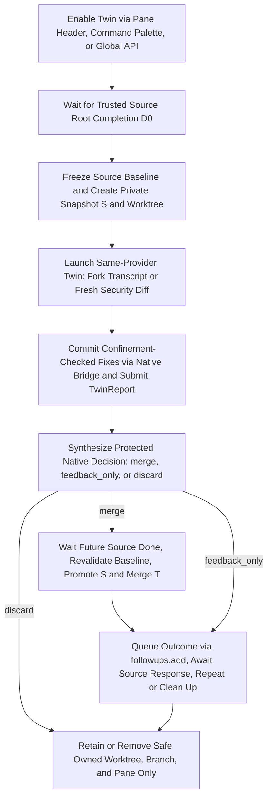

# Pessimistic Twin: Isolated Review, Confined Fixes, and Human-Gated Dirty Merge

> **Summary**: Pessimistic Twin delivers review, direct fixes, human-selected integration, feedback forwarding, and owned cleanup as one durable milestone across `code_review`, `security_review`, and `general_review`. It freezes a live Claude or Codex session at a trusted root completion, captures tracked and nonignored untracked files into a private snapshot commit without mutating the source checkout, and runs an isolated same-provider reviewer inside an owned Git worktree. Engineers must enforce strict native sandbox confinement, require explicit human native Decisions before merging, and complete the remaining integrated verification gates before claiming end-to-end qualification.

## Architecture

A provider conversation fork copies exact dialogue history into a new conversation ID, while a Git worktree supplies separate editable files on its own branch. Pessimistic Twin combines both so a reviewer inherits context and commits fixes without editing the active source checkout. Because dialogue and files must represent the exact same boundary, activation binds the live source session and waits for a trusted root completion (`D0`) before freezing the source transcript and working tree into private snapshot commit `S`.

`code_review` and `general_review` fork the verified source JSONL transcript (max 128 MiB, stable bytes) into a new conversation ID; `security_review` never reads or copies the source transcript, starting fresh with only the bounded snapshot diff (max 512 KiB). The twin edits only inside its worktree under restricted provider tools and a strict native inner shell sandbox, committing through the native `twins.commit` bridge with zero shared Git metadata write permission. After a valid `TwinReport` and trusted twin root completion, a protected native Decision card offers `merge`, `feedback_only`, or `discard`. Selecting `merge` waits for a distinct later source completion, revalidates that source `HEAD` `H`, real index hash, and working files match the captured baseline, advances `H` to `S` (`read-tree S` index-only without `-u`), and runs `git merge --no-ff --no-edit T` before queuing findings. `feedback_only` queues findings directly via `followups.add`, and `discard` proceeds directly to owned-only cleanup.

## Components and durable data

Because active exact resume may navigate to the existing source pane, the `TerminalRuntime` extension in `PessimisticTwinPaneRuntime.swift` reuses the shared `launch(cwd,agent,prompt,owned)` workspace path with explicit owned twin launch metadata and a reserved pane/generation ticket. `TwinCoordinator`, `PessimisticTwinWorker.swift`, and the `TerminalRuntime` extensions in `PessimisticTwinRuntime.swift` and `PessimisticTwinRuntimeGitWork.swift` drive the state machine across panes and Git worktrees alongside `TwinGitService`, `TwinLaunchPreparer`, `TwinProviderPlanner`, `TwinProviderProfile`, and `TwinProviderSandbox`.

`TwinStore` persists state in private `pessimistic-twins.json` (`schemaVersion` 1, max 1 MiB, up to 4 active and 20 total runs, 160 decision bindings, 160 forward receipts, and at most 8 rounds per run). Before running `snapshot`, `launch`, `publish_decision`, `merge`, `forward`, or `cleanup`, `TwinStore` records a typed durable operation intent; no long backend or Git work executes under the sidecar metadata lock. Per-round artifacts under `root/twins/<run>/round-N/` hold `launch-ticket.json` (outside the sibling provider profile, storing immutable source, generation, executable/args/env, and org proof; reserving `paneID` before create and pairing PID/birth once), snapshot plans/receipts, and the Git mutation journal.

`PessimisticTwinModels.swift` defines canonical schemas preserving compatibility provenance with external `ipagent` contracts (`PRD` `FR-001` / `FR-003` and `internal/ipagent/contracts.go` `AgentOutput`) without external import dependencies. Canonical `TwinReport` requires `status` (`working` or `no_further_improvement`), `rationale`, and normalized relative `changed_files` while preserving additional `AgentOutput` fields; full field and payload limits live in [PESSIMISTIC-TWIN-API.md](PESSIMISTIC-TWIN-API.md) .

## Behaviors per FR

### FR-TWIN-1: Source Eligibility, Binding, and UI Activation
- **Owning Components**: `TerminalRuntime` (`PessimisticTwinRuntime.swift`), `PessimisticTwinModels.swift`, `PessimisticTwinAPI.swift`, `PessimisticTwinControls.swift`, `StorePessimisticTwins.swift`.
- **Fulfillment & Failure**: Native `@MainActor` UI captures the unique active local managed launch generation, conversation, and working directory (`TwinSourceExpectation`) before async queuing in `StorePessimisticTwins.swift`. Inside its transaction, `enablePessimisticTwin` in `PessimisticTwinRuntime.swift` verifies `expectedSource` before context or coordinator work; missing or stale native captures fail without `nil` fallback. Global API calls keep current binding and unchanged defaults (`roundCap = 3`, `noopCap = 2`). Exact live provider, account, and process bindings remain required, with trusted source completion, input, tool, ordinary Decision/Queue, and quota guards enforced and `--last`, fallback, cross-provider, or twin-of-twin bindings rejected.
- **Unit Test Hooks**: `PessimisticTwinModelTests`, `PessimisticTwinAPITests`, `PessimisticTwinNativeButtonTests`, `PessimisticTwinPresentationTests`.

### FR-TWIN-2: Non-Mutating Dirty Snapshot and Owned Worktree
- **Owning Components**: `TwinGitService` (`PessimisticTwinGit.swift`), `PessimisticTwinGitNative.swift`, `TwinLaunchPreparer` (`PessimisticTwinLaunchPreparation.swift`).
- **Fulfillment & Failure**: Private alternate index (`hash-object --no-filters`, `update-index`, `write-tree`, `commit-tree`) captures tracked and nonignored untracked files (binary, Unicode, symlinks, deletions) into `S` across main or linked worktrees while keeping source files, real index, and `HEAD` byte-identical. Caps: 10,000 files, 128 MiB bytes, 8 MiB output, 512 KiB diff. Partial/unstable reads, unsafe filters, submodules, or nested repos visibly refuse.
- **Unit Test Hooks**: `PessimisticTwinGitTests`, `PessimisticTwinGitPathTests`, `PessimisticTwinGitPlumbingTests`, `PessimisticTwinLaunchPreparationTests`.

### FR-TWIN-3: Same-Provider Fork vs. Fresh Security Launch
- **Owning Components**: `TwinLaunchPreparer`, `TwinProviderPlanner`, `TwinProviderProfile` (`PessimisticTwinProvider.swift`), `TerminalRuntime` (`PessimisticTwinPaneRuntime.swift`).
- **Fulfillment & Failure**: `TwinLaunchPreparer` freezes `D0` before and after transcript copy and snapshot creation, enforcing exact source executable gates (`Claude 2.1.323`, `Codex 0.167.0`). `code_review` and `general_review` fork the same provider into a new ID; `security_review` starts fresh with diff-only input and no history. Preparation writes access-only OAuth files (`TwinAccessOnlyCredentials`) without refresh tokens or alternate auth, then `TerminalRuntime.validateTwinFrozenAuthentication` verifies the frozen source credential fingerprint, selected organization, and private profile SHA-256 before bootstrap and suspended-provider continuation in `PessimisticTwinPaneRuntime.swift`. Organization proof runs in the twin working directory. Lifetime cuts off 5 minutes before token expiry without refreshing source credentials. See [Private startup and lifetime](PESSIMISTIC-TWIN-API.md#private-startup-and-lifetime) for limits.
- **Unit Test Hooks**: `PessimisticTwinProviderTests`, `PessimisticTwinProfileTests`, `PessimisticTwinLaunchFileTests`, `PessimisticTwinInvocationInputTests`, `PessimisticTwinRunCLITests`.

### FR-TWIN-4: Native Confinement and Scoped Commit Bridge
- **Owning Components**: `TwinProviderPlanner`, `TwinProviderSandbox` (`PessimisticTwinSandbox.swift`), `PessimisticTwinAPI.swift`, `PessimisticTwinBridgeCLI.swift`.
- **Fulfillment & Failure**: The architecture combines restricted provider tools, strict native inner shell sandboxing, and scoped IPC with native `twins.commit`, avoiding outer wrapper sandboxes that fail with nested `EPERM`. Launch disables MCP, plugins, apps, browser, and new project or skill instructions without bypass flags; inherited dialogue history in `code_review` or `general_review` modes may still contain prior instructions. Before launch and native commit, alias admission (`TwinFileAliasAdmission` and `PessimisticTwinAPI.swift`) inventories canonical owned worktree and private temporary roots, treating symlinks as opaque and rejecting hardlinks or alias changes; this snapshot check is not continuous external-writer protection. Native `FR-SUP-4` human decisions remain required, with no reviewer writes to shared Git.
- **Unit Test Hooks**: `PessimisticTwinProviderTests`, `PessimisticTwinSandboxTests`, `PessimisticTwinNativeFileTests`, `PessimisticTwinBridgeCLITests`.

### FR-TWIN-5: Hook Admission, Canonical Report, and Worktree Hygiene
- **Owning Components**: `TwinHookAdmission` (`PessimisticTwinHookAdmission.swift`), `TranoSandboxBridge.c`, `PessimisticTwinModels.swift`, `TwinCoordinator`, `TwinGitService`, `TerminalRuntime` (`PessimisticTwinRuntimeGitWork.swift`).
- **Fulfillment & Failure**: Reviewer kernel hook caller admission rechecks the exact helper executable, wrapper ancestry, process birth, and private file witness without performing actual kernel writes; subsequent report and Git verification in `PessimisticTwinRuntimeGitWork.swift` and `PessimisticTwinModels.swift` then checks exact turn completion, clean descendant tip ancestry, and committed path equality. `no_further_improvement` requires an empty `changed_files` list alongside zero committed path changes; invalid or mismatched output is rejected without merge. These guards passed the recorded unit acceptance; authenticated runtime qualification remains pending.
- **Unit Test Hooks**: `PessimisticTwinHookAdmissionTests`, `PessimisticTwinModelTests`, `PessimisticTwinGitTests`, `PessimisticTwinLifecycleTests`, `PessimisticTwinRuntimeGitWorkTests`.

### FR-TWIN-6: Protected Native Human Decision Gate
- **Owning Components**: `TwinCoordinator`, `TwinStore`, `PessimisticTwinAPI.swift`.
- **Fulfillment & Failure**: Synthesizes a protected native Decision card from the canonical sidecar bound to `run`, `round`, source `generation`, `snapshotOID`, and `twinTipOID` with human choices `merge`, `feedback_only`, or `discard`. Cards survive reviewer exit and older `RuntimeState` writers without blocking source `Stop`. Reviewer only gates its own operational questions; generic agent resolve/poll/abandon, self-approval, stale choices, or nonexistent `twins.resolve` calls are rejected.
- **Unit Test Hooks**: `PessimisticTwinDecisionGuardTests`, `PessimisticTwinAPITests`, `PessimisticTwinSourceIdleTests`.

### FR-TWIN-7: Revalidated Dirty-Baseline Promotion and Non-Fast-Forward Merge
- **Owning Components**: `TwinGitService`, `TerminalRuntime` (`PessimisticTwinRuntimeGitWork.swift`), `TwinCoordinator`.
- **Fulfillment & Failure**: `merge` waits for a distinct later source completion after choice and `D0` (with idle/input/queue/decision/quota guards). Preflight runs outside the metadata lock; commit serializes with runtime admission. If source `H`, real index hash, and working files match baseline, durable intent CAS-updates `H` to `S`, runs `read-tree S` (without `-u`), and runs `git merge --no-ff --no-edit T`. Diverged sources enter `needs_review` without stash/reset/force; conflicts remain for human resolution.
- **Unit Test Hooks**: `PessimisticTwinGitTests`, `PessimisticTwinLifecycleTests`, `PessimisticTwinInvocationInputTests`.

### FR-TWIN-8: Idempotent Queued Feedback, Source Response, and Loop Bounds
- **Owning Components**: `TwinCoordinator`, `TwinStore`, `PessimisticTwinAPI.swift`, `PessimisticTwinBridgeCLI.swift`.
- **Fulfillment & Failure**: Queues one item after trusted done via `followups.add` (`FR-QUEUE-2`) using key `twin:<runID>:<round>` and `forwardedID` receipt without weakening Queue guards. Delivers outcome plus `trano twin respond RUN_ID --round N` (JSON on `stdin`). Only exact original peer responds after delivery; next round requires later trusted done. Caps `roundCap` 3, `noopCap` 2 (`1...8`); exits: `agent_agreement`, `noop_cap`, `round_cap`, `user_interrupt`, `agent_unavailable`, `invalid_agent_output`.
- **Unit Test Hooks**: `PessimisticTwinCoordinatorTests`, `PessimisticTwinStoreTests`, `PessimisticTwinReservationTests`, `PessimisticTwinSourceIdleTests`.

### FR-TWIN-9: Crash-Safe Intent Journaling and Owned-Only Cleanup
- **Owning Components**: `TwinStore`, `TerminalRuntime` (`PessimisticTwinRuntimeGitWork.swift`, `PessimisticTwinRuntime.swift`), `TwinGitService`.
- **Fulfillment & Failure**: Durable intents and reservations prevent blind replay across restarts. Asynchronous retirement (`TwinProviderRetirement` and `PessimisticTwinPaneRuntime.swift`) verifies exact owned provider identity, journals `SIGTERM` once, waits for exit receipt outside blocking metadata locks, and sends `SIGKILL` once after 5 seconds if still running. Only after pane/backend retirement, with no live state users and after `TwinProfileProcessUse` verifies no other same-UID process holds a CWD or open descriptor inside the profile (exempting cleanup's own held descriptors, while unknown or busy inspection holds), does `TwinPrivateProfileCleanup` delete the private per-round copied auth, transcript, and config profile after exact owned path and marker checks, before Git cleanup in `PessimisticTwinRuntimeGitWork.swift`. Ignored outputs move intact into durable `artifacts` quarantine (preserving raw bytes, empty directories, and opaque symlinks) and are never automatically deleted; partial moves are retained. Clean owned worktree and branch removal remains non-force and exact-tip, while unsafe, dirty, active, conflicted, or uncertain resources retain diagnostics without deleting source credentials, source worktrees, or user assets.
- **Unit Test Hooks**: `PessimisticTwinGitPathTests`, `PessimisticTwinStoreTests`, `PessimisticTwinReservationTests`.

### FR-TWIN-10: Runtime Gates and Live-Session Preservation
- **Owning Components**: `TwinProviderPlanner`, `TwinProviderSandbox`, `PessimisticTwinBridgeCLI.swift`.
- **Fulfillment & Failure**: Enforces strict provider executable/version, sandbox profile, and launch-ticket gates at runtime, failing closed on mismatch. `snapshot-preflight.json` is a development evidence receipt and is never emitted or required at runtime. Final milestone acceptance requires build, sign, and install preserving live shell PIDs, layout, and settings.
- **Unit Test Hooks**: `PessimisticTwinGitPlumbingTests`, `PessimisticTwinRuntimeGateTests`, `PessimisticTwinSandboxTests`, `PessimisticTwinRunCLITests`.

## Qualification gates

Current source guards for access-only authentication, organization pinning, profile digests, strict no-op validation, disabled new skill/project instructions, one-time restricted startup acknowledgement, alias admission, artifact quarantine, asynchronous retirement, and private profile cleanup are implemented with the unit and installation receipts below; authenticated runtime qualification remains pending.

`.local/pessimistic-twin/snapshot-preflight.json` is a development proof artifact only and is not a runtime qualification gate. The latest aggregate run recorded in `.local/pessimistic-twin/unit-receipt.json` (`passed`, from the same `final-unit-green.log` invocation) passed 1364 product unit tests (`TranoCLITests.xctest` 38/0, `TerminalUITests.xctest` 474/0, `TerminalCoreTests.xctest` 826/0, Swift Testing 26/0) with 0 failures, including 299 Pessimistic Twin tests as a subset, while `.local/pessimistic-twin/packaging-unit.log` separately passed 45/0 packaging tests.

| Recorded gate | Result |
|---|---|
| Local build, Apple Development signature, installation | passed; `.local/pessimistic-twin/installed-receipt.json` |
| Live session continuity | 26 shell PIDs preserved; layout and settings unchanged |
| Installed identity | 123 built/installed file hashes matched; running executable and helper API identity verified |
| Authenticated provider/fork/hook, PTY and physical GUI/E2E verification | paused by user; no Twin fork started during verification |

- **Sandbox and provider runtime**: Native Codex generated-policy checks and installed Anthropic `sandbox-runtime 0.0.37` primitive proofs do not qualify embedded `Claude 2.1.323`, authenticated fork identity, or live provider hook execution.
- **Original-source hook trust**: The original source conversation still relies on its existing trusted hook pipeline; Twin C-helper admission authenticates Twin reviewer hooks only, not original source hook callers.
- **External filesystem writers**: Runtime locks serialize participating Trano operations, not external editors or host processes. Pre-launch, pre-commit, and cleanup process-use rechecks detect and refuse observed divergence, rather than providing global atomic filesystem isolation.

## References

- **Specifications & Plans**: [PESSIMISTIC-TWIN.md](PESSIMISTIC-TWIN.md) , [PESSIMISTIC-TWIN-SRS.md](PESSIMISTIC-TWIN-SRS.md) , [PESSIMISTIC-TWIN-API.md](PESSIMISTIC-TWIN-API.md) , [PESSIMISTIC-TWIN-TESTS.md](PESSIMISTIC-TWIN-TESTS.md) , [RESUME.md](RESUME.md) , [SUPERVISOR.md](SUPERVISOR.md) , [FOLLOW-UPS.md](FOLLOW-UPS.md)
- **Coordinator, Store & Runtimes**: [PessimisticTwinCoordinator.swift](../Sources/TerminalCore/PessimisticTwinCoordinator.swift) , [PessimisticTwinWorker.swift](../Sources/TerminalCore/PessimisticTwinWorker.swift) , [PessimisticTwinRuntime.swift](../Sources/TerminalCore/PessimisticTwinRuntime.swift) , [PessimisticTwinPaneRuntime.swift](../Sources/TerminalCore/PessimisticTwinPaneRuntime.swift) , [PessimisticTwinModels.swift](../Sources/TerminalCore/PessimisticTwinModels.swift) , [PessimisticTwinStore.swift](../Sources/TerminalCore/PessimisticTwinStore.swift)
- **Git, Launch & Sandbox**: [PessimisticTwinGit.swift](../Sources/TerminalCore/PessimisticTwinGit.swift) , [PessimisticTwinGitNative.swift](../Sources/TerminalCore/PessimisticTwinGitNative.swift) , [PessimisticTwinRuntimeGitWork.swift](../Sources/TerminalCore/PessimisticTwinRuntimeGitWork.swift) , [PessimisticTwinLaunchPreparation.swift](../Sources/TerminalCore/PessimisticTwinLaunchPreparation.swift) , [PessimisticTwinProvider.swift](../Sources/TerminalCore/PessimisticTwinProvider.swift) , [PessimisticTwinSandbox.swift](../Sources/TerminalCore/PessimisticTwinSandbox.swift)
- **API, Hook Bridge, CLI & UI**: [PessimisticTwinAPI.swift](../Sources/TerminalCore/PessimisticTwinAPI.swift) , [PessimisticTwinHookAdmission.swift](../Sources/TerminalCore/PessimisticTwinHookAdmission.swift) , [TranoSandboxBridge.c](../Sources/TranoSandboxBridge/TranoSandboxBridge.c) , [PessimisticTwinBridgeCLI.swift](../Sources/TranoCLI/PessimisticTwinBridgeCLI.swift) , [PessimisticTwinControls.swift](../Sources/TranoApp/PessimisticTwinControls.swift) , [StorePessimisticTwins.swift](../Sources/TranoApp/StorePessimisticTwins.swift)

- Core startup, authentication, and isolation guards: [PessimisticTwinSourceExpectation.swift](../Sources/TerminalCore/PessimisticTwinSourceExpectation.swift) , [PessimisticTwinAuthentication.swift](../Sources/TerminalCore/PessimisticTwinAuthentication.swift) , [PessimisticTwinSourceEnvironment.swift](../Sources/TerminalCore/PessimisticTwinSourceEnvironment.swift) , [PessimisticTwinRestrictedStartup.swift](../Sources/TerminalCore/PessimisticTwinRestrictedStartup.swift) , [PessimisticTwinFileAliasAdmission.swift](../Sources/TerminalCore/PessimisticTwinFileAliasAdmission.swift)
- Artifact quarantine, retirement, profile cleanup, and UI controls: [PessimisticTwinArtifacts.swift](../Sources/TerminalCore/PessimisticTwinArtifacts.swift) , [PessimisticTwinArtifactsNative.swift](../Sources/TerminalCore/PessimisticTwinArtifactsNative.swift) , [PessimisticTwinRetirement.swift](../Sources/TerminalCore/PessimisticTwinRetirement.swift) , [PessimisticTwinProfileCleanup.swift](../Sources/TerminalCore/PessimisticTwinProfileCleanup.swift) , [PessimisticTwinProfileProcessUse.swift](../Sources/TerminalCore/PessimisticTwinProfileProcessUse.swift) , [StorePessimisticTwins.swift](../Sources/TranoApp/StorePessimisticTwins.swift) , [PessimisticTwinControls.swift](../Sources/TranoApp/PessimisticTwinControls.swift)
