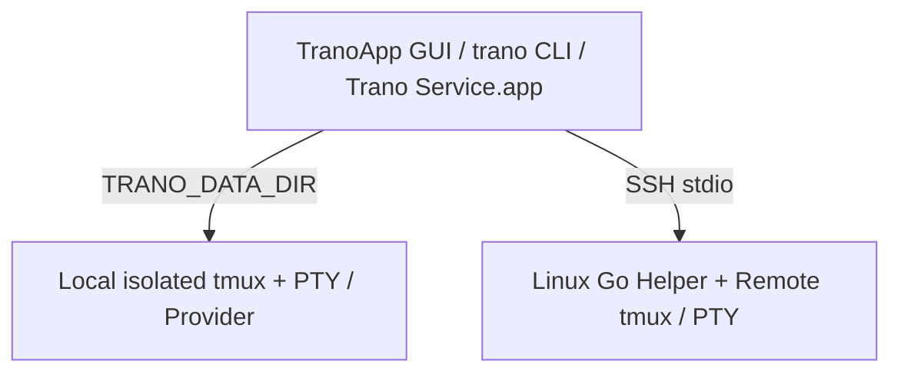

# Trano Engineering Progress

## Customize View toolbar icons share native symbol styling — 2026-11-20

| Evidence | Result |
| --- | --- |
| Repair | Shared 14pt Regular monochrome SF Symbols and 24pt buttons; outline terminal; proportional decision bubble; reset-ticket symbol uses the same configuration |
| Focused verification | 13 existing units passed, 0 failures: decision-count geometry, reset tickets, toolbar customization and visibility; horizontal/vertical toolbar coverage |
| Native capture | `.local/toolbar-icon-consistency/preview.png`; exact counts 0, 1, 12 and 512 fit; physical pointer/display qualification not claimed |
| Signed installation | Source/build/installed ID `174686ea2ca2d03b0818daaa0888f2ddf9dc7fb025d62a1074a5ff18315783e1`; 129 installed file hashes match; GUI PID 80975 and helper PID 81159 verified. Concurrent session completed the same bundle installation; this task did not independently record pre/post shell PIDs |
| Build limit | Initial shared-build link failed while another session changed input code; serialized rerun passed. Full product suite not run for this styling change |

## Native PTY host replaces local tmux; legacy panes migrate by resume — 2026-11-18

| Evidence | Result |
| --- | --- |
| Scope | Local panes run under `trano pty-host` (`Sources/TranoCLI/PtyHost.swift`) through `PaneBackend`/`PaneHostClient`; the app attaches with `trano pty-attach <id> --root <root>`. `TerminalRuntime` no longer requires tmux. Remote Linux helper still uses tmux (separate deliverable) |
| Migration (user decision) | App startup and `trano migrate-legacy` kill each legacy tmux session, confirm the session and process witnesses are gone, then run per-pane recovery: active Claude/Codex resume by provider session ID, other panes restart as shells in their recorded cwd. Non-agent foreground jobs do not survive |
| Host defects fixed | Per-request dispatch sources were released at once (ping hung); cancel handler swapped inside the event handler never applied, closing every request fd twice; exit source cancelled with the master so exited panes stayed alive and unreaped; wide-cell capture returned NUL |
| Crash fix | `MacLocalTerminalView` stored the input handler in `Locked<Function?>`; each inout access re-wrapped it, so handler and write-completion depth grew 2 levels per input event until release overflowed `com.apple.libdispatch-io.opq` (installed crash 2026-11-18 22:53). Boxed handler; `InputHandlerDepthTests` keeps depth flat over 2,000 events |
| Activity / tabs | Rex status names Blocked, Error, Done, Working, Idle and command `View Activity`; filter field with its own field editor (shared window field editor caused ownership leaks), guarded focus, Cmd+Up/Down while Cmd is still held after Cmd+.; tab close button visible only on tab hover |
| Real PTY experiments | `check-migration.py` (new, installed tmux CLI as legacy): same pane IDs, `--resume` with same conversation ID, cwd/layout kept, idempotent. `check-recovery.py` with host SIGKILL and `check-native.py`: OK |
| Units | Core 1184 run, 2 skipped, 2 failed; CLI 57/57; UI 925 run before the Activity/hint/opacity repairs. Remaining failures do not reach the host: `/bin/sleep` fixtures blocked by `closedShellSelection` (Navigation, HeaderContextMenu, FloatingPane, WorkspaceClose), DecisionReview pid-0 fixture, NativePaneDrag follow-up gating, InputTests replaced delegate, recorded ActivityGeometry sidebar |
| Limits | No pre-session baseline for the remaining failures (files already had uncommitted changes); physical IME/pointer qualification not claimed |

## Cmd+Shift+G opens the existing folder-to-new-tab action — 2026-11-17

| Evidence | Result |
| --- | --- |
| Scope / defect | Existing Go to Directory picker/new-tab path had no default shortcut;Cmd+Shift+G belonged to global Find Previous |
| Repair | Bind existing folder action;unbound conflicting global Find Previous default;retain its action/custom binding and explicit single/prefix priority;no new picker or API |
| RED / GREEN | 3 native tests,7 assertion failures before repair;24 focused units pass,0 failures after repair |
| Qualification | Native action directory-only request,configured menu/local NSOpenPanel settings,existing new-tab focus and key/sequence units;no physical chooser confirmation or real PTY/SSH E2E;pause retained |
| Signed installation | Apple Development `bc326bb0cc1e0c37598319c2a43a28f44844733995b2f24dfd772efe88a00d52`;68 shell PIDs,24 provider PIDs,layout/settings/4prefs preserved;129 bundle hashes match |
| Receipts | `.local/go-directory-shortcut/{unit-receipt,final-review,installed-receipt}.json`;global pending qualification retained |


## Activity immediately owns focus and handles native keyboard input — 2026-11-17

| Evidence | Result |
| --- | --- |
| Native RED | 3 tests,2 assertion failures: actual mounted firstResponder.keyDown Down did not move selection;NSApp.sendEvent plus counted monitor positive control passed |
| Native repair | Immediate makeFirstResponder when Activity mounts,guarded deferred fallback;Activity responder implements keyDown with shared Up/Down/Tab/Enter/Escape mapping |
| Safety RED / repair | 2 tests,8 assertion failures: old Escape fallback bypassed Settings/IME admission and declined keys fell through to underlying URL hints. Optional handler result distinguishes unrelated,yield,handled;obsolete Escape branch removed |
| Focused GREEN | 82 executed,79 passed,3 existing background SwiftUI padding skips,0 failures;no full-product or physical E2E claim |
| Native event scope | Real firstResponder.keyDown;nil-window native keys;NSApp.sendEvent with counted monitor;single row step;Enter exact split renderer and first fake bytes;Escape typing return;Settings,marked editor and URL hint safety |
| Signed installation | Apple Development `2017f0fc6b1e8df7d4a77d67e6b486bf820e73836f900e7b80a91431a5e5d0bb`;66 shell PIDs,22 provider PIDs,layout,settings and4preference files preserved;129 bundle hashes verified |
| Limits / outstanding | Physical/provider/PTY E2E paused;live user event.window and exact reported cause unobserved. General click failure remains under diagnosis `.local/live-click-stall/runtime-observations.json`;native PTY replacement remains planned |
| Receipts | `.local/activity-direct-focus/{unit-receipt,final-review,installed-receipt}.json`;prior monitor-only tests retained as historical scoped proof |


## Activity native keyboard focus and pane input ownership — 2026-11-17

| Evidence | Result |
| --- | --- |
| Activity RED | 3 inert native tests,7 assertion failures: mounted Activity retained a real search field editor;cached terminal restoration competed with panel focus |
| Activity repair | Native list first responder;deferred window/responder/overlay/IME validation;Activity blocks pending terminal restoration;native Close returns terminal focus |
| Exact navigation | Configured Cmd+. menu action,Up/Down/Tab selection,bounds,Enter to exact cross-workspace split renderer and native keyDown bytes;no started process/socket |
| Pointer repair | Keyboard-only NSEvent access gated by event type;actual native hit renderer receives logical/native focus and first byte;hidden/nonselected panes and higher editors/overlays excluded |
| Focused regression | 76 executed,73 passed,3 existing background SwiftUI padding skips,0 failures;no full-suite or physical/provider/PTY E2E claim |
| Signed installation | Apple Development `236375f231d1b475170ef09201d0cf122c1469fddfb3f8a1ee655b1ffe140e54`;66 live shell PIDs,23 provider PIDs,layout,settings and4preference files preserved;129 bundle hashes verified |
| Hangul scope | 2 inert native availability units pass across keyboard modes;OS selected-input-source behavior remains unqualified;no codec change |
| Receipts / remaining work | `.local/activity-owned-focus/{unit-receipt,final-review,installed-receipt}.json`;prior pointer RED/GREEN `.local/pane-click-focus/`;native PTY replacement remains planned;full-product partial status retained |


## Visible footer navigation, confirmed tab presentation and input contention repaired — 2026-11-17

| Evidence | Result |
| --- | --- |
| Footer defect | Add Remote Host was a separate button outside selectable entries; both visible footer actions now participate under empty/filtered queries,with native Enter opening Remote Hosts |
| Native RED | Footer4 assertions;ordinary/header presentation blocking2;state decode/cache5;confirmed title metadata presentation1. Padding failures excluded after harmless SwiftUI gesture control failed |
| GREEN | 121 passed,3 explicit background-SwiftUI skips,0 failures across124 units:40 native passed/3skipped,66core,15CLI |
| Read/observation repair | Copy coherent primary/continuity/organization bytes under own lock,decode afterward;retain explicit caller/action/input transactions. Release action locks before external presentation queries |
| Tab repair | Publish confirmed tab selection before unrelated metadata through existing IME/modal-aware apply;no optimistic mutation or input authority bypass |
| Retained processes | 19 provider supervisors keep old code until normal lifecycle;new unchanged-poll cache applies to subsequent launches. No provider or shell restart performed |
| Passive lock observation | Compiler-idle10s:67.80%→23.99% busy;max395.35→67.48ms;p95busy164.63→55.46ms. Uncontrolled workload and helper recovery/startup;not physical typing latency |
| Signed installation | Apple Development `9781412387325071b8b3e1f3d284becf89a5f29a5c53f2855a9c5c5ce745369f`;GUI77772/helper77767/API and129 bundle hashes match;65 shell PIDs,19 provider PIDs,layout,settings and4preference sidecars preserved |
| Helper recovery | Prior helper was absent before installation;`--ensure-service` recovered its API without stopping jobs. Exit cause unverified |
| Receipts / limits | `.local/remote-footer-and-input-latency/{unit-receipt,final-review,installed-receipt}.json` and diagnostics;physical/provider/PTY E2E paused;full-product partial status retained |


## Activity sessions first and close confirmation — 2026-11-18

| Evidence | Result |
| --- | --- |
| Live diagnosis | Installed Activity listed Pessimistic Twins and 7+ On Hold worktrees above sessions; list 1938px in a 370px viewport, so the selected session row was offscreen |
| Repair | Session sections render first; Twins/Worktrees follow; relative time alone uses `TimelineView`; selection scroll has no top anchor |
| Close confirmation | `CloseConfirmation` asks before closing panes/tabs whose agent is running, blocked, or done-unread; idle shells and read results close directly |
| Notifications | Focused pane in the active app suppresses banner and sound via `presence/gui.json`; blocked banner body uses the activity reason |
| Units | 5 `CloseConfirmationTests` passed; Activity 36/37 (known sidebar geometry failure); WorkspaceCloseUITests 20 and FloatingPane/HeaderContextMenu 11 failures reproduce with confirmation disabled; `TabTransferTests` drop test passes alone |
| Signed installation | Apple Development `ecd8902480d44061fa79479fc8bad5405cfbb282910632201b783ef2accce453`; GUI 76917/helper 76899; 61 live shell PIDs and layout preserved |
| Limits | Live keyboard Up/Down not pressed because the focused pane held a Claude permission prompt |

## Compact Rex-style Activity with visible keyboard selection — 2026-11-17

| Evidence | Result |
| --- | --- |
| Diagnosis | Isolated instance (`TRANO_DATA_DIR=/tmp/tr-act/root`, copied bundle id) logged `fr=ActivityKeyboardFocusView canFocus=true` and AX selection moved on Down; the 22% accent fill on 88pt rows made movement hard to see |
| Repair | 44pt rows: icon, one-line title, reason or workspace subtitle, relative time; strong accent fill+stroke selection; Blocked section first with red marker; Up/Down/Tab wrap at both ends |
| Units | 37 Activity units: 36 passed; `ActivityGeometryTests.testSessionsSidebarIsOptionalAndKeepsLayout` remains the previously recorded sidebar failure |
| Signed installation | Apple Development `a354bed8d4f21b13b2c994c8d3247803d3023b5217aade84ab8ede74504cc54f`; GUI 59510/helper 59489; 65 live shell PIDs and layout preserved |
| Receipts | `.local/activity-compact/{signed-build,install}.log` |

## Cmd+K session-picker arrows wrap at both ends — 2026-11-16

| Evidence | Result |
| --- | --- |
| Native RED | 2 native search-editor tests,19 failed assertions: first Up stayed at first entry and last Down stayed at last entry |
| Repair | Sessions-only circular selection; selectable New Session/Create entries remain reachable; empty results and other picker modes retain prior behavior |
| GREEN | 35 units passed:28 native,7 core; compact/full, filtered, single-entry, Korean literal order/no duplicates and IME controls; Activity and terminal-tab regressions retained |
| Existing test update | Korean-search last-Down assertion expected the former clamp; updated to first/last wrap while retaining no-duplicate/no-Create checks |
| Signed installation | Apple Development `ae5a9dd3800e9e8d309a88b677f7b0e415f030501b2f6f61841b696a1fe3ebb4`;GUI38875/helper38870/API and129 bundle hashes verified;65 live shell PIDs,layout,settings and4 preference sidecars preserved |
| Receipts / limits | `.local/workspace-picker-wrap/{unit-receipt,final-review,installed-receipt}.json`; physical keyboard/provider/PTY E2E remains paused |


## Activity owns Tab combinations for notification navigation — 2026-11-16

| Evidence | Result |
| --- | --- |
| Corrected scope | The request concerns Activity notification selection; previous terminal-tab repairs did not add Activity Tab handling |
| Native RED | 1 inert native test, 14 failed assertions: Tab combinations failed to move selection/highlight and Enter activated the unchanged row |
| Repair | Activity consumes Tab/Ctrl+Tab for next notification and Shift+Tab/Ctrl+Shift+Tab for previous notification before terminal handlers; existing arrows, Enter and editor/IME/modal/window guards retained |
| GREEN | 58 units passed: 51 native, 7 core; selected-row bounds, exact-pane Enter, protected editors/settings and ordinary terminal tab routing covered |
| Signed installation | Apple Development `ef579251d1a1659de1ba8fa4e7e44ebee79a14d0de2a8decb11ec2780450cfc5`; GUI21009/helper21004/API and129 bundle hashes verified;65 live shell PIDs, layout, settings and4 preference sidecars preserved |
| Receipts / limits | `.local/activity-tab-navigation/{unit-receipt,final-review,installed-receipt}.json`; physical keyboard/provider/PTY E2E remains paused; retained-editor speculation was not established as the cause and was not patched |


## Shift+Tab input and shared-terminal tab navigation repaired — 2026-11-16

| Evidence | Result |
| --- | --- |
| Native RED | 5 tests, 2 failed assertions: registered Unisession focus consumed Ctrl+Shift+Tab; legacy physical Shift+Tab with literal Tab characters sent plain Tab |
| Repair | Registered external owner whitelist for next/previous tab; legacy physical Shift+Tab sends ESC[Z through existing guarded user transport |
| GREEN | 57 units passed: 50 native, 7 core; ordinary navigation, Kitty encoding, IME/editor/settings and foreign renderer guards retained |
| Signed installation | Apple Development `8db7dd315555aa31f56a4a032a54fc5563a97241cff8719d9dcd6cd8f365679a`; GUI 93839/helper 93829/API and 129 bundle hashes verified; 67 live shell PIDs, layout, settings and 4 preference sidecars preserved |
| Receipts / limits | `.local/tab-shortcut-routing/{unit-receipt,final-review,installed-receipt}.json`; inert native post-controller routing and actual keyDown bytes qualified; full private controller and physical keyboard/provider/PTY E2E not run; no sole-cause claim for every intermittent case |

## Paste confirmation owns its initial Enter handling — 2026-11-16

The confirmation starts with a nonediting keyboard responder that maps plain Return and Keypad Enter to the native Paste action. The preview still owns newline and IME handling when explicitly focused,and Escape and deferred input guards are unchanged.

| Evidence | Result |
| --- | --- |
| Owned-responder RED |Native click succeeds;Return/keypad direct dispatch to the actual configured initial responder failed4 assertions before repair |
| GREEN |43 units passed:36 native,7 core;native modal action/response,edited bracketed bytes without terminal submission,editor newline,marked input,cancel and ownership guards |
| Focus correction |NSScrollView forwarded initial focus into its editor;owned becomeFirstResponder prevents forwarding |
| Signed installation |Apple Development `a36cebf2c8dfc8c64233a35e22e1555dddf754eae45913c99ca5426c2bd3333c`;GUI38383/helper38313/API and129 bundle hashes verified;67 live shell PIDs,layout,settings and4 preference sidecars preserved |
| Receipts / limits |`.local/paste-return-modal/{unit-receipt,final-review,installed-receipt}.json`;inactive background modal eventqueue probes excluded;physical OS keyboard E2E remains paused |


## Activity receives navigation before terminal interceptors — 2026-11-16

Activity plain Up/Down and Enter now route before shared-terminal and URL-hint handlers. Higher overlays,owning-window identity,IME/editor/modal protections,modifier handling and Enter-repeat behavior remain unchanged.

| Evidence | Result |
| --- | --- |
| RED |7 native tests;6 failures in competing native URL-hint test:selection stayed still and Enter opened a URL instead of its Activity pane |
| GREEN |79 units passed:68 native,11 core;actual Cmd+.opening with inert terminal,exact-pane Enter,guard coverage and typing-lock regressions |
| Visible selection |Native selected-row bounds and actual trailing-area pixel change passed with unread-blue-badge calibration;no palette or layout source change |
| Signed installation |Apple Development `ca7ecaadc93fe03f6ea9d6664227d5b64551383e97395f528f7842bebe5604ae`;GUI8864/helper8854/API and129 hashes verified;65 live shell PIDs,layout,settings and4 preference sidecars preserved |
| Scope / receipts |`.local/activity-keyboard-priority/{unit-receipt,final-review,installed-receipt}.json`;normal native opening/paint already passed before fix;competing-route ordering is the reproduced defect;physical keyboard E2E remains paused |


## Background discovery no longer holds the input transaction — 2026-11-16

Session and load-metric discovery now copy state before querying tmux or inspecting foreground processes. Periodic refresh uses each reconciler's own transaction;explicit action transactions and durable input ownership checks remain intact.

| Evidence | Result |
| --- | --- |
| Existing live lock |Busy32.85% of12s,max256.0ms;input delivery and completion wait for the same lock |
| Behavioral RED/GREEN |Blocked fake metadata caused4 input/cross-runtime failures;afterrepair all4 lock tests pass,including explicit-caller lock retention and durable prewrite reservation |
| Focused regression |124 passed:69 core,55 native;no real PTY/provider jobs or physical input E2E |
| Signed installation |Apple Development `1d4e3ba0a5b3c6552c4d7be77789cd24299b64f8acd625a7dd96d210d5ace395`;GUI79831/helper79756/API and129 hashes match;65 live shell PIDs,layout,settings and4 preference sidecars preserved |
| Receipts / limits |`.local/terminal-latency/lock-repair/{unit-receipt,final-review,installed-receipt}.json`;physical E2E paused;observations can age during discovery and final actions revalidate |


## Idle input no longer waits for a batch timer — 2026-11-16

The default relay dispatches asynchronously without a fixed coalescing delay. Single-flight delivery, explicit batching delays, bounded input, PID/generation authority and durable input guards remain in place.

| Evidence | Result |
| --- | --- |
| Isolated fake-writer dispatch |24 sequential packets;mean10.681ms before,0.058ms after;not physical keyboard-to-render or provider timing |
| Unit gate |111 passed:56 core,55 native;includes partial-write cancellation,slow writer,batch authority,IME and pointer regressions |
| Scope decision |Native paint fixtures failed calibration;render candidate deferred with unchanged production render files;`.local/terminal-latency/render-audit.json` |
| Signed installation |Apple Development `e2bd921cd7978e710c492317fcd3e28754c1ece61409a4c82ea792f3db15de4f`;129 bundle hashes,GUI/helper/API identity verified;65 live shell PIDs,layout,settings and4 preference sidecars preserved |
| Receipts / limits |`.local/terminal-latency/{unit-receipt,final-review,installed-receipt}.json`;physical/provider/PTY E2E paused;no full-product or whole-interaction latency claim |


## Hangul commit-to-echo anchoring — 2026-11-16

**Outcome:** A view-local bounded per-grapheme commit ledger anchors consecutive Hangul composition (commit `여`, next preedit `ㅈ` before echo) without changing terminal buffers or ordinary plain commit input bytes, while attributed commits now correctly emit their string UTF8. Overlay, occlusion, and candidate geometry share the predicted anchor, using view-only presentation scroll and CG offset invalidation on full-viewport wraps. Native CG captures confirm `136` preedit ink pixels remain unchanged while `267` pixels change only inside echoed glyph bounds.

**Limit:** Partial scrolling-region bottom wrapping defers ambiguous projection until actual cursor output to preserve fixed footers. Actual physical OS IME/provider/PTY E2E remains paused, without claiming universal VT/TUI layout prediction.

| Evidence | Result |
| --- | --- |
| Focused native units |74 passed,0 failed;32 IME and42 related cursor/pixel/transparency/key/pointer units;`.local/hangul-commit-echo/unit-receipt.json` |
| Regression proof |Before-echo:2 tests/12 RED assertions;virtual-scroll pointer:1 test/12 RED assertions;native CG pixel receipt and two independent scoped reviews |
| Signed local installation |Apple Development build `d823ea598b27871b2db7cb96ce427de4e719f9fc68765942a46fda74db38a2d4`;129 bundle hashes and GUI/helper/API identity verified;65 live shell PIDs,layout,settings and4 preference sidecars preserved |
| Installed receipt |`.local/hangul-commit-echo/installed-receipt.json` |
| Qualification |Physical OS IME/provider/PTY E2E remains paused;full product suite not rerun |


## Native interaction and close-history repairs — 2026-11-16

This update repairs native macOS notifications, tab layout, link handling, selection copying, scrolling, input shortcuts, and close-history persistence.

- Removed in-window notification policy, producer, and overlay; enabled notifications use macOS foreground/background while retaining user toggles, sound, and Dock.
- Compressed tabs with count and truncated titles while retaining separate close and drag targets.
- Resolved Cmd-click local paths against pane cwd, normalized line annotations, decoded UTF8 OSC8 targets, and kept URL/remote boundaries.
- Routed Cmd-C to the registered selection owner, preserved selection on subcell resize, copied coding-agent drags, and kept k9s passthrough.
- Updated scrolling hit-testing to use correct superview coordinates and exclude control overlays.
- Sent ESC CR for legacy Claude/Codex ShiftEnter while retaining ordinary Enter, shell, Kitty, and IME paths without touching tmux.
- Stored zsh/bash nonUTF8 CmdW history bytes losslessly while retaining fish UTF8 and all byte, entry, NUL, and private-file guards.

| Evidence | Result |
| --- | --- |
| Focused units | 180 passed;90 native,90 core;`.local/native-interaction-batch/unit-receipt.json` |
| Signed installation | Apple Development build `5e1eeab11d7f7747c0aa78878a916ce2fa7d80f42b94615fb271a937014ad85b`;129 hashes;GUI/helper/API verified;65 live shell PIDs/layout/settings and4 sidecars preserved |
| Installed receipt | `.local/native-interaction-batch/installed-receipt.json`;macOS notification authorization=`authorized` |
| Regression proofs | File/notification/tab/pointer RED;native key bytes;zsh/bash byte-preserving close/reopen;private pasteboard and balanced mouse reports |
| Qualification | Physical GUI/provider/PTY/SSH/OS-notification E2E remains paused;no real jobs started for tests |

## Titlebar double-click maximize — 2026-11-16

Double-clicking the custom main-window blank titlebar or floating-pane header now triggers native maximize/restore via `NSWindow.performZoom(nil)`, while preserving single-click `performDrag`, main-window control-click context-menu precedence, and tab/pane dragging.

| Evidence | Result |
| :--- | :--- |
| `.local/titlebar-double-click/unit-receipt.json` | 6 native unit tests passed after 5 expected RED assertion failures; verified native action dispatch via window spy, blank-header hit target, control alignment, and ARC window ownership. |
| Physical E2E | Physical double-click E2E remains paused. |
| Signed installation | Apple Development build `1502ecb2b57dc875615a5b9ef924efa7501918c64a327585a8dcb8100a5391c8`;129 hashes;GUI/helper/API verified;64 live shell PIDs/layout/settings and4 preference sidecars preserved;`.local/titlebar-double-click/installed-receipt.json` |

## Activity keyboard navigation — 2026-11-16

`Cmd+.` opens the existing Activity where `Up`/`Down` follows displayed sections, clamps endpoints, highlights and scrolls the selected row, preserves stable pane ID selection through reorder with removal fallback, and `Enter`/keypad `Enter` dismisses Activity to read the selected event through existing receipts and use existing exact-pane attach across workspace/tab/split. Empty list consumes arrows/`Enter` while protecting editor, IME marked text, settings/sheets, and another window.

| Verification | Result |
| --- | --- |
| Focused unit gate | 26 passed;21 native,5 core;4 expected RED assertions |
| Wider regression | 35 passed,1 unresolved sidebar geometry assertion;see `.local/activity-keyboard/final-green.log` |
| Signed local installation | 40c6b036b2861005d5da3a7f1594ab9430380959e59ec052c7677f78248f94f4;129 hashes verified;63 live shell PIDs/layout/settings and4 preference sidecars preserved |
| Receipts | `.local/activity-keyboard/{unit-receipt,installed-receipt}.json` |
| Qualification | Physical/provider/PTY E2E paused;no full regression pass claimed |

## Closed Terminal Capture and Reopen Verified — 2026-11-16

Explicit Cmd+W/pane/tab/close-others captures saved split topology, cwd, sanitized screen/scrollback, original shell, and available native history across all targets before terminating target processes. Cmd+Shift+T reopens a fresh same-kind shell and resumes the exact Claude/Codex conversation with saved account/org. An independent close ledger survives legacy writers, retry retains original witnesses, successful fresh shells, and exact remote tokens while rejecting stale monitor callbacks bound to old PID, and reopened unreferenced archives are pruned without marking live shells retired.

| Evidence | Result |
| --- | --- |
| Automated tests & review | 116 Swift units passed (92 core/20 native/4 CLI), 44 fake/pure Go race tests passed, Claude rival accepted. |
| Receipts | `.local/closed-terminal-state/{unit-receipt,installed-receipt}.json` and `.findings/final.md` |
| Installed binary `/Applications/Trano.app` | Apple Development signed build `8a3bf2453d1e2a3144d7a08dd81dfc766af39e890180b513afa04c327e2f0909` (129 bundle file hashes checked); GUI/helper restarted with matching API build; `--ensure-service` restored initially unavailable helper API (cause not established); 63 live shell PIDs, layout/settings, and 4 preference sidecars preserved. |
| Scope & limits | Legacy live shells without hooks recover on-disk history only; remote helpers packaged, not deployed/live-tested; user-paused real PTY/provider/SSH/GUI E2E unrun; whole-product qualification partial; no commits/pushes/dependency changes. |

## Native CG Hangul Preedit Overlap Fixed — 2026-11-16

Transparent Hangul preedit overlap on the native CG component before the next frame tick happened because the old snapshot context painted stale terminal ink under new preedit and composition-only mask changes did not schedule a repaint. The repair uses current occlusion on immediate CG drawing and marks mask changes as appearance changes, without `selectedRange`/input-byte/terminal-buffer or predictive-echo changes.

| Evidence | Result |
| --- | --- |
| Pixel diff & assertions | 3 new tests first failed 5 assertions; immediate-vs-next native composites differed 244 RGBA pixels before and 0 after; adjacent glyph visible-ink count 273 unchanged. |
| Unit tests & review | 48 native units passed (immediate render, delayed echo CG/Metal, underlines, cursor, transparency); independent `rendering_review` found no blockers. |
| Receipts | `.local/hangul-preedit-anchor/{unit-receipt,pixel-receipt,installed-receipt}.json` |
| Installed binary `/Applications/Trano.app` | Apple Development signed build `8a3bf2453d1e2a3144d7a08dd81dfc766af39e890180b513afa04c327e2f0909` (129 bundle file hashes checked); `--ensure-service` restored initially unavailable helper API (cause not established) with matching API build; 63 live shell PIDs, layout/settings, and 4 preference sidecars preserved. |
| Scope & limits | Physical OS IME E2E paused (no live OS qualification); whole-product qualification partial; no commits/pushes/dependency changes. |

## Running sessions no longer show notification dots — 2026-11-16

Running panes no longer contribute tab or sidebar dots, including old settings that enabled them. Completion and attention indicators from other panes remain visible, and the Working Tab checkbox is removed.

| Evidence | Result |
|---|---|
| Reproduction | Five expected assertions failed before repair: running projection, mixed-tab priority, defaults and delivery effects |
| Units | 55 passed:32 core and23 native; legacy settings, transitions, mixed panes, read receipts, independent banner/sound channels and settings layout |
| Review | Shared projection covers horizontal tabs/sidebar; workspace picker and Activity already exclude running; no job/read-receipt/preferences mutation |
| Installation | Apple Development build `f9659fd4c3f2252f3f1d9efb7524b358c0b8249abdab7abed91af8caa7d92ec8`;62 live shell PIDs, layout/settings and4 preference sidecars preserved; GUI/helper/API identity and129 installed file hashes verified |
| Receipts / limits | `.local/running-session-dots/{unit-receipt,final-review,installed-receipt}.json`; physical E2E remains paused |


## Hangul composition selection — 2026-11-16

Composing selection now shares the local UTF-16 coordinates used by marked text and substring queries. Rendering remains unchanged; physical overlap causality remains unverified under the E2E pause.

| Evidence | Result |
|---|---|
| Reproduction | Nine selection/substr assertions failed before repair; native range contract corrected |
| Units | 34 passed; consecutive syllables, immediate/delayed echo, prefix RGBA, cached native glyphs, underlines, transparency, UTF-8 and tab/split focus |
| Captures | Retained and fresh glyph pixels match at1×/2× capture resolution; actual backing scale2× |
| Rejected approaches | Direct clearing erased prefix ink; explicit layer changed metrics; both reverted. Direct-draw and double-scaled capture evidence excluded; `evidence-index.json` records reasons |
| Installation | Apple Development build `72b910001481888906ba983e28cd293f7c30f2f90a4c47a2d56135f1342ab06f`;62 live shell PIDs, exact layout/settings and4 preference sidecars preserved; running GUI/helper/API identity and129 installed file hashes verified |
| Receipts / limits | `.local/hangul-syllable-transition/{unit-receipt,final-review,installed-receipt}.json`; physical OS IME/PTY/provider E2E remains paused |

## Split shortcuts retain native keyboard focus — 2026-11-16

Split focus now survives native renderer reparenting in the original window and yields to newer pane selections or editor input.

| Evidence | Result |
|---|---|
| Reproduction | Basic mounted shortcuts passed before the change; native reparenting lost focus on both axes in `.local/split-pane-focus/reparent-red.log` |
| Units | 34 passed;8 split tests cover native ⌘D/⌘⇧D with a fake mux, repeated splits, reparenting, first typed bytes and focus isolation |
| Review | Window-bound one-shot return; no timers, process lifecycle changes or settings changes |
| Installation | Apple Development build `a03a2bb2f4e4fdc9a8531ff1afea27302b768e687262e3dac5ff6ba30d54627d` installed;60 live shell PIDs, exact layout/settings and4 preference sidecars preserved; GUI/helper/API identity and129 installed file hashes verified |
| Limits | Native components and fake transport only; physical keyboard/PTY/provider E2E remains paused |

## New Tab focuses the mounted terminal — 2026-11-16

New Tab now retains the selected pane's focus request until its native terminal joins the window, then consumes it once so typing needs no click. Later selection changes, settings, IME and terminal search editing retain their input ownership.

| Evidence | Result |
|---|---|
| Reproduction | Both delayed view creation and delayed window attachment left the old responder selected before the fix; `.local/new-tab-focus/red-behavior.log` |
| Units | 26 passed, including5 focus units with the actual native first responder and first typed `a` captured at the process-input boundary; no jobs started |
| Review | Existing input protections retained; no timers, settings, new input queues or backend lifecycle changes |
| Installation | Apple Development build `1645abdd7d246c4f942b52540625a78b485aef909583cdcf45041bdd34e426c7` installed;59 live shell PIDs, exact layout/settings and4 preference sidecars preserved; GUI/helper/API identity and129 installed file hashes verified |
| Receipts / limits | `.local/new-tab-focus/{unit-receipt,source-manifest,final-review}.json`; physical keyboard/provider/PTY E2E remains paused |

## Workspace entry clears unread activity — 2026-11-16

Entering or explicitly reselecting a workspace now records its captured unread events across every tab and split pane. The workspace picker and Activity use the same durable read receipts; running status alone no longer keeps the workspace dot lit.

| Evidence | Result |
|---|---|
| Reproduction | Missing workspace-entry receipts and persistent blocked/error/running picker dots reproduced in `.local/workspace-read-receipts/red-behavior.log` |
| Units | 45 passed: 16 native component and29 core units, including workspace selection, reselection, keyboard cycle, captured navigation, newer-event races, unrelated workspace isolation and old-schema continuity |
| Scope | No session, process, workflow status, layout or settings changes; passive same-workspace refresh preserves new unread events |
| Installation | Apple Development build `34515380e980cb64fdc8a07dc2688d6025a33714249955da31ec03ec84ca63e9` installed;58 live shell PIDs, exact layout/settings and4 preference sidecars preserved; GUI/helper/API identity and129 installed file hashes verified |
| Receipts / limits | `.local/workspace-read-receipts/{unit-receipt,source-manifest,final-review}.json`; physical/provider/PTY/SSH E2E remains paused |

## Text rendering and menu-bar mark — 2026-11-16

Smoothed CoreGraphics text now uses neutral glyph coverage before tinting, preserving red text strokes and the requested RGB without changing font, theme or opacity settings. Transparent IME preedit hides only covered terminal ink through the shared CG/Metal text builder, preserves cell backgrounds and underlines, and restores ink after commit, cancel or empty preedit, including double-width and double-height rows. The menu bar reuses the Dock snake wordmark as a cached white template vector with its eye cutout and no background tile; server status remains in the menu and tooltip.

| Evidence | Result |
|---|---|
| Raster regression | Smoothed red/white alpha ratio was0.856 at1× and0.947 at2×; now1.0 with matching solid pixels. Menlo/Meslo14, smoothing on/off, requested RGB verified |
| IME regression | Full-row background repaint reproduced before repair; transparent unused row pixels and original buffer/background preservation verified afterward |
| Units | 47 focused native units and49 packaging units passed; `.local/text-rendering/unit-receipt.json` |
| Review | Independent read-only review identified doubled-row mask coordinates; fixed and covered by normal/doubled row cases |
| Icon | Actual1×/2× white ink/transparent background and8× shape capture inspected |
| Limits | Physical OS IME/compositor/provider/PTY/SSH E2E remains paused; per-run smoothing group cost has not been benchmarked |
| Installation | Apple Development build `f09009a24b5a6893d25e797fc28e5e02fa9248235bc035dd2c1a77aceaa85482` installed;55 live shell PIDs, layout/settings and preference sidecars preserved;129 file hashes verified; helper logo and status registration verified |


Stable Swift environment forwarding excludes agent variables/credentials while retaining explicit toolchain, locale and test capture inputs. Same-source release builds measured148.61s for the first sanitized build,2.71s warm, and2.58s from a separate tool invocation with plugin-cache timestamps unchanged; the latter two qualify cache reuse, not full rebuild speed. The native `--skip-build` command completed in8.36s (47 tests themselves2.14s), and warm signed packaging completed in14.81s. Evidence: `.local/text-rendering/build-speed.json`; source/API references, review and helper resources are now checked before compilation.

## Session search, shell icons and Dock badges — 2026-11-16

Cmd+K now excludes closed workspaces before empty, literal, or keyboard-corrected matching, preserving original query/name and explicit recovery. A session-only marked-text preview filters the entire visible editor string without replacing or committing native preedit, keeping Up/Down/Enter with the IME during composition. Previously, the native search editor skipped updates during Hangul marked text: committed 개 was searched as ro while displayed 개ㅛ meant roy, matching proxysql. Now roy or 개ㅛ matches roy and project-roy-dev, not proxysql or r-o-y. A native component fixture reproduced the bug across compact/full pickers with four assertion failures, while the pure contiguous matcher passed unchanged.

Normal shell/zsh share the native dark rounded terminal tile and green prompt with explicit tint and compact size intact. The empty Workspace was closed via API preserving 44 live shell PIDs, prior selection, tabs, and settings. badgeDockIcon was enabled via API baseline merge alongside active done/blocked/error channels without global default changes.

67 targeted product units (31 native/presentation, 36 core; three native regression tests failed before repairs) and 45 packaging units passed with zero failures (.local/closed-session-search/unit-receipt.json). Physical Dock/UI/IME/provider/PTY/SSH E2E remains paused.

| Installation evidence | Verified result |
|---|---|
| Signed build | `1c1ae3961a9ecdf27e785899937161360e2975c5c273cd5a36e66577e999b2ce`; Apple Development; `/Applications/Trano.app` |
| Continuity | 48 live shell PIDs, exact layout and settings preserved |
| Identity | Running GUI/helper/API verified; 123 installed file hashes match |
| Receipt | `.local/closed-session-search/installed-receipt.json` |

## Session picker and empty-session close — installed 2026-11-16

Closing an empty selected session via Cmd+W or `closeTab` now captures the session ID, closes only that view, selects a successor, and preserves the native window without backend job starts or terminations. The Cmd+K picker removes the title row, uses placeholder `Filter or create`, and sets creation labels to `New Session`. Verification passed 29 product units (24 native, 5 core), 45 packaging units, native picker captures, release build, `scripts/build-app.sh`, `install-ui-update.py`, and `verify-current-install.py` (E2E paused). Receipts: `.local/workspace-close-crash/unit-receipt.json`, `.local/workspace-close-crash/final-review.json`, and `.local/workspace-close-crash/installed-receipt.json` (build `b1ebee8178caf5a5dfaeaf3cd052d3792e4900c49b05480b465360d119b7a15f`, `Apple Development`, 42 preserved shells, 123 hashes verified).

## Remaining bottom viewport gap — installed 2026-11-14

| Area | Verified Status | Evidence / Limits |
| :--- | :--- | :--- |
| Geometry | Native populated `WorkspaceWindow` gaps: 2/15/7 pt before, 0/0/0 pt after; rows 37/37/32 unchanged. Default terminal uses full bounds; explicit bottom anchoring and configured padding preserved. Horizontal/vertical splits and padding 0/9 checked. | `.local/footer-residual/red.log` , `green-captures/geometry.json` |
| Rendering | macOS CoreGraphics residual background fill removed. Real native paint composited over actual backing color: bottom RGB/alpha matches interior at 1×/2×, opacity 1/.8/.45/0; first/last-row ink checked. | Component compositing only, not physical compositor qualification. |
| Units | 45 targeted product units (36 native + 9 core), 45 packaging units passed; 2 new regressions. | `.local/footer-residual/unit-receipt.json` |
| Build & Install | Signed Apple Development build `597b39f1956f48409682ad5aa583eb1fc99ce5c6a0bd82ddf3ad379620d6a43a` installed at `/Applications/Trano.app` . Running GUI/helper/API identity and 123 installed file hashes verified. 40 live shell PIDs, exact layout and settings preserved. | `.local/footer-residual/installed-receipt.json` |
| Limits | Physical UI/compositor/provider/PTY/SSH E2E paused by user; no job-starting tests; full product suite not rerun. | User-paused scope. |

## Workspace search, editable paste and footer removal — installed 2026-11-14

Cmd+K finds English workspace names from accidental Korean two-set input. Multiline paste previews are editable; Enter adds a newline in the editor and activates Paste outside it. The bottom status strip is removed.

| Evidence | Verified result |
|---|---|
| Search | Literal Korean matches first; original query, preedit, workspace IDs and Create name retained |
| Paste | Edited Unicode sent once; Return/keypad Enter routing, edited cancellation, final owner/provider/UTF-8/bracketed-mode checks |
| Space | Entire 27 pt footer removed; empty-workspace content reaches bottom in 12 toolbar/sidebar/size combinations; populated terminal geometry was not covered by this earlier run |
| Units | 66 targeted product units and 45 packaging units passed; 18 new regressions; RED logs retained |
| Installation | Apple Development build `42a9acdc61e05a3bc17db763b051fef896f899b6bf6e764f5448f398fe295dec`; running GUI/helper/API identity and 123 file hashes verified |
| Continuity | 40 existing shell PIDs, exact layout and settings preserved; previous unavailable API recovered before installation |
| Receipts / limits | `.local/input-ergonomics/{unit-receipt,source-manifest,final-review,installed-receipt}.json`; physical OS IME/provider E2E paused; full product suite not repeated |

[Acceptance](INPUT-ERGONOMICS-SRS.md) and [traceability](RTM.md) retain the remaining qualification gates. Footer and editor captures were inspected; the incomplete full-alert material capture is not visual acceptance evidence. Native initial Return tests do not force button focus or claim physical modal activation.

## IME composition underline — installed 2026-11-14

| Evidence | Verified result |
|---|---|
| Composition | Marked Hangul has an underline; the ordinary cursor is hidden until commit, cancel or empty preedit |
| Preserved behavior | Terminal cursor mode/style, raw IME clause attributes, candidate position, delayed echo anchoring and Unicode input bytes |
| Rendering | CG, MTKView Metal and background Metal state transitions; actual 1×/2× underline pixels and offscreen Metal cursor pixels; before/after captures inspected |
| Units | 43 targeted renderer/input units and 45 packaging units passed; 4 new regressions failed before the fix |
| Installation | Apple Development build `065e175253ed58a55ef6d74069a3650258cbe94172be00f49175fa3d4325af6f`; running GUI/helper/API identity and 123 file hashes verified |
| Continuity | 40 existing shell PIDs, exact layout and settings preserved |
| Receipts / limits | `.local/ime-underline/{unit-receipt,source-manifest,final-review,installed-receipt}.json`; full product suite not repeated; physical OS IME/provider E2E remains paused |


## Closing-tab input callbacks — installed 2026-11-13

Closed or replaced native terminal connections no longer publish delayed input-confirmation or reconnect warnings over another tab.

| Evidence | Verified result |
|---|---|
| Lifecycle |View removal cancels its input relay; error publication checks exact registered view and relay lifetime |
| Safety |Active connection errors remain visible; unsent drafts remain uncertain; the remaining pane's input lease is unchanged |
| Units |58 targeted product units and45 packaging units passed;7 new native lifecycle regressions |
| Installation |Apple Development build `d4186d2bebca23c7545114f05aa987aee34d3af08f6b2f1eff0e5a4bac12204a`; GUI/helper/API identity and123 installed file hashes verified |
| Continuity |35 existing shell PIDs, exact layout and settings preserved |
| Receipts / limits | `.local/closed-tab-input/{unit-receipt,final-review,installed-receipt}.json`; full product suite not repeated; physical/provider E2E remains paused |

## Workspace New Session footer — installed 2026-11-13

New Session is fixed immediately above Add Remote Host, outside the scrolling workspace results.

| Evidence | Verified result |
|---|---|
| Native units |9 picker/keyboard tests passed, including compact/full footer bounds, arrow selection and filtered named Create;45 packaging units passed |
| Installation |Apple Development build `6142e93ca38572b267cc0bb1621cbfcf127a9842d8c283289d0277dd15888dbb`; GUI/helper/API identity and123 installed file hashes verified |
| Continuity |32 existing shell PIDs, layout and settings preserved |
| Receipts / limits | `.local/workspace-new-session/{unit-receipt,final-review,installed-receipt}.json`; targeted units only; full product suite not repeated; physical/provider E2E remains paused |

## Activity inbox seen/read separation — installed 2026-11-13

| Behavior | Verified result |
|---|---|
| Toolbar marker |Actual Activity appearance clears the window-local new-event marker; closing does not relight unchanged events; a newer event while closed relights it |
| Item marker |Done/blocked/error read receipts clear their unread dots; opening Activity does not mark sessions read or clear unresolved attention |
| Worktree alerts |Same presented-event boundary; no permanent extra toolbar OR; held status remains intact |
| Race guards |Captured event identities/state/timestamps; stale and closed callbacks cannot consume newer alerts; unchanged snapshots do not republish |
| Units |1439 product+45packaging units passed;4 new native lifecycle/read regressions; no runtime writes or terminal jobs |
| Installation |Apple Development build `e2a0bf44ed1461a207ba223d4dcc900c270bfac020aaf041879996c5f06ea698`; GUI/helper/API identity and123 file hashes verified;32 existing shell PIDs/layout/settings preserved |
| Evidence / limits | `.local/activity-seen/{unit-receipt,source-manifest,final-review,installed-receipt}.json`; physical/provider E2E paused; toolbar seen state is window-local, item read receipts remain durable |

## Activity unread badge legibility — installed 2026-11-13

| Evidence | Verified result |
|---|---|
| Item marker |8pt blue unread Done badge beside agent icon; orange blocked/error attention retained; native geometry follows the visual offset |
| Read state |Existing acknowledgment predicates unchanged; opening the popup does not mark all read; observed completion clears its marker and a newer completion restores it |
| Units |1435 product+45packaging units passed;2 new native popup units verify light/dark actual blue paint, geometry and read transitions |
| Installation |Apple Development build `7d8001229aa039bfcd3657904bd8e6c450ffe4fc974667e5685f41ea7956d7db`; GUI/helper/API identity and123 file hashes verified;32 existing shell PIDs/layout/settings preserved |
| Scope / limit |Legibility improvement; baseline capture already contains a small orange dot; complete physical disappearance was not reproduced; physical/provider E2E remains paused |
| Receipts | `.local/activity-unread/{unit-receipt,source-manifest,final-review,installed-receipt}.json`; before/after captures inspected |

## IME overlap, review visibility and workspace activity — installed 2026-11-13

| Change | Verified behavior |
|---|---|
| Hangul preedit | Existing marked text follows delayed committed echo and cursor-row redraw on CG, MTKView Metal and background Metal; before/after offscreen captures inspected |
| Code Review | Existing input-verification wait now appears in Activity; readiness guards remain intact; the observed existing run is still waiting, with no review report |
| Workspace picker | Quiet6pt activity dot after the title for current live running/blocked/error/unread-done panes; native geometry, painting, search/selection and read transitions verified |
| Product units |1433 selected units =38CLI+529native+840core+26SwiftTesting;45packaging units passed;8 new regression/feature tests |
| Installation |Apple Development build `416d9e3d074ae45409f092acd1873f3de72943bd1bd24506a3dcf0bd78b8455b`;32 existing shell PIDs, exact layout/settings preserved; GUI/helper/API identity and123 file hashes verified |
| Evidence | `.local/workspace-activity-dot/{unit-receipt,installed-receipt,final-review,source-manifest}.json`; IME captures in `.local/ime-overlap/`; private review diagnosis in `.local/twin-review-visibility/` |
| Limits |Physical OS IME/pointer/provider/PTY/SSH E2E paused; theme-consistent activity dot, no pixel-parity claim against Rex |

## Double-interrupt typing preservation — installed 2026-11-13

Physical keys typed after two Ctrl+C presses in Claude/Codex wait for the same foreground shell and stable current input modes, then replay FIFO through the native encoder.

| Evidence | Recorded result |
|---|---|
| `.local/interrupt-handoff/unit-receipt.json` |1420 distinct product units,45 packaging units and14 file-only remote units passed;20 new handoff units |
| `.local/interrupt-handoff/installed-receipt.json` |Apple Development build `895e13a842a732d7ae191ee4b668042700f78b02ea0f3ff47c2f3e719a93ec14`;29 existing shell PIDs, layout and settings preserved; GUI/helper/API identity and123 installed file hashes verified |
| `.local/interrupt-handoff/final-review.json` |Independent source review; pre-interrupt witnesses, owned IME replay, complete generation guards and isolated admission batches verified |
| Limits |Physical keyboard/OS IME and live provider/PTY/SSH E2E paused; clipboard/API/pointer input outside this buffer; older remote helpers require update/refresh; stable modes do not prove complete output drain or arbitrary shell-plugin readiness |

## Shared tool panel design — installed 2026-11-13

Customize View tools, utility dialogs and Unisession chrome share the current interface theme,40pt header,13pt title,16pt inset,8pt corners and24pt Close controls.

| Evidence | Recorded result |
|---|---|
| `.local/tool-panel-design/final-unit.log`, `unit-receipt.json` |1400 product units and45 packaging units passed;8 new native design tests; zero failures |
| `.local/tool-panel-design/captures/` |13 actual tool roots × light/dark/custom tint;39 offscreen captures; representative captures inspected; bounded organization text verified |
| `.local/tool-panel-design/installed-receipt.json` | Apple Development build `9b374e36a7e09622ec452244c47bdda15e3f90a0df741173d69be481304f9e24`; running GUI/helper/API identity and123 file hashes verified;26 existing shell PIDs, layout and settings preserved |
| `.local/tool-panel-design/final-review.json` | Independent source review and Claude reflection accepted; portable capture export; source-review limits explicit; regression/error/interrupted logs retained |
| `.local/tool-panel-design/portable-no-export-proof.json` |8/0 design units from `/tmp`, export unset; persistent capture files unchanged |

Physical E2E remains paused. [Acceptance](TOOL-PANELS-SRS.md) and [design](TOOL-PANELS-DESIGN.md) define the shared rendering contract.

## Command Palette Shift-P — installed 2026-11-13

Command Palette uses `⌘⇧P`; `⌘P` no longer opens the shared search picker by default, while Go to Anything remains available as an action or configured shortcut.

| Evidence | Recorded result |
|---|---|
| `.local/palette-shortcut/final-unit.log`, `unit-receipt.json` | 1392 product units, including 2 new core/native shortcut tests; 45 packaging units passed; zero failures |
| `.local/palette-shortcut/installed-action-proof.json` | Installed palette binding `cmd+shift+p`; no `cmd+p` default owner |
| `.local/palette-shortcut/installed-receipt.json` | Apple Development build `cc7579ee01012141c0f1c1f588dc2fbd1bb0eb6b3ac3fdde03b8429e93db75f3`; running GUI/helper/API identity and 123 installed hashes verified; 26 existing shell PIDs, layout and settings preserved |

E2E remains paused; native event and actual command-field verification created no terminal jobs.

## Activity Command-period — installed 2026-11-13

`⌘.` now toggles Activity through the shared registry, native menu and command palette; held-key repeats do not retoggle, and existing user bindings retain precedence.

| Evidence | Recorded result |
|---|---|
| `.local/activity-shortcut/final-unit.log`, `unit-receipt.json` | 1390 product units, including 4 new binding/native tests; 45 packaging units passed; zero failures |
| `.local/activity-shortcut/installed-action-proof.json` | Installed `actions.list` reports `pane.view_activity` → `cmd+.` |
| `.local/activity-shortcut/installed-receipt.json` | Apple Development build `72800d94b54a3e4f4921e81bdf667e582168e716c61939badd0363cf9e0c4b01`; running GUI/helper identity and 123 file hashes verified; 26 existing shell PIDs, layout and settings preserved |

E2E remains paused; tests used pure/fake/native components without terminal jobs.

## Settings outside dismissal — native nonmodal revision installed 2026-11-13

Settings and Customize View tools now use owned nonmodal native child panels bounded within their Trano owner, retaining the existing guarded Close/Cancel actions. Actual WorkspaceView presentation, outside event routing, resize/draft rollback, Unisession layering, and Esc/IME/shortcut recording are unit verified.

| Evidence | Recorded result |
|---|---|
| `.local/settings-outside-dismissal/final-unit.log`, `unit-receipt.json` | 1386 product units (38 CLI + 496 native UI + 826 core + 26 Swift Testing); 8 actual tool-presentation tests; zero failures |
| `.local/settings-outside-dismissal/packaging-unit.log` | 45 packaging units passed |
| `.local/settings-outside-dismissal/release.log`, `signed-build.log`, `installed-receipt.json` | Apple Development signed build `8997dd54aaf5162683f2ac7d1a3de48332016a20f325e061f6f245805b321311`; GUI/helper/API identities and 123 installed hashes verified |
| `.local/settings-outside-dismissal/installed-receipt.json` | 26 existing live shell PIDs, layout and settings preserved |
| `.local/settings-outside-dismissal/final-review.json` | Read-only review findings resolved; native-owner and Escape/recorder RED logs retained; two fixture compilation/setup errors recorded separately |

Qualification: E2E paused; synthetic native events do not qualify physical pointer admission; direct Rex pointer comparison unavailable without computer-use tooling.

## Customize View outside dismissal — installed 2026-11-13

Clicking outside toolbar feature panels inside their Trano owner window now invokes the same guarded Close/Cancel and consumes the click. Chrome, sidebar, footer, terminal, native sheets and Unisession share the route; inside clicks, nested dialogs, saving/launch guards and organization IME composition remain protected. Organization sheet teardown now cancels pending work immediately and defers observation updates to avoid the reproduced SwiftUI access conflict.

| Evidence | Recorded result |
|---|---|
| `.local/outside-dismissal/final-unit.log`, `unit-receipt.json` | 1377 product units passed, including 13 outside-click regressions; 45 packaging units passed; zero failures |
| `.local/outside-dismissal/release.log`, `signed-build.log`, `installed-receipt.json` | Apple Development signed build `53d833d6acc1329e539d92a99c3dc00741c56ec5523792dd934f2a9f57568a03`; running GUI/helper/API identity and 123 installed file hashes verified |
| `.local/outside-dismissal/installed-receipt.json` | 26 existing live shell PIDs, exact layout and settings preserved |
| `.local/outside-dismissal/final-review.json` | Independent read-only review; geometry, native Cancel/IME and teardown findings resolved; RED/error logs retained |

Physical pointer and OS-presentation E2E remain paused by the user; verification used pure/fake/offscreen native component units and installed artifact/identity checks.

## Pessimistic Twin — installed 2026-11-13

Pane-header, Command Palette and local Unix API controls now drive same-provider exact conversation forks (fresh diff-only security mode), non-mutating dirty/untracked snapshots, confined worktree fixes, protected native merge choices, queued feedback, bounded rounds and owned-resource cleanup. [Milestone and usage](PESSIMISTIC-TWIN.md), [acceptance](PESSIMISTIC-TWIN-SRS.md), [design](PESSIMISTIC-TWIN-DESIGN.md), [API](PESSIMISTIC-TWIN-API.md).

| Evidence | Recorded result |
|---|---|
| `.local/pessimistic-twin/final-unit-green.log`, `unit-receipt.json` | 1364 product units passed, including 299 Twin tests; zero failures |
| `.local/pessimistic-twin/packaging-unit.log` | 45 packaging units passed; zero failures |
| `.local/pessimistic-twin/release.log`, `signed-build.log`, `installed-receipt.json` | Apple Development signed build `8e743ff52c3f8e7a24e884cc250bd5c6c0a2106ed52615981e08d4e6597aa160`; GUI/helper paths and API identity matched; 123 installed file hashes verified |
| `.local/pessimistic-twin/installed-receipt.json`, `installed-api-receipt.json` | 26 live shell PIDs, exact layout and settings preserved; read-only `twins.status` passed |
| `.local/pessimistic-twin/metal-readback/scale-proof.log` | Fixed four existing 1× offscreen test fixtures inheriting a 2× display scale; original pixel assertions and production renderer unchanged |

Authenticated Claude/Codex forks, live hook/confinement behavior, PTY and physical GUI E2E remain paused by the user. Unsafe or uncertain source state, conflicting merges, partial resources and active process use retain artifacts with diagnostics; runtime locks cannot exclude external writers atomically. The install preflight recovered an unavailable existing helper API before replacing the app; all continuity assertions subsequently passed.


> **Summary**: Trano implements its core contracts and is published at [peterlyoo/trano](https://github.com/peterlyoo/trano) with previous clean-checkout macOS and Linux CI jobs passing, covering the `U20` source-publication scope. However, the full product remains incomplete. Completed performance qualification (`not_qualified`) fails the `U17` idle max RSS ceiling (`251.484375 MiB` > `250 MiB`), while cold-start, physical OS/UI, live-provider, and notarized-release gates remain open.

## Session worktree cleanup — current installed revision

| Evidence | Result |
|---|---|
| Build / installation | `33aeed3ff8077a66dc41147da60dc04330d43333d8939a9249c0be7b55d07525`; Apple Development signed; `25` live shell PIDs, exact layout and saved settings preserved;123 built/installed file hashes matched |
| Product units |1065 selected units =566 core +461 native +12 CLI XCTest +26 Swift Testing;0 failures; E2E paused |
| Focused / packaging |82 worktree/Git-adapter units and44 packaging units passed;81 new product units |
| Installed API | Tracking enabled/available; complete current-user process census after exact zombie birth/UID revalidation; no tracked worktrees or real worktree test operations |
| Controls | Settings → Integrations; Activity → Worktrees; `worktrees.status`, local configure/retry/keep/diagnostics |
| Limits | Supported future local creations and trusted managed completion only; branch refs kept; external writer races and custom/group signal parity remain unqualified; real Git/provider/physical E2E paused |
| Receipts | `.local/worktree-cleanup/installed-receipt.json`, `runtime-proof.json`, `final-unit-regression.log`, `final-packaging-unit.log`, `review-proof.json` |

## Scope & Architecture

Trano is a standalone native macOS 14+ application built with full Xcode, AppKit, and SwiftUI. [../Package.swift](../Package.swift) vendors a modified `SwiftTerm` `1.99.1` at its recorded upstream revision and pins `Sparkle` `2.10.1`. It produces the `TranoApp` GUI, `trano` CLI, `build/Trano.app` bundle, and `Trano Service.app` background helper. Local sessions run on an isolated `tmux` socket under `TRANO_DATA_DIR`, keeping PTYs independent of the UI. Remote sessions use a Linux Go helper over SSH stdio (`remote/recovery.go`, `agent.go`, `hooks.go`, `shell.go`, `scrollback.go`).



- **No Private/Global Leakage**: No private harness or transcripts are copied, and no global user credentials are modified.
- **OSS Publication**: The standalone Git repository is published on `main` at [peterlyoo/trano](https://github.com/peterlyoo/trano) (`origin` `https://github.com/peterlyoo/trano.git`, commit [`1e027ceb132287756f056bee11ea663fde76db1f`](https://github.com/peterlyoo/trano/commit/1e027ceb132287756f056bee11ea663fde76db1f) ) with MIT licensing (`LICENSE`, `THIRD_PARTY_NOTICES.md`, `licenses/`), `README.md`, `CONTRIBUTING.md`, `SECURITY.md`, [sbom.json](sbom.json) , [publication-boundary.yaml](publication-boundary.yaml) , [../scripts/check-publication.py](../scripts/check-publication.py) , [../scripts/generate-sbom.py](../scripts/generate-sbom.py) , passing `.github/workflows/ci.yml` checks, and implemented `.github/workflows/release.yml` workflow tooling.

## Current local installation

Unisession replaces the visible Supervisor dashboard with one shared ordinary terminal pinned at the upper-right of the active workspace. The same renderer and backend follow workspace/window changes. Hide and window closure retain the backend job; the ordinary workspace layout remains unchanged. [Contract](UNISESSION-SRS.md), [design](UNISESSION-SDD.md).

| Evidence | Result |
|---|---|
| Installed build | `ae8de01d1a1a39d09bf1c5cf7423cb6563d38e8abcd76d0a484f44dea035d486`; Apple Development signature verified |
| Product units |492 core+459 native+7 CLI XCTest+26 Swift Testing=984;0 failures; `.local/unisession/verified-unit-regression-final.log` |
| New coverage |35 new units cover singleton/reservation/migration, live-only resume, overlay geometry, owned editors, focus intent, theme opacity, local profile zoom and remote-directory fallback. Actual native FindBar tested without a terminal process. |
| Packaging |44 units passed; SBOM/publication/new-file checks passed |
| Continuity |25 live shell PIDs, exact workspace/tab/pane layout and saved settings preserved; `.local/unisession/installed-receipt.json` |
| Binary identity |Running GUI/helper and API build verified;123 built/installed file hashes matched |
| Qualification |E2E remains paused. No real shared terminal/provider/SSH fixture was started for testing. Physical UI/IME and live backend feature interaction remain unqualified. |

## Previous server-status installation

The native background helper now exposes verified server health in the macOS menu bar. Its menu provides Open Trano, Retry Connection, Restart Server, Copy Diagnostics and Quit Server. API recovery and exit preserve terminal jobs. [Server status contract](SERVER-STATUS-SRS.md).

| Evidence | Result |
|---|---|
| Installed build | `3a931cf5a45255b922cac84fa1d9ee5b4ce5158249dc7cc599cbd4e453355b98`; Apple Development signature verified |
| Product units |469 core+447 native+7 CLI XCTest+26 Swift Testing=949;0 failures; `.local/server-status/unit-regression.log` |
| Packaging |44 units passed; `.local/server-status/packaging-unit.log` |
| Installed status |Current helper PID/build verified; native menu item registered; phase `running`; `.local/server-status/status-proof.json` |
| Continuity |25 live shell PIDs, exact workspace/tab/pane layout and saved settings preserved |
| Binary identity |Running GUI/helper paths and API identity verified;123 built/installed file hashes matched |
| Qualification |E2E and physical menu inspection remain paused. A whole-helper process crash watchdog is outside this slice. API-less startup failure can be exited through Quit Server before installing a replacement. |

## Previous accumulated-request installation

**The accumulated65-request audit and confirmed repair batch is signed and installed.** [Request inventory](request-inventory.json) records every source/test mapping and supported boundary; physical/provider E2E remains paused.

| Evidence | Result |
|---|---|
| Installed build | `a57971aa63ec6b87cda0baa208b14334e1e058e9473702b21b6d17f554e52982`; Apple Development signature verified |
| Product units |459 core+443 native+7 CLI XCTest+26 Swift Testing=935;0 failures; `.local/batch-completion/final-unit.log` |
| Packaging / remote history |44 packaging units and8 fake Go history units passed in separate logs; not added to product count |
| Continuity |25 live shell PIDs, exact workspace/tab/pane layout and saved terminal settings preserved |
| Binary identity |Running GUI/helper and helper API build verified;123 built/installed file hashes matched |
| Repairs |Organization identity/quota/cooldown isolation; shared guarded queued input and Supervisor continuation; captured Go to Session; remote history; voice/image ownership and recovery; attachment memory bound; workspace naming, key sequences, tab close and updater retry |
| Current limits |Organization source model is Claude2.1.322 with ordinary physical local projects; unsupported managed/worktree/symlink contexts refuse; authenticated failover, physical UI, production update feed and current performance qualification remain open |
| Receipt |`.local/batch-completion/installed-receipt.json`; [verification.json](verification.json) |

## Earlier input/settings installation

**Terminal input/settings repairs passed100 selected product units and44 packaging/fake-benchmark units with0 failures.** Local tmux history scrolling, terminal context-menu zoom/close/reset actions and effective font-size dispatch are connected. Deferred input requires the same native responder and verified backend PID.

| Evidence | Result |
|---|---|
| Installed build | `8f58c94a922b24f9b8d8de627d5710669cb6ae8b678853a19403545d012b51e0`; Apple Development signature verified |
| Continuity |23 existing shell PIDs and exact workspace/tab/pane layout retained |
| Binary identity | Running GUI/helper paths, helper API identity and123 built/installed file hashes verified |
| Product units |38 core+62 native=100;0 failures; `.local/input-settings-repair/final-unit.log` |
| Separate private units |28 actual-renderer/fake-runtime checks passed; no real terminal jobs; not added to product count |
| Packaging units |44 passed;0 failures; `.local/input-settings-repair/packaging.log` |
| Opacity | Inclusive0–100%; continuous draft preview updates parent bitmap; cancel restores stored setting; explicit profiles and current saved opacity retained |
| Fonts |9 OSS families/81files/152 native faces added; existing files and selected font retained; catalog refresh and native system monospaced choice verified |
| Font exclusions | SF Mono/Consolas not copied because applicable use permission was not established; exact licensed original IBM EGA distribution unidentified |
| Smoothing and notifications | Only existing fontSmoothing setting enabled; selected smoothing reaches previews; program-request source separated from banner/sound delivery labels |
| Scope | Pure/native components only; physical input and real multiplexer/provider E2E paused by user |
| Artifacts | `.local/input-settings-repair/installed-receipt.json`, `self-review.json`, `smoothing-check.log`; `.local/article-fonts/font-install-summary.json` |

## Implemented Capabilities

### Local Installation & Native UI Corrections

The current signed installation includes the priority terminal/workspace fixes, lazy Profiles font menus, packaged notification icon, OSC 5522 host and visible-URL hint mode. E2E testing is paused at the user’s request; current verification is limited to targeted unit/component checks, while the earlier full-suite result is listed separately.

Cmd+K session rows provide native Rename Session, Close Session and Move Up/Down menus. Open-session order persists across hidden closed entries and updates the sidebar; search text, focus, keyboard result identity and backend jobs are retained during management.

Tabs, the workspace selector and blank tab-strip space provide a native right-click/Control-click menu with New Tab, session controls, Add Remote Host and Customize View. Appearance settings, clicked-pane profiles and sidebar visibility reuse existing controls; frozen targets and delayed-input checks protect queued rename, close and navigation actions.

The tab-strip New Tab plus is removed; Cmd+T and menu/palette creation remain available. A ticket beside Command Palette shows fresh available Codex banked-reset totals for enabled accounts and opens account details; the background helper refreshes metadata without consuming resets, while zero, unknown, stale and known-expired balances stay hidden.

Close Workspace is available through the header, workspace picker and sidebar close buttons. Closing keeps backend jobs and tab/pane identity, hides native clients across mirrors, and survives passive refresh, queued context restoration and startup; explicit name search can reopen the retained workspace.

Closing the last tab or final pane now advances to the next open workspace, wrapping past closed entries and restoring terminal input focus. Captured close targets prevent queued commands from closing a successor workspace; mirrors keep local navigation and transfer detach retains its previous behavior.

Navigation controls now include numbered decision bubbles, pane-header Queued Input with configurable `Cmd+Shift+U`, 40-point tabs with 12-point titles, cross-window tab/pane drag, native Float Pane/return, and tested `Cmd+Shift+Enter` maximization. Native search fields handle palette arrows and marked text; empty interactive startup creates a random workspace and shell, while ARC-managed window closure and transfers preserve jobs across mirrors and destination-window closure.

Native window controls match the supplied Rex reference's 14-point circles and 23-point pitch, centered in the existing 40-point header. Native actions and the 3-point workspace gap remain intact through frame changes and updates; 1×/2× header renders were visually inspected and measured as14/28-pixel circles.

Native Decisions embeds the EasyDecision-compatible local inbox with choices, Other input, explicit cancellation and one Send Answer action after selection. Private producer generation and kernel peer validation prevent stale targeting; pending or unread decisions block native Stop and queued follow-up delivery, while existing live agents receive a native command on their next prompt hook. See [DECISIONS.md](DECISIONS.md).

Go to Session opens the selected question's exact pane, including retained closed views and existing floating panes, without answering or restarting jobs. Choices and unfinished text survive reopening; native editor identity and completion-time composition checks protect Hangul input and keep different questions' drafts separate.

Tabs stack distinct pane-agent icons with the focused provider in front; automatic titles follow that pane’s live terminal title. Explicit tab names, the 20×16 hint/icon slot, native renderers and attach clients remain intact. Title-only changes use coalesced background metadata reads with an 8,192-byte input bound and no DNS lookup.

Native pane-header dragging moves the same running pane into another tab or a normal window when released outside its original window. Cancel and accepted-tab drops do not create another window; existing header clicks and controls remain intact, and detached windows do not start unrelated recovery.

Tab labels now start native move drags with cancellation and outside-release completion, preserving the whole tab and its running jobs in a normal new window. Workspace rows and a contained drag chooser on the existing switcher accept pane/tab drops into an explicit workspace, including empty destinations, without pre-drop navigation or terminal resizing.

Tabs, sidebar and pane headers now identify foreground zsh, k9s and `kubectl exec`, retaining Claude/Codex icons and restoring zsh when commands finish. Program identity comes from bounded process metadata; bundled artwork and notices have pinned upstream provenance in [program-icon-sources.json](program-icon-sources.json).

| Earlier Kitty/URL installation and verification | Recorded result |
|---|---|
| Installed build | `c7228f8f854845ffb825e94fbd9a37e68e9882acdf026faf7cba30e22f21a193` — Apple Development signed; GUI/helper executable paths and helper API identity verified |
| Installation continuity | 21 live shell PIDs and exact layout preserved; all 122 built/installed file hashes matched |
| Earlier Kitty/URL targeted checks | 32 passed: 16 clipboard, 7 isolated native hints, 5 pure matcher and 4 keybinding checks; 0 failures |
| Previous Profiles targeted component checks | 9 passed: 3 lazy-menu and 6 font/draft checks; 0 failures |
| Profiles mount diagnostic, separate run | 1 passed; synchronous isolated component samples 977.6 / 853.8 / 910.5 ms before, 265.7 / 124.9 / 98.3 ms after |
| Unopened Profiles font menus | 46 / 706 items before; 1 / 2 after; full choices load on first menu opening |
| Notification icon packaging | 1 unit passed; actual OS notification delivery is not qualified |
| Prior full Swift suite — Wave 1 | 429 executed: 224 core / 199 UI / 6 CLI; 2 optional skips; 0 failures; completed before the E2E pause |
| Transparent pane boundaries — Wave 1 | 2 native alpha checks passed; opaque chrome/split backing preserves configured terminal/profile opacity |
| E2E policy | Paused until the user explicitly resumes; no current revision E2E or cold-start qualification |

The component samples do not establish whole-app or cold Profiles startup latency, physical screen clarity, or notification delivery. Kitty clipboard tests use a private pasteboard and hint tests use isolated native views; actual system clipboard interaction, physical hint transport and terminal-multiplexer round trips remain unqualified. The two real-job AppDelegate hint fixtures and `experiments/check-kitty.py` were not run.

| Earlier feature-specific verification | Recorded result |
|---|---|
| Window controls | 2 native geometry/action tests;14×14pt,23pt pitch,20pt top-center; native close preserved backend PID; existing lifecycle/header/drag regressions passed |
| Workspace menu | 2 native tests cover selector-aligned compact overlay, containment/viewport at 3 sizes, keyboard selection, row menus, marked text, Escape/outside dismissal and unchanged jobs |
| Random workspace names | 9 startup tests passed, including 3 new format/collision tests; lowercase `word-word`, numeric collision suffix, existing titles preserved |
| Native tab/workspace drag | 28 additional UI regression methods cover label hit targets, composition-safe clicks, private move masks, end-state handling, window detach, async token cleanup and explicit workspace destinations |
| Drag chooser | Native same-window bounds, unchanged terminal dimensions, lifecycle and empty/same-workspace destinations passed; preview visually inspected |
| Drag review | Claude rival accepted after F1–F7 amendments; actual physical pointer/OS drag-end callback delivery remains unqualified |
| Last-tab close regression | 7 core and 5 native tests cover successor/wrap, mirrors, keyboard/menu close, restoration, queued targets, marked input and actual responder handoff |
| Previous input/decision revision signed provider checks | 5 passed at `bd72ec9613d6` |
| Previous input/decision revision signed follow-up/helper checks | 7 passed at `bd72ec9613d6` |
| Foreground program checks | 8 core and 3 native tests; signed-bundle fake PTY transitions and packaged artwork/notice hashes passed |
| Binary asset gates | 2 build-identity and 4 publication tests passed; reviewed PNG bytes are included in source identity |
| Remote program checks | Darwin Go race suite passed in 24.163s; Linux arm64/amd64 test binaries compiled; current Linux/SSH runtime not run |
| Signed release last-tab actions | Next workspace, final-pane wrap and same-ID tab restore passed with 3 unchanged fixture shell PIDs |
| Signed release GUI-kill persistence | 1 passed in 4.835s |

Earlier Kitty/URL-install evidence: `.local/kitty-hints-installed-receipt.json`, `.local/kitty-hints-resume-green.log` and `.local/kitty-keybindings-unit.log`. Previous Profiles/icon evidence is in `.local/profiles-icons-installed-receipt.json`, `.local/profiles-unit-green.log`, `.local/profiles-entry-{before,after}.json`, `.local/profiles-entry-after.log` and `.local/notification-icon-green.log`. The prior full-suite artifact is `.local/priority-bugfix-final-swift.log` at the Wave 1 revision. Earlier workspace-menu geometry evidence remains in `.local/workspace-menu-evidence.json`; the later transparent-boundary alpha checks supersede its geometry-only gap diagnosis.

Foreground-program evidence: `.local/program-icons-final-swift.log`, `.local/program-icons-parser-final.log`, `.local/program-icons-release-artifact.json`, `.local/program-icons-remote-evidence.json` and `.local/program-icons-installed-receipt.json`. Named fake executables exercise real PTYs without contacting Kubernetes; the native preview and signed workspace snapshot were visually inspected.

Native-drag evidence: `.local/tab-drag-evidence.json`, `.local/tab-drag-final-swift.log`, `.local/tab-drag-release-native.log` and `.local/tab-drag-installed-receipt.json`. Real pointer negotiation and delivery of the system drag-end callback remain unqualified because native computer-use tooling is unavailable; the production end-state handler and native window/render fixtures are covered.


Activity now groups Working, Needs Attention, Done and Idle with provider icons and durable unread-completion dots. Core receipt/grouping and native overlay tests: 12 passed (`.local/activity-inbox-final-tests.log`), including stale-receipt protection and unchanged terminal bounds.

Pane title bars use the resolved terminal background as an opaque fill, including pane-specific profiles. Focused appearance and native layout tests: 17 passed (`.local/pane-title-tests.log`).

Remote Hosts is directly accessible from the integrated header and Add Remote Host in the workspace picker. Host names are optional; successful registration selects the new host, and validation errors retain the form input. Focused native geometry and remote registry/installer tests: 14 passed (`.local/remote-entry-tests.log`).

The per-pane native Queued Input overlay leaves the terminal viewport unchanged while supporting ordered Add/Edit/Delete, Save/Cancel, multiline exact UTF-8 including Hangul NFC/NFD and ZWJ emoji, and composition-safe outside/Escape dismissal. For local managed Claude/Codex, a background helper delivers one pending input per trusted root completed turn using live foreground provider identity/device/ancestry validation, safe-paste verification, durable reservation, and no automatic retry of interrupted ambiguous delivery. Queue/read receipts are stored in private `continuity.json` so old live supervisors rewriting `state.json` cannot erase these newly introduced fields.

Remote automatic follow-up delivery is unsupported in this revision, retaining inputs for review. Already-running providers require fresh observed safe-paste mode or inputs remain held for review, without restarting provider/shell processes to upgrade monitors. Trano now uses standard xterm indices 16–255 instead of SwiftTerm's desaturated LAB-derived palette while keeping the configured ANSI16 theme customizable.

Sources (`FollowUpQueueView.swift`, `Store.swift`, `FollowUpQueue.swift`, `RuntimeContinuity.swift`) and tests (`FollowUpQueueUITests`, `FollowUpQueueTests`, `RuntimeContinuityTests`, `TerminalColorTests`: 2 passed for native OSC palette replies and real tmux/PTY ANSI16, indexed, and exact RGB cell attributes) passed alongside isolated-fixture reproductions of existing shell startup and syntax-highlighting. The full Swift suite recorded 182 executed = 118 core + 58 UI + 6 CLI, 2 optional provider checks skipped, and 0 failures (`.local/followup-color-final-swift.log`), while the real PTY/headless helper/old-binary writer suite using the actual previous installed CLI in `experiments/check-followups.py` passed 7 tests (`.local/followup-pty-continuity-tests.log`).

Profile creation and deletion use visible New Profile and Delete Profile buttons. Holding Command alone for 400ms shows tab hints in a fixed leading slot; release, shortcuts, editing, modal UI, or owner loss cancel them while close buttons and tab/terminal geometry remain unchanged.

Local session, navigation and font changes are installed; the test scopes above and remaining physical visual qualification still apply.

- Tab and workspace flows: Stable pane identity `.id(id)` fixed `Cmd+T` `NSHostingView`/tmux regressions (`.local/tab-lifecycle-red.log`), preserving renderer object identity and attach/backend PIDs. Named workspace get-or-create reuses or creates workspaces via `actions.perform` / `trano do session.new --title NAME`, generating lowercase `word-word` names for blank names, with numeric collision suffixes.
- Overlay focus and geometry: Same-window navigation closes on outside click or Escape before PTY input, returning focus to terminal while keeping Find text field focus. The workspace selector sits 3pt after traffic lights without the outer 8pt terminal inset; native bounds pass without physical pointer automation.
- Fonts and Settings layout: Default `Menlo-Regular` 14pt migrates legacy defaults and supports inline dropdowns with live preview, `Automatic`, and Save/Cancel. Replacing the 888pt single `HStack` (48pt wells in a 680pt window) with an 8-column, two-row `LazyVGrid` resolved horizontal overflow; horizontal clipping no longer remains, though malformed bitmap captures prevent visual acceptance.

### Workspace, Appearance, Input & Tab Activity
- **Appearance & Profiles**: Fonts, fallback, line spacing, color, opacity, background images, themes, and per-pane profiles in `Appearance.swift`, `AppearanceProfiles.swift`, `AppearanceSettings.swift`, `ProfileAppearanceView.swift`, and `TerminalBackgroundImage.swift`.
- **Keymaps, Voice & Glyphs**: Exact-modifier keymaps (`KeyBindings.swift`, `KeyboardShortcutRecorder.swift`), `ko-KR`/`en-US` voice preview and PTT controls (`VoiceInput.swift`), and custom provider glyphs (`AgentLogo.swift`, not final official trademark-qualified assets).
- **Tab Activity (`FR-HOVER-1..4`)**: Contract in [docs/TAB-ACTIVITY.md](TAB-ACTIVITY.md) . Shows every pane root and up to 64 structured child rows per pane from `agentTasks` without per-hover polling or network I/O (100ms local debounce, 15s remote refresh). Child activity never mutates root supervision; missing `agentTasks` metadata means no reported children, not proof of no children.

### Account Isolation, Extensions, Quota & Same-Provider Switch
- **Managed Profiles**: Implemented across `Accounts.swift`, `AccountAuthentication.swift`, `AccountUsage.swift`, `AgentSupervision.swift`, `AccountSwitch.swift`, `AccountDatabaseTransfer.swift`, `AccountHistoryReset.swift`, `AccountRollbackRows.swift`, `TranoCLI/ProviderSupervisor.swift`, `ProviderSignalRelay.swift`, `TranoCLI/main.swift`, and `TranoApp/AccountsView.swift` using isolated `CLAUDE_CONFIG_DIR`/`CODEX_HOME` and sanitized child environments (`--no-daemon` remains in `Sources/TerminalCore/Accounts.swift:133` and `Sources/TerminalCore/Extensions.swift:238`).
- **Extensions Manager**: `Extensions.swift` and `ExtensionsView.swift` implement shared skill symlinks, hooks/MCP translation, previews, receipts, backups, ownership conflict checks, rollback, and provider-native plugin install flows (authenticated provider plugin compatibility remains unqualified).
- **Usage Snapshots**: `accounts.usage` reads structured Claude statusline `rate_limits` (`accounts.usage.refresh` returns existing snapshot) and Codex `account/rateLimits/read`. In `AccountUsage.swift`, only `available` snapshots older than 300s downgrade to `unknown`; quota is never inferred from reset times or output silence.
- **Safe Boundary Switch & Rollback**: `automaticAccountSwitching` defaults to `false`. Queued switches occur only at root safe turn boundaries with no tools in flight, same provider, and exact conversation without prompt/tool replay. It copies only exact conversation files/metadata with receipts/backups while preserving target credentials. Rollback preflights backups/digests/conflicts, guards attached SQLite state/history changes, and refuses newer target work, **but is not crash-atomic across filesystem and database**.

### Local/Remote Recovery, Scrollback & Bundled Installer
- **Session Recovery**: `Recovery.swift`, `ProcessIdentity.swift`, `ShellIntegration.swift`, `TranoCLI/main.swift`, `TranoApp/Store.swift`, `TerminalPane.swift`, and `WorkspaceView.swift` track exact trusted conversation IDs, launch generations, and root-provider ancestry (`providerPID` recorded under suspended spawn before hooks; `SessionStart` may replace an existing bound conversation ID only for verified root `clear`/`fork`, not arbitrary `SessionStart` events). Root `Stop` is turn completion; normal exits are excluded. `automaticRestore` (default `true`, controlled alone by `recovery.settings`) exposes `live`, `restoring`, `restored`, `needs_attention`, and `failed` across CLI `recovery list/run [PANE_ID]` and API `recovery.{list,run,retry,settings}`. Native `Retry` targets dead panes only and reattaches the renderer after PID replacement. No system login auto-launch registration is implemented.
- **Remote Installer & Recovery**: Bundled offline Linux `arm64`/`amd64` SSH installer (`RemoteInstaller.swift`, `RemoteHostsView.swift`, [../scripts/bundle-remote.sh](../scripts/bundle-remote.sh) , [../scripts/build-remote.sh](../scripts/build-remote.sh) , [../scripts/install-remote.sh](../scripts/install-remote.sh) ) verifies SHA256, check/dry-run, conflict refusal, and force+backup (`tmux` prerequisite, no root package install). `Remote.swift` and `remote/recovery.go` recover exact-ID remote conversations after reboot/lost `tmux` and reconnect to the same live remote PID without `--last` guessing or prompt replay. SSH work runs outside the shared local state transaction (`RecoveryLockTests`, `RecoveryEntryTests`).
- **Bounded Scrollback**: `ScrollbackStore.swift`, `ScrollbackRuntime.swift`, `TranoCLI/ScrollbackMonitoring.swift`, and `remote/scrollback.go` persist sanitized UTF-8 display archives (default `persistScrollback = true`, max 4MiB / 10,000 lines per pane, 5s dirty snapshot interval, no command replay). `scrollback.settings(enabled: boolean)` controls local runtime `persistScrollback`, while native Settings separately propagates the preference to configured remote helpers. Disabling stops collection and removes archives.

### Updater & Release Tooling
- **Fail-Closed Sparkle**: `UpdateController.swift` and `UpdatePolicy.swift` require a valid HTTPS feed, 32-byte non-zero Ed25519 key, numeric `CFBundleVersion`, `SURequireSignedFeed=true`, and `SUVerifyUpdateBeforeExtraction=true` for GUI only (excluding service/snapshot), backed by [../scripts/configure-updates.py](../scripts/configure-updates.py) , [../scripts/release-update.sh](../scripts/release-update.sh) , `experiments/check-updates.py`, and `experiments/check-service-update.py`.

## Latest Verification Evidence

Current installed checks and earlier revision evidence are distinguished below; their test counts must not be combined:

| Evidence Artifact | Scope & Exact Result |
| :--- | :--- |
| `.local/input-settings-repair/installed-receipt.json`, `final-unit.log`, `packaging.log` | Current signed build `8f58c94a922b24f9b8d8de627d5710669cb6ae8b678853a19403545d012b51e0`;100 product and44 packaging/fake units passed;23 existing shells/layout and123 installed hashes verified. E2E paused. |
| `.local/tab-icon-color/installed-receipt.json` | Previous signed build `36024b352c39534cff190ba5bc2883da2b03370017cd2622609952230a3846e5`;21 existing shell PIDs/layout and123 installed hashes verified; prior appearance preferences unchanged. |
| `.local/tab-icon-color/final-unit.log`, `packaging.log` |32 selected product units and26 packaging units passed;0 failures; E2E paused. |
| `.local/window-transparency/installed-receipt.json`, `appearance-continuity.json` | Previous signed build `0c3c2d66f16ebe758962f2522436745697284d9e40b6649bf12f147b7e4795dd`;21 existing shell PIDs/layout retained during installation and local appearance changes;123 installed hashes verified. |
| `.local/window-transparency/final-unit.log`, `packaging.log` |77 selected product units and26 packaging units passed;0 failures; E2E paused. |
| `.local/toolbar-customization/installed-receipt.json` | Previous signed build `6a26287f839dca01bf668c33676c2f84b28b4de1285457a6a742eb22f9b50328`;21 existing shell PIDs/layout and123 installed file hashes retained. |
| `.local/toolbar-customization/final-unit.log`, `packaging.log` |54 selected product units and26 packaging units passed;0 failures; E2E paused. |
| `.local/native-resume-stage/installed-receipt.json` | Previous signed build `8c00b3fb79d68ec935aba37b15936854e9d47f8d6243c1d9721190d26d25a596`;21 existing shell PIDs and exact layout retained;123 installed file hashes matched. |
| `.local/native-resume-stage/final-unit.log`, `owner-final-unit.log`, `packaging-unit.log` |569 selected product units,54 subsequent targeted owner checks and26 packaging units passed;0 failures. E2E paused. |
| `.local/settings-installed-receipt.json` | Previous signed build `c6b3e574ce453eb1b29691009e94a54f698dabe6fcab3fc332cd471a2a2ddb0a`; 21 existing shell PIDs and layout retained; 123 installed file hashes matched. |
| `.local/settings-release-unit.log`, `.local/settings-packaging-unit.log` | Previous selected unit scope:537 product tests and26 packaging tests;0 failures. E2E paused. |
| `.local/kitty-hints-installed-receipt.json` | Earlier signed build `c7228f8f854845ffb825e94fbd9a37e68e9882acdf026faf7cba30e22f21a193`; GUI/helper paths and API build ID verified; 21 live shell PIDs and exact layout preserved; 122 file hashes matched. |
| `.local/kitty-hints-resume-green.log`, `.local/kitty-keybindings-unit.log` | Earlier Kitty/URL changes: 32 targeted checks passed = 16 private/native clipboard + 7 isolated native hints + 5 pure matcher + 4 keybinding tests. Real-job hint fixtures and `check-kitty.py` were not run under the E2E pause. |
| `.local/profiles-unit-green.log`, `.local/profiles-entry-after.log`, `.local/profiles-entry-{before,after}.json` | Preceding Profiles revision: 9 targeted component checks and a separate 1-test isolated mount diagnostic passed. This is not a current full-suite or cold-start result. |
| `.local/notification-icon-green.log` | 1 packaging unit passed; no actual OS notification-delivery claim. |
| `.local/priority-bugfix-final-swift.log` | Prior Wave 1 full suite: 429 executed = 224 core + 199 UI + 6 CLI, 2 optional skips, 0 failures, before the explicit E2E pause. |
| `.local/pane-drag-final-swift.log`, `.local/pane-drag-release-native.log`, `.local/pane-drag-installed-receipt.json` | FR-NAV-10: 8 native source and 7 tear-off tests; full suite 346 executed, 2 optional skips, 0 failures. Signed release persistence: 1 passed in 4.393s; same 17 live shell PIDs and exact layout after installation. |
| `.local/tab-height-final-swift.log`, `.local/tab-height-release-native.log`, `.local/tab-height-installed-receipt.json` | Tab strip height adjusted from 36 to 40 points; 331 executed, 2 optional skips, 0 failures. Signed release persistence: 1 passed in 4.482s; same 17 live shell PIDs and exact layout after installation. |
| `.local/active-tab-final-swift.log` | 331 executed: 193 core, 132 UI, 6 CLI; 2 optional skips, 0 failures. FR-NAV-9 adds 10 title metadata and 7 presentation/native tests, including last-event and no-DNS regressions. |
| `.local/active-tab-icons.png`, `.local/active-tab-installed-receipt.json`, `.local/active-tab-release-native.log` | Native icon preview inspected; signed release persistence: 1 test in 4.401s. Installed source/GUI/helper identity verified; same 17 live shell PIDs and exact layout. |
| `.local/profile-command-hints-final-swift.log` | Full run: 99 core (2 optional skipped), 45 UI, 6 CLI; 150 executed, 0 failures. Includes 7 Command-hold threshold/cancellation/mapping/native geometry and editing tests. |
| `.local/profile-command-hints-signed-build.log`, `.local/native-ui-installed-receipt.json`, `.local/profile-command-hints-native.log` | Signed release build in 71.45s; separate installation preserved 7 live shell PIDs and exact layout. Isolated native crash persistence: 1 passed in 4.335s. |
| `.local/review-repair-provider-compat.log` | 9 installed-provider compatibility tests passed, 0 skipped, 0 failures (empty managed profile Claude auth; Codex transferred conversation read without model request). |
| `.local/provider-signals-green.log` | 3 isolated PTY fake-provider signal relay/cancellation tests passed in `12.315s`. |
| `.local/provider-account-switch-green.log` | 3 fake-provider switch tests passed in `20.008s` (safe tool boundary, reaped old process, exact resume, preserved credentials, no duplicate launch). |
| `.local/provider-account-isolation-green.log` | 3 fake-provider isolation tests passed in `6.605s`. |
| `.local/review-repair-bundle-recovery.log` | 1 refreshed bundle recovery check passed in `6.066s` (exact Claude/Codex IDs, `cwd`, unchanged pane/tab/split layout, normal-exit exclusion, concurrent/repeated deduplication). |
| `.local/review-repair-bundle-native.log` | 1 refreshed bundle native check passed in `3.756s` (native client `SIGKILL` keeps same shell PID, detached completion collected, API stays alive). |
| `.local/review-repair-bundle-updates.log` | 4 refreshed bundle update/service compatibility checks passed in `0.868s` (local ad-hoc checks, not Developer ID notarized feed deployment). |
| `.local/tab-hover-evidence.json` | 7 real `NSPanel`+`NSHostingView` hover tests with deterministic owner-key state. |
| `.local/remote-lifecycle-race.log` | Saved transcription of captured `go test -race -count=1 -v ./...` tool output (exit `0`, full verbose `PASS` in `41.042s`, includes empty-conversation-ID confirmation guard). |
| `.local/remote-lifecycle-vet-linux-compile.log` | Saved transcription receipt for `go vet ./...`, `GOOS=linux GOARCH=amd64 go test -c`, and `GOOS=linux GOARCH=arm64 go test -c` (no output, observed aggregate exit `0`). |
| `.local/remote-lifecycle-pty.log` | Saved captured macOS PTY harness `PASS` in `0.76s` (exit `0`; `0x03` Ctrl-C interrupt, exit `42`, active retry metadata, original foreground group restored; captured before later empty-ID guard while terminal/process-group code remained unchanged). |
| Earlier `.local/published-source-build.log`, `.local/final-service-handoff.log` | Release `Build complete! (13.16s)`, `codesign --verify --deep --strict build/Trano.app` exit `0`, `plutil -lint` `OK`, `TranoBuildID` `4b9e94cd26a0a0aa95bd52b3594bef04ca7fb7d923a92763399733d3b129b339`; service handoff `1` pass (`3.356s`) replaced old helper with new helper PID/build while preserving the live shell PID. |
| [GitHub Actions run `42869346614`](https://github.com/peterlyoo/trano/actions/runs/42869346614) | Clean-checkout CI `SUCCESS` at [`1e027ceb132287756f056bee11ea663fde76db1f`](https://github.com/peterlyoo/trano/commit/1e027ceb132287756f056bee11ea663fde76db1f) : [`remote` job `130016099447`](https://github.com/peterlyoo/trano/actions/runs/42869346614/job/130016099447) (`go test -race ./...` in `28.714s` + cross-compile) and [`macos` job `130016100336`](https://github.com/peterlyoo/trano/actions/runs/42869346614/job/130016100336) (native core/renderer, bundle build, and publication checks) both passed. |
| `.local/review-repair-packaging-tests.log` | 6 packaging/OSS boundary tests passed in `1.243s`. |
| `.local/review-repair-privacy.log` | Candidate publication privacy check passed across 185 files. |
| [performance-observations.json](performance-observations.json) (`.local/performance-final/qualification-gates.json`) | Completed (`not_qualified`) `30`-launch, `10`-visible-native-pane local qualification harness run (`60.410034875s` idle, `600.434856334s` output) against [performance-contract.json](performance-contract.json) : warm-cache launch-to-headless-ready p95 `433.49ms`; idle CPU `0.033107` core-percent **PASS** (`<= 1`); idle product RSS max `251.484375 MiB` **FAIL** (`> 250 MiB`, median `248.953125 MiB` cannot justify a maximum-gate pass); output RSS max `260.59375 MiB` (`+2.890625 MiB` finite-window growth). |

*Historical Integration Context*: Earlier bundle revisions passed isolated local/remote checks (`.local/recovery-reviewed-bundle.log`, `.local/accounts-reviewed-bundle.log`, `.local/native-reviewed-bundle.log`, and `.local/remote-final-bundle.log` Linux SSH in `12.263s`) alongside pre-fix Go/Linux runs (`.local/tab-hover-go-final-2.log`, `.local/tab-hover-linux.log` with 26 tests, and `.local/remote-final-linux.log` with 16 tests). Current Linux remote runtime tests now pass in CI, while latest-revision full SSH end-to-end remains unrun.

## Remaining Qualification Gates

- **Linux SSH End-to-End & Physical Reboot**: Linux remote runtime tests (`go test -race ./...` in `28.714s`) and Linux cross-compilation passed in [CI job `130016099447`](https://github.com/peterlyoo/trano/actions/runs/42869346614/job/130016099447) at [`1e027ceb132287756f056bee11ea663fde76db1f`](https://github.com/peterlyoo/trano/commit/1e027ceb132287756f056bee11ea663fde76db1f) , but latest-revision full macOS-to-Linux SSH end-to-end and physical remote host reboot remain **NOT RUN**.
- **Authenticated Live Providers**: Real paid/authenticated quota telemetry, live conversation handoff, trusted hooks, plugins, and live subagents are not qualified by fake-provider or read-only compatibility probes.
- **Physical OS & Hardware**: Physical pointer/hover activation, IME, keyboard/render latency, drag, clipboard, microphone, OS notifications, VoiceOver, 1x/2x display matrix, actual physical OS reboot, and live Glass adapter connection remain unqualified.
- **Performance SLO (`U17`)**: Full `30`-launch, `10`-visible-pane (`60.410034875s` idle / `600.434856334s` output) measurement completed (`not_qualified` in [performance-observations.json](performance-observations.json) ): idle CPU (`0.033107` core-percent) passed, but idle product RSS max (`251.484375 MiB` vs `250 MiB` ceiling) **FAILED**; cold startup (`500ms`), native in-process warm attach (`200ms`), physical keyboard-to-render (`16.7ms`), and user `zsh` cost are **NOT RUN**, and finite-window output RSS (`260.59375 MiB` max, `+2.890625 MiB` growth) has no contractual steady-state bound.
- **Binary Distribution (`U16`)**: Public source publication and clean-checkout GitHub Actions CI (`remote` and `macos` jobs in [run `42869346614`](https://github.com/peterlyoo/trano/actions/runs/42869346614) ) are complete, while Developer ID signing, Apple notarization, live signed Sparkle feeds, and signed binary release qualification remain open.

## Runnable Commands

Require full Xcode (`xcode-select -p`). Serialize Swift builds; never run concurrent `swift build`/`swift test` against the same `.build` directory or against live user roots.

```bash
swift test
scripts/build-app.sh
scripts/build-remote.sh
scripts/bundle-remote.sh
(cd remote && go test -race -count=1 -v ./...)
TRANO_TEST_CLI="$PWD/build/Trano.app/Contents/MacOS/trano" python3 experiments/check-recovery.py
python3 experiments/check-native.py
python3 experiments/check-updates.py
python3 experiments/check-service-update.py
python3 scripts/check-publication.py
python3 scripts/generate-sbom.py
python3 experiments/benchmark-trano.py --output .local/performance-qualification.json
```

## 2026-11-19 Activity focus, closed-pane rows, and pty-host terminate deadlock

- **pty-host deadlock**: `HostedPane.terminate(waitForExit:)` waited without a bound on a child that could not finish exiting while its TTY output stayed unread; the master is closed only by the read source's cancel handler on the same serial queue. The wait is now bounded and discards pending output. `PtyHostTerminateTests` timed out at 20s before the fix and passes in 2.7s after it.
- **Activity**: the list owns first focus, typed text moves focus to the filter, and the filter row sits below the rows. Panes whose only placement is a closed tab or closed workspace are excluded from Activity rows, so Activity cannot reattach them.
- **Tests**: `swift test --filter 'Activity|NotificationActivityProjectionTests|PtyHostTerminateTests'` ran 63 UI, 7 core and 1 CLI tests; the only failure is `ActivityGeometryTests.testSessionsSidebarIsOptionalAndKeepsLayout`, which also fails with the original terminate code. The full suite has 13 further failures in real-shell close/reopen fixtures that reproduce without the terminate change; they are not qualified here.
- **Review follow-up**: closed-pane membership is one shared set (`WorkspaceLayout.closedPaneIDs`); a split-close snapshot counts only its focused pane while its tab exists, and the toolbar unread indicator uses the same membership as the rows.
- **Install**: Apple Development signed build `3d2c5de83d86e0b5e53dec67eec41e8c2526af72c0fbe831e32505759d6f79d5` at `/Applications/Trano.app`; 70 live shells kept their PIDs and layout. The retained pty-host still runs the previous executable, so the terminate fix applies only after that host restarts. Physical keyboard and IME qualification is not claimed.

## 2026-11-19 Decision wait surfaces at submit

- **Behavior**: a newly submitted decision reports its pane as blocked "Waiting for a decision" at submit, because the asking agent polls inside its turn and no Stop hook arrives. Resolve or abandon returns the pane to running once no question is pending; a `PreToolUse` hook from the poll does not overwrite the wait. The card itself still opens from the Decisions toolbar button.
- **Tests**: `swift test --filter 'DecisionInboxTests|DecisionReviewRegressionTests|TerminalInputRetirementTests|NotificationActivityProjectionTests'` ran 21 core and 8 UI tests; the only failure is `DecisionReviewRegressionTests.testStopGateRetainsArmedFollowUpUntilTheAnswerIsRead`, which also fails without this change.
- **Install**: Apple Development signed build `cccb28eb35c65ab63af1ed899fb601f6402d9e9a5bc00598cb3932ae860c2fac`; 72 live shells kept their PIDs and layout, and the service helper was replaced. The service helper was not running before installation and was started with `--ensure-service`. A real provider ask against the installed build and OS notification delivery are not qualified.

## 2026-11-23 Service restart notification burst

- **Cause**: the background service resumes activity notifications from `notification-cursor`. After it stopped, the cursor froze, and the next start replayed every stale event at once. On 11-23 09:16:45 it posted 15 banners and 15 sounds in the same instant: 12 `Exit 1` events from 11-22 10:35, one `done`, and two `Exit 143` events from the 03:02 shutdown. The service stopped again at 09:16:57 through `applicationShouldTerminateAfterLastWindowClosed`. In service mode no interface runtime exists, so the defaults (`dockOnly`, `showWindowOnLaunch`) returned `true` while ControlCenter invalidated the status-item scene. The match is from the unified log; the physical scene invalidation was not reproduced.
- **Fix**: `ActivityNotificationBacklog.deliverable` keeps the latest notifiable event per pane only if it is at most 120 s old. Event timestamps come only from `Runtime.report`'s local `Date()`. `NotificationDelivery.deliver(batch:)` posts every banner but plays one sound per refresh. In service mode the app never terminates on last-window close.
- **Tests**: `NotificationDeliveryTests` (7) and `WindowLifecycleTests.testBackgroundServiceNeverTerminatesWhenItsLastWindowCloses` passed. The `Notification|Attention` filter had 0 failures. The full `TerminalCoreTests` run had 1190 passes and 2 failures, both in other uncommitted work: `DecisionReviewRegressionTests.testStopGateRetainsArmedFollowUpUntilTheAnswerIsRead` (already recorded 11-19) and `NavigationTests.testRealShellsSurviveWorkspaceAndTabActionsThroughAPI`. E2E paused.
- **Install**: Apple Development signed build `fd980e1444b1424d540c3bcf7bf2539019937dc7fcff0f54f4a06e2add8a11ae`. The helper was restarted from the installed bundle; 123 pty-host children were unchanged. The GUI was not restarted, because the changed GUI path applies only in `--service` mode. On the real state the new service replayed revisions 39371-39776 (13 panes, 18 notifiable events) and posted 0 notifications and 0 sounds. Receipt: `.local/notification-backlog-installed-receipt.json`.
- **Limits**: live exits within 120 s still notify per pane; sound is coalesced only within one 150 ms refresh, so exits spread over a minute (the 11-22 recovery spanned 64 s) can still ring repeatedly.

## 2026-11-25 Post-reboot agent resume retry

- **Cause**: after the 11-24 17:54 reboot, automatic recovery restored 47 shells and started 14 Claude resumes at 17:56. Thirteen exited 1 with "Your organization requires remote managed settings to load, but they could not be loaded" (network not ready about 2 minutes after boot); one had no transcript ("No conversation found"). The failure was terminal: `recoverSessions` skips panes whose restored shell is alive, and the Retry button required `session?.alive == false`.
- **Fix**: `trano recovery resume` retries a resume that exits before the provider confirms the conversation, using Claude Code 2.1.331 API retry timing (`RecoveryResumeBackoff`: min(32 s, 500 ms * 2^(attempt-1)) plus 0-25% proportional jitter, 10 retries). Each wait is shown in the pane and in the recovery banner; SIGINT/SIGTERM/SIGHUP cancel it. `retryRecovery(paneID:)` (UI Retry and `recovery.retry`) re-sends the resume into a live pane only when the shell owns the foreground and the active launch has no running provider.
- **Tests**: `RecoveryTests` 5 passed (backoff table, live-shell retry guard). `ConversationResume|UnisessionResume|RecoveryLock|ForegroundProgram|APITests` 35 passed; `ClosedAgentRecoveryTests` 23 passed. `experiments/check-recovery.py` 2 passed, including the new fake-provider case: two failed resumes, retries at 0.5 s and 1 s, same conversation resumed in 2.8 s.
- **Install**: Apple Development signed build `5c9824930e8243a31d534677f00733bc2efd5e705954b3eeca2db3ac2183d85d`, installed by bundle swap (previous bundle at `/Applications/Trano.app.old`). 62 live shells kept their PIDs and layout. The running GUI was not restarted, so the Retry button change applies after the next GUI start; the CLI retry applies to every new resume.
- **Limits**: a missing transcript is retried like a transient failure (about 3 minutes in total). `bootID` still uses drifting `kern.boottime`. Actual physical reboot is not qualified.

## 2026-11-25 Tab hover placement, minimum tab width, compact hover card

- **Cause**: inside the SwiftUI tab `ScrollView`, `NSView.visibleRect` of each tab's hover anchor spans the whole strip viewport (592 pt) instead of the 71 pt tab. `.inVisibleRect` tracking areas therefore entered every tab at once, and every card was placed under the first visible tab (x=284 for all 8 tabs in the probe).
- **Fix**: `clippedVisibleBounds` (`bounds ∩ visibleRect`) drives the tracking rect and card position in `TabActivityHover` and `HoverTrackingRegion`. Tabs keep a minimum width (80 pt with icons, 52 pt without) and the strip scrolls the selected tab into view on selection, tab count, and width changes. The hover card shows one line per pane/subagent (icon, title, state); source, timestamp, host and "No subagents reported" rows were removed, and the reason shows only for blocked/error.
- **Tests**: new `testEachWorkspaceTabTracksAndPresentsOnlyBelowItself` and `testOverflowingTabsKeepMinimumWidthAndScrollToTheSelectedTab`. Full `swift test`: 1196 executed, 3 failures in `ActivityGeometryTests.testSessionsSidebarIsOptionalAndKeepsLayout` and two `FloatingPaneTests`, reproduced identically on a baseline copy without these changes.
- **Install**: build `0c7af18a1319fa893c6ae22fe8eca26928ac2bb8dd632f07c30d89bac4845efa`, bundle swap; 68 live shells kept their PIDs, layout unchanged. GUI not restarted.

## 2026-11-25 Restart to Update, close tabs to the left/right

- **Restart to Update**: `AppRestartController` polls `Contents/Info.plist` at the running bundle path every 5 s; when `InstalledBuildCheck.pendingRestart` finds a different bundled `TranoBuildID` with an executable `TranoApp`, the toolbar shows **Restart**. Pressing it starts a detached `/bin/sh` that waits for this GUI PID to exit, then `open -n` (carrying `TRANO_DATA_DIR`/`HOME`) and, if LaunchServices refuses the bundle, execs `Contents/MacOS/TranoApp` directly. Shells stay in the pty-host; the relaunched GUI hands the background service to the new build through `ServiceHandoff`.
- **Close Tabs to the Left/Right**: new `ActionID.closeTabsToLeft` (`client.tab.close_left`) and `.closeTabsToRight` (`client.tab.close_right`), `WorkspaceLayout.tabIDs(beside:side:)`, `TerminalRuntime.closeTerminalTabs(beside:side:)`, close confirmation, command palette entries, and tab context menu items next to Close Tab / Close Other Tabs (disabled when that side is empty). Only tabs of the clicked tab's workspace close.
- **Tests**: `InstalledBuildCheckTests`, `TabSideTests`, `TabCompressionTests.testRestartControllerTracksTheInstalledBuild`, `ClosedTerminalLifecycleUITests.testHeaderCloseTabsToTheLeftAndRightCloseOnlyThatSideOfTheWorkspace` pass. `experiments/check-restart-update.py` (isolated GUI, bundle swap, real click on Restart): GUI relaunched on the new build, service handed over, shell PID kept and responsive; passed 3 of 4 runs, the failed run was the click guard reporting `obscured` because another window covered the test window. Full `swift test` 1198 executed: 15 failing tests, all reproduced on a baseline copy without these changes (real-shell tests failing with "Cannot identify this terminal's original shell", plus the flaky `WindowLifecycleTests.testAnimatedClose…`).
- **Note**: System Events resolves `process whose unix id` by bundle id, so with two Trano instances it read the user's window; the experiment clicks by CGWindow PID with an occlusion guard instead.
- **Install**: build `57b01cff7a9eccd6f06ad0f5315b25ff5f4852919107d28433d0cbaf80651225`, bundle swap; 55 live shells kept their PIDs, layout unchanged. The running GUI (PID 1125, started 11-24 17:55) predates the Restart button and needs one manual restart.

## 2026-11-25 Tab hover hit-testing on each event

- **Cause**: the previous fix gave each tab anchor a fixed `clippedVisibleBounds` tracking rect. SwiftUI scrolling and tab insertion move the anchors without AppKit calling `updateTrackingAreas`, so rects went stale. Measured on build `57b01cff7a9e` with 7 tabs in an isolated GUI: the second tab opened no card.
- **Fix**: `TabActivityHoverTrackingView` and `HoverTrackingView` use an `.inVisibleRect` area with `.mouseMoved` and hit-test every enter/move event against the current `bounds ∩ visibleRect`; `mouseEntered` resets the pointer state so a card reopens after window deactivation.
- **Tests**: `testEachWorkspaceTabTracksAndPresentsOnlyBelowItself` now sends the same `mouseMoved` event to every anchor before and after scrolling and requires exactly one card, under the hovered tab. Hover tests now send synthetic events at the anchor centre. Real GUI (7 tabs, undisturbed run): card x followed each tab's left edge (884, 999, 1114, 1228, 1343, 1457, 1572). A second run with the pointer harness was disturbed by focus changes and is not counted.
- **Install**: build `081f1b113eb5d2b4c1272fde599da03fc8e8b3ee05b5a06efc7c39c2bc0f23df`; GUI restarted (old PID 85953 quit, new PID 38300), service PID 38306 on the new build, 53 live shells kept their PIDs.

## 2026-11-25 Compact hover card width

- The card width now fits its longest row (`TabActivitySnapshot.preferredWidth`, 200-300 pt) instead of a fixed 380 pt; long titles truncate in the middle. Test `testCardWidthFitsContentWithinCompactBounds`.
- Hover tracing: `trano.hover` debug-level `os.Logger` events (tracking updates, enter, show guards) stay in the build for diagnosis; read them with `/usr/bin/log stream --level debug --predicate 'subsystem == "trano.hover"'`.
- On build `081f1b113eb5` the user's GUI opened no card on its single tab (measured once with a real pointer move); after restarting on the next build the card opened at x=859. The cause of that miss is not identified.
- Install: build `259d4bb574f9dd86565ca960c1c70e1a34c76ac32eb975fac3e4f986c68ce9d8`, GUI restarted (new PID 71511, service 71538 on the new build); all 44 previously live shells kept their PIDs.

## Decision answer with Korean composition — 2026-11-26

Send Answer and Cancel Question commit an in-progress IME syllable and then answer, instead of silently ignoring the click while the instruction editor still has marked text. Go to Session keeps refusing during composition so the exact draft is preserved.

| Evidence | Result |
|---|---|
| Regression | `testSendAnswerCommitsTheComposingSyllableInsteadOfIgnoringTheClick` failed (4 assertions) before the fix and passes after |
| Units | Decision inbox/view/arrival/navigation/adapter suites: 44 passed, 0 failures |
| Installation | Build `adee7bff8a28ec8a7dd95c97c17a236c6d4afed2f58cfc964542f6a2a5b51c65`; 208 live pane PIDs retained |

## Option held after an input source shortcut — 2026-11-26

- Symptom: switching Korean to ABC with Control-Option-Space and typing at once produced `π` for P.
- Cause: Option from the switch chord was still held, so the next key composed an Option character.
- Fix: `MacTerminalView` records the input source when Option goes down; a key pressed after the source changed, before Option is released, loses Option (`withoutInputSourceSwitchOption`).
- Test: `InputTests.testOptionHeldFromInputSourceShortcutDoesNotComposeTheNextKey` fails without the fix (`π`), passes with it. Physical switch-key typing is not automated.

## Rex-style attention notifications — 2026-11-26

- Questions read `answer: <question> (<option> · <option>)`; pending Trano decisions use the same form instead of "Waiting for a decision" (`AttentionSummary.decision`, `TerminalRuntime.notificationReason`).
- A Claude/Codex blocked state reported on screen (osc7501 "permission prompt") waits `ActivityNotificationBacklog.hookGrace` (1s) so the hook's `approve <tool>: <input>` is what the notification shows.
- Done/running bodies are unchanged.

## Master View — 2026-11-27

One open session can be made the Master View (header right-click "Use as Master View", API `workspaces.master`). Its tab strip then shows, after its own tabs, every tab of another open session that is blocked or has an unread completion/failure, labelled with the source session. Tabs are presented, not moved. Requirement: FR-NAV-13 in `docs/NAVIGATION.md`.

| Evidence | Result |
|---|---|
| Units | `MasterViewTests` 8 passed: membership/order, closed sessions, sticky shown tab, selection kept in the view, read-before-commit selection, selection repair on view off/source close/last source tab close, last own tab close, navigation requests, `master-view.json` outside `state.json`, API route |
| Native | `MasterViewUITests` passed (menu toggle, blocked and read completion presented and opened inside the view, source label region, presented-tab menu scoping, view off returns selection, PIDs unchanged); `HeaderMenuSmokeTests` updated for the new item |
| Regression | Without `selectPresentedTab` in `AppStore.selectTab`, the native test fails: the read completion opened in its source session |
| Pre-existing | `NavigationTests.testRealShellsSurviveWorkspaceAndTabActionsThroughAPI`, `ActivityGeometryTests.testSessionsSidebarIsOptionalAndKeepsLayout`, `FloatingPaneTests` (2), `HeaderContextMenuTests.testClickedTabReorderAndClose…`, `WorkspaceCloseUITests` (5) fail identically on a scratch copy with the Master View hunks reverted |
| Installation | Build `aa4e7a7bebb5cb65bb73776784e738f01bd358993cb7d0dcf03985977dd0e859`; GUI 57776 and service 57786 run from `/Applications/Trano.app`; 51 live pane PIDs retained |

Limits: Close Tab or Cmd+W on a presented tab closes the real tab. The Sessions Sidebar still lists tabs by owning session. Physical pointer use is not automated.

## Done notifications name the session — 2026-11-27

- A completion notification's body is the session title the agent set (`terminalTitle`, e.g. "로그인 버그 수정") instead of "Task completed"; without one it stays "Task completed" (`AttentionSummary.completion`). The notification title is unchanged (`title`).
- Test `AttentionSummaryTests.testCompletionNamesTheSessionTitleTheAgentSet`; AttentionSummary/Notification filter 58 passed.
- Install: build `13ea570b2b3d4d0aa8e593e3928ff8cf46f6c1e8c0320d65637c37ec47814aeb`; GUI 80160, service 80169; 51 live pane PIDs retained. Rex's own done-notification content was not verified (its stored announcements have no done entries).

## Terminal links and hex color preview — 2026-11-27

- Links: Cmd+click and URL Hints (Ctrl+Shift+E) opened the wrong address when Korean text or Markdown emphasis was glued to a URL: `…/pull/61에서` was opened as `…/pull/61에서`, `**https://…**` kept `**` (probe on SwiftTerm implicit detection before the fix). Both matchers now drop Hangul directly after an ASCII letter, digit or closing bracket and trailing `*` (`Terminal.implicitLinkEnd`, `URLHintMatcher`); Hangul after `/`, `=` or `#` (`/wiki/대한민국`) stays. Plain URLs, mouse-reporting panes and a real shell in a workspace window open on Cmd+click (`TerminalURLClickTests`, 5 passed).
- Color preview: hovering `#rgb`, `#rgba`, `#rrggbb` or `#rrggbbaa` shows a swatch with the value above the text (`HexColorMatcher`, `TerminalColorPreviewController`); typing, clicks and scrolling dismiss it, and it never takes clicks. Digit-only short forms (`#204`) are treated as issue numbers. Routed from the app's local event monitor because SwiftTerm's `mouseMoved` is not `open`.
- Full suite: 1213 core tests with the known `DecisionReviewRegressionTests` and `NavigationTests` failures; UI failures are the baseline list plus `NativePaneDragTests.testClickFocuses…` (fails identically with the color routing line removed) and `RecoveryEntryTests` (source scan counts 2 `recoverSessions(` calls after an earlier uncommitted removal in `WorkspaceView.swift`).
- Install: build `5a1cb8751a5f2f4fc0e02554fe591ebd9946baa4121ca24e73aa3e30c91fdcb7`; GUI 88485, service 88509; 51 live pane PIDs retained. Physical pointer hover is not automated.
