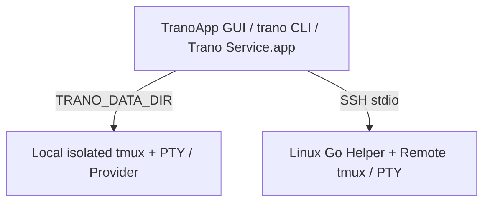

# Trano Engineering Progress

> **Summary**: Trano implements its core contracts and is published at [peterlyoo/trano](https://github.com/peterlyoo/trano) with previous clean-checkout macOS and Linux CI jobs passing, covering the `U20` source-publication scope. However, the full product remains incomplete. Completed performance qualification (`not_qualified`) fails the `U17` idle max RSS ceiling (`251.484375 MiB` > `250 MiB`), while cold-start, physical OS/UI, live-provider, and notarized-release gates remain open.

## Scope & Architecture

Trano is a standalone native macOS 14+ application built with full Xcode, AppKit, and SwiftUI. [../Package.swift](../Package.swift) pins `SwiftTerm` `1.99.1` and `Sparkle` `2.10.1`. It produces the `TranoApp` GUI, `trano` CLI, `build/Trano.app` bundle, and `Trano Service.app` background helper. Local sessions run on an isolated `tmux` socket under `TRANO_DATA_DIR`, keeping PTYs independent of the UI. Remote sessions use a Linux Go helper over SSH stdio (`remote/recovery.go`, `agent.go`, `hooks.go`, `shell.go`, `scrollback.go`).



- **No Private/Global Leakage**: No private harness or transcripts are copied, and no global user credentials are modified.
- **OSS Publication**: The standalone Git repository is published on `main` at [peterlyoo/trano](https://github.com/peterlyoo/trano) (`origin` `https://github.com/peterlyoo/trano.git`, commit [`1e027ceb132287756f056bee11ea663fde76db1f`](https://github.com/peterlyoo/trano/commit/1e027ceb132287756f056bee11ea663fde76db1f) ) with MIT licensing (`LICENSE`, `THIRD_PARTY_NOTICES.md`, `licenses/`), `README.md`, `CONTRIBUTING.md`, `SECURITY.md`, [sbom.json](sbom.json) , [publication-boundary.yaml](publication-boundary.yaml) , [../scripts/check-publication.py](../scripts/check-publication.py) , [../scripts/generate-sbom.py](../scripts/generate-sbom.py) , passing `.github/workflows/ci.yml` checks, and implemented `.github/workflows/release.yml` workflow tooling.

## Implemented Capabilities

### Local Installation & Native UI Corrections

Session, navigation, and font refinements are complete, with native bounds verified and font-settings visual qualification remaining open.

- Tab and workspace flows: Stable pane identity `.id(id)` fixed `Cmd+T` `NSHostingView`/tmux regressions (`.local/tab-lifecycle-red.log`), preserving renderer object identity and attach/backend PIDs. Named workspace get-or-create reuses or creates workspaces via `actions.perform` / `trano do session.new --title NAME`, defaulting blank names to `Session N`.
- Overlay focus and geometry: Same-window navigation closes on outside click or Escape before PTY input, returning focus to terminal while keeping Find text field focus. The workspace selector sits 3pt after traffic lights without the outer 8pt terminal inset; native bounds pass without physical pointer automation.
- Fonts and Settings layout: Default `Menlo-Regular` 14pt migrates legacy defaults and supports inline dropdowns with live preview, `Automatic`, and Save/Cancel. Replacing the 888pt single `HStack` (48pt wells in a 680pt window) with an 8-column, two-row `LazyVGrid` resolved horizontal overflow; horizontal clipping no longer remains, though malformed bitmap captures prevent visual acceptance.

### Workspace, Appearance, Input & Tab Activity
- **Appearance & Profiles**: Fonts, fallback, line spacing, color, opacity, background images, themes, and per-pane profiles in `Appearance.swift`, `AppearanceProfiles.swift`, `AppearanceSettings.swift`, `ProfileAppearanceView.swift`, and `TerminalBackgroundImage.swift`.
- **Keymaps, Voice & Glyphs**: Exact-modifier keymaps (`KeyBindings.swift`, `KeyboardShortcutRecorder.swift`), `ko-KR`/`en-US` voice preview and PTT controls (`VoiceInput.swift`), and custom provider glyphs (`AgentLogo.swift`, not final official trademark-qualified assets).
- **Tab Activity (`FR-HOVER-1..4`)**: Contract in [docs/TAB-ACTIVITY.md](TAB-ACTIVITY.md) . Shows every pane root and up to 64 structured child rows per pane from `agentTasks` without per-hover polling or network I/O (100ms local debounce, 15s remote refresh). Child activity never mutates root supervision; missing `agentTasks` metadata means no reported children, not proof of no children.

### Account Isolation, Extensions, Quota & Same-Provider Switch
- **Managed Profiles**: Implemented across `Accounts.swift`, `AccountAuthentication.swift`, `AccountUsage.swift`, `AgentSupervision.swift`, `AccountSwitch.swift`, `AccountDatabaseTransfer.swift`, `AccountHistoryReset.swift`, `AccountRollbackRows.swift`, `TranoCLI/ProviderSupervisor.swift`, `ProviderSignalRelay.swift`, `TranoCLI/main.swift`, and `TranoApp/AccountsView.swift` using isolated `CLAUDE_CONFIG_DIR`/`CODEX_HOME` and sanitized child environments (`--no-daemon` remains in `Sources/TerminalCore/Accounts.swift:133` and `Sources/TerminalCore/Extensions.swift:238`).
- **Extensions Manager**: `Extensions.swift` and `ExtensionsView.swift` implement shared skill symlinks, hooks/MCP translation, previews, receipts, backups, ownership conflict checks, rollback, and provider-native plugin install flows (authenticated provider plugin compatibility remains unqualified).
- **Usage Snapshots**: `accounts.usage` reads structured Claude statusline `rate_limits` (`accounts.usage.refresh` returns existing snapshot) and Codex `account/rateLimits/read`. In `AccountUsage.swift`, only `available` snapshots older than 300s downgrade to `unknown`; quota is never inferred from reset times or output silence.
- **Safe Boundary Switch & Rollback**: `automaticAccountSwitching` defaults to `false`. Queued switches occur only at root safe turn boundaries with no tools in flight, same provider, and exact conversation without prompt/tool replay. It copies only exact conversation files/metadata with receipts/backups while preserving target credentials. Rollback preflights backups/digests/conflicts, guards attached SQLite state/history changes, and refuses newer target work, **but is not crash-atomic across filesystem and database**.

### Local/Remote Recovery, Scrollback & Bundled Installer
- **Session Recovery**: `Recovery.swift`, `ProcessIdentity.swift`, `ShellIntegration.swift`, `TranoCLI/main.swift`, `TranoApp/Store.swift`, `TerminalPane.swift`, and `WorkspaceView.swift` track exact trusted conversation IDs, launch generations, and root-provider ancestry (`providerPID` recorded under suspended spawn before hooks; `SessionStart` may replace an existing bound conversation ID only for verified root `clear`/`fork`, not arbitrary `SessionStart` events). Root `Stop` is turn completion; normal exits are excluded. `automaticRestore` (default `true`, controlled alone by `recovery.settings`) exposes `live`, `restoring`, `restored`, `needs_attention`, and `failed` across CLI `recovery list/run [PANE_ID]` and API `recovery.{list,run,retry,settings}`. Native `Retry` targets dead panes only and reattaches the renderer after PID replacement. No system login auto-launch registration is implemented.
- **Remote Installer & Recovery**: Bundled offline Linux `arm64`/`amd64` SSH installer (`RemoteInstaller.swift`, `RemoteHostsView.swift`, [../scripts/bundle-remote.sh](../scripts/bundle-remote.sh) , [../scripts/build-remote.sh](../scripts/build-remote.sh) , [../scripts/install-remote.sh](../scripts/install-remote.sh) ) verifies SHA256, check/dry-run, conflict refusal, and force+backup (`tmux` prerequisite, no root package install). `Remote.swift` and `remote/recovery.go` recover exact-ID remote conversations after reboot/lost `tmux` and reconnect to the same live remote PID without `--last` guessing or prompt replay. SSH work runs outside the shared local state transaction (`RecoveryLockTests`, `RecoveryEntryTests`).
- **Bounded Scrollback**: `ScrollbackStore.swift`, `ScrollbackRuntime.swift`, `TranoCLI/ScrollbackMonitoring.swift`, and `remote/scrollback.go` persist sanitized UTF-8 display archives (default `persistScrollback = true`, max 4MiB / 10,000 lines per pane, 5s dirty snapshot interval, no command replay). `scrollback.settings(enabled: boolean)` controls local runtime `persistScrollback`, while native Settings separately propagates the preference to configured remote helpers. Disabling stops collection and removes archives.

### Updater & Release Tooling
- **Fail-Closed Sparkle**: `UpdateController.swift` and `UpdatePolicy.swift` require a valid HTTPS feed, 32-byte non-zero Ed25519 key, numeric `CFBundleVersion`, `SURequireSignedFeed=true`, and `SUVerifyUpdateBeforeExtraction=true` for GUI only (excluding service/snapshot), backed by [../scripts/configure-updates.py](../scripts/configure-updates.py) , [../scripts/release-update.sh](../scripts/release-update.sh) , `experiments/check-updates.py`, and `experiments/check-service-update.py`.

## Latest Verification Evidence

Latest verification supersedes older milestone baselines:

| Evidence Artifact | Scope & Exact Result |
| :--- | :--- |
| `.local/session-refinement-final-palette-swift.log` | Full run: 99 core (2 optional skipped), 38 UI, 6 CLI; 143 executed, 0 failures. Includes real pane/attach PID, native menu action, focus and Settings bounds regressions. |
| `.local/session-refinement-final-signed-build.log`, `.local/native-ui-installed-receipt.json`, `.local/session-refinement-final-native.log` | Signed release build in 76.95s; separate installation preserved 7 live shell PIDs and exact layout. Isolated native crash persistence: 1 passed in 4.709s. |
| `.local/review-repair-provider-compat.log` | 9 installed-provider compatibility tests passed, 0 skipped, 0 failures (empty managed profile Claude auth; Codex transferred conversation read without model request). |
| `.local/provider-signals-green.log` | 3 isolated PTY fake-provider signal relay/cancellation tests passed in `12.315s`. |
| `.local/provider-account-switch-green.log` | 3 fake-provider switch tests passed in `20.008s` (safe tool boundary, reaped old process, exact resume, preserved credentials, no duplicate launch). |
| `.local/provider-account-isolation-green.log` | 3 fake-provider isolation tests passed in `6.605s`. |
| `.local/review-repair-bundle-recovery.log` | 1 refreshed bundle recovery check passed in `6.066s` (exact Claude/Codex IDs, `cwd`, unchanged pane/tab/split layout, normal-exit exclusion, concurrent/repeated deduplication). |
| `.local/review-repair-bundle-native.log` | 1 refreshed bundle native check passed in `3.756s` (native client `SIGKILL` keeps same shell PID, detached completion collected, API stays alive). |
| `.local/review-repair-bundle-updates.log` | 4 refreshed bundle update/service compatibility checks passed in `0.868s` (local ad-hoc checks, not Developer ID notarized feed deployment). |
| `.local/tab-hover-evidence.json` | 7 real `NSPanel`+`NSHostingView` hover tests with deterministic owner-key state. |
| `.local/remote-lifecycle-race.log` | Saved transcription of captured `go test -race -count=1 -v ./...` tool output (exit `0`, full verbose `PASS` in `41.042s`, includes empty-conversation-ID confirmation guard). |
| `.local/remote-lifecycle-vet-linux-compile.log` | Saved transcription receipt for `go vet ./...`, `GOOS=linux GOARCH=amd64 go test -c`, and `GOOS=linux GOARCH=arm64 go test -c` (no output, observed aggregate exit `0`). |
| `.local/remote-lifecycle-pty.log` | Saved captured macOS PTY harness `PASS` in `0.76s` (exit `0`; `0x03` Ctrl-C interrupt, exit `42`, active retry metadata, original foreground group restored; captured before later empty-ID guard while terminal/process-group code remained unchanged). |
| Earlier `.local/published-source-build.log`, `.local/final-service-handoff.log` | Release `Build complete! (13.16s)`, `codesign --verify --deep --strict build/Trano.app` exit `0`, `plutil -lint` `OK`, `TranoBuildID` `4b9e94cd26a0a0aa95bd52b3594bef04ca7fb7d923a92763399733d3b129b339`; service handoff `1` pass (`3.356s`) replaced old helper with new helper PID/build while preserving the live shell PID. |
| [GitHub Actions run `42869346614`](https://github.com/peterlyoo/trano/actions/runs/42869346614) | Clean-checkout CI `SUCCESS` at [`1e027ceb132287756f056bee11ea663fde76db1f`](https://github.com/peterlyoo/trano/commit/1e027ceb132287756f056bee11ea663fde76db1f) : [`remote` job `130016099447`](https://github.com/peterlyoo/trano/actions/runs/42869346614/job/130016099447) (`go test -race ./...` in `28.714s` + cross-compile) and [`macos` job `130016100336`](https://github.com/peterlyoo/trano/actions/runs/42869346614/job/130016100336) (native core/renderer, bundle build, and publication checks) both passed. |
| `.local/review-repair-packaging-tests.log` | 6 packaging/OSS boundary tests passed in `1.243s`. |
| `.local/review-repair-privacy.log` | Candidate publication privacy check passed across 185 files. |
| [performance-observations.json](performance-observations.json) (`.local/performance-final/qualification-gates.json`) | Completed (`not_qualified`) `30`-launch, `10`-visible-native-pane local qualification harness run (`60.410034875s` idle, `600.434856334s` output) against [performance-contract.json](performance-contract.json) : warm-cache launch-to-headless-ready p95 `433.49ms`; idle CPU `0.033107` core-percent **PASS** (`<= 1`); idle product RSS max `251.484375 MiB` **FAIL** (`> 250 MiB`, median `248.953125 MiB` cannot justify a maximum-gate pass); output RSS max `260.59375 MiB` (`+2.890625 MiB` finite-window growth). |

*Historical Integration Context*: Earlier bundle revisions passed isolated local/remote checks (`.local/recovery-reviewed-bundle.log`, `.local/accounts-reviewed-bundle.log`, `.local/native-reviewed-bundle.log`, and `.local/remote-final-bundle.log` Linux SSH in `12.263s`) alongside pre-fix Go/Linux runs (`.local/tab-hover-go-final-2.log`, `.local/tab-hover-linux.log` with 26 tests, and `.local/remote-final-linux.log` with 16 tests). Current Linux remote runtime tests now pass in CI, while latest-revision full SSH end-to-end remains unrun.

## Remaining Qualification Gates

- **Linux SSH End-to-End & Physical Reboot**: Linux remote runtime tests (`go test -race ./...` in `28.714s`) and Linux cross-compilation passed in [CI job `130016099447`](https://github.com/peterlyoo/trano/actions/runs/42869346614/job/130016099447) at [`1e027ceb132287756f056bee11ea663fde76db1f`](https://github.com/peterlyoo/trano/commit/1e027ceb132287756f056bee11ea663fde76db1f) , but latest-revision full macOS-to-Linux SSH end-to-end and physical remote host reboot remain **NOT RUN**.
- **Authenticated Live Providers**: Real paid/authenticated quota telemetry, live conversation handoff, trusted hooks, plugins, and live subagents are not qualified by fake-provider or read-only compatibility probes.
- **Physical OS & Hardware**: Physical pointer/hover activation, IME, keyboard/render latency, drag, clipboard, microphone, OS notifications, VoiceOver, 1x/2x display matrix, actual physical OS reboot, and live Glass adapter connection remain unqualified.
- **Performance SLO (`U17`)**: Full `30`-launch, `10`-visible-pane (`60.410034875s` idle / `600.434856334s` output) measurement completed (`not_qualified` in [performance-observations.json](performance-observations.json) ): idle CPU (`0.033107` core-percent) passed, but idle product RSS max (`251.484375 MiB` vs `250 MiB` ceiling) **FAILED**; cold startup (`500ms`), native in-process warm attach (`200ms`), physical keyboard-to-render (`16.7ms`), and user `zsh` cost are **NOT RUN**, and finite-window output RSS (`260.59375 MiB` max, `+2.890625 MiB` growth) has no contractual steady-state bound.
- **Binary Distribution (`U16`)**: Public source publication and clean-checkout GitHub Actions CI (`remote` and `macos` jobs in [run `42869346614`](https://github.com/peterlyoo/trano/actions/runs/42869346614) ) are complete, while Developer ID signing, Apple notarization, live signed Sparkle feeds, and signed binary release qualification remain open.

## Runnable Commands

Require full Xcode (`xcode-select -p`). Serialize Swift builds; never run concurrent `swift build`/`swift test` against the same `.build` directory or against live user roots.

```bash
swift test
scripts/build-app.sh
scripts/build-remote.sh
scripts/bundle-remote.sh
(cd remote && go test -race -count=1 -v ./...)
TRANO_TEST_CLI="$PWD/build/Trano.app/Contents/MacOS/trano" python3 experiments/check-recovery.py
python3 experiments/check-native.py
python3 experiments/check-updates.py
python3 experiments/check-service-update.py
python3 scripts/check-publication.py
python3 scripts/generate-sbom.py
python3 experiments/benchmark-trano.py --output .local/performance-qualification.json
```
