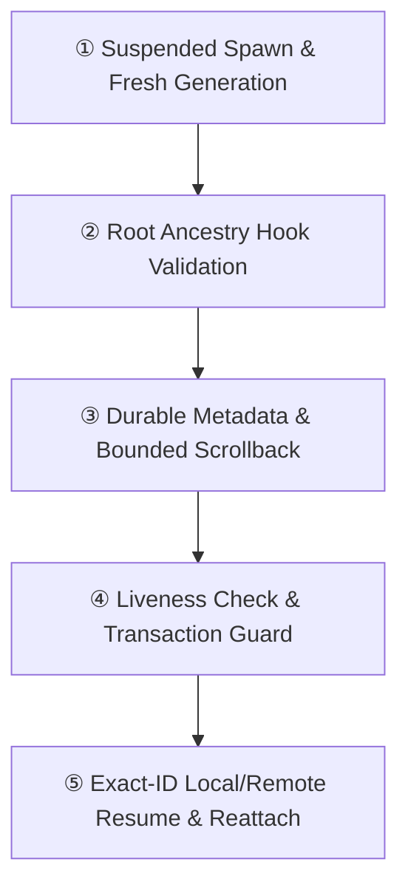

# Trano Session & Scrollback Recovery (`docs/RECOVERY.md`)

> **Summary**: Trano implements exact-ID local and remote session recovery alongside bounded display-only scrollback archives (`persistScrollback`, default `true`, up to 4MiB / 10000 lines per pane), without replacing live panes or replaying commands. This addendum preserves original scope `U01`–`U21` and updates historical planning baselines against current source, `docs/PROGRESS.md`, `docs/RTM.md`, and `docs/verification.json`. Actual physical OS reboot, system login auto-launch registration (still unimplemented), live authenticated provider resume, and current post-fix Linux runtime/SSH execution remain unqualified.

## Premise: Process Lifetimes vs. Durable State

UI views, live `tmux` jobs, durable launch metadata, and scrollback archives have distinct lifetimes (`Sources/TerminalCore/Runtime.swift`, `Sources/TerminalCore/Recovery.swift`, `Sources/TerminalCore/ScrollbackStore.swift`). When an OS reboot or `tmux` server loss destroys process trees, durable layout and metadata survive on disk while the dead processes do not (`Sources/TerminalCore/Recovery.swift:187`, `remote/recovery.go`). Recovery therefore checks live `tmux` jobs first—preserving any running pane or active fallback shell—before recreating missing panes. Rather than guessing `--last`, scanning global transcripts, or replaying commands that could repeat side effects, Trano binds exact conversation identity and restores sanitized terminal text only (`Sources/TerminalCore/Recovery.swift:169`).

## Overall Architecture: Identity Binding & Restore Flow



- **① Suspended Spawn & Fresh Generation**: `Sources/TranoCLI/main.swift:141` strips inherited `REX_*`, assigns a fresh launch generation, and uses `POSIX_SPAWN_START_SUSPENDED` to record `providerPID` before any hook executes, while `Sources/TerminalCore/Accounts.swift:133` and `Sources/TerminalCore/Extensions.swift:238` configure Codex launches with `--no-daemon`.
- **② Root Ancestry Hook Validation**: `Sources/TerminalCore/Recovery.swift:100` reads bounded (1MiB) hook JSON and verifies parent PID and executable path (`ProcessIdentity.swift`) against root-provider ancestry so early SDK probes, child subagents (`agentTasks`), or stale generations cannot overwrite root session identity.
- **③ Durable Metadata & Bounded Scrollback**: Persists pane UUID, provider, `session_id`, `cwd`, managed profile (`CLAUDE_CONFIG_DIR`/`CODEX_HOME`), lifecycle (`active`/`exited`), and boot identity. `ScrollbackStore.swift`, `ScrollbackRuntime.swift`, `TranoCLI/ScrollbackMonitoring.swift`, and `remote/scrollback.go` write dirty sanitized UTF-8 display snapshots on a 5s interval.
- **④ Liveness Check & Transaction Guard**: On `AppStore` startup (`Sources/TranoApp/Store.swift`), Trano inspects local and remote `tmux` liveness. Local state mutations serialize under an atomic transaction lock (`RecoveryLockTests`, `RecoveryEntryTests`), while network SSH recovery runs outside the shared local state transaction (`Sources/TerminalCore/Remote.swift`).
- **⑤ Exact-ID Resume & Reattach**: Dead `active` panes rehydrate display scrollback and run explicit `claude --resume ID` or `codex resume ID` in the recorded `cwd` and profile; `Sources/TranoApp/TerminalPane.swift` reattaches the renderer after PID replacement.

## Functional Requirements

### FR-RECOVERY-1: Deterministic Session Binding & Child Isolation
Bind exact pane ID, provider, trusted `session_id`, `cwd` (`ShellIntegration.swift`), profile root, launch generation, and lifecycle (`Sources/TerminalCore/Recovery.swift:100`).
- Root `SessionStart` binds an initial ID or replaces an existing bound ID only on verified root clear/fork after root-provider ancestry verification (`POSIX_SPAWN_START_SUSPENDED` PID recorded in `Sources/TranoCLI/main.swift:141`).
- Root `Stop` represents turn completion and stays `active`; normal process exit marks `exited`.
- Child subagent hooks and metadata (`agentTasks`) never mutate root lifecycle or supervision state.
- If a trusted `session_id` is missing, fail visibly without guessing.

### FR-RECOVERY-2: Layout-Preserving Local & Remote Recreation and Bounded Scrollback
Recreate missing local and remote `tmux` panes with the **same pane UUIDs**, workspace/tab/split/focus layout, and original `cwd` (`Sources/TerminalCore/Recovery.swift:187`, `Sources/TerminalCore/Remote.swift`, `remote/recovery.go`, `remote/agent.go`, `remote/hooks.go`, `remote/shell.go`).
- Reconnect to the same living remote PID when the remote `tmux` server survives; perform exact-ID remote restore when the remote `tmux` server or host was lost, never using `--last` or prompt replay. Exclude `exited` records and preserve all live panes, including active fallback shells.
- **Bounded Display Scrollback**: `persistScrollback` defaults to `true` (controlled locally via `scrollback.settings(enabled: boolean)`, while native Settings separately propagates the preference to configured remote helpers), storing at most 4MiB and 10000 lines per pane of sanitized UTF-8 display text under owned private runtime storage. Restoring scrollback prints display text only and never replays commands. Disabling `persistScrollback` stops collection and deletes stored archives. Dirty snapshots flush every 5s, so abrupt loss may drop up to 5s of recent output; private archives can contain sensitive terminal output and stay excluded from publication boundaries.

### FR-RECOVERY-3: App-Start Restore, Lock Discipline & Diagnostics
Provide `automaticRestore` (default `true`, configured via `recovery.settings`) on `AppStore` startup (`Sources/TranoApp/Store.swift`). System login item auto-launch registration is not implemented.
- **Surfaces**: API exposes `recovery.list`, `recovery.run`, `recovery.retry`, and `recovery.settings`; CLI exposes `trano recovery list` and `trano recovery run [PANE_ID]`. Reported statuses are `live`, `restoring`, `restored`, `needs_attention`, and `failed`.
- **Native UI**: `Retry` in `Sources/TranoApp/WorkspaceView.swift` appears only for dead panes, never active fallback shells, and `TerminalPane.swift` reattaches after PID replacement.
- **Concurrency & Diagnostics**: Shared transaction serialization deduplicates concurrent local restores while keeping SSH network work outside the lock. Missing trusted ID, `cwd`, or profile surfaces `needs_attention` or `failed`.

### FR-RECOVERY-4: Evidence Governance (`docs/PROGRESS.md` & `docs/verification.json`)
Track durable verification state across `docs/PROGRESS.md`, `docs/RTM.md`, and `docs/verification.json` without claiming whole-product completion or equating local release builds with product qualification.

## Verification Evidence & Qualification Boundaries

- **Swift & Integrated Bundle Evidence**: `.local/review-repair-final-swift.log` records 92 core tests executed (2 optional installed-provider tests skipped, 0 failures), 17 UI tests passed, and 6 CLI tests passed, including `RecoveryEntryTests` (1 test), `AgentTaskTests` (12 tests), and `TabActivityHoverTests` (7 tests). Newly integrated bundle checks pass in `.local/review-repair-bundle-recovery.log` (1 passed, 6.066s: exact Claude/Codex IDs, `cwd`, unchanged pane/tab/split layout, normal exit excluded, concurrent/repeated deduplication), `.local/review-repair-bundle-native.log` (1 passed, 3.756s: native client `SIGKILL` preserves same `shellPID`, detached completion collected, API alive), and `.local/review-repair-bundle-updates.log` (4 passed, 0.868s: local ad-hoc bundle update/service compatibility checks, not Developer ID notarized feed deployment).
- **Provider Probes**: `.local/provider-signals-green.log` (3 tests, 12.315s), `.local/provider-account-switch-green.log` (3 tests, 20.008s), and `.local/provider-account-isolation-green.log` (3 tests, 6.605s) verify real PTY fake-provider lifecycle, exact session resume, and signal handling. `.local/review-repair-provider-compat.log` (9 tests passed, 0 skipped, 0 failures) verifies installed CLI config/session compatibility without model inference.
- **Remote, Release & Performance Boundaries**: `.local/remote-lifecycle-race.log` is a saved transcription of captured `go test -race -count=1 -v ./...` output (exit 0, full verbose PASS, 41.042s; `.local/tab-hover-go-final-2.log` also records a Go `-race` pass). `.local/remote-lifecycle-vet-linux-compile.log` is a saved transcription receipt for `go vet ./...`, `GOOS=linux GOARCH=amd64 go test -c`, and `GOOS=linux GOARCH=arm64 go test -c` with observed aggregate exit 0 (not separate per-command exit statuses). `.local/remote-lifecycle-pty.log` is a saved captured macOS PTY harness PASS (0.76s, exit 0, `0x03` Ctrl-C interrupt, exit 42, active retry metadata, foreground group restored, captured just before the later empty-conversation-ID confirmation guard included in the final race and Linux compile receipts). Historical Linux runs passed at earlier revisions (`.local/remote-final-bundle.log` 1 pass in 12.263s; `.local/remote-final-linux.log` 16 pass; `.local/tab-hover-linux.log` 26 pass before final parser/lifecycle fixes), while a current Linux runtime/SSH rerun remains **not run** because the Linux fixture/images are unavailable. `.local/review-repair-release.log` (`Build complete! (81.96s)`) proves local ad-hoc release build integrity, and full 600s performance qualification remains ongoing with no SLO claim.

```bash
swift test
python3 experiments/check-service-update.py
python3 scripts/check-publication.py
```
