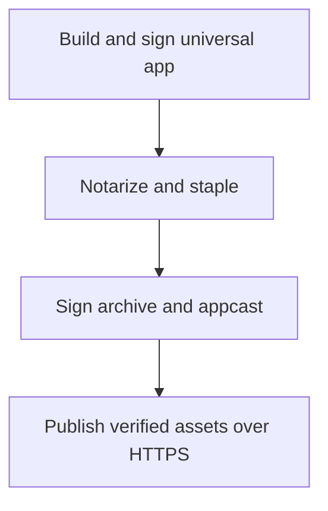

# Releasing and Updates

> Production releases require external Apple Developer ID signing, Apple notarization, and Sparkle Ed25519 signing before publishing release artifacts. Default local builds (`scripts/build-app.sh`) use ad-hoc signing and disable update feeds.

## Update Architecture



Sparkle 2.10.1 enforces HTTPS feeds and Ed25519 signature verification on both the feed and archive before extraction. Users can toggle automatic update checks and downloads in Settings (default check interval is daily). Helper and snapshot processes never start the updater, and live terminal jobs survive app updates inside `tmux`.

The new app compares the background service's captured source build identity and version with its own, then requests an acknowledged handoff before starting a replacement. `build/Trano.app/Contents/MacOS/TranoApp --ensure-service` exposes the same operation without opening a window; `python3 experiments/check-service-update.py` verifies replacement against an isolated copied bundle.

## Dedicated Sparkle Signing Key Setup

To generate a new dedicated local Ed25519 signing key after resolving Swift packages, a maintainer explicitly runs:

```sh
.build/artifacts/sparkle/Sparkle/bin/generate_keys --account dev.trano.updates
```

This command stores the private key in the local macOS Keychain and prints the base64 public key. Never commit or export the private key into the repository.

## Required Release Environment Variables

Configure these environment variables before running the release script (managed via `scripts/configure-updates.py` and `scripts/release-update.sh`):

- `TRANO_SIGNING_IDENTITY`: Developer ID Application certificate identity.
- `TRANO_NOTARY_PROFILE`: Existing `xcrun notarytool` keychain profile name.
- `TRANO_UPDATE_FEED_URL`: HTTPS URL for `appcast.xml`.
- `TRANO_UPDATE_PUBLIC_KEY`: Base64-encoded 32-byte Ed25519 public key.
- `TRANO_UPDATE_DOWNLOAD_URL`: HTTPS directory URL where release archives are hosted.
- `TRANO_APP_VERSION`: Numeric dotted marketing version (for example, `0.1.0`).
- `TRANO_BUILD_VERSION`: Positive, strictly increasing numeric build version.
- `TRANO_UPDATE_KEY_ACCOUNT` (optional): Keychain account name, defaulting to `dev.trano.updates`.

## Building and Verifying a Local Release

1. **Validate configuration and signing identity**:
   ```sh
   scripts/release-update.sh --check
   ```
   When finished, the script confirms that all required environment variables and signing identities are present.

2. **Build, sign, notarize, and package**:
   ```sh
   scripts/release-update.sh --build
   ```
   When finished, `build/releases/<version>-<build>/` contains the notarized universal app archive, signed `appcast.xml`, `SHA256SUMS`, and `notarization.plist`. The script waits for explicit `Accepted` notarization status, staples the ticket, and verifies the bundle. It does not publish artifacts automatically.

3. **Upload public artifacts**:
   Keep `notarization.plist` private. Upload only the `.zip` archive, `appcast.xml`, and `SHA256SUMS` to your HTTPS target. Do not edit `appcast.xml` after signing, as any modification invalidates the Ed25519 signature.

## GitHub Actions Release Workflow

The manual workflow in `.github/workflows/release.yml` runs against the `release` GitHub environment using temporary runner keychains and credential files that are deleted after the job.

- **Variables**: `TRANO_UPDATE_FEED_URL` (for example, the illustrative template `https://github.com/OWNER/REPOSITORY/releases/latest/download/appcast.xml`) and `TRANO_UPDATE_PUBLIC_KEY`. The download path automatically targets the version tag.
- **Secrets**: `TRANO_SIGNING_IDENTITY`, `TRANO_CERTIFICATE_BASE64`, `TRANO_CERTIFICATE_PASSWORD`, `TRANO_SPARKLE_PRIVATE_KEY`, `TRANO_APPLE_ID`, `TRANO_APPLE_TEAM_ID`, and `TRANO_APP_SPECIFIC_PASSWORD`.

The workflow builds, tests, signs, and notarizes the bundle, then creates a **draft** GitHub release. A maintainer must verify the attached assets and release qualification before publishing the draft.

## Release Qualification Boundaries

Local automated tests (`python3 experiments/check-updates.py`) verify signed feed and archive tamper rejection using ephemeral test keys, not production installed-app replacement. Before publishing a production release, maintainers must qualify on supported hardware:

- Old-to-new signed installed app replacement while verifying `tmux` terminal survival.
- Authenticity verification and tamper rejection against the production feed.
- macOS microphone and notification permissions, real OS Korean IME input, OS reboot recovery, and authenticated provider quota handoff/resumption (see [PROGRESS.md](PROGRESS.md)).
