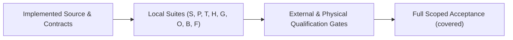

# Trano Requirement Coverage

> **L1 Summary**: **Source implementation and automated test suites exist across every scoped requirement, and open-source repository publication (`U20`) plus recovery documentation (`FR-RECOVERY-4`) are `covered`, but full product acceptance remains incomplete.** User requirements `U01`–`U19` and `U21` (including `U16` signed binary updater and `U17` performance SLOs, where idle max RSS failed at `251.484375 MiB` > `250 MiB`) and functional requirements `FR-NAV-1`–`FR-NAV-6`, `FR-RECOVERY-1`–`FR-RECOVERY-3`, and `FR-HOVER-1`–`FR-HOVER-4` remain `partial` with explicit remaining qualification gates. Passing unit, CI, or fake-provider tests never establish whole-product completion.

## Governance & Status Definitions

Original PRD/M1/M2/M3 milestone snapshots are historical planning baselines, not current acceptance proof. Current repository source, [`PROGRESS.md`](PROGRESS.md), this RTM, and [`verification.json`](verification.json) govern evidence.

- **`covered`**: Implementation exists and full scoped acceptance for that requirement is verified (`U20` public source repository publication + clean-checkout CI, and `FR-RECOVERY-4` documentation contract).
- **`partial`**: Source implementation and local automated verification exist, with remaining physical, external, or release acceptance gates tracked.
- **`pending`**: Scoped implementation or deliverables do not exist (0 rows currently).
- **Evidence rules**: Do not sum pass counts across separate test runs. Fake-provider PTY probes and deterministic `NSPanel` tests do not qualify authenticated live provider quotas/handoffs or physical macOS input/window activation.

---

## User Requirements (`U01`–`U21`)

All relative links resolve from `docs/RTM.md`. Native AppKit/SwiftUI macOS 14+ sources build with full Xcode against pinned `SwiftTerm` `1.99.1` and `Sparkle` `2.10.1` in [`Package.swift`](../Package.swift) using isolated `tmux` root `TRANO_DATA_DIR`, `TranoApp` GUI, `trano` CLI, `build/Trano.app`, `Trano Service.app` background helper, and the Linux Go helper over SSH stdio.

| ID | Status | Implementation Sources | Verification & Latest Evidence | Remaining Acceptance Gate |
| :--- | :--- | :--- | :--- | :--- |
| **U01** | `partial` | [`Runtime.swift`](../Sources/TerminalCore/Runtime.swift), [`TerminalPane.swift`](../Sources/TranoApp/TerminalPane.swift) (`Trano Service.app`, `build/Trano.app`) | [`RuntimeTests.swift`](../Tests/TerminalCoreTests/RuntimeTests.swift), [`check-native.py`](../experiments/check-native.py), `S`, `B` (prior native bundle `1` passed in `3.756s`; current service handoff `1` passed in `3.356s` preserving live shell PID across helper build replacement) | Physical UI relaunch and live-update daemon job persistence acceptance. |
| **U02** | `partial` | [`TerminalPane.swift`](../Sources/TranoApp/TerminalPane.swift), [`ScrollbackStore.swift`](../Sources/TerminalCore/ScrollbackStore.swift), [`scrollback.go`](../remote/scrollback.go) (`ShellIntegration.swift`, `ScrollbackRuntime.swift`, `ScrollbackMonitoring.swift`; `persistScrollback` default `true`, max `4MiB`/`10000` lines/pane, sanitized UTF-8 under owned private runtime, `5s` dirty interval, disabling stops collection and deletes archives, no command replay) | [`InputTests.swift`](../Tests/TerminalUITests/InputTests.swift), [`RecoveryTests.swift`](../Tests/TerminalCoreTests/RecoveryTests.swift), [`check-recovery.py`](../experiments/check-recovery.py), `S`, `B`, `G` | Full interactive `zsh`/job-control/link/`terminfo` matrix and abrupt loss within `5s` dirty window. |
| **U03** | `partial` | [`Actions.swift`](../Sources/TerminalCore/Actions.swift), [`WorkspaceView.swift`](../Sources/TranoApp/WorkspaceView.swift) | [`NavigationTests.swift`](../Tests/TerminalCoreTests/NavigationTests.swift), `S` | Physical keyboard focus and interactive command palette acceptance. |
| **U04** | `partial` | [`API.swift`](../Sources/TerminalCore/API.swift), [`Launcher.swift`](../Sources/TerminalCore/Launcher.swift), [`trano.lua`](../integrations/glass-launcher/trano.lua) | [`APITests.swift`](../Tests/TerminalCoreTests/APITests.swift), [`NavigationTests.swift`](../Tests/TerminalCoreTests/NavigationTests.swift), `S` | Live Glass adapter installation and connection qualification. |
| **U05** | `partial` | [`Appearance.swift`](../Sources/TerminalCore/Appearance.swift), [`AppearanceProfiles.swift`](../Sources/TerminalCore/AppearanceProfiles.swift), [`AppearanceSettings.swift`](../Sources/TranoApp/AppearanceSettings.swift), [`FontPicker.swift`](../Sources/TranoApp/FontPicker.swift) (`ProfileAppearanceView.swift`, `TerminalBackgroundImage.swift`; fonts, fallback, line spacing, colors, opacity, background image, themes, per-pane profiles) | [`WindowStateTests.swift`](../Tests/TerminalCoreTests/WindowStateTests.swift), [`FontDefaultTests.swift`](../Tests/TerminalCoreTests/FontDefaultTests.swift), [`FontSelectionTests.swift`](../Tests/TerminalUITests/FontSelectionTests.swift), UI suite in `S` | Physical 1x/2x display rendering and interactive settings verification. |
| **U06** | `partial` | [`TerminalPane.swift`](../Sources/TranoApp/TerminalPane.swift) | [`InputTests.swift`](../Tests/TerminalUITests/InputTests.swift) in `S` (Korean UTF-8, IME contract, PTY) | Physical macOS two-set Korean IME hardware typing qualification. |
| **U07** | `partial` | [`ActivityMonitor.swift`](../Sources/TerminalCore/ActivityMonitor.swift), [`Notifications.swift`](../Sources/TranoApp/Notifications.swift) | [`InteractionTests.swift`](../Tests/TerminalCoreTests/InteractionTests.swift), `S`, `B` | Live macOS notification permission prompt and OS banner delivery. |
| **U08** | `partial` | [`TabActivityHover.swift`](../Sources/TranoApp/TabActivityHover.swift), [`AgentTaskActivity.swift`](../Sources/TerminalCore/AgentTaskActivity.swift), [`AgentLogo.swift`](../Sources/TranoApp/AgentLogo.swift) (custom provider glyphs, not trademark-qualified official assets; [`TAB-ACTIVITY.md`](TAB-ACTIVITY.md)) | `AgentTaskTests` (12) and `TabActivityHoverTests` (7) in `S`, [`check-tab-activity.py`](../experiments/check-tab-activity.py), `H` | Physical pointer hover/window activation, authenticated live subagents, and official trademark review if required. |
| **U09** | `partial` | [`Actions.swift`](../Sources/TerminalCore/Actions.swift), [`KeyBindings.swift`](../Sources/TerminalCore/KeyBindings.swift), [`KeyboardShortcutRecorder.swift`](../Sources/TranoApp/KeyboardShortcutRecorder.swift) (`App.swift`; editable exact-modifier keymaps and `Cmd+N` new OS window) | [`NavigationTests.swift`](../Tests/TerminalCoreTests/NavigationTests.swift), [`WindowStateTests.swift`](../Tests/TerminalCoreTests/WindowStateTests.swift), [`TabLifecycleTests.swift`](../Tests/TerminalUITests/TabLifecycleTests.swift), UI suite in `S` | Physical keyboard shortcut capture, `Cmd+N` multi-window interaction, and live iTerm-equivalent keymap acceptance. |
| **U10** | `partial` | [`Actions.swift`](../Sources/TerminalCore/Actions.swift), [`Workspace.swift`](../Sources/TerminalCore/Workspace.swift), [`WorkspaceView.swift`](../Sources/TranoApp/WorkspaceView.swift) | [`NavigationTests.swift`](../Tests/TerminalCoreTests/NavigationTests.swift), [`WindowStateTests.swift`](../Tests/TerminalCoreTests/WindowStateTests.swift), `S` | Physical OS multi-window and pane shortcut acceptance. |
| **U11** | `partial` | [`Workspace.swift`](../Sources/TerminalCore/Workspace.swift), [`WorkspaceView.swift`](../Sources/TranoApp/WorkspaceView.swift) | [`NavigationTests.swift`](../Tests/TerminalCoreTests/NavigationTests.swift), [`RuntimeTests.swift`](../Tests/TerminalCoreTests/RuntimeTests.swift), `S` | Physical pointer drag, drop target hover, and cancel gesture acceptance. |
| **U12** | `partial` | [`WorkspaceView.swift`](../Sources/TranoApp/WorkspaceView.swift), [`Appearance.swift`](../Sources/TerminalCore/Appearance.swift), [`AgentLogo.swift`](../Sources/TranoApp/AgentLogo.swift) | `design/native-workspace.png`, `S` | Full 1x/2x scale, contrast, and visual state matrix qualification. |
| **U13** | `partial` | [`VoiceInput.swift`](../Sources/TranoApp/VoiceInput.swift) (`ko-KR`/`en-US` voice preview and PTT controls) | UI suite in `S`, `B` | Physical microphone hardware, OS speech/mic permissions, and live transcription acceptance. |
| **U14** | `partial` | [`Remote.swift`](../Sources/TerminalCore/Remote.swift), [`RemoteInstaller.swift`](../Sources/TerminalCore/RemoteInstaller.swift), [`recovery.go`](../remote/recovery.go) (`RemoteHostsView.swift`, `bundle-remote.sh`, `build-remote.sh`, `install-remote.sh`, `agent.go`, `hooks.go`, `shell.go`, `scrollback.go`; bundled offline Linux `arm64`/`amd64` SSH installer with SHA256, check/dry-run, conflict refusal, force+backup; existing `tmux` prerequisite, no root install; exact-ID remote reboot/lost-`tmux` recovery and live PID reconnect outside local state transaction) | [`RemoteTests.swift`](../Tests/TerminalCoreTests/RemoteTests.swift), `RecoveryLockTests`, `RecoveryEntryTests` (1) in `S`, `G` (Linux remote runtime CI passed in [job `130016099447`](https://github.com/peterlyoo/trano/actions/runs/42869346614/job/130016099447) ) | Latest-revision full SSH end-to-end rerun and physical remote host reboot. |
| **U15** | `partial` | [`Attachment.swift`](../Sources/TerminalCore/Attachment.swift), [`TerminalPane.swift`](../Sources/TranoApp/TerminalPane.swift), [`files.go`](../remote/files.go) | [`InteractionTests.swift`](../Tests/TerminalCoreTests/InteractionTests.swift), `S`, `G` | Physical macOS clipboard paste UI and latest-revision live Linux SSH transfer rerun. |
| **U16** | `partial` | [`UpdateController.swift`](../Sources/TranoApp/UpdateController.swift), [`UpdatePolicy.swift`](../Sources/TerminalCore/UpdatePolicy.swift), [`RELEASING.md`](RELEASING.md) (`configure-updates.py`, `release-update.sh`; Sparkle `2.10.1` fail-closed unless valid HTTPS feed, 32-byte non-zero Ed25519 key, numeric `CFBundleVersion`, `SURequireSignedFeed=true`, `SUVerifyUpdateBeforeExtraction=true`; GUI-only excluding service/snapshot) | [`check-service-update.py`](../experiments/check-service-update.py), [`check-updates.py`](../experiments/check-updates.py), `S`, `O`, `B` (`4` local ad-hoc bundle update checks passed in `0.868s`) | Developer ID signing, Apple notarization, live HTTPS signed appcast feed, and end-to-end signed update deployment. |
| **U17** | `partial` | [`benchmark-trano.py`](../experiments/benchmark-trano.py), [`performance-contract.json`](performance-contract.json), [`performance-observations.json`](performance-observations.json) | `F` (completed `30`-launch, `10`-visible-pane, `60.410034875s`-idle / `600.434856334s`-output run, `not_qualified`: idle CPU `0.033107` core-percent PASS, warm-cache headless p95 `433.49ms`, idle RSS max `251.484375 MiB` FAIL vs `250 MiB`) | Resolve idle product RSS max failure (`251.484375 MiB` > `250 MiB`), run cold app-ready (`500ms`), native in-process warm attach (`200ms`), physical keyboard-to-render (`16.7ms`), user `zsh` cost, and define/pass an output-load memory bound. |
| **U18** | `partial` | [`Accounts.swift`](../Sources/TerminalCore/Accounts.swift), [`AccountSwitch.swift`](../Sources/TerminalCore/AccountSwitch.swift), [`ProviderSupervisor.swift`](../Sources/TranoCLI/ProviderSupervisor.swift) (`AccountAuthentication.swift`, `AccountUsage.swift`, `AgentSupervision.swift`, `AccountDatabaseTransfer.swift`, `AccountHistoryReset.swift`, `AccountRollbackRows.swift`, `ProviderSignalRelay.swift`, `main.swift`, `AccountsView.swift`; managed `CLAUDE_CONFIG_DIR`/`CODEX_HOME` with sanitized child env; `accounts.usage` reads Claude `rate_limits` and Codex `account/rateLimits/read`, downgrades available snapshots older than `300s` to `unknown`, no inference from reset/silence; `automaticAccountSwitching` default `false`; queued switch at root safe turn boundary with no tools in flight, same provider and exact conversation only, no prompt/tool replay; copies exact conversation files/metadata with receipts/backups preserving target credentials; rollback preflights backups/digests/conflicts, guards attached SQLite state/history changes, refuses newer target work, NOT crash-atomic across filesystem+SQLite) | [`AccountTests.swift`](../Tests/TerminalCoreTests/AccountTests.swift), `AccountRollbackTests` (13) in `S`, `P`, `T` | Authenticated live paid-provider quota feeds and live same-provider handoff; rollback remains guarded rather than crash-atomic across filesystem+SQLite. |
| **U19** | `partial` | [`Extensions.swift`](../Sources/TerminalCore/Extensions.swift), [`ExtensionsView.swift`](../Sources/TranoApp/ExtensionsView.swift) (shared skills, hooks, and MCP config translation across owned provider roots with preview, apply, backup, conflict detection, and rollback) | [`ExtensionTests.swift`](../Tests/TerminalCoreTests/ExtensionTests.swift) (`4` passed in `S`), `P` | Authenticated provider native plugin installation and live hook/skill execution compatibility. |
| **U20** | `covered` | [`LICENSE`](../LICENSE), [`publication-boundary.yaml`](publication-boundary.yaml), [`check-publication.py`](../scripts/check-publication.py) (`README.md`, `THIRD_PARTY_NOTICES.md`, `CONTRIBUTING.md`, `SECURITY.md`, `licenses/`, [`sbom.json`](sbom.json), `generate-sbom.py`, `ci.yml`, `release.yml`; standalone `MIT` repository at [peterlyoo/trano](https://github.com/peterlyoo/trano) commit [`1e027ceb132287756f056bee11ea663fde76db1f`](https://github.com/peterlyoo/trano/commit/1e027ceb132287756f056bee11ea663fde76db1f) ; excludes `design/`, `.local/`, `build/`, `.build/`, private harness/transcripts/credentials) | `O` (`6` packaging tests in `1.243s`; `185` candidate files passed privacy/boundary checks; clean public checkout CI passed in [run `42869346614`](https://github.com/peterlyoo/trano/actions/runs/42869346614) across [`remote`](https://github.com/peterlyoo/trano/actions/runs/42869346614/job/130016099447) and [`macos`](https://github.com/peterlyoo/trano/actions/runs/42869346614/job/130016100336) ) | None for `U20` source-publication scope (signed binary distribution and notarization are tracked under `U16`). |
| **U21** | `partial` | [`WorkspaceView.swift`](../Sources/TranoApp/WorkspaceView.swift), [`AppearanceSettings.swift`](../Sources/TranoApp/AppearanceSettings.swift) (`design/native-workspace.png`) | `design/native-workspace.png`, UI suite in `S` | VoiceOver accessibility, 1x/2x display scaling, and full interactive state matrix qualification. |

---

## Functional Requirements (`FR-NAV`, `FR-RECOVERY`, `FR-HOVER`)

### Navigation (`FR-NAV-1`–`FR-NAV-6`)

| ID | Status | Implementation Sources | Verification & Latest Evidence | Remaining Acceptance Gate |
| :--- | :--- | :--- | :--- | :--- |
| **FR-NAV-1** | `partial` | [`NAVIGATION.md`](NAVIGATION.md), [`Workspace.swift`](../Sources/TerminalCore/Workspace.swift), [`WorkspaceView.swift`](../Sources/TranoApp/WorkspaceView.swift) (named workspace get-or-create and automatic Session N names; stable native pane identity; scoped Session → Tab → Pane navigation; session wrap restores active tab/focused pane; tab cycle stays within workspace without restarting shells) | [`NavigationTests.swift`](../Tests/TerminalCoreTests/NavigationTests.swift) (migration, focus restore, named reuse and PID preservation), [`TabLifecycleTests.swift`](../Tests/TerminalUITests/TabLifecycleTests.swift), `S` | Physical keyboard/mouse session and tab switching acceptance. |
| **FR-NAV-2** | `partial` | [`NAVIGATION.md`](NAVIGATION.md), [`Actions.swift`](../Sources/TerminalCore/Actions.swift), [`KeyBindings.swift`](../Sources/TerminalCore/KeyBindings.swift), [`CommandKeyHints.swift`](../Sources/TranoApp/CommandKeyHints.swift) (`KeyboardShortcutRecorder.swift`; Command-hold hints with stable tab bounds; unified typed action registry across menus, palette, keyboard, and `actions.list`; exact-modifier shortcuts without stealing IME/TextField commits; `Cmd+K`/`Shift+Cmd+P` pickers, no `Cmd+P` default picker, and `Cmd+1..9` cycling) | [`CommandPaletteShortcutTests.swift`](../Tests/TerminalUITests/CommandPaletteShortcutTests.swift), [`AppearanceKeyBindingTests.swift`](../Tests/TerminalCoreTests/AppearanceKeyBindingTests.swift), [`NavigationTests.swift`](../Tests/TerminalCoreTests/NavigationTests.swift), [`TabLifecycleTests.swift`](../Tests/TerminalUITests/TabLifecycleTests.swift), [`CommandKeyHintTests.swift`](../Tests/TerminalUITests/CommandKeyHintTests.swift), UI suite in `S` | Physical keyboard capture, picker interaction, and Rex session-cycle default confirmation. |
| **FR-NAV-3** | `partial` | [`NAVIGATION.md`](NAVIGATION.md), [`Actions.swift`](../Sources/TerminalCore/Actions.swift), [`WorkspaceView.swift`](../Sources/TranoApp/WorkspaceView.swift) (`pane.insert_path` and `pane.go_to_directory`; multi-select shell-quoting for spaces, apostrophes, and Korean without trailing newline; cancel no-op; newline/`NUL` rejection; remote browser requirement) | [`NavigationTests.swift`](../Tests/TerminalCoreTests/NavigationTests.swift), [`InputTests.swift`](../Tests/TerminalUITests/InputTests.swift), `S` | Physical native file-picker modal, file drag-and-drop, and remote directory browser acceptance. |
| **FR-NAV-4** | `partial` | [`NAVIGATION.md`](NAVIGATION.md), [`Workspace.swift`](../Sources/TerminalCore/Workspace.swift), [`WorkspaceView.swift`](../Sources/TranoApp/WorkspaceView.swift) (rename workspace/tab/pane and move/swap/balance splits while preserving running jobs; explicit pane/tab close and fresh-shell restore follow FR-CLOSE below; window/app close and workspace hide preserve jobs) | [`NavigationTests.swift`](../Tests/TerminalCoreTests/NavigationTests.swift), [`RuntimeTests.swift`](../Tests/TerminalCoreTests/RuntimeTests.swift), `S` | Physical tab drag-and-drop and live split manipulation acceptance. |
| **FR-NAV-5** | `partial` | [`NAVIGATION.md`](NAVIGATION.md), [`API.swift`](../Sources/TerminalCore/API.swift), [`Launcher.swift`](../Sources/TerminalCore/Launcher.swift) ([`Actions.swift`](../Sources/TerminalCore/Actions.swift) line `115`, [`trano.lua`](../integrations/glass-launcher/trano.lua); headless `actions.list`/`actions.perform` returning `requiresUI` for native panels; workspace-scoped GlassLauncher with stable v1 pane mappings) | [`APITests.swift`](../Tests/TerminalCoreTests/APITests.swift), [`NavigationTests.swift`](../Tests/TerminalCoreTests/NavigationTests.swift), `S` | Live external Glass launcher adapter execution. |
| **FR-NAV-6** | `partial` | [`NAVIGATION.md`](NAVIGATION.md), [`WorkspaceView.swift`](../Sources/TranoApp/WorkspaceView.swift), [`WindowSelection.swift`](../Sources/TerminalCore/WindowSelection.swift) ([`Actions.swift`](../Sources/TerminalCore/Actions.swift) lines `4`/`46`, [`App.swift`](../Sources/TranoApp/App.swift), [`Store.swift`](../Sources/TranoApp/Store.swift); optional grouped workspace sidebar, compact workspace selector and unified 32pt title/tab row, contained Activity overlay, workspace-scoped tab bar, `Workspace > Tab > Pane` search labels, native black UI, `Cmd+N` `client.window.new`, and Rex action audit) | [`WindowStateTests.swift`](../Tests/TerminalCoreTests/WindowStateTests.swift), [`ActivityGeometryTests.swift`](../Tests/TerminalUITests/ActivityGeometryTests.swift), `design/native-workspace.png`, `S`, `Q` | Physical `Cmd+N`/multi-window interaction, native black UI 1x/2x scale, VoiceOver accessibility, and planned Rex parity surfaces. |

### Workspace search and editable paste (`FR-SEARCH`, `FR-PASTE-EDIT`, `FR-CHROME-FOOTER`)

Contract: [INPUT-ERGONOMICS-SRS.md](INPUT-ERGONOMICS-SRS.md). Targeted 2026-11-14 evidence: `.local/input-ergonomics/unit-receipt.json` records 66 product and 45 packaging units; the full product suite was not repeated.

| ID | Status | Implementation | Unit evidence | Remaining acceptance gate |
|---|---|---|---|---|
| **FR-SEARCH-1** | `partial` | [KeyboardLayoutSearch.swift](../Sources/TerminalCore/KeyboardLayoutSearch.swift), [WorkspaceView.swift](../Sources/TranoApp/WorkspaceView.swift) | `KeyboardLayoutSearchTests`, `WorkspaceSearchCorrectionTests`: composed/compatibility/canonical jamo, mixed input, literal priority and stable alternate tiers | Physical Cmd+K typing with OS input sources |
| **FR-SEARCH-2** | `partial` | Existing picker query, result IDs and Create closures retained | Native field contents, preedit, navigation, reorder identity and original trimmed Create name; no runtime jobs | Physical activation/context-menu regression; existing activation closures unchanged |
| **FR-PASTE-EDIT-1** | `partial` | [TerminalDraftPaste.swift](../Sources/TranoApp/TerminalDraftPaste.swift) | `DeferredPasteNativeTests`: edited Unicode bytes exactly once, edited Escape cancellation; editor bitmap inspected | Physical clipboard/modal interaction |
| **FR-PASTE-EDIT-2** | `partial` | Native editor responder removes/restores Paste key equivalent | Return/keypad Enter insert native newline in editor; initial and returned button Enter activates Paste without terminal submit; marked text remains owned | Physical OS IME commit and modal activation; pre-order native window focus is not physical qualification |
| **FR-PASTE-EDIT-3** | `partial` | Final ownership, UTF-8 byte limit and bracketed-mode checks | `DeferredPasteOwnershipTests`, `DeferredTerminalInputTests`, native edited over-limit rejection | Real provider/PTY E2E remains paused |
| **FR-CHROME-FOOTER-1** | `partial` | WorkspaceView footer removed; default native viewport fills its container; default CoreGraphics remainder uses backing background once | `WorkspaceFooterTests`: 12 empty layouts plus populated resize/split/padding/hit targets; `TerminalBottomViewportTests`: 1×/2× composited RGB/alpha and first/last-row ink; 45 targeted product units | Physical display/compositor inspection remains paused; no job-starting tests |

### Recovery (`FR-RECOVERY-1`–`FR-RECOVERY-4`)

| ID | Status | Implementation Sources | Verification & Latest Evidence | Remaining Acceptance Gate |
| :--- | :--- | :--- | :--- | :--- |
| **FR-RECOVERY-1** | `partial` | [`Recovery.swift`](../Sources/TerminalCore/Recovery.swift), [`ProcessIdentity.swift`](../Sources/TerminalCore/ProcessIdentity.swift), [`main.swift`](../Sources/TranoCLI/main.swift) (`ShellIntegration.swift`; exact trusted conversation ID, fresh launch generation, root-provider ancestry, suspended spawn records provider PID before hooks, `SessionStart` replaces an existing bound ID only on verified root `clear`/`fork`, root `Stop` = turn completion not exit, children never mutate root) | [`RecoveryTests.swift`](../Tests/TerminalCoreTests/RecoveryTests.swift), `S`, `T`, `B` (recovery bundle `1` passed in `6.066s`) | Authenticated live provider hook emission and real session resume. |
| **FR-RECOVERY-2** | `partial` | [`Recovery.swift`](../Sources/TerminalCore/Recovery.swift), [`Remote.swift`](../Sources/TerminalCore/Remote.swift), [`ScrollbackStore.swift`](../Sources/TerminalCore/ScrollbackStore.swift) (`TerminalPane.swift`, `recovery.go`, `scrollback.go`; bounded `4MiB`/`10000`-line scrollback local+remote, exact-ID remote reboot/lost-`tmux` recovery and same-PID reconnect, normal exits excluded, live panes/fallback shell preserved, missing trusted ID/cwd/profile diagnostic, no guessed ID/`--last`/replay, no macOS login auto-launch registration) | [`RecoveryTests.swift`](../Tests/TerminalCoreTests/RecoveryTests.swift), `RecoveryLockTests`, `RecoveryEntryTests` (1) in `S`, `B`, `G` (Linux remote runtime CI passed in [job `130016099447`](https://github.com/peterlyoo/trano/actions/runs/42869346614/job/130016099447) ) | Physical macOS/Linux OS reboot, latest-revision full Linux SSH end-to-end rerun, and system login auto-launch if ever scoped. |
| **FR-RECOVERY-3** | `partial` | [`Store.swift`](../Sources/TranoApp/Store.swift), [`API.swift`](../Sources/TerminalCore/API.swift), [`Recovery.swift`](../Sources/TerminalCore/Recovery.swift) (`TerminalPane.swift`, `WorkspaceView.swift`, `main.swift`; `automaticRestore` default `true`, CLI `recovery list`/`run [PANE_ID]`, API `recovery.list`/`run`/`retry`/`settings`, statuses `live`/`restoring`/`restored`/`needs_attention`/`failed`, native `Retry` on dead panes only with renderer PID reattach, remote SSH outside local transaction) | [`RecoveryTests.swift`](../Tests/TerminalCoreTests/RecoveryTests.swift), `RecoveryLockTests`, `RecoveryEntryTests` (1) in `S`, `B`, `G` (Linux remote runtime CI passed in [job `130016099447`](https://github.com/peterlyoo/trano/actions/runs/42869346614/job/130016099447) ) | Authenticated live provider error/resume verification and latest-revision full Linux SSH end-to-end rerun. |
| **FR-RECOVERY-4** | `covered` | [`PROGRESS.md`](PROGRESS.md), [`RTM.md`](RTM.md), [`verification.json`](verification.json) ([`AGENTS.md`](../AGENTS.md)) | Documented evidence, commands, and remaining qualification gates synchronized with `2026-11-11` verification logs | None (documentation contract satisfied). |

### Tab Activity Hover (`FR-HOVER-1`–`FR-HOVER-4`)

| ID | Status | Implementation Sources | Verification & Latest Evidence | Remaining Acceptance Gate |
| :--- | :--- | :--- | :--- | :--- |
| **FR-HOVER-1** | `partial` | [`TAB-ACTIVITY.md`](TAB-ACTIVITY.md), [`TabActivityHover.swift`](../Sources/TranoApp/TabActivityHover.swift), [`WorkspaceView.swift`](../Sources/TranoApp/WorkspaceView.swift) (shows root and child `running`/`blocked`/`done`/`error`/`idle`/`unknown` status for every pane in hovered tab with provider identity and source timestamp) | `AgentTaskTests` (12) and `TabActivityHoverTests` (7) in `S`, [`check-tab-activity.py`](../experiments/check-tab-activity.py), `H` | Physical pointer hover and authenticated live subagent execution. |
| **FR-HOVER-2** | `partial` | [`TAB-ACTIVITY.md`](TAB-ACTIVITY.md), [`TabActivityHover.swift`](../Sources/TranoApp/TabActivityHover.swift), [`WorkspaceView.swift`](../Sources/TranoApp/WorkspaceView.swift) (refreshes open hover from existing local `100ms` watcher and remote `15s` SSH refresh; closes on pointer exit or window deactivation with zero hover polling or network requests) | `TabActivityHoverTests` (7) in `S`, `.local/tab-hover-card.png`, `H` (real `NSPanel`+`NSHostingView` with deterministic owner-key fixture) | Physical macOS pointer exit and window deactivation outside headless XCTest. |
| **FR-HOVER-3** | `partial` | [`TAB-ACTIVITY.md`](TAB-ACTIVITY.md), [`AgentTaskActivity.swift`](../Sources/TerminalCore/AgentTaskActivity.swift), [`hooks.go`](../remote/hooks.go) (accepts child metadata only from structured provider hooks or identified OSC records; isolates root identity/supervision, rejects stale generations/unrelated probes, caps storage at `64` children/pane, discards hook prompts/transcript paths; absent metadata means no reported children) | `AgentTaskTests` (12) in `S`, [`check-tab-activity.py`](../experiments/check-tab-activity.py), `H` | Authenticated live Claude/Codex subagent hook emission and provider-controlled Codex hook trust. |
| **FR-HOVER-4** | `partial` | [`TAB-ACTIVITY.md`](TAB-ACTIVITY.md), [`AgentTaskActivity.swift`](../Sources/TerminalCore/AgentTaskActivity.swift), [`agent.go`](../remote/agent.go) (decodes legacy snapshots without child metadata, transports equivalent Linux helper metadata with timestamps, and clears obsolete children on new root launch generation) | `AgentTaskTests` (12) in `S`, `G` (Linux remote runtime CI passed in [job `130016099447`](https://github.com/peterlyoo/trano/actions/runs/42869346614/job/130016099447) ), `H` | Latest-revision full Linux SSH end-to-end rerun. |

---

## Latest Verification Evidence Keys (`2026-11-11`)

Do not combine test counts across distinct execution logs. Ignored local logs and generated artifacts are shown as inline code paths.

- **`S` (`.local/profile-command-hints-final-swift.log`)**: Full `.local/profile-command-hints-final-swift.log` executed 150 tests with 2 optional skipped and 0 failures across 99 core, 45 UI, and 6 CLI tests. This includes 7 `CommandKeyHintTests` covering the 400ms threshold, cancellation/stale callbacks, modifier suppression, 1/9/12-tab mapping, native tab/close/viewport bounds, owner/modal loss, and text/IME editing guards. Native fixtures use explicit test owner state while production retains real app/key-window checks. Existing appearance-profile and Settings draft tests passed; new-feature API RED was compiler-first coverage, not a reproduced old runtime bug.
- **`P` (`.local/review-repair-provider-compat.log`)**: Installed provider compatibility: `9` tests passed, `0` skipped, `0` failures (verifies installed Claude auth inside an empty managed profile and installed Codex reading a transferred conversation without a model request; not live paid quota/handoff proof).
- **`T` (`.local/provider-signals-green.log`, `.local/provider-account-switch-green.log`, `.local/provider-account-isolation-green.log`)**: Real isolated PTY fake-provider probes: signals (`3` tests in `12.315s`), account switch (`3` tests in `20.008s` verifying safe tool boundary, reaped old process, exact session resume, preserved target credentials, no duplicate launch), and isolation (`3` tests in `6.605s`).
- **`H` (`.local/tab-hover-evidence.json`)**: Tab hover verification contract paired with `12` `AgentTaskTests` and `7` `TabActivityHoverTests` in `S` using real `NSPanel`+`NSHostingView` and deterministic owner-key state.
- **`G` ([GitHub Actions run `42869346614`](https://github.com/peterlyoo/trano/actions/runs/42869346614) , `.local/tab-hover-go-final-2.log`, `.local/remote-lifecycle-race.log`, `.local/remote-lifecycle-vet-linux-compile.log`, `.local/remote-lifecycle-pty.log`)**: At published commit [`1e027ceb132287756f056bee11ea663fde76db1f`](https://github.com/peterlyoo/trano/commit/1e027ceb132287756f056bee11ea663fde76db1f) , Linux [`remote` job `130016099447`](https://github.com/peterlyoo/trano/actions/runs/42869346614/job/130016099447) succeeded (`go test -race ./...` on `trano/remote` passed in `28.714s` plus Linux cross-compile) alongside [`macos` job `130016100336`](https://github.com/peterlyoo/trano/actions/runs/42869346614/job/130016100336) (`SUCCESS`). Local provenance logs record Darwin `go test -race` (`41.042s` in `.local/remote-lifecycle-race.log`), `go vet` + Linux `amd64`/`arm64` test-binary compiles (`.local/remote-lifecycle-vet-linux-compile.log`), and the macOS PTY `Ctrl+C` (`0x03`) harness pass (`0.76s`, exit `42`, restored foreground process group in `.local/remote-lifecycle-pty.log`). Earlier Linux container/SSH logs (`.local/tab-hover-linux.log`, `.local/remote-final-linux.log`, and `.local/remote-final-bundle.log` in `12.263s`) remain historical; latest-revision full SSH end-to-end is **NOT RUN**.
- **`O` (`.local/review-repair-packaging-tests.log`, `.local/review-repair-privacy.log`)**: Local OSS and updater packaging checks: `6` packaging tests passed in `1.243s`; `185` candidate publication files passed content/privacy boundary checks.
- **`B` (`.local/published-source-build.log`, `.local/final-service-handoff.log`, `.local/review-repair-release.log`, `.local/review-repair-bundle-recovery.log`, `.local/review-repair-bundle-native.log`, `.local/review-repair-bundle-updates.log`)**: Earlier published-source `build/Trano.app` built in `13.16s` (`.local/published-source-build.log`) with `codesign --verify --deep --strict build/Trano.app` exit `0`, `plutil -lint` `OK`, and `Info.plist` `TranoBuildID` `4b9e94cd26a0a0aa95bd52b3594bef04ca7fb7d923a92763399733d3b129b339` matching `python3 scripts/build-id.py`; `.local/final-service-handoff.log` (`1` passed in `3.356s`) verified old-helper exit acknowledgment, new helper PID/build replacement, preserved live shell PID, and no replacement loop. Prior bundle integration logs (`81.96s` build; recovery `1` pass in `6.066s`; native `1` pass in `3.756s`; updates `4` passes in `0.868s`) remain prior-bundle proofs; Developer ID notarized updater deployment is still unqualified.
- **`F` ([`performance-observations.json`](performance-observations.json) , `.local/performance-final/qualification-gates.json`, `.local/performance-baseline.json`)**: Full qualification from the local qualification harness (archived in [`performance-observations.json`](performance-observations.json) ; public [benchmark-trano.py](../experiments/benchmark-trano.py) completed its display-layout repair with regression coverage in [test_benchmark.py](../Tests/Integrations/test_benchmark.py) (`24` Python integration tests passed) and a short native smoke check across `2` launches with `10` visible pane views each, though this repair and smoke run do not replace or rerun the original `30`-launch `60s`/`600s` measurement, leaving its `not_qualified` status and `U17` idle RSS failure unchanged) completed with `qualification_status: not_qualified` (superseding the non-comparable `5`-round backend-only `.local/performance-baseline.json`) on Apple M4 Pro (`48 GiB`, `14` logical CPUs, macOS `26.7.2`, uncontrolled background load) against benchmarked copy `9ce0fa0712616fbed9af0359ee94da000d56afc960eb072c766f58349148465a` (an earlier measured bundle, distinct from current local UI build `83e56194d3be5d40b06e2869684dcf6ceea76df1e2c417b75cd65da4179ca03b`). Across `30` launches and `10` visible native panes (`60.410034875s` idle, `600.434856334s` output), warm-cache launch-to-headless-ready p95 was `433.49ms`; idle CPU `0.033107` core-percent **PASSED** (`<= 1`); idle resident product RSS max `251.484375 MiB` **FAILED** the `250 MiB` ceiling (median `248.953125 MiB` cannot justify a maximum-gate pass); output RSS reached `260.59375 MiB` max (`+2.890625 MiB` finite-window growth, no contractual output bound). Cold startup (`500ms`), native in-process warm attach (`200ms`), physical keyboard render (`16.7ms`), and user `zsh` cost are **NOT RUN**.

- **`Q` (`.local/native-ui-installed-receipt.json`, `.local/profile-command-hints-native.log`)**: Release `scripts/build-app.sh` built and Apple Development signed `build/Trano.app` in 71.45s per `.local/profile-command-hints-signed-build.log`. A separate managed installation at `/Applications/Trano.app` verified build `83e56194d3be5d40b06e2869684dcf6ceea76df1e2c417b75cd65da4179ca03b`, installed GUI/helper paths, strict signature, replacement helper, 7 live shell PIDs, and exact layout in `.local/native-ui-installed-receipt.json`. Isolated native client crash persistence passed 1 test in 4.335s per `.local/profile-command-hints-native.log`. Physical modifier-key operation and previous visual/provider/performance gates remain separate.

## Follow-up queue amendment

| Requirement | Status | Implementation | Passing evidence | Remaining scope |
|---|---|---|---|---|
| FR-QUEUE-1–4 | local covered | `FollowUpQueue.swift`, `RuntimeContinuity.swift`, `FollowUpQueueView.swift`, helper/API integration | 14 core queue tests, 2 continuity tests, 10 native queue tests, 7 real PTY/helper checks | Remote auto-delivery unsupported; preexisting providers require fresh observed safe-paste mode; no new authenticated paid-provider qualification claimed. |

## Native decision amendment

| Requirement | Status | Implementation | Passing evidence | Remaining scope |
|---|---|---|---|---|
| FR-DECISION-1–4 | local covered | `DecisionInbox.swift`, `DecisionAdapter.swift`, `DecisionInboxView.swift`, CLI/hook/socket/Store integration | 19 core tests, 3 native inbox tests + shared real-PTY input/reply guard, 5 signed-release provider/CLI checks | Hosted discussion, translation and remote intake unsupported; physical OS IME and live authenticated provider qualification remain separate gates. |
| FR-DECISION-5 | local covered | Exact runtime navigation, native Go button, Store drafts and `DecisionInstructionEditor.swift` | 8 core navigation tests, 5 native navigation tests and 1 question-identity/composition regression; full Swift suite 270 executed, 2 optional skips, 0 failures | Physical OS IME and authenticated provider qualification remain separate gates. |

## Banked reset ticket amendment

| Requirement | Status | Implementation | Passing evidence | Remaining scope |
|---|---|---|---|---|
| FR-RESET-1–3 | local covered | Header plus removal; `AccountResetCredits.swift`, `ResetTicketButton.swift`, helper `AccountUsageWorker.swift`, Store and Accounts integration | 13 reset-core, 4 native ticket and 2 background-worker tests; full Swift suite 289 executed, 2 optional skips, 0 failures | Codex structured metadata only; no automatic redemption or paid-reset purchase; authenticated-provider and physical UI qualification remain separate gates. |

## Header context-menu amendment

| Requirement | Status | Implementation | Passing evidence | Remaining scope |
|---|---|---|---|---|
| FR-NAV-7 | local covered | `HeaderContextMenu.swift`, `WindowChrome.swift`, WorkspaceView regions and guarded Store commits | 11 native menu tests; normal/stale actions, profile/checkmarks, custom shortcuts, event routing, queued rename/close, late composition and existing queue target binding; full Swift suite 300 executed, 2 optional skips, 0 failures | Physical pointer/OS IME qualification remains separate. |
| FR-NAV-13 | local covered | `MasterView.swift`, `Workspace.swift` (`currentTabs`, `selectPresentedTab`), `WindowSelection.swift`, `HeaderContextMenu.swift`, `WorkspaceView.swift`, API `workspaces.master` | `MasterViewTests` 8 and `MasterViewUITests` 1 pass; RED without `selectPresentedTab` | Physical pointer qualification separate. |
| FR-NAV-8 | local covered | `SessionPickerContextMenu.swift`, stable PickerView result identity, before-work UI validation and `WorkspaceLayout.reorderWorkspace` | 6 model and 8 native tests; inactive/closed/deleted targets, query/focus/IME, durable ordering, canonical commits and existing keyboard navigation; full Swift suite 314 executed, 2 optional skips, 0 failures | Physical pointer/OS IME qualification remains separate. |
| FR-NAV-9 | local covered | `TabPresentation.swift`, title metadata projection, native delegate and coalesced Store reads | 10 core and 7 native/presentation tests; focused icons/titles, manual names, real OSC, Unicode/byte limits, no DNS, late events, unchanged renderer/client/backend PIDs; full Swift suite 331 executed, 2 optional skips, 0 failures; signed installation preserved 17 live shells and layout | Physical pointer/OS IME and latest remote-helper end-to-end qualification remain separate. |
| FR-NAV-10 | local covered | `PaneDragSource.swift`, `WorkspaceDrag.swift`, pane-header overlays, seeded `AppStore` and `ApplicationDelegate.makeDetachedPaneWindow` | 15 native tests cover actual header/control hit testing, tabs, outside-origin normal windows, cancellation, lifetime, queued/stale paths, mirrors, no replacement/unrelated recovery and unchanged jobs/PIDs; full suite 346 executed, 2 optional skips, 0 failures; signed installation preserved 17 live shells and layout | Physical pointer qualification remains separate from headless native event/state fixtures. |
| FR-NAV-11 | local covered | `TerminalProgram.swift`, `ForegroundProgramProbe.swift`, coalesced Store sampler, `ProgramLogo.swift`, `remote/program.go` and optional remote metadata | 8 core, 3 native and 6 Python gate tests; 7 new Go tests and Darwin race suite passed; Linux arm64/amd64 compiled; signed fake-program PTY transitions, artwork/notice hashes and GUI-kill persistence passed; full Swift suite 357 executed, 2 optional skips, 0 failures; signed installation preserved 17 live shells and layout | Actual Linux/SSH runtime and real Kubernetes interaction were not run for this revision. |
| FR-NAV-12 | local covered | `TabDragSource.swift`, `WorkspaceDrag.swift`, `WorkspaceDropTarget.swift`, canonical workspace transfer guards and header/sidebar wiring | 28 additional UI methods cover source input, complete-tab normal-window detach, private masks, end-state seam, async/stale transfers and workspace/chooser rendering; full397 executed,2 optional skips,0 failures; Claude rival accepted amendments; signed native persistence passed and installation preserved17 live shells/layout | Physical pointer negotiation and real AppKit drag-end callback delivery are not qualified; native event/state fixtures do not establish them. |

## Native navigation refinement

FR-NAV-2/4/6, FR-QUEUE-4 and FR-DECISION-4 have fresh local coverage in the signed navigation build. Physical pointer/OS IME and broader product qualification remain separate gates.

| Scope | Verification |
|---|---|
| Decision count, pane Queued Input, compatibility remaps, tab metrics | Native control/bounds tests and `AppearanceKeyBindingTests` |
| Native Rex-sized window controls centered in shared 40pt header | 2 `WindowControlGeometryTests` cover 14×14pt/23pt pitch, native update/resize, selector gap, unclipped edge hits, original actions and close/PID continuity; 1×/2× renders measured and inspected; full 399 executed, 2 optional skips, 0 failures |
| Cross-window tab/pane movement, mirrors, destination closure | 8 native transfer tests with real tmux PIDs; 4 core transfer tests |
| Float/return, menu/keyboard routing, backgrounds, transient owner input | 9 native tests preserving renderer, attach PID and split/frame identity |
| Random workspace startup and ARC window closure | 6 core startup tests; 3 native lifecycle tests including 8 animated closes |
| Palette arrows, selection scrolling, editing and marked text | 5 native picker tests |
| Fresh full suite and installed continuity | 244 executed, 2 optional skips, 0 failures; same 12 live shell PIDs and exact layout |

Workspace-close refinement (FR-NAV-4/6): 8 core and 4 native tests cover active/inactive/final close, actual close buttons, mirrored windows, floating pane cleanup, stale queued work, startup and explicit reopening with retained IDs/PIDs. That revision's full suite executed 256 tests, with 2 optional skips and 0 failures; its signed installation preserved the same 12 live shell PIDs and exact layout.

Last-tab close regression (FR-NAV-4/6): 7 additional core and 5 native tests cover next-workspace order/wrap, closed and inactive targets, passive mirrors, final-pane keyboard close, native tab-menu close and restoration, stale queued targets, marked input and actual responder handoff. Generic transfer detach remains unchanged. The full Swift suite executed 369 tests with 2 optional provider skips and 0 failures; evidence is in `.local/last-tab-close-final-swift.log` and the nil-selection, queued-target and focus RED logs under `.local/last-tab-close-*.log`.

## Native settings, Supervisor and session load

| Requirement | Local implementation | Current evidence | Qualification |
|---|---|---|---|
| FR-SET-1–114 | [114-option inventory](SETTINGS-PARITY-SRS.md), domain sidecars/native controls and actual application/render/input consumers | `.local/settings-release-unit.log`:226 core+285 native+26 Swift Testing; `.local/settings-packaging-unit.log`:26 packaging | Unit covered; live notifications, Tailscale and physical UI pending under E2E pause |
| FR-SUP-1–5 | [Supervisor](SUPERVISOR.md), retained native panel, nonce/socket bootstrap and backend birth identity | Same selected unit run; explicit fake scheduler/backend/renderer and ownership regressions | Live provider and actual bootstrap IPC/PTY pending |
| FR-LOAD-1–4 | [Session load](SESSION-LOAD.md), owned-process sampling, bounded trusted hook tails, shared cache/API/UI | Same selected unit run; fake processes/clocks/hooks and native cache/strip components | Live sampling accuracy/performance pending |

## Native conversation resume

| Requirement | Implementation | Unit evidence | Qualification |
|---|---|---|---|
| FR-RESUME-1 | `ConversationHistory.swift`, `ConversationHistorySources.swift`; bounded owned-file parser, exact source/account identity | 9 `ConversationHistoryTests`; source-identity tests in `ConversationResumeTests` | Synthetic histories; no private production history read during development |
| FR-RESUME-2 | `ConversationResumePicker.swift`; native search/filter/table/selection/error states | 7 `ConversationResumeUITests` | Native component and fake callbacks; physical IME pending |
| FR-RESUME-3 | Header/menu/action, `ConversationResumeInput.swift`, Store/window lease | 2 input tests plus native picker, Supervisor and layout selections | Final floating-owner selection:54 passed; physical GUI pending |
| FR-RESUME-4–5 | `ConversationResume.swift`, `ConversationResumeRuntime.swift`, `StoreConversationResume.swift`; exact-ID new tab or existing owner | 14 `ConversationResumeTests`; new generation, stale identity/workspace, rollback, Supervisor, no cross-window broadcast | Fake operations; actual provider/PTY resume paused |
| FR-RESUME-6 | Selected units, package checks, signed local install | `.local/native-resume-stage/final-unit.log`:569 passed; packaging:26 passed | E2E paused by user; signed installation receipt recorded in [RESUME.md](RESUME.md) |

## Direct toolbar customization

| Requirement | Implementation | Current evidence | Qualification |
|---|---|---|---|
| FR-TOOLBAR-1 | Shared `HeaderContextMenuRegion`, direct eight-item menu and per-icon modifier | 5 native `ToolbarCustomizationTests`; right/Control-click, context-only hit handling, exact direct actions | Native components; physical pointer E2E paused |
| FR-TOOLBAR-2 | Shared horizontal/vertical toolbar visibility; conditional ticket behavior preserved | Native mounted controls, all-hidden/restoration and synthetic reset metadata | No real provider/reset operation performed |
| FR-TOOLBAR-3 | `InterfacePreferences.hiddenToolbarItems`, per-ID draft merge and private sidecar | 3 `ToolbarVisibilityTests`; legacy defaults, future IDs, concurrent visibility/settings and persistence | Temporary synthetic files only |
| FR-TOOLBAR-4 | Existing header submenu recovery, native owner and input guards | Native all-hidden and stale-owner tests;22 core+32 native selected checks passed | Signed installation receipt recorded in [TOOLBAR.md](TOOLBAR.md) |

## Whole-window background transparency

| Requirement | Implementation | Current evidence | Qualification |
|---|---|---|---|
| FR-TRANSP-1 | Interface context/background-only alpha on header/footer/sidebar/pane chrome, separators and empty content | 5 `WindowTransparencyTests`, 2 `WindowBackgroundPolicyTests`;0.8/0.45/default1 and1x/2x samples; native foreground/window alpha1 | Physical compositor/OS qualification paused |
| FR-TRANSP-2 | Container gap clip, padding mask and single image composition with effective profile opacity | Same new tests plus renderer, theme, typography and native effects checks | Corrected source-image RGBA precondition plus rendered RGB/alpha; no real PTY fixtures |
| FR-TRANSP-3 | Root-level behind-window material includes footer; floating panel first-frame material/alpha | Source review and selected native layout/default-opacity checks | macOS public material; no exact external numeric blur-radius equivalence |
| FR-TRANSP-4 | Local owned/locked display-preference application with private backups and source hashes | Private application/installation receipts in [TRANSPARENCY.md](TRANSPARENCY.md) | Original configs and non-settings runtime state retained |
| FR-TRANSP-5 | Shared0–100% range, owned in-memory preview, native continuous slider and zero-opacity click-through material | `OpacityRangeTests`, `WindowOpacityPreviewTests`: draft/cancel/stale owner and actual parent bitmap alpha | Native components only; physical compositor E2E paused |

Default tab-color regression (FR-NAV-9/11): tab-only forced tints and badge backing removed; natural ProgramLogo colors match in same-scheme native RGBA comparisons. Explicit monochrome/shell theme/accent controls and20x16 focus-first stack geometry remain. `.local/tab-icon-color/final-unit.log`:32 selected units passed; real-job ProgramIconTests fixture excluded under E2E pause.

## Input and settings repair follow-up (2026-11-13)

| Existing requirement | Repair | Evidence and limits |
|---|---|---|
| U02/U09/FR-NAV-4 | Hit-tested local tmux history, native context actions, effective font zoom/reset dispatch | Core plans, native menus/focus and font authority; private actual renderer with fake runtime; physical/real tmux E2E paused |
| FR-INPUT-1 | Bounded single-flight history exit; double-Ctrl+C typed-event handoff with same-shell/mode proofs and isolated guarded batches | Existing cancellation/Reset/marked-text units plus `InterruptHandoffNativeTests`, `TerminalShellHandoffTests`, relay admission-key and file-only remote shell-identity tests; physical/provider E2E paused |
| U05/FR-SET-66–73 | Installed font catalog refresh, public native system monospaced option, selected smoothing in renderer/previews |9 OSS families installed without overwrite; font/Smoothing leaf receipts private; SF Mono, Consolas and exact original IBM EGA excluded |
| U07/FR-SET notification controls | Terminal-program source labels separated from banner/sound delivery |4 pure source/delivery and4 native settings checks; existing notification behavior retained; OS delivery unqualified |
| FR-TRANSP-5 | Inclusive0–100% and reversible continuous preview | Parent native bitmap alpha and cancel/owner/profile cases; physical compositor unqualified |

Current selected evidence is100 product units and44 packaging/fake-benchmark units,0 failures. The separate28 private renderer/fake-runtime checks overlap scope and are not added to that count. Signed installation and smoothing application retained23 existing shell PIDs/layout; overall product acceptance remains partial.

## Accumulated request batch (2026-11-13)

All65 consolidated accepted requests retain actual relative source/test pointers in [request-inventory.json](request-inventory.json); current935 product units,44 packaging units and8 Go history units are separate execution receipts in [verification.json](verification.json).

| Requirement | Implementation / tests | Current gate |
|---|---|---|
| FR-ORG-1–6 | AccountOrganizations, AccountAuthenticationFingerprint/Context, ManagedAccountPath, AccountUsage, Recovery, ProviderLaunchCommit; AccountOrganization*, AccountAuthentication*, ManagedAccount*, OrganizationUsageScope, CLI generation/failure tests | Unit verified and signed installed; authenticated switching unrun; unsupported source contexts explicit |
| FR-REMOTE-INPUT-1–3 | RemoteTerminalHistory, TerminalHistoryScroll, remote/history.go; RemoteTerminalHistory* and8 fake Go tests | Unit verified; real SSH remains paused |
| FR-QUEUE-5–6 | TerminalInputLedger/Relay, RuntimeTerminalInput, transport classification and QueuedInputDraftGuard tests | Unit verified; unknown/manual drafts require review; remote delivery unavailable |
| FR-SUP-6–7 | SupervisorContinuation*, readiness-only watch/render, SupervisorSessionNavigation and target actions; final authority/identity/reservation/navigation tests | Unit verified; existing live Supervisor instructions retained; no real provider started |
| FR-IMAGE-1 | AttachmentAdmissionBudget and StoreAttachmentAdmission;5 pure+2 actual native budget methods, separate synthetic consumer tests | Unit verified; per-store2 items/20MiB each/40MiB total |
| Existing input/window/settings/navigation contracts | DeferredPaste*, DeferredTerminal*, InterfaceWindowContext, opacity bitmap tests, workspace launch/sequence tests and safe captured close consumer | Current unit scope verified; physical OS interaction and VoiceOver unrun |

## Native background server visibility

| Requirement | Implementation and current evidence | Status |
|---|---|---|
| FR-SERVER-1 | Existing LSUIElement helper retains native status item before runtime initialization; installed API reports itemRegistered=true. | partial; physical menu inspection paused |
| FR-SERVER-2 | Matching PID/build/API/kind, total deadline, bounded framing, single-flight probe and generation rejection; ServerStatusTests. | partial; OS interaction paused |
| FR-SERVER-3 | Same-worker API restart/exit, notification callback ownership, remote permanent invalidation; fake lifecycle units; actual installed shell/layout/settings continuity. | partial; physical actions paused |
| FR-SERVER-4 | Cached server.info.serverStatus and healthOnly response; native Copy Diagnostics action unit; installed status-proof.json. | partial; physical clipboard action paused |
| FR-SERVER-5 |14 new units;16 focused units;949 product-unit regression and44 packaging units passed; signed install verified. | implemented; E2E remains paused |

## Unisession shared terminal

| Requirement | Implementation and current evidence | Status |
|---|---|---|
| FR-UNI-1 | Unisession coordinator/store/runtime, pre-reserved UUID and exact birth identity; fake concurrency/migration/death tests. | implemented; live new-shell interaction paused |
| FR-UNI-2–3 | One external renderer, native workspace anchor and ownership projection; startup/recovery/ordinary attach reservations; active-only Resume; native reparent/hide tests. | implemented; physical window interaction paused |
| FR-UNI-4 | Existing TerminalPane/theme/background image/pane opacity and copied profile font overrides; native geometry/color and profile units. | implemented; physical visual inspection paused |
| FR-UNI-5 | Exact owner/responder/intent, descendant field editors, key-window pending guard; actual FindBar native component and hide/input units. | implemented; real OS IME/keyboard interaction paused |
| FR-UNI-6 |984 product units and44 packaging units passed; signed actual install verified unchanged live PIDs/layout/settings. | implemented; E2E remains paused |

## Session worktree cleanup

| Requirement | Implementation and current evidence | Status |
|---|---|---|
| FR-WT-1 | Owned Git shims; supported creation parser; exact before/after provenance, generation/birth and repository identities; fake concurrency/alias/argument checks. | implemented; real Git operations paused |
| FR-WT-2 | Trusted root Stop, 30-second grace, exact completed turn/input revision; successful-exit retained binding; queued/tools/decisions/account-switch holds. | implemented; real provider hooks paused |
| FR-WT-3 | Repeated Git/index/filter/HEAD/path/process checks; branch retention; final shared runtime commit serializes native/API/automatic input. | implemented; external writer TOCTOU remains |
| FR-WT-4 | Private bounded sidecars and short metadata/operation leases; worker stops at final context; interrupted outcomes require review. | implemented; fake/file units |
| FR-WT-5 | Native Integrations toggle; Activity status/reasons/Retry/Keep/Finder; local guarded API controls and read-only diagnostics. | implemented; physical UI paused |
| FR-WT-6 | Git passthrough, separate provider-compatible PATH, nested-capture bypass, missing-helper fallback, original exit/signal handling. | implemented; custom/group signal and physical terminal parity unqualified |
| FR-WT-7 | 1065 product regression units,82 focused units and44 packaging units passed; signed install preserved live PIDs/layout/settings; installed process census complete. | implemented; E2E remains paused |

## Pessimistic twin remains under qualification

`.local/pessimistic-twin/snapshot-preflight.json` is a development proof artifact only and is not a runtime qualification gate. The latest aggregate run recorded in `.local/pessimistic-twin/unit-receipt.json` (`passed`, from the same `final-unit-green.log` invocation) passed 1364 product unit tests (`TranoCLITests.xctest` 38/0, `TerminalUITests.xctest` 474/0, `TerminalCoreTests.xctest` 826/0, Swift Testing 26/0) with 0 failures, including 299 Pessimistic Twin tests as a subset, while `.local/pessimistic-twin/packaging-unit.log` separately passed 45/0 packaging tests.

| Recorded gate | Result |
|---|---|
| Local build, Apple Development signature, installation | passed; `.local/pessimistic-twin/installed-receipt.json` |
| Live session continuity | 26 shell PIDs preserved; layout and settings unchanged |
| Installed identity | 123 built/installed file hashes matched; running executable and helper API identity verified |
| Authenticated provider/fork/hook, PTY and physical GUI/E2E verification | paused by user; no Twin fork started during verification |

| ID | Status | Implementation | Unit acceptance hooks | Remaining gate |
| --- | --- | --- | --- | --- |
| FR-TWIN-1 | `partial` | [PessimisticTwinRuntime.swift](../Sources/TerminalCore/PessimisticTwinRuntime.swift) , [PessimisticTwinSourceExpectation.swift](../Sources/TerminalCore/PessimisticTwinSourceExpectation.swift) , [StorePessimisticTwins.swift](../Sources/TranoApp/StorePessimisticTwins.swift) | [PessimisticTwinSourceExpectationTests.swift](../Tests/TerminalCoreTests/PessimisticTwinSourceExpectationTests.swift) , [PessimisticTwinNativeButtonTests.swift](../Tests/TerminalUITests/PessimisticTwinNativeButtonTests.swift) | Physical native UI and authenticated provider qualification paused by user. |
| FR-TWIN-2 | `partial` | [PessimisticTwinGit.swift](../Sources/TerminalCore/PessimisticTwinGit.swift) | [PessimisticTwinGitPlumbingTests.swift](../Tests/TerminalCoreTests/PessimisticTwinGitPlumbingTests.swift), [PessimisticTwinGitPathTests.swift](../Tests/TerminalCoreTests/PessimisticTwinGitPathTests.swift) | Concurrent external-writer qualification remains outside Trano serialization; original-source hook trust unchanged. |
| FR-TWIN-3 | `partial` | [PessimisticTwinAuthentication.swift](../Sources/TerminalCore/PessimisticTwinAuthentication.swift) , [PessimisticTwinLaunchPreparation.swift](../Sources/TerminalCore/PessimisticTwinLaunchPreparation.swift) , [PessimisticTwinRestrictedStartup.swift](../Sources/TerminalCore/PessimisticTwinRestrictedStartup.swift) | [PessimisticTwinAuthenticationTests.swift](../Tests/TerminalCoreTests/PessimisticTwinAuthenticationTests.swift) , [PessimisticTwinRestrictedStartupTests.swift](../Tests/TerminalCoreTests/PessimisticTwinRestrictedStartupTests.swift) , [PessimisticTwinRunCLITests.swift](../Tests/TranoCLITests/PessimisticTwinRunCLITests.swift) | Authenticated fork, organization and hook runtime qualification paused by user. |
| FR-TWIN-4 | `partial` | [PessimisticTwinFileAliasAdmission.swift](../Sources/TerminalCore/PessimisticTwinFileAliasAdmission.swift) , [PessimisticTwinProvider.swift](../Sources/TerminalCore/PessimisticTwinProvider.swift) , [PessimisticTwinProfileProcessUse.swift](../Sources/TerminalCore/PessimisticTwinProfileProcessUse.swift) | [PessimisticTwinAliasAdmissionTests.swift](../Tests/TerminalCoreTests/PessimisticTwinAliasAdmissionTests.swift) , [PessimisticTwinPrivateReadTests.swift](../Tests/TerminalCoreTests/PessimisticTwinPrivateReadTests.swift) , [PessimisticTwinProviderTests.swift](../Tests/TerminalCoreTests/PessimisticTwinProviderTests.swift) , [PessimisticTwinProfileProcessUseTests.swift](../Tests/TerminalCoreTests/PessimisticTwinProfileProcessUseTests.swift) | Embedded provider runtime qualification paused; external writers remain outside runtime locks. |
| FR-TWIN-5 | `partial` | [PessimisticTwinModels.swift](../Sources/TerminalCore/PessimisticTwinModels.swift) , [PessimisticTwinRuntimeGitWork.swift](../Sources/TerminalCore/PessimisticTwinRuntimeGitWork.swift) | [PessimisticTwinModelTests.swift](../Tests/TerminalCoreTests/PessimisticTwinModelTests.swift) , [PessimisticTwinHookAdmissionTests.swift](../Tests/TerminalCoreTests/PessimisticTwinHookAdmissionTests.swift) | Authenticated hook, turn and tip runtime qualification paused; original-source hook trust unchanged. |
| FR-TWIN-6 | `partial` | [PessimisticTwinCoordinator.swift](../Sources/TerminalCore/PessimisticTwinCoordinator.swift), [PessimisticTwinStore.swift](../Sources/TerminalCore/PessimisticTwinStore.swift) | [PessimisticTwinDecisionGuardTests.swift](../Tests/TerminalCoreTests/PessimisticTwinDecisionGuardTests.swift), [PessimisticTwinAPITests.swift](../Tests/TerminalCoreTests/PessimisticTwinAPITests.swift) | Native human choice with live provider qualification paused by user. |
| FR-TWIN-7 | `partial` | [PessimisticTwinGit.swift](../Sources/TerminalCore/PessimisticTwinGit.swift), [PessimisticTwinRuntimeGitWork.swift](../Sources/TerminalCore/PessimisticTwinRuntimeGitWork.swift) | [PessimisticTwinGitTests.swift](../Tests/TerminalCoreTests/PessimisticTwinGitTests.swift), [PessimisticTwinInvocationInputTests.swift](../Tests/TerminalCoreTests/PessimisticTwinInvocationInputTests.swift) | Live next-boundary merge and conflict qualification paused by user. |
| FR-TWIN-8 | `partial` | [PessimisticTwinCoordinator.swift](../Sources/TerminalCore/PessimisticTwinCoordinator.swift) , [PessimisticTwinArtifacts.swift](../Sources/TerminalCore/PessimisticTwinArtifacts.swift) | [PessimisticTwinCoordinatorTests.swift](../Tests/TerminalCoreTests/PessimisticTwinCoordinatorTests.swift) , [PessimisticTwinArtifactTests.swift](../Tests/TerminalCoreTests/PessimisticTwinArtifactTests.swift) | Live queued delivery and response round-trip qualification paused by user. |
| FR-TWIN-9 | `partial` | [PessimisticTwinRetirement.swift](../Sources/TerminalCore/PessimisticTwinRetirement.swift) , [PessimisticTwinProfileCleanup.swift](../Sources/TerminalCore/PessimisticTwinProfileCleanup.swift) , [PessimisticTwinProfileProcessUse.swift](../Sources/TerminalCore/PessimisticTwinProfileProcessUse.swift) , [PessimisticTwinGitCleanup.swift](../Sources/TerminalCore/PessimisticTwinGitCleanup.swift) , [PessimisticTwinArtifactsNative.swift](../Sources/TerminalCore/PessimisticTwinArtifactsNative.swift) | [PessimisticTwinRetirementTests.swift](../Tests/TerminalCoreTests/PessimisticTwinRetirementTests.swift) , [PessimisticTwinProfileCleanupTests.swift](../Tests/TerminalCoreTests/PessimisticTwinProfileCleanupTests.swift) , [PessimisticTwinArtifactFileTests.swift](../Tests/TerminalCoreTests/PessimisticTwinArtifactFileTests.swift) | Live provider retirement, restart and cleanup round-trip qualification paused by user. |
| FR-TWIN-10 | `partial` | [PESSIMISTIC-TWIN-TESTS.md](PESSIMISTIC-TWIN-TESTS.md) | [PessimisticTwinRuntimeGateTests.swift](../Tests/TerminalCoreTests/PessimisticTwinRuntimeGateTests.swift) , [PessimisticTwinGitPlumbingTests.swift](../Tests/TerminalCoreTests/PessimisticTwinGitPlumbingTests.swift) , [PessimisticTwinRunCLITests.swift](../Tests/TranoCLITests/PessimisticTwinRunCLITests.swift) , [PessimisticTwinProfileProcessUseTests.swift](../Tests/TerminalCoreTests/PessimisticTwinProfileProcessUseTests.swift) | Authenticated provider and physical E2E verification paused by user; local unit/build/sign/install gates recorded above. |

## Shared tool panels — 2026-11-13

| Requirement | Status | Implementation | Verification |
|---|---|---|---|
| FR-PANEL-1 | `covered` | Shared `ToolPanelTheme`; overlay/native/utility consumers | `ToolPanelDesignTests`:13 actual tools × light/dark/custom tint |
| FR-PANEL-2 | `covered` | `ToolPanelStyle.swift`, native Resume/Unisession metrics, bounded native painting | Actual40pt headers,24pt native Close, title pixels and painter confinement |
| FR-PANEL-3 | `covered` | Settings/Profiles/Accounts/org/Remote/Extensions/Voice common surfaces | Actual mounted roots and native font/shortcut controls |
| FR-PANEL-4 | `covered` | Native child-host environment reinjection and in-place theme adapters | Open Settings draft/slider identity; Resume marked text/selection/undo; recorder state |
| FR-PANEL-5 | `covered` | Existing dismissal/Cancel/IME/ownership callbacks retained |1400 product and45 packaging units passed; signed install verified26 unchanged live PIDs, layout/settings and123 file hashes |

Evidence: `.local/tool-panel-design/unit-receipt.json`, `final-unit.log`, `packaging-unit.log`, `source-manifest.json`; physical E2E remains paused.

## Workspace activity dots — 2026-11-13

| Requirement | Implementation | Evidence / limits |
|---|---|---|
| FR-WSACT-1–3 / FR-ACTIVITY-1 | Workspace entry/reselection acknowledges captured events across all tabs/splits; picker and Activity share durable unread receipts; running status alone does not light the picker dot | `WorkspaceActivityReadTests`6 and `WorkspaceActivityDotTests`4 within45 focused native/core units; newer and unrelated events preserved; `.local/workspace-read-receipts/{unit-receipt,installed-receipt}.json`; signed install and58 unchanged live shell PIDs/layout/settings verified; physical E2E paused |
| FR-INPUT-1 / FR-SET-86 | Retained preedit follows output-driven cursor movement through macOS main frame effects | Two late-echo/redraw regressions across CG/Metal; before/after native captures inspected; physical OS IME remains unqualified |
| FR-TWIN-1 / FR-TWIN-7 | Missing input proof displayed through existing waiting message, without weakening readiness | Three coordinator regressions; installed existing run reports waiting reason and no review result; input-proof loss cause remains unknown |

Evidence: `.local/workspace-activity-dot/{unit-receipt,installed-receipt,final-review,source-manifest}.json`.

## Activity unread marker legibility — 2026-11-13

| Requirement | Repair | Evidence / limits |
|---|---|---|
| FR-ACTIVITY-1 |8pt blue unread Done badge at the agent icon; orange blocked/error attention retained; native marker follows visual offset; read predicates and acknowledgment unchanged |2 new native popup units; light/dark actual colored paint, geometry and read/newer/unrelated transitions;1435 product+45packaging units passed; original complete physical disappearance not reproduced; physical E2E paused |

Evidence: `.local/activity-unread/{unit-receipt,source-manifest,final-review}.json`, before/after popup captures.

## Activity inbox seen/read separation — 2026-11-13

| Requirement | Repair | Evidence / limits |
|---|---|---|
| FR-ACTIVITY-1 |Actual inbox presentation acknowledges a window-local exact event snapshot for the toolbar; unchanged events stay clear after close; newer closed-inbox events relight it; item read receipts remain independent |4 new native no-job regressions;1439 product+45packaging units passed; physical/provider E2E paused |
| FR-ACTIVITY-1 / FR-WT-5 |Read-aware item dots for done/blocked/error while unresolved workflow attention remains; worktree events use the same viewed snapshot, without a permanent toolbar OR |Read/section and held-status assertions; no runtime writes, process/worktree operations, new persistence or API schema |

Evidence: `.local/activity-seen/{unit-receipt,source-manifest,final-review}.json`.

### Session search, shell icons and Dock follow-up — 2026-11-16

| Requirements | Targeted evidence | Limits |
|---|---|---|
| FR-SEARCH-1/2, FR-NAV-4/6 | Closed sessions excluded before matching; native committed `개` plus marked `ㅛ` filters the full `개ㅛ` query, preserves preedit, and excludes `proxysql`; pure contiguous matcher unchanged | Physical OS IME remains unqualified |
| FR-NAV-9/11 | Shared dark/green shell and zsh drawing; light/dark pixels, explicit tints and compact stack verified | Native capture only |
| FR-SET-8, FR-NOTIFY-2 | Existing Dock badge preference enabled; 28 notification policy units passed | Physical Dock E2E paused |

67 product units and45 packaging units passed. Evidence: `.local/closed-session-search/{unit-receipt,final-review,installed-receipt}.json`. Signed local installation preserved48 live shell PIDs, layout and settings;123 file hashes and running GUI/helper/API identity verified.

### Colored text, IME row background and menu-bar mark — 2026-11-16

| Requirements | Evidence | Limits |
|---|---|---|
| U02, FR-SET-75 | Red/white native glyph alpha equality and requested RGB at1×/2× with smoothing on/off | Native offscreen rendering; physical compositor E2E paused |
| FR-INPUT-1, FR-TRANSP-2 | Transparent preedit; shared CG/Metal normal/double-width/double-height ink occlusion and commit/cancel/empty restoration without terminal-buffer mutation | Physical IME E2E paused |
| FR-SERVER-1/3 | Dock wordmark vector, white template, transparent tile-free bounds at1×/2×; cached image and existing menu actions retained | Native component capture |

47 focused native units and49 packaging units passed. Evidence: `.local/text-rendering/{unit-receipt,source-manifest,final-review}.json`; signed installation is verified in `installed-receipt.json` (55 preserved shells,129 file hashes).

## New-tab native focus regression — 2026-11-16

| Requirement | Implementation | Evidence |
|---|---|---|
| FR-NAV-1 / FR-NAV-2 | Retain focus for the selected pane through asynchronous renderer creation/window mounting; consume once and preserve current editor/selection ownership | `NewTabFocusTests`:5 native no-job cases within26 focused units; native first responder plus actual first keyboard byte captured at process-input boundary; `.local/new-tab-focus/{unit-receipt,installed-receipt}.json`; signed install and59 unchanged live shell PIDs/layout/settings verified; physical E2E paused |

## Split native focus regression — 2026-11-16

| Requirement | Implementation | Evidence | Status |
|---|---|---|---|
| FR-NAV-2, FR-NAV-5 | Window-bound focus return on native renderer reparenting | `SplitPaneFocusTests`:8 tests;34 focused native units passed; `.local/split-pane-focus/unit-receipt.json` | Native unit passed; physical E2E paused |

Installation evidence: `.local/split-pane-focus/installed-receipt.json`; signed build `a03a2bb2f4e4fdc9a8531ff1afea27302b768e687262e3dac5ff6ba30d54627d`;60 live shells retained with unchanged PID/layout/settings;129 installed hashes verified.

## Consecutive Hangul composition selection — 2026-11-16

| Requirement | Evidence | Remaining gate |
|---|---|---|
| FR-INPUT-1 / U06 | Composition-local UTF-16 range contract corrected;34 focused native units passed, including retained/fresh glyph output and prefix RGBA preservation. Apple Development build `72b910001481888906ba983e28cd293f7c30f2f90a4c47a2d56135f1342ab06f` installed;62 live shell PIDs/layout/settings preserved. Receipts: `.local/hangul-syllable-transition/`. | Physical OS IME overlap causality remains unverified; E2E paused; status remains partial. |

## Running notification dots — 2026-11-16

| Requirement | Evidence | Remaining gate |
|---|---|---|
| FR-NOTIFY-2 / FR-SET-11 | Running excluded by tab projection and effects despite legacy enabled preferences; mixed-pane completion/attention preserved; Working Tab checkbox removed.55 focused units passed; signed build `f9659fd4c3f2252f3f1d9efb7524b358c0b8249abdab7abed91af8caa7d92ec8` installed with62 live shell PIDs/layout/settings retained. | Physical E2E remains paused; whole-product qualification unchanged. |

## Explicit close and fresh-shell restore — 2026-11-16

| Requirement | Implementation | Passing evidence | Remaining qualification |
| --- | --- | --- | --- |
| FR-CLOSE-1 | ClosedTerminalRuntime, ClosedTerminalStore | ClosedTerminalLifecycleTests: capture-all, stale identity, preparation failure | Live shell/PTY E2E paused |
| FR-CLOSE-2 | ClosedTerminalProcesses, Recovery, StartupWorkspace, immutable CLI monitor PID | ClosedTerminalProcessTests, ClosedAgentRecoveryTests, MonitorIdentityTests | Live termination/provider E2E paused |
| FR-CLOSE-3 | ClosedTerminalRestore, Workspace, ShellHistoryStore/Integration | ShellHistoryTests, TerminalReopenTests, TerminalLaunchSelectionTests, partial-retry lifecycle units | Legacy unhooked history limited to disk; real shell E2E paused |
| FR-CLOSE-4 | ClosedTerminalAgentRecovery | 23 ClosedAgentRecoveryTests: exact ID, account/org, old-process exit and duplicate protection | Real authenticated provider E2E paused |
| FR-CLOSE-5 | ClosedTerminalActions, Store, App, FloatingPaneController | 11 ClosedTerminalLifecycleUITests; 7 EmptyWorkspaceCloseTests; CLI monitor units | Physical keyboard/GUI E2E paused |
| FR-CLOSE-6 | ClosedRemoteTerminal, remote/closed.go and helper process/history adapters | 6 ClosedRemoteTerminalTests, fake coordinator lifecycle cases, 44 Go race units | Helpers packaged; remote deployment/live SSH unrun |
| FR-CLOSE-7 | Independent private close ledger and bounded replay archives | Lifecycle legacy-rewrite/pruning tests, process/history units | Full integration E2E paused |

| Gate | Evidence |
| --- | --- |
| Units | 116 Swift units (92 core,20 native,4 CLI); 44 fake/pure Go race tests; `.local/closed-terminal-state/unit-receipt.json` |
| Reflection | Rival accepted; `.local/closed-terminal-state/final-review.json`; nonblocking follow-ups retained |
| Installation | Apple Development build 8a3bf2453d1e2a3144d7a08dd81dfc766af39e890180b513afa04c327e2f0909; 129 hashes; 63 live shell PIDs/layout/settings and 4 preference sidecars preserved |

## Immediate Hangul preedit mask repair — 2026-11-16

| Requirement | Implementation and evidence | Remaining qualification |
| --- | --- | --- |
| FR-INPUT-1 / FR-TRANSP-2 | TerminalRenderOwner uses current preedit occlusion for immediate CG draws; TerminalSnapshot schedules repaint on mask-only changes. 3 regressions failed 5 assertions before repair; 48 native units pass. Immediate-vs-next composite differences: 244 → 0 RGBA pixels; adjacent glyph ink stays 273 pixels. Receipts: `.local/hangul-preedit-anchor/{unit-receipt,pixel-receipt,installed-receipt}.json`. | Physical OS IME E2E paused; current component defect verified without claiming full OS qualification. |

## Activity keyboard navigation — 2026-11-16

| Requirement | Implementation / evidence | Limits |
| --- | --- | --- |
| U07 / U21 / FR-NAV-2 / FR-ACTIVITY-1 | Window-owned Up/Down/Enter routing; AppStore stable pane-ID selection; ActivityListView highlight and scroll; existing exact-pane attach/read receipt. 26 focused units passed, including5 new navigation and4 shortcut units. Receipt: `.local/activity-keyboard/unit-receipt.json`. | Wider gate35 passed,1 sidebar geometry assertion failed; no full regression pass. Physical/provider/PTY E2E paused. |

## Native titlebar double-click — 2026-11-16

| Requirement | Implementation / evidence | Limits |
| --- | --- | --- |
| U01 / U21 / FR-NAV-6 | WindowChrome and FloatingPaneController dispatch double-click to native window zoom;single-click drag and main-window context precedence retained. Six inert native units pass;five expected RED assertions. Receipt:`.local/titlebar-double-click/unit-receipt.json`. | Native action dispatch via spy plus header hit-target/control/ownership regressions;physical pointer E2E paused. |

## Native interaction batch — 2026-11-16

| Requirement | Change | Passing focused evidence |
| --- | --- | --- |
| U07 | macOS-only notification producer/policy;in-window overlay/settings removed;foreground delivery enabled by existing user switches | MacOSOnlyNotificationTests,NotificationPreferencesTests,NotificationDeliveryTests,NotificationSourceDeliveryTests,NotificationSettingsDraftTests |
| U03/U21/FR-NAV-6 | Count-based tab compression,clipped title and independent close/drag hit targets | TabCompressionTests,InterfacePreferencesTests |
| U02/U06/FR-SET-93/94 | Existing local file paths and UTF8 OSC8 target opening;origin cwd,URI/remote/policy guards | AgentFileLinkTests,QuickLookVendorLinkTests,TerminalInteractionTests,AsyncTerminalLinksTests |
| U02/U09/FR-INPUT-1 | Native Copy owner,same-grid selection retention,scoped coding-agent text drag and correct pointer scroll target | SplitPanePointerCopyTests,IMEViewportTests,PixelViewportTests |
| U02/U06/FR-INPUT-1 | Distinct multiline ShiftEnter bytes for legacy Claude/Codex;ordinary/Kitty paths preserved | ShiftEnterNativeTests |
| FR-CLOSE-1/3/7 | Native nonUTF8 zsh/bash history Data preserved through close/archive/restore;existing validity bounds retained | ShellHistoryEncodingTests,ShellHistoryTests,ClosedTerminalLifecycleTests |

Gate:180 units passed (90 native,90 core);`.local/native-interaction-batch/unit-receipt.json`. Physical/provider/PTY/SSH/OS-notification E2E paused. Historical broader sidebar assertion remains unqualified;no full-product suite pass claimed.

## Hangul commit-to-echo anchoring — 2026-11-16

| Requirement | Implementation / evidence | Limits |
| --- | --- | --- |
| FR-INPUT-1 / U06 / FR-TRANSP-2 | Bounded view-local per-grapheme pending commit anchor, shared overlay/candidate/occlusion geometry; effective presentation offset in CG rendering, invalidation and input hit tests. Before-echo RED:2 tests/12 assertions;pointer RED:1 test/12 assertions. Final74 native units pass. Native CG capture changes267 pixels only inside echoed glyph bounds;136 next-preedit ink pixels remain unchanged. Receipts:`.local/hangul-commit-echo/{unit-receipt,pixel-receipt,final-review}.json`. | Partial scrolling-region bottom wrap defers ambiguous projection until actual output to preserve fixed footers. Physical OS IME/provider/PTY E2E paused;no universal VT layout or full-product qualification claim. |

## Idle terminal input latency — 2026-11-16

| Requirement | Implementation / evidence | Limits |
| --- | --- | --- |
| U02 / FR-INPUT-1 / FR-QUEUE-5 | Default TerminalInputRelay delay8→0,asynchronous single-flight and all input authority/durability guards retained.111 focused units pass;24 fake-writer packets mean10.681→0.058ms;`.local/terminal-latency/unit-receipt.json`. | Dispatch timing only;physical key-to-render/provider/PTY E2E paused. Render candidate deferred after invalid fixture controls;no rendering source changes. |

## Background observation and terminal input locks — 2026-11-16

| Requirement | Implementation / evidence | Limits |
| --- | --- | --- |
| U02 / FR-INPUT-1 / FR-QUEUE-5 / FR-LOAD-1 | list/sessionLoadTargets external probes run after their own short state read;refresh retains reconciler-specific transactions.4 native-fake lock regressions pass;124 focused units total;`.local/terminal-latency/lock-repair/unit-receipt.json`. | Explicit caller action/input transactions unchanged;physical key-to-render/provider E2E paused;no whole-product qualification claim. |

## Activity navigation priority — 2026-11-16

| Requirement | Implementation / evidence | Limits |
| --- | --- | --- |
| U07 / U21 / FR-NAV-2 / FR-ACTIVITY-1 | App.handle moves plain Up/Down/Enter ahead of shared-terminal and hint routes,retaining previous overlay/input guards.6 RED assertions then79 focused units pass;actual Cmd+.opening,exactpane Enter and native selected-row bounds/pixels verified;`.local/activity-keyboard-priority/unit-receipt.json`. | Normal native route/paint passed before repair;competing native hint route reproduces ordering failure. Physical keyboard E2E paused;no palette/layout change. |

## Multiline paste confirmation keyboard owner — 2026-11-16

| Requirement | Implementation / evidence | Limits |
| --- | --- | --- |
| FR-INPUT-3 / FR-PASTE-EDIT-1/2/3 | Owned nonediting scroll responder maps plain Return/keypad to native Paste exactly once;explicit preview focus keeps newline/IME,Escape and deferred guards.4 RED assertions then43 focused units pass;`.local/paste-return-modal/unit-receipt.json`. | Native owned-responder action/modal response qualified;physical key-window admission and provider/PTY E2E remain paused. |

### 2026-11-16 scoped tab shortcut routing regression

| Requirements | Implementation | Verification | Remaining qualification |
| --- | --- | --- | --- |
| FR-NAV-1, FR-NAV-2, FR-INPUT-1 | `App.swift`: registered Unisession next/previous-tab ownership; `TerminalPane.swift`: legacy physical Shift+Tab normalization | `TabShortcutRoutingTests.swift`; 57 focused units passed; `.local/tab-shortcut-routing/{unit-receipt,final-review,installed-receipt}.json`; signed installed build `8db7dd315555aa31f56a4a032a54fc5563a97241cff8719d9dcd6cd8f365679a` | Inert native post-controller routing and captured keyDown bytes only; physical keyboard/provider/PTY E2E paused; existing full-product partial statuses unchanged |

### 2026-11-16 scoped Activity Tab navigation regression

| Request | Implementation | Verification | Remaining qualification |
| --- | --- | --- | --- |
| REQ-032 / Activity keyboard navigation | `App.swift`: Activity-owned Tab/Shift+Tab/Ctrl+Tab/Ctrl+Shift+Tab selection before terminal handlers; arrows and Enter retained | `ActivityKeyboardNavigationTests.swift`;58 focused units passed; `.local/activity-tab-navigation/{unit-receipt,final-review,installed-receipt}.json`; signed build `ef579251d1a1659de1ba8fa4e7e44ebee79a14d0de2a8decb11ec2780450cfc5` | Inert native components only; physical keyboard/provider/PTY E2E paused; full-product partial qualification unchanged |

### 2026-11-16 scoped session-picker circular navigation

| Requirement | Implementation | Verification | Remaining qualification |
| --- | --- | --- | --- |
| FR-NAV-2 / REQ-025 / REQ-071 | `WorkspaceView.swift`: sessions-only Up/Down wrap across selectable results and footer/Create actions | `WorkspaceSearchCorrectionTests.swift`;35 focused units passed; `.local/workspace-picker-wrap/{unit-receipt,final-review,installed-receipt}.json`;signed build `ae5a9dd3800e9e8d309a88b677f7b0e415f030501b2f6f61841b696a1fe3ebb4` | Native search-editor selectors; physical keyboard/provider/PTY E2E paused; full-product partial qualification unchanged |

### 2026-11-17 visible-footer, input-contention and confirmed-tab regression

| Requirements | Implementation | Verification | Limits |
| --- | --- | --- | --- |
| FR-NAV-2 / REQ-006 / REQ-025 | `WorkspaceView.swift` unified visible footer actions under filtered/unfiltered native keyboard navigation | Remote selection/highlight/Enter RED4 assertions;compact/full native units pass | Remote SSH/provider E2E paused |
| U17 / FR-QUEUE-5 / FR-INPUT-1 | `Runtime.swift` coherent3file snapshots;`RuntimeContinuity.swift`,`AccountOrganizations.swift` captured-data hydration;`Store.swift` transaction boundary;`ProviderSupervisor.swift` observation cache | 121 units passed,3 background-SwiftUI skips;passive lock67.8%→24.0%,max395→67ms | Old supervisors retained;uncontrolled observational windows;physical typing latency and historical U17 gates remain unqualified |
| FR-NAV-12 / REQ-028 | `Store.swift`,`TabDragSource.swift` publish confirmed tab selection before metadata using existing input-aware apply | Native title/icon,editor,IME,stale press,queued work and delayed-metadata cases pass | Padding gesture qualification skipped after failed harmless SwiftUI control;physical E2E paused |

Signed installed build `9781412387325071b8b3e1f3d284becf89a5f29a5c53f2855a9c5c5ce745369f`;receipts `.local/remote-footer-and-input-latency/{unit-receipt,final-review,installed-receipt}.json`;65shell and19provider PIDs,layout,settings and4sidecars preserved.

## Activity native keyboard ownership and pointer first-byte admission — 2026-11-17

| Requirement | Evidence | Qualification |
| --- | --- | --- |
| REQ-032 / FR-NAV-2 / FR-ACTIVITY-1 | ActivityListView native responder lifecycle;Store blocks competing terminal restoration;actual configured menu opening from field editor,selected-row bounds,native Close and Enter exact split renderer+bytes;`.local/activity-owned-focus/unit-receipt.json` | 76 focused units:73 pass,3 explicit background SwiftUI padding skips,0 fail;physical/provider/PTY E2E paused;full-product partial state retained |
| FR-INPUT-1 / FR-NAV-5 | Typed NSEvent access and actual native hit renderer ownership;split/header click first fake byte,hidden/nonselected views and overlay guards;prior RED `.local/pane-click-focus/` and current regression | Native components with inert transport;no physical key-to-render or OS input-source qualification |

## Activity direct native keyboard ownership — 2026-11-17

| Requirement | Evidence | Qualification |
| --- | --- | --- |
| REQ-032 / FR-NAV-2 / FR-ACTIVITY-1 | Activity immediate firstResponder and native keyDown;shared guarded mapping,windowless key delivery,exact split renderer Enter,Escape typing return,monitored Cocoa dispatch and editor/hint safety;`.local/activity-direct-focus/unit-receipt.json` | 82 executed,79 passed,3 existing background skips,0 fail;physical/provider/PTY E2E paused;live reported cause unobserved;full-product partial status retained |

## Go to Directory default shortcut — 2026-11-17

| Requirement | Evidence | Qualification |
| --- | --- | --- |
| FR-NAV-2 / FR-NAV-3 / REQ-051 | Existing Go to Directory picker/new-tab action bound to Cmd+Shift+G;single/prefix custom priority retained;GoToDirectoryShortcutTests default/menu/native directory-only request/local panel configuration;`.local/go-directory-shortcut/unit-receipt.json` | 24 focused units pass,0 failures;physical chooser/PTY/SSH E2E paused;global pending gates retained |
