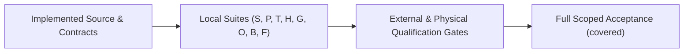

# Trano Requirement Coverage

> **L1 Summary**: **Source implementation and automated test suites exist across every scoped requirement, and open-source repository publication (`U20`) plus recovery documentation (`FR-RECOVERY-4`) are `covered`, but full product acceptance remains incomplete.** User requirements `U01`–`U19` and `U21` (including `U16` signed binary updater and `U17` performance SLOs, where idle max RSS failed at `251.484375 MiB` > `250 MiB`) and functional requirements `FR-NAV-1`–`FR-NAV-6`, `FR-RECOVERY-1`–`FR-RECOVERY-3`, and `FR-HOVER-1`–`FR-HOVER-4` remain `partial` with explicit remaining qualification gates. Passing unit, CI, or fake-provider tests never establish whole-product completion.

## Governance & Status Definitions

Original PRD/M1/M2/M3 milestone snapshots are historical planning baselines, not current acceptance proof. Current repository source, [`PROGRESS.md`](PROGRESS.md), this RTM, and [`verification.json`](verification.json) govern evidence.

- **`covered`**: Implementation exists and full scoped acceptance for that requirement is verified (`U20` public source repository publication + clean-checkout CI, and `FR-RECOVERY-4` documentation contract).
- **`partial`**: Source implementation and local automated verification exist, with remaining physical, external, or release acceptance gates tracked.
- **`pending`**: Scoped implementation or deliverables do not exist (0 rows currently).
- **Evidence rules**: Do not sum pass counts across separate test runs. Fake-provider PTY probes and deterministic `NSPanel` tests do not qualify authenticated live provider quotas/handoffs or physical macOS input/window activation.

---

## User Requirements (`U01`–`U21`)

All relative links resolve from `docs/RTM.md`. Native AppKit/SwiftUI macOS 14+ sources build with full Xcode against pinned `SwiftTerm` `1.99.1` and `Sparkle` `2.10.1` in [`Package.swift`](../Package.swift) using isolated `tmux` root `TRANO_DATA_DIR`, `TranoApp` GUI, `trano` CLI, `build/Trano.app`, `Trano Service.app` background helper, and the Linux Go helper over SSH stdio.

| ID | Status | Implementation Sources | Verification & Latest Evidence | Remaining Acceptance Gate |
| :--- | :--- | :--- | :--- | :--- |
| **U01** | `partial` | [`Runtime.swift`](../Sources/TerminalCore/Runtime.swift), [`TerminalPane.swift`](../Sources/TranoApp/TerminalPane.swift) (`Trano Service.app`, `build/Trano.app`) | [`RuntimeTests.swift`](../Tests/TerminalCoreTests/RuntimeTests.swift), [`check-native.py`](../experiments/check-native.py), `S`, `B` (prior native bundle `1` passed in `3.756s`; current service handoff `1` passed in `3.356s` preserving live shell PID across helper build replacement) | Physical UI relaunch and live-update daemon job persistence acceptance. |
| **U02** | `partial` | [`TerminalPane.swift`](../Sources/TranoApp/TerminalPane.swift), [`ScrollbackStore.swift`](../Sources/TerminalCore/ScrollbackStore.swift), [`scrollback.go`](../remote/scrollback.go) (`ShellIntegration.swift`, `ScrollbackRuntime.swift`, `ScrollbackMonitoring.swift`; `persistScrollback` default `true`, max `4MiB`/`10000` lines/pane, sanitized UTF-8 under owned private runtime, `5s` dirty interval, disabling stops collection and deletes archives, no command replay) | [`InputTests.swift`](../Tests/TerminalUITests/InputTests.swift), [`RecoveryTests.swift`](../Tests/TerminalCoreTests/RecoveryTests.swift), [`check-recovery.py`](../experiments/check-recovery.py), `S`, `B`, `G` | Full interactive `zsh`/job-control/link/`terminfo` matrix and abrupt loss within `5s` dirty window. |
| **U03** | `partial` | [`Actions.swift`](../Sources/TerminalCore/Actions.swift), [`WorkspaceView.swift`](../Sources/TranoApp/WorkspaceView.swift) | [`NavigationTests.swift`](../Tests/TerminalCoreTests/NavigationTests.swift), `S` | Physical keyboard focus and interactive command palette acceptance. |
| **U04** | `partial` | [`API.swift`](../Sources/TerminalCore/API.swift), [`Launcher.swift`](../Sources/TerminalCore/Launcher.swift), [`trano.lua`](../integrations/glass-launcher/trano.lua) | [`APITests.swift`](../Tests/TerminalCoreTests/APITests.swift), [`NavigationTests.swift`](../Tests/TerminalCoreTests/NavigationTests.swift), `S` | Live Glass adapter installation and connection qualification. |
| **U05** | `partial` | [`Appearance.swift`](../Sources/TerminalCore/Appearance.swift), [`AppearanceProfiles.swift`](../Sources/TerminalCore/AppearanceProfiles.swift), [`AppearanceSettings.swift`](../Sources/TranoApp/AppearanceSettings.swift) (`ProfileAppearanceView.swift`, `TerminalBackgroundImage.swift`; fonts, fallback, line spacing, colors, opacity, background image, themes, per-pane profiles) | [`WindowStateTests.swift`](../Tests/TerminalCoreTests/WindowStateTests.swift), UI suite in `S` | Physical 1x/2x display rendering and interactive settings verification. |
| **U06** | `partial` | [`TerminalPane.swift`](../Sources/TranoApp/TerminalPane.swift) | [`InputTests.swift`](../Tests/TerminalUITests/InputTests.swift) in `S` (Korean UTF-8, IME contract, PTY) | Physical macOS two-set Korean IME hardware typing qualification. |
| **U07** | `partial` | [`ActivityMonitor.swift`](../Sources/TerminalCore/ActivityMonitor.swift), [`Notifications.swift`](../Sources/TranoApp/Notifications.swift) | [`InteractionTests.swift`](../Tests/TerminalCoreTests/InteractionTests.swift), `S`, `B` | Live macOS notification permission prompt and OS banner delivery. |
| **U08** | `partial` | [`TabActivityHover.swift`](../Sources/TranoApp/TabActivityHover.swift), [`AgentTaskActivity.swift`](../Sources/TerminalCore/AgentTaskActivity.swift), [`AgentLogo.swift`](../Sources/TranoApp/AgentLogo.swift) (custom provider glyphs, not trademark-qualified official assets; [`TAB-ACTIVITY.md`](TAB-ACTIVITY.md)) | `AgentTaskTests` (12) and `TabActivityHoverTests` (7) in `S`, [`check-tab-activity.py`](../experiments/check-tab-activity.py), `H` | Physical pointer hover/window activation, authenticated live subagents, and official trademark review if required. |
| **U09** | `partial` | [`Actions.swift`](../Sources/TerminalCore/Actions.swift), [`KeyBindings.swift`](../Sources/TerminalCore/KeyBindings.swift), [`KeyboardShortcutRecorder.swift`](../Sources/TranoApp/KeyboardShortcutRecorder.swift) (`App.swift`; editable exact-modifier keymaps and `Cmd+N` new OS window) | [`NavigationTests.swift`](../Tests/TerminalCoreTests/NavigationTests.swift), [`WindowStateTests.swift`](../Tests/TerminalCoreTests/WindowStateTests.swift), UI suite in `S` | Physical keyboard shortcut capture, `Cmd+N` multi-window interaction, and live iTerm-equivalent keymap acceptance. |
| **U10** | `partial` | [`Actions.swift`](../Sources/TerminalCore/Actions.swift), [`Workspace.swift`](../Sources/TerminalCore/Workspace.swift), [`WorkspaceView.swift`](../Sources/TranoApp/WorkspaceView.swift) | [`NavigationTests.swift`](../Tests/TerminalCoreTests/NavigationTests.swift), [`WindowStateTests.swift`](../Tests/TerminalCoreTests/WindowStateTests.swift), `S` | Physical OS multi-window and pane shortcut acceptance. |
| **U11** | `partial` | [`Workspace.swift`](../Sources/TerminalCore/Workspace.swift), [`WorkspaceView.swift`](../Sources/TranoApp/WorkspaceView.swift) | [`NavigationTests.swift`](../Tests/TerminalCoreTests/NavigationTests.swift), [`RuntimeTests.swift`](../Tests/TerminalCoreTests/RuntimeTests.swift), `S` | Physical pointer drag, drop target hover, and cancel gesture acceptance. |
| **U12** | `partial` | [`WorkspaceView.swift`](../Sources/TranoApp/WorkspaceView.swift), [`Appearance.swift`](../Sources/TerminalCore/Appearance.swift), [`AgentLogo.swift`](../Sources/TranoApp/AgentLogo.swift) | `design/native-workspace.png`, `S` | Full 1x/2x scale, contrast, and visual state matrix qualification. |
| **U13** | `partial` | [`VoiceInput.swift`](../Sources/TranoApp/VoiceInput.swift) (`ko-KR`/`en-US` voice preview and PTT controls) | UI suite in `S`, `B` | Physical microphone hardware, OS speech/mic permissions, and live transcription acceptance. |
| **U14** | `partial` | [`Remote.swift`](../Sources/TerminalCore/Remote.swift), [`RemoteInstaller.swift`](../Sources/TerminalCore/RemoteInstaller.swift), [`recovery.go`](../remote/recovery.go) (`RemoteHostsView.swift`, `bundle-remote.sh`, `build-remote.sh`, `install-remote.sh`, `agent.go`, `hooks.go`, `shell.go`, `scrollback.go`; bundled offline Linux `arm64`/`amd64` SSH installer with SHA256, check/dry-run, conflict refusal, force+backup; existing `tmux` prerequisite, no root install; exact-ID remote reboot/lost-`tmux` recovery and live PID reconnect outside local state transaction) | [`RemoteTests.swift`](../Tests/TerminalCoreTests/RemoteTests.swift), `RecoveryLockTests`, `RecoveryEntryTests` (1) in `S`, `G` (Linux remote runtime CI passed in [job `130016099447`](https://github.com/peterlyoo/trano/actions/runs/42869346614/job/130016099447) ) | Latest-revision full SSH end-to-end rerun and physical remote host reboot. |
| **U15** | `partial` | [`Attachment.swift`](../Sources/TerminalCore/Attachment.swift), [`TerminalPane.swift`](../Sources/TranoApp/TerminalPane.swift), [`files.go`](../remote/files.go) | [`InteractionTests.swift`](../Tests/TerminalCoreTests/InteractionTests.swift), `S`, `G` | Physical macOS clipboard paste UI and latest-revision live Linux SSH transfer rerun. |
| **U16** | `partial` | [`UpdateController.swift`](../Sources/TranoApp/UpdateController.swift), [`UpdatePolicy.swift`](../Sources/TerminalCore/UpdatePolicy.swift), [`RELEASING.md`](RELEASING.md) (`configure-updates.py`, `release-update.sh`; Sparkle `2.10.1` fail-closed unless valid HTTPS feed, 32-byte non-zero Ed25519 key, numeric `CFBundleVersion`, `SURequireSignedFeed=true`, `SUVerifyUpdateBeforeExtraction=true`; GUI-only excluding service/snapshot) | [`check-service-update.py`](../experiments/check-service-update.py), [`check-updates.py`](../experiments/check-updates.py), `S`, `O`, `B` (`4` local ad-hoc bundle update checks passed in `0.868s`) | Developer ID signing, Apple notarization, live HTTPS signed appcast feed, and end-to-end signed update deployment. |
| **U17** | `partial` | [`benchmark-trano.py`](../experiments/benchmark-trano.py), [`performance-contract.json`](performance-contract.json), [`performance-observations.json`](performance-observations.json) | `F` (completed `30`-launch, `10`-visible-pane, `60.410034875s`-idle / `600.434856334s`-output run, `not_qualified`: idle CPU `0.033107` core-percent PASS, warm-cache headless p95 `433.49ms`, idle RSS max `251.484375 MiB` FAIL vs `250 MiB`) | Resolve idle product RSS max failure (`251.484375 MiB` > `250 MiB`), run cold app-ready (`500ms`), native in-process warm attach (`200ms`), physical keyboard-to-render (`16.7ms`), user `zsh` cost, and define/pass an output-load memory bound. |
| **U18** | `partial` | [`Accounts.swift`](../Sources/TerminalCore/Accounts.swift), [`AccountSwitch.swift`](../Sources/TerminalCore/AccountSwitch.swift), [`ProviderSupervisor.swift`](../Sources/TranoCLI/ProviderSupervisor.swift) (`AccountAuthentication.swift`, `AccountUsage.swift`, `AgentSupervision.swift`, `AccountDatabaseTransfer.swift`, `AccountHistoryReset.swift`, `AccountRollbackRows.swift`, `ProviderSignalRelay.swift`, `main.swift`, `AccountsView.swift`; managed `CLAUDE_CONFIG_DIR`/`CODEX_HOME` with sanitized child env; `accounts.usage` reads Claude `rate_limits` and Codex `account/rateLimits/read`, downgrades available snapshots older than `300s` to `unknown`, no inference from reset/silence; `automaticAccountSwitching` default `false`; queued switch at root safe turn boundary with no tools in flight, same provider and exact conversation only, no prompt/tool replay; copies exact conversation files/metadata with receipts/backups preserving target credentials; rollback preflights backups/digests/conflicts, guards attached SQLite state/history changes, refuses newer target work, NOT crash-atomic across filesystem+SQLite) | [`AccountTests.swift`](../Tests/TerminalCoreTests/AccountTests.swift), `AccountRollbackTests` (13) in `S`, `P`, `T` | Authenticated live paid-provider quota feeds and live same-provider handoff; rollback remains guarded rather than crash-atomic across filesystem+SQLite. |
| **U19** | `partial` | [`Extensions.swift`](../Sources/TerminalCore/Extensions.swift), [`ExtensionsView.swift`](../Sources/TranoApp/ExtensionsView.swift) (shared skills, hooks, and MCP config translation across owned provider roots with preview, apply, backup, conflict detection, and rollback) | [`ExtensionTests.swift`](../Tests/TerminalCoreTests/ExtensionTests.swift) (`4` passed in `S`), `P` | Authenticated provider native plugin installation and live hook/skill execution compatibility. |
| **U20** | `covered` | [`LICENSE`](../LICENSE), [`publication-boundary.yaml`](publication-boundary.yaml), [`check-publication.py`](../scripts/check-publication.py) (`README.md`, `THIRD_PARTY_NOTICES.md`, `CONTRIBUTING.md`, `SECURITY.md`, `licenses/`, [`sbom.json`](sbom.json), `generate-sbom.py`, `ci.yml`, `release.yml`; standalone `MIT` repository at [peterlyoo/trano](https://github.com/peterlyoo/trano) commit [`1e027ceb132287756f056bee11ea663fde76db1f`](https://github.com/peterlyoo/trano/commit/1e027ceb132287756f056bee11ea663fde76db1f) ; excludes `design/`, `.local/`, `build/`, `.build/`, private harness/transcripts/credentials) | `O` (`6` packaging tests in `1.243s`; `185` candidate files passed privacy/boundary checks; clean public checkout CI passed in [run `42869346614`](https://github.com/peterlyoo/trano/actions/runs/42869346614) across [`remote`](https://github.com/peterlyoo/trano/actions/runs/42869346614/job/130016099447) and [`macos`](https://github.com/peterlyoo/trano/actions/runs/42869346614/job/130016100336) ) | None for `U20` source-publication scope (signed binary distribution and notarization are tracked under `U16`). |
| **U21** | `partial` | [`WorkspaceView.swift`](../Sources/TranoApp/WorkspaceView.swift), [`AppearanceSettings.swift`](../Sources/TranoApp/AppearanceSettings.swift) (`design/native-workspace.png`) | `design/native-workspace.png`, UI suite in `S` | VoiceOver accessibility, 1x/2x display scaling, and full interactive state matrix qualification. |

---

## Functional Requirements (`FR-NAV`, `FR-RECOVERY`, `FR-HOVER`)

### Navigation (`FR-NAV-1`–`FR-NAV-6`)

| ID | Status | Implementation Sources | Verification & Latest Evidence | Remaining Acceptance Gate |
| :--- | :--- | :--- | :--- | :--- |
| **FR-NAV-1** | `partial` | [`NAVIGATION.md`](NAVIGATION.md), [`Workspace.swift`](../Sources/TerminalCore/Workspace.swift), [`WorkspaceView.swift`](../Sources/TranoApp/WorkspaceView.swift) (scoped Session → Tab → Pane navigation; session wrap restores active tab/focused pane; tab cycle stays within workspace without restarting shells) | [`NavigationTests.swift`](../Tests/TerminalCoreTests/NavigationTests.swift) (round-trip migration and focus restore), `S` | Physical keyboard/mouse session and tab switching acceptance. |
| **FR-NAV-2** | `partial` | [`NAVIGATION.md`](NAVIGATION.md), [`Actions.swift`](../Sources/TerminalCore/Actions.swift), [`KeyBindings.swift`](../Sources/TerminalCore/KeyBindings.swift) (`KeyboardShortcutRecorder.swift`; unified typed action registry across menus, palette, keyboard, and `actions.list`; exact-modifier shortcuts without stealing IME/TextField commits; `Cmd+K`/`Shift+Cmd+P`/`Cmd+P` pickers and `Cmd+1..9` cycling) | [`NavigationTests.swift`](../Tests/TerminalCoreTests/NavigationTests.swift), UI suite in `S` | Physical keyboard capture, picker interaction, and Rex session-cycle default confirmation. |
| **FR-NAV-3** | `partial` | [`NAVIGATION.md`](NAVIGATION.md), [`Actions.swift`](../Sources/TerminalCore/Actions.swift), [`WorkspaceView.swift`](../Sources/TranoApp/WorkspaceView.swift) (`pane.insert_path` and `pane.go_to_directory`; multi-select shell-quoting for spaces, apostrophes, and Korean without trailing newline; cancel no-op; newline/`NUL` rejection; remote browser requirement) | [`NavigationTests.swift`](../Tests/TerminalCoreTests/NavigationTests.swift), [`InputTests.swift`](../Tests/TerminalUITests/InputTests.swift), `S` | Physical native file-picker modal, file drag-and-drop, and remote directory browser acceptance. |
| **FR-NAV-4** | `partial` | [`NAVIGATION.md`](NAVIGATION.md), [`Workspace.swift`](../Sources/TerminalCore/Workspace.swift), [`WorkspaceView.swift`](../Sources/TranoApp/WorkspaceView.swift) (rename workspace/tab/pane, reorder/drag tabs, close/restore tabs, move/swap/balance splits while preserving PTY IDs and running backend jobs) | [`NavigationTests.swift`](../Tests/TerminalCoreTests/NavigationTests.swift), [`RuntimeTests.swift`](../Tests/TerminalCoreTests/RuntimeTests.swift), `S` | Physical tab drag-and-drop and live split manipulation acceptance. |
| **FR-NAV-5** | `partial` | [`NAVIGATION.md`](NAVIGATION.md), [`API.swift`](../Sources/TerminalCore/API.swift), [`Launcher.swift`](../Sources/TerminalCore/Launcher.swift) ([`Actions.swift`](../Sources/TerminalCore/Actions.swift) line `116`, [`trano.lua`](../integrations/glass-launcher/trano.lua); headless `actions.list`/`actions.perform` returning `requiresUI` for native panels; workspace-scoped GlassLauncher with stable v1 pane mappings) | [`APITests.swift`](../Tests/TerminalCoreTests/APITests.swift), [`NavigationTests.swift`](../Tests/TerminalCoreTests/NavigationTests.swift), `S` | Live external Glass launcher adapter execution. |
| **FR-NAV-6** | `partial` | [`NAVIGATION.md`](NAVIGATION.md), [`WorkspaceView.swift`](../Sources/TranoApp/WorkspaceView.swift), [`WindowSelection.swift`](../Sources/TerminalCore/WindowSelection.swift) ([`Actions.swift`](../Sources/TerminalCore/Actions.swift) lines `4`/`46`, [`App.swift`](../Sources/TranoApp/App.swift) line `127`, [`Store.swift`](../Sources/TranoApp/Store.swift) line `225`; grouped workspace sidebar, workspace-scoped tab bar, `Workspace > Tab > Pane` search labels, native black UI, `Cmd+N` `client.window.new`, and Rex action audit) | [`WindowStateTests.swift`](../Tests/TerminalCoreTests/WindowStateTests.swift), `design/native-workspace.png`, `S` | Physical `Cmd+N`/multi-window interaction, native black UI 1x/2x scale, VoiceOver accessibility, and planned Rex parity surfaces. |

### Recovery (`FR-RECOVERY-1`–`FR-RECOVERY-4`)

| ID | Status | Implementation Sources | Verification & Latest Evidence | Remaining Acceptance Gate |
| :--- | :--- | :--- | :--- | :--- |
| **FR-RECOVERY-1** | `partial` | [`Recovery.swift`](../Sources/TerminalCore/Recovery.swift), [`ProcessIdentity.swift`](../Sources/TerminalCore/ProcessIdentity.swift), [`main.swift`](../Sources/TranoCLI/main.swift) (`ShellIntegration.swift`; exact trusted conversation ID, fresh launch generation, root-provider ancestry, suspended spawn records provider PID before hooks, `SessionStart` replaces an existing bound ID only on verified root `clear`/`fork`, root `Stop` = turn completion not exit, children never mutate root) | [`RecoveryTests.swift`](../Tests/TerminalCoreTests/RecoveryTests.swift), `S`, `T`, `B` (recovery bundle `1` passed in `6.066s`) | Authenticated live provider hook emission and real session resume. |
| **FR-RECOVERY-2** | `partial` | [`Recovery.swift`](../Sources/TerminalCore/Recovery.swift), [`Remote.swift`](../Sources/TerminalCore/Remote.swift), [`ScrollbackStore.swift`](../Sources/TerminalCore/ScrollbackStore.swift) (`TerminalPane.swift`, `recovery.go`, `scrollback.go`; bounded `4MiB`/`10000`-line scrollback local+remote, exact-ID remote reboot/lost-`tmux` recovery and same-PID reconnect, normal exits excluded, live panes/fallback shell preserved, missing trusted ID/cwd/profile diagnostic, no guessed ID/`--last`/replay, no macOS login auto-launch registration) | [`RecoveryTests.swift`](../Tests/TerminalCoreTests/RecoveryTests.swift), `RecoveryLockTests`, `RecoveryEntryTests` (1) in `S`, `B`, `G` (Linux remote runtime CI passed in [job `130016099447`](https://github.com/peterlyoo/trano/actions/runs/42869346614/job/130016099447) ) | Physical macOS/Linux OS reboot, latest-revision full Linux SSH end-to-end rerun, and system login auto-launch if ever scoped. |
| **FR-RECOVERY-3** | `partial` | [`Store.swift`](../Sources/TranoApp/Store.swift), [`API.swift`](../Sources/TerminalCore/API.swift), [`Recovery.swift`](../Sources/TerminalCore/Recovery.swift) (`TerminalPane.swift`, `WorkspaceView.swift`, `main.swift`; `automaticRestore` default `true`, CLI `recovery list`/`run [PANE_ID]`, API `recovery.list`/`run`/`retry`/`settings`, statuses `live`/`restoring`/`restored`/`needs_attention`/`failed`, native `Retry` on dead panes only with renderer PID reattach, remote SSH outside local transaction) | [`RecoveryTests.swift`](../Tests/TerminalCoreTests/RecoveryTests.swift), `RecoveryLockTests`, `RecoveryEntryTests` (1) in `S`, `B`, `G` (Linux remote runtime CI passed in [job `130016099447`](https://github.com/peterlyoo/trano/actions/runs/42869346614/job/130016099447) ) | Authenticated live provider error/resume verification and latest-revision full Linux SSH end-to-end rerun. |
| **FR-RECOVERY-4** | `covered` | [`PROGRESS.md`](PROGRESS.md), [`RTM.md`](RTM.md), [`verification.json`](verification.json) ([`AGENTS.md`](../AGENTS.md)) | Documented evidence, commands, and remaining qualification gates synchronized with `2026-11-11` verification logs | None (documentation contract satisfied). |

### Tab Activity Hover (`FR-HOVER-1`–`FR-HOVER-4`)

| ID | Status | Implementation Sources | Verification & Latest Evidence | Remaining Acceptance Gate |
| :--- | :--- | :--- | :--- | :--- |
| **FR-HOVER-1** | `partial` | [`TAB-ACTIVITY.md`](TAB-ACTIVITY.md), [`TabActivityHover.swift`](../Sources/TranoApp/TabActivityHover.swift), [`WorkspaceView.swift`](../Sources/TranoApp/WorkspaceView.swift) (shows root and child `running`/`blocked`/`done`/`error`/`idle`/`unknown` status for every pane in hovered tab with provider identity and source timestamp) | `AgentTaskTests` (12) and `TabActivityHoverTests` (7) in `S`, [`check-tab-activity.py`](../experiments/check-tab-activity.py), `H` | Physical pointer hover and authenticated live subagent execution. |
| **FR-HOVER-2** | `partial` | [`TAB-ACTIVITY.md`](TAB-ACTIVITY.md), [`TabActivityHover.swift`](../Sources/TranoApp/TabActivityHover.swift), [`WorkspaceView.swift`](../Sources/TranoApp/WorkspaceView.swift) (refreshes open hover from existing local `100ms` watcher and remote `15s` SSH refresh; closes on pointer exit or window deactivation with zero hover polling or network requests) | `TabActivityHoverTests` (7) in `S`, `.local/tab-hover-card.png`, `H` (real `NSPanel`+`NSHostingView` with deterministic owner-key fixture) | Physical macOS pointer exit and window deactivation outside headless XCTest. |
| **FR-HOVER-3** | `partial` | [`TAB-ACTIVITY.md`](TAB-ACTIVITY.md), [`AgentTaskActivity.swift`](../Sources/TerminalCore/AgentTaskActivity.swift), [`hooks.go`](../remote/hooks.go) (accepts child metadata only from structured provider hooks or identified OSC records; isolates root identity/supervision, rejects stale generations/unrelated probes, caps storage at `64` children/pane, discards hook prompts/transcript paths; absent metadata means no reported children) | `AgentTaskTests` (12) in `S`, [`check-tab-activity.py`](../experiments/check-tab-activity.py), `H` | Authenticated live Claude/Codex subagent hook emission and provider-controlled Codex hook trust. |
| **FR-HOVER-4** | `partial` | [`TAB-ACTIVITY.md`](TAB-ACTIVITY.md), [`AgentTaskActivity.swift`](../Sources/TerminalCore/AgentTaskActivity.swift), [`agent.go`](../remote/agent.go) (decodes legacy snapshots without child metadata, transports equivalent Linux helper metadata with timestamps, and clears obsolete children on new root launch generation) | `AgentTaskTests` (12) in `S`, `G` (Linux remote runtime CI passed in [job `130016099447`](https://github.com/peterlyoo/trano/actions/runs/42869346614/job/130016099447) ), `H` | Latest-revision full Linux SSH end-to-end rerun. |

---

## Latest Verification Evidence Keys (`2026-11-11`)

Do not combine test counts across distinct execution logs. Ignored local logs and generated artifacts are shown as inline code paths.

- **`S` (`.local/native-ui-final-swift.log`)**: Latest full Swift suite: `92` core tests executed (`2` optional installed-provider tests skipped, `0` failures), `22` UI tests passed, and `6` CLI tests passed. Includes `ActivityGeometryTests` (1), `SettingsDismissalTests` (4 draft/runtime contracts), `13` `AccountRollbackTests`, `12` `AgentTaskTests`, `7` `TabActivityHoverTests`, and `1` `RecoveryEntryTests`. Native Activity geometry has a reproduced failure before the fix; Settings draft tests cover the new state API because background SwiftUI accessibility button actions are unavailable.
- **`P` (`.local/review-repair-provider-compat.log`)**: Installed provider compatibility: `9` tests passed, `0` skipped, `0` failures (verifies installed Claude auth inside an empty managed profile and installed Codex reading a transferred conversation without a model request; not live paid quota/handoff proof).
- **`T` (`.local/provider-signals-green.log`, `.local/provider-account-switch-green.log`, `.local/provider-account-isolation-green.log`)**: Real isolated PTY fake-provider probes: signals (`3` tests in `12.315s`), account switch (`3` tests in `20.008s` verifying safe tool boundary, reaped old process, exact session resume, preserved target credentials, no duplicate launch), and isolation (`3` tests in `6.605s`).
- **`H` (`.local/tab-hover-evidence.json`)**: Tab hover verification contract paired with `12` `AgentTaskTests` and `7` `TabActivityHoverTests` in `S` using real `NSPanel`+`NSHostingView` and deterministic owner-key state.
- **`G` ([GitHub Actions run `42869346614`](https://github.com/peterlyoo/trano/actions/runs/42869346614) , `.local/tab-hover-go-final-2.log`, `.local/remote-lifecycle-race.log`, `.local/remote-lifecycle-vet-linux-compile.log`, `.local/remote-lifecycle-pty.log`)**: At published commit [`1e027ceb132287756f056bee11ea663fde76db1f`](https://github.com/peterlyoo/trano/commit/1e027ceb132287756f056bee11ea663fde76db1f) , Linux [`remote` job `130016099447`](https://github.com/peterlyoo/trano/actions/runs/42869346614/job/130016099447) succeeded (`go test -race ./...` on `trano/remote` passed in `28.714s` plus Linux cross-compile) alongside [`macos` job `130016100336`](https://github.com/peterlyoo/trano/actions/runs/42869346614/job/130016100336) (`SUCCESS`). Local provenance logs record Darwin `go test -race` (`41.042s` in `.local/remote-lifecycle-race.log`), `go vet` + Linux `amd64`/`arm64` test-binary compiles (`.local/remote-lifecycle-vet-linux-compile.log`), and the macOS PTY `Ctrl+C` (`0x03`) harness pass (`0.76s`, exit `42`, restored foreground process group in `.local/remote-lifecycle-pty.log`). Earlier Linux container/SSH logs (`.local/tab-hover-linux.log`, `.local/remote-final-linux.log`, and `.local/remote-final-bundle.log` in `12.263s`) remain historical; latest-revision full SSH end-to-end is **NOT RUN**.
- **`O` (`.local/review-repair-packaging-tests.log`, `.local/review-repair-privacy.log`)**: Local OSS and updater packaging checks: `6` packaging tests passed in `1.243s`; `185` candidate publication files passed content/privacy boundary checks.
- **`B` (`.local/published-source-build.log`, `.local/final-service-handoff.log`, `.local/review-repair-release.log`, `.local/review-repair-bundle-recovery.log`, `.local/review-repair-bundle-native.log`, `.local/review-repair-bundle-updates.log`)**: Earlier published-source `build/Trano.app` built in `13.16s` (`.local/published-source-build.log`) with `codesign --verify --deep --strict build/Trano.app` exit `0`, `plutil -lint` `OK`, and `Info.plist` `TranoBuildID` `4b9e94cd26a0a0aa95bd52b3594bef04ca7fb7d923a92763399733d3b129b339` matching `python3 scripts/build-id.py`; `.local/final-service-handoff.log` (`1` passed in `3.356s`) verified old-helper exit acknowledgment, new helper PID/build replacement, preserved live shell PID, and no replacement loop. Prior bundle integration logs (`81.96s` build; recovery `1` pass in `6.066s`; native `1` pass in `3.756s`; updates `4` passes in `0.868s`) remain prior-bundle proofs; Developer ID notarized updater deployment is still unqualified.
- **`F` ([`performance-observations.json`](performance-observations.json) , `.local/performance-final/qualification-gates.json`, `.local/performance-baseline.json`)**: Full qualification from the local qualification harness (archived in [`performance-observations.json`](performance-observations.json) ; public [benchmark-trano.py](../experiments/benchmark-trano.py) completed its display-layout repair with regression coverage in [test_benchmark.py](../Tests/Integrations/test_benchmark.py) (`24` Python integration tests passed) and a short native smoke check across `2` launches with `10` visible pane views each, though this repair and smoke run do not replace or rerun the original `30`-launch `60s`/`600s` measurement, leaving its `not_qualified` status and `U17` idle RSS failure unchanged) completed with `qualification_status: not_qualified` (superseding the non-comparable `5`-round backend-only `.local/performance-baseline.json`) on Apple M4 Pro (`48 GiB`, `14` logical CPUs, macOS `26.7.2`, uncontrolled background load) against benchmarked copy `9ce0fa0712616fbed9af0359ee94da000d56afc960eb072c766f58349148465a` (an earlier measured bundle, distinct from current local UI build `04c6b221a155a493b41af366be736a93c1aa025f58dd971bf5b034a619faf620`). Across `30` launches and `10` visible native panes (`60.410034875s` idle, `600.434856334s` output), warm-cache launch-to-headless-ready p95 was `433.49ms`; idle CPU `0.033107` core-percent **PASSED** (`<= 1`); idle resident product RSS max `251.484375 MiB` **FAILED** the `250 MiB` ceiling (median `248.953125 MiB` cannot justify a maximum-gate pass); output RSS reached `260.59375 MiB` max (`+2.890625 MiB` finite-window growth, no contractual output bound). Cold startup (`500ms`), native in-process warm attach (`200ms`), physical keyboard render (`16.7ms`), and user `zsh` cost are **NOT RUN**.

- **`Q` (`.local/native-ui-installed-receipt.json`, `.local/native-ui-bundle-persistence.log`)**: Current local Apple Development-signed installation at `/Applications/Trano.app` uses build `04c6b221a155a493b41af366be736a93c1aa025f58dd971bf5b034a619faf620`. Deep signature verification, installed GUI/helper paths, live shell PID and layout preservation passed; the isolated native client crash check passed in `4.396s`. Native titlebar rendering and Activity viewport geometry were checked; physical pointer and OS permission gates remain open.
